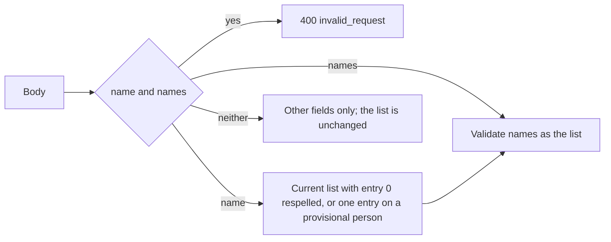

# Contract: Names of people and organizations

Source of truth: [api/openapi.yaml](../../../api/openapi.yaml) (`getPerson`,
`listPeople`, `createPerson`, `updatePerson`, `mergePeople` and the
organization operations) and
[api/external-v1.yaml](../../../api/external-v1.yaml) (`listPeople`,
`createPerson`, `updatePerson`, `mergePeople` and the organization operations).
The two files change the same way, in place.

## Schemas

`CreditName` replaces `Alias` in both files.

| Schema | Field | Type | Required | Meaning |
| --- | --- | --- | --- | --- |
| `CreditName` | `name` | string | yes | One spelling |
| `CreditName` | `language` | string | no | BCP 47 tag; omitted when absent |
| `Person`, `Organization` | `name` | string | yes | The display name; `""` for a provisional person (unchanged) |
| `Person`, `Organization` | `names` | `CreditName[]` | yes | Every name in the owner's order, the display name first; `[]` for a provisional person. Replaces `aliases` |
| `CreditInput` | `names` | `CreditName[]` | yes | The names to create with; `[]` creates a provisional person. Replaces `name` and `aliases` |
| `CreditPatch`, `CreditUpdateRequest` | `names` | `CreditName[]` or null | no | Replaces the whole list; null is `[]`. Replaces `aliases` |
| `CreditPatch`, `CreditUpdateRequest` | `name` | string | no | Replaces the display name's spelling and keeps its language and the other entries; on a provisional person it is a one-entry list |

`CreditRef`, `WorkPerson`, `WorkOrganization`, the peer vocabulary entries and
the assistant's compacted lists keep `name`; the compacted `listPeople` and
`listOrganizations` items carry `names` where they carried `aliases`.

## `PATCH /api/people/{id}`, `PATCH /api/organizations/{id}`, `POST /api/v1/people/update`, `POST /api/v1/organizations/update`

Replaces the list with `names`, or the display name's spelling with `name`.

The diagram shows how the two fields are read.

**Response**: `200` with the entity, as today. A patch that changes nothing
writes nothing.

| Status | `code` | `reason` | `field` | When |
| --- | --- | --- | --- | --- |
| 400 | `invalid_request` | | | `name` and `names` together; `aliases`; `name` null; a `names` entry without `name` |
| 400 | `invalid_request` | `work_info_empty` | `names[i].name` | A blank entry |
| 400 | `invalid_request` | `work_info_empty` | `names` | An organization's list emptied |
| 400 | `invalid_request` | `work_info_too_long`, `work_info_control_characters` | `names[i].name` | The entry's spelling |
| 400 | `invalid_request` | `work_info_too_long`, `work_info_invalid_language` | `names[i].language` | The entry's language |
| 400 | `invalid_request` | `work_info_duplicate` | `names[i].name` | The later of two entries with one spelling |
| 400 | `invalid_request` | `work_info_duplicate` | `name` | `name` equals another entry of the list |
| 400 | `invalid_request` | `work_info_too_many` | `names` | `names` with over 50 entries; `limit` is 50. A patch without `names` does not count the list, so a list migrated with 51 entries survives a `name` or other-field patch |

## `POST /api/people`, `POST /api/organizations`, `POST /api/v1/people`, `POST /api/v1/organizations`

Creates the entity with `names`; the errors are those of the update with
`names`. A body with `name` or `aliases` is `400 invalid_request`.

**Response**: `201` on the screen API and `200` on external v1 with the
entity, as today.

## `POST /api/people/{id}/merge`, `POST /api/organizations/{id}/merge`, `POST /api/v1/people/merge`, `POST /api/v1/organizations/merge`

Unchanged request. The merged entity's `names` is the target's list followed
by each source's list in `sourceIds` order, each spelling once; a provisional
target's list therefore starts with the first named source's display name.
Over 50 names changes nothing and answers as `aliases` did:

| Status | `code` | `reason` | `field` | When |
| --- | --- | --- | --- | --- |
| 400 | `invalid_request` | `work_info_too_many` | `names` | The merged list has over 50 entries; `limit` is 50 |

## MCP tools

`list_people`, `create_person`, `update_person`, `merge_people` and the
organization tools describe `names` where they described aliases; their input
schemas follow the external v1 schemas.

## Assistant tool arguments

| Tool | Argument | Meaning |
| --- | --- | --- |
| `createPerson`, `createOrganization` | `names` (string array, required; replaces `name` and `aliases`) | The names in order; the first is the display name |
| `updatePerson`, `updateOrganization` | `names` (string array; replaces `aliases`) | Replaces the whole list |
| `updatePerson`, `updateOrganization` | `newName` (unchanged) | Sends `name` |

A plan row with both `newName` and `names` sends only `names` with its first
entry respelled, since the two fields exclude each other on the request.
