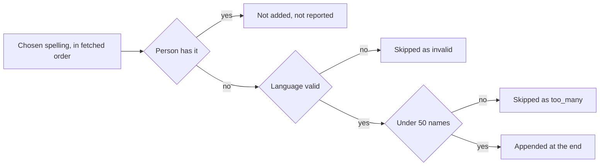

# Contract: Names in a person-plugin fetch and apply

Source of truth: [api/openapi.yaml](../../../api/openapi.yaml)
(`fetchPersonWithPlugin`, `applyPersonPluginFetch` and
`applyPeerFetchedPerson`). The plugin module's own output,
`{"person": {"name", "aliases", …}}` in
[work-info-plugins.md](../../../docs/how-to/work-info-plugins.md#person-plugins),
does not change.

## `POST /api/people/{id}/plugin-fetches`

Unchanged request. `PersonPluginFetchedPerson` carries the fetched names as
one list.

| Field | Type | Required | Meaning |
| --- | --- | --- | --- |
| `name` | string | yes | The fetched display name, for the dialog's title (unchanged) |
| `names` | `CreditName[]` | yes | The fetched name first, then the module's aliases with their languages, each spelling once, 50 in all. Replaces `aliases` |

`mdm plugin run` prints the kept person in this shape.

## `POST /api/people/{id}/plugin-fetches/{fetchId}/apply`

The item `names` replaces `aliases` in `PersonPluginItem`, and the request's
list `names` replaces `aliases`.

| Field | Type | Required | Meaning |
| --- | --- | --- | --- |
| `names` | string array | no | Spellings to append, each the `name` of one of the result's `names` |

The diagram shows what the apply does with each chosen spelling.

**Response**: `200` with `PersonPluginFetchApplied`; `skipped[].item` is
`names` for a skipped spelling. A provisional person's first appended name
becomes its display name, so the response's `person` has `provisional: false`.

| Status | `code` | When |
| --- | --- | --- |
| 400 | `invalid_request` | `aliases` in the body, the item `aliases`, or a spelling not among the result's `names` |

## `POST /api/peer/people/{id}/fetched-person`

`PeerFetchedPluginPerson` carries `names` (`CreditName[]`) in place of
`aliases`, and its `items` take `names` in place of `aliases`; the node that
holds the person applies them under the rule above.

## Client use

The comparison's "Adds to lists" part lists the result's `names` the person
lacks, the fetched name among them, as it lists aliases today; the assistant's
`applyPersonPluginFetch` takes `names` as a `fields` value in place of
`aliases`.
