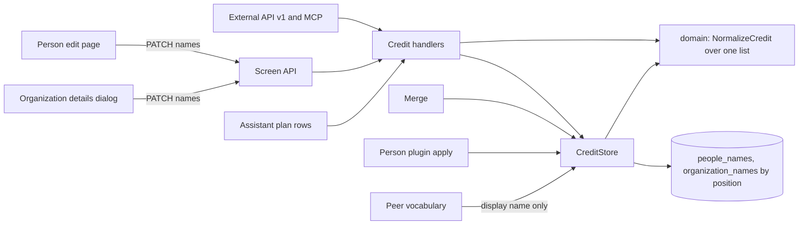
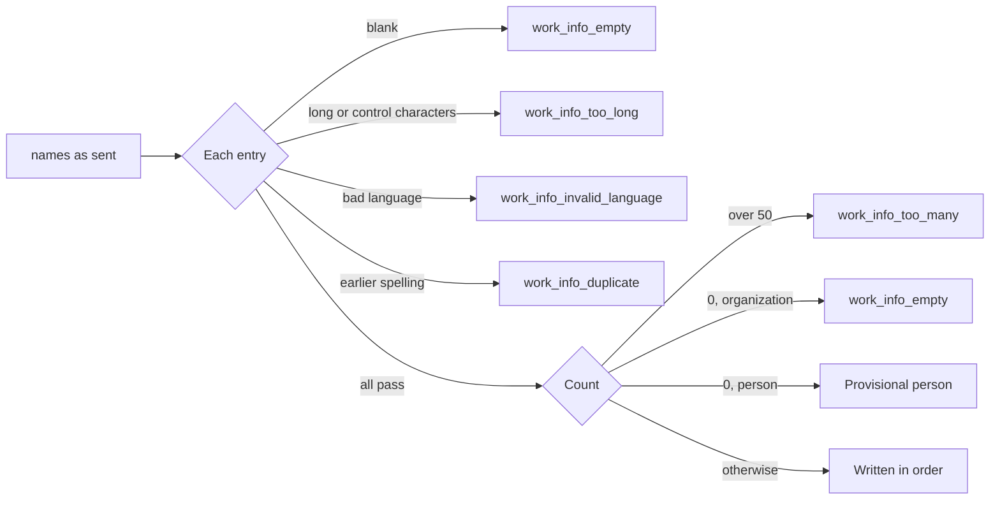
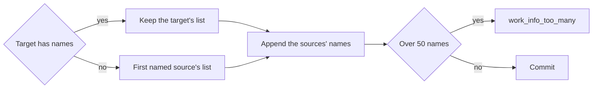
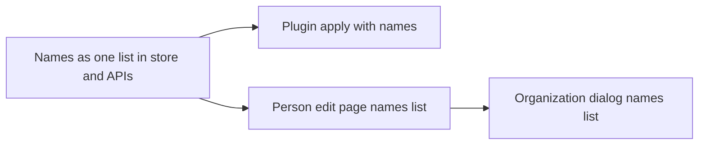

# Implementation Plan: One ordered list of names

**Branch**: `feature/072-names` | **Parent Issue**: #1881

**Input**: The parent Issue. It is this feature's specification.

## Summary

A person's or organization's names become one ordered list whose first entry
is the display name: the `canonical` flag on the name rows gives way to a
`position`, every entry may carry a language, the owner's order is kept, and
one validation runs over the whole list. The screen API and external API v1
return `name` and `names` and take `names`, `aliases` leaves both, merge and
person-plugin apply append to the end of the list, and the person edit page
and the organization details dialog edit the list with reorder and "make this
the display name".

The diagram shows the parts this feature changes and where the one list rule
lives.



## Technical Context

**Canonical definitions**: [ARCHITECTURE.md](../../ARCHITECTURE.md) for
layers, store roles and the web layer;
[people.md](../../docs/design-docs/people.md) for provisional people, merge
and the person screens;
[person-plugins.md](../../docs/design-docs/person-plugins.md) for the fetch
result and the apply;
[peer-library.md, Vocabulary by name](../../docs/design-docs/peer-library.md#vocabulary-by-name)
for what reaches a paired node; [assistant.md](../../docs/design-docs/assistant.md)
for the assistant's name resolution and tool arguments;
[api/openapi.yaml](../../api/openapi.yaml) and
[api/external-v1.yaml](../../api/external-v1.yaml) for the contracts;
[design-system.md](../../docs/design-docs/design-system.md) for the screens;
[testing.md](../../docs/design-docs/testing.md) and
[web-testing.md](../../docs/design-docs/web-testing.md) for test levels.

**Feature-specific context**:

| Item | Delta |
| --- | --- |
| Name storage | `people_names` and `organization_names` keep one row per name with a `canonical` flag, a `language` that is null on the canonical row, and natural-order sorting at read time; this feature replaces the flag with a position ([data-model.md](data-model.md)) |
| Reads of the flag | About 40 store queries join or test `canonical = 1` on the two tables; each becomes `position = 0` |
| Plugin module contract | A person plugin module still answers `{"person": {"name", "aliases", …}}` ([work-info-plugins.md](../../docs/how-to/work-info-plugins.md#person-plugins)); VVMDM folds the two into one list ([Merge and plugin apply](#merge-and-plugin-apply)) |
| Paired nodes | Out of scope by the Issue: a rename of the display name still reaches the peer by name, and the other names stay per node |
| Feature `070-tag-workbench` | Open on its own branch; it moves the organizations screen onto `WorkbenchPage` with the details dialog's fields in a pane. The names editor here is one component, so whichever feature integrates second places it in the other's screen |

## Constitution Check

*GATE: Must pass before Phase 0 research. Re-check after Phase 1 design.*

| Rule | Source | Verdict |
| --- | --- | --- |
| The domain decides, the store enforces | ARCHITECTURE.md | `domain.NormalizeCredit` holds the list rules; `CreditStore` writes positions and the unique index on `(id, position)` is the final guard |
| Store roles | ARCHITECTURE.md | Names stay `CreditStore` writes; the face merges and the by-name peer writes keep calling its package-private helpers |
| User data survives a rebuild | ARCHITECTURE.md | Name rows stay keyed by the entity's own id; the migration rewrites columns of existing rows and drops none |
| Remote ids carry an offset | ARCHITECTURE.md | No new request; the peer vocabulary lists the names of both nodes as it lists aliases today |
| Generated files are not hand-edited | AGENTS.md | `api/openapi.yaml` and `api/external-v1.yaml` change, then `task generate` |
| Complexity 25 and no copies | AGENTS.md | One `NameRows` component serves both editors; the merge stays one SQL statement per step |
| Design system first | AGENTS.md, design-system.md | The editors reuse `Field`, `Input`, the row controls of the details editor and the `dnd-kit` sorting of `reorder.tsx`; `ui-design.md` decides the layout |
| Tests at the lowest level | testing.md | Validation in domain tests, order and merge in store tests, the contract in handler tests, the editors in page tests |

No gate is at stake after Phase 1; `## Complexity Tracking` is left out.

## One ordered list of names

Each person and organization keeps its names as one list in the owner's
order; the first entry is the display name, every entry may carry a language,
and one rule validates the whole list
([data-model.md](data-model.md)).

The diagram shows the rule a write runs over the list; the error fields are
in [contracts/credit-names.md](contracts/credit-names.md).



A long spelling is `work_info_too_long` and a control character
`work_info_control_characters`, each at the entry's `name`.

| Decision | Rejected | Why |
| --- | --- | --- |
| A `position` column replaces `canonical`; the display name is the row at position 0, and positions are dense | Keep `canonical` beside `position` | Two facts that can disagree, the reason people.md rejected a stored `provisional` flag; every write would keep them in step |
| Same | A separate `people_name_order` table | A join for an integer the row can hold, and the merge would write two tables |
| The `language` column takes a value on any row | A `display_language` column on the entity | The display name is a row like the others; one column serves every entry |
| The list is stored and returned in the sent order; `SortAliases` goes | Keep natural order for the entries after the first | Requirement 3; the owner decides the order |
| The limit is 50 names in all, the display name counted; `work_info_too_many` at `names` with `limit` 50 | 51, so every existing entity stays within the limit | 50 is the product's number; an entity migrated with 51 rows keeps them until its list is next written, when the owner drops one, and a merge or apply over 50 is refused or skipped as today |
| A blank `name` in `names[i]` is `work_info_empty` at `names[i].name` | Drop blank entries silently, as blank aliases are dropped today | Requirement 4: the error points at the entry; a dropped first entry would silently make the next one the display name |
| Duplicates compare the trimmed spelling exactly, and the error points at the later entry | Folded comparison (width, case, kana) | The rows' primary key is the exact spelling; two spellings that fold to one name are two names today and stay matchable by search |
| A person with an empty list is provisional; an organization's empty list is `work_info_empty` at `names` | Refuse an empty list on a person and keep a separate "unnamed" state | Requirement 5 defines a provisional person by its list; face recognition creates such people and the owner may clear a list |
| The migration numbers existing rows: the canonical row at 0, the others from 1 in their current display order (natural order, ties by spelling), and drops `canonical` with its partial index | Recreate the two tables | `alter table` keeps the search-dirty triggers of migration 62 in place; dropping the column needs only its index dropped first |
| `Credit.Name` stays the display name read from position 0, and `Credit.Names` replaces `Aliases` | Only `Names`, with callers reading `Names[0]` | Every reader of a display name (activity labels, work credits, the assistant, the peer) would branch on an empty list; today's `Provisional` is read the same way |

## Screen API and external API v1

`Person` and `Organization` return `name` and `names` and no `aliases`;
creation takes `names`; an update takes `names`, or `name` to change only the
display name's spelling ([contracts/credit-names.md](contracts/credit-names.md)).

| Decision | Rejected | Why |
| --- | --- | --- |
| `CreditPatch` and `CreditUpdateRequest` take `names` (the whole list) or `name` (the display name's spelling, keeping its language and the other entries); both together are `400 invalid_request` | `names` only | The organizations row rename, the video editor's naming of an unnamed person, the paired node's by-name rename and the assistant's `newName` know only the new spelling; a whole list they read earlier would drop names changed in between |
| `name` set to a spelling the entity already holds elsewhere in its list is `work_info_duplicate` at `name` | Move that entry to the front | A rename is also the paired node's by-name write; a swap there would change the peer's list, which the Issue leaves out of scope |
| `CreditInput` takes `names` and no `name`; `[]` creates a provisional person and answers an organization `work_info_empty` at `names` | `name` as a one-entry shorthand on create | Creation has no stored list to keep, so the shorthand would be a second shape of the same input |
| The `Alias` schema becomes `CreditName` in both files | Keep the schema name `Alias` | Requirement 6 removes aliases as a term; a schema named for the old concept would outlive it |
| Error fields are `names`, `names[i].name` and `names[i].language` in both APIs | Keep `name` as the field for a duplicate of the display name | The display name is entry 0 of the list the client sent |
| External API v1 changes in place; `aliases` and the old `name` on create are unknown properties and answer `400 invalid_request` | A `/api/v2` or keeping `aliases` as a read-only mirror | Out of scope by the Issue |
| The assistant's `createPerson`, `updatePerson`, `createOrganization` and `updateOrganization` take `names` in place of `aliases` (create: the whole list, update: replaces the list); `newName` stays and sends `name`; MCP descriptions name `names` | Keep `aliases` as the model's argument | The model reads `names` on every person and organization it lists; a second word for the same list makes it guess which one the tool takes |

## Merge and plugin apply

A merge and a person-plugin apply append names at the end of the list and
never reorder it.

The diagram shows where the target's display name comes from in a merge.



The sources' names are appended in `sourceIds` order, each source's in its
own order, skipping a spelling the list already holds; over 50 names, or over
20 external IDs as today, nothing changes.

| Decision | Rejected | Why |
| --- | --- | --- |
| One rule: the merged list is the target's list followed by each source's list in `sourceIds` order, each spelling once, positions continuing; a provisional target therefore takes the first named source's display name as its own | Keep the two statements, "name the target" and "move the names as aliases" | Requirement 7; one statement over the ordered rows is one rule and keeps the fixed statement count |
| A plugin apply takes the item `names` and a list `names` of fetched spellings; the names the person lacks are appended in the fetched order, each once, and a provisional person's first appended name becomes its display name | Keep `aliases` as the item and seed the duplicate check with the display name | Requirement 8 and acceptance 9; with one list there is nothing to seed |
| The fetch result carries `names`: the fetched name first, then the fetched aliases, each spelling once, 50 in all; `name` stays for the dialog's title | `name` and `aliases` as today, with the apply accepting "the name or one of the aliases" | That rule is the distinction requirement 8 removes |
| The plugin module's own output keeps `name` and `aliases`; VVMDM folds them when it keeps the result, and `mdm plugin run` prints the kept person with `names` | Rename the module output field | Every published module would break for a rename; the fold costs one line |
| `PeerFetchedPluginPerson` carries `names` and the item `names` | Keep `aliases` on the peer apply | Both nodes run the same release's schema; the by-name writes the Issue keeps unchanged are the vocabulary endpoint, not this one |
| An apply over 50 names skips the rest as `too_many`; a merge over 50 fails whole | One rule for both | The Issue's edge case keeps today's split |

## Screens

The person edit page and the organization details dialog edit the list in one
`NameRows` component: name and language per row, add, remove, reorder by drag
and keyboard, and "make this the display name"; the display name is the first
row and marked as such. `ui-design.md` decides the layout, the marker, the
words and the widths.

| Decision | Rejected | Why |
| --- | --- | --- |
| One `NameRows` component in `web/src/credits/` replaces `AliasRows` and the person page's `NameField`, used by both editors | A list on the person page and a plain field set in the dialog | Requirement 9 names both screens; the organizations pane of feature 070 takes the same component |
| "Make this the display name" moves the row to the front of the list in the draft; `Save` sends `names` | A separate request that promotes a name | The list is sent whole on save, so a promote is a reorder; one `PATCH` keeps the editor's one-save model |
| Reorder uses the `dnd-kit` sorting and sensors of `reorder.tsx` with the keyboard coordinates it configures | Up and down buttons only | The playlist and group screens already reorder this way; keyboard sorting comes with it |
| A provisional person's editor shows an empty list with its placeholder, and `Save` with no rows keeps the person provisional | Require a name before saving | Acceptance 5 |
| The organizations row keeps its inline rename, sending `name` | Remove the inline rename for the dialog | The row rename is one press for the common case and the dialog holds the list |
| Field errors land on the row they name: `names[i].name` and `names[i].language` on the row's inputs, `names` under the list | The dialog's current `aliases[i]` mapping | The paths change with the contract |
| The rows, the profile and the pickers show the entries after the first where they show aliases today, in list order | A new "other names" shape | Requirement 10 keeps the matching; only the words change, which `ui-design.md` settles |

## Project Structure

### Documentation (this feature)

```text
specs/072-names/
├── plan.md
├── data-model.md                      # position replaces canonical; migration 98
└── contracts/
    ├── credit-names.md                # Person, Organization, create, update, errors, assistant
    └── person-plugin-names.md         # fetch result, apply, peer apply
```

No `research.md`: every decision and its rejected alternatives fit in this
plan's tables. No `quickstart.md`: the acceptance criteria are checked by
store, handler and page tests and by the visual review the screen units owe.
`ui-design.md` is written by the `design` stage.

### Source Code

**Affected boundaries**: `internal/domain` (`credit.go`,
`person_plugin_apply.go`, `person_plugin.go`, the assistant catalog and
argument schemas), `internal/store` (`credits.go`, `credit_listing.go`,
`person_plugin_apply.go`, `vocabulary_by_name.go`, `credit_match.go`, the face
merge files, the assistant reads, every query on `canonical` of the two name
tables, `migrations/`), `internal/httpapi` (`credits.go`,
`external_credits.go`, `person_plugin_fetch.go`, `peer_person_plugin_fetch.go`,
`peer_vocabulary.go`, `mcp_work_info.go`), `internal/app` (assistant plan
rows and fetch apply), `cmd/mdm/plugin_run_person.go`, `api/openapi.yaml`,
`api/external-v1.yaml`, `web/src/api/`, `web/src/credits/`,
`web/src/player/detailsEditor/`, `web/src/library/bulkEdit/`, `web/src/i18n/`,
`docs/design-docs/`, `docs/how-to/`.

**New paths**: `internal/store/migrations/00098_credit_name_positions.sql`
and its test, `web/src/credits/NameRows.tsx` and its test,
`docs/design-docs/credit-names.md`.

**Structure decision**: The list rule, the merge rule and the apply rule get
their own design document, `docs/design-docs/credit-names.md`, linked from
the index and from `people.md`, whose provisional and merge sections then
point there. Rejected: growing `people.md`, which is already past the two
screens of [W-11](../../docs/design-docs/writing-quality.md#w-11-length-budget).

## Implementation Work

The graph shows the units and what each waits for.



### Store and serve a person's or organization's names as one ordered list

**Scope**: The data model and the rules of
[One ordered list of names](#one-ordered-list-of-names) and
[data-model.md](data-model.md): the migration, `domain.CreditName` and
`Credit.Names` in place of `Aliases`, `NormalizeCredit` over the whole list
with the kind's empty-list rule, position-ordered reads and writes, every
store query that read `canonical` on the two name tables, the merge rule of
[Merge and plugin apply](#merge-and-plugin-apply), the merged-limit check
counting all names, `FillPersonItems` appending to the list, and the by-name
rename keeping the display name's language. The contract of
[contracts/credit-names.md](contracts/credit-names.md): both schemas,
`task generate`, the credit handlers, the external handlers, the MCP
descriptions, the peer vocabulary's name list, the assistant's arguments and
bodies. The web side reads `names` wherever it read `aliases` (rows, profile,
pickers, search match, the fetch dialog's other names, the comparison's
current person), the New person dialog, the bulk editor and the video editor
send `names` or `name`, and the two editors keep their layout and send
`names` from their current rows. Adds `docs/design-docs/credit-names.md`
with the list, merge and API decisions, links it from the index and
`people.md`, and updates `external-api.md` and `assistant.md`.

**Dependencies**: None

**Acceptance**: Domain tests: each row of the rule diagram, with the error
field it names, and the swap of two entries not being a duplicate. Store
tests: a list saved in an arbitrary order with a language on the first entry
reads back the same (acceptance 2, 3); an emptied list makes a person
provisional and answers an organization `work_info_empty` (acceptance 5); a
merge into a named target keeps its display name and appends the sources'
names in order without repeats, and into a provisional target takes the first
named source's list first (acceptance 7); a merge or apply reaching 51 names
is refused or skipped; the migration test numbers a person's rows canonical
first and the rest in natural order and round-trips down. Handler tests:
`Person` and `Organization` carry `name` and `names` and no `aliases` on both
APIs (acceptance 6); `name` with `names` is `invalid_request`; `aliases` on
external v1 is `invalid_request`; a `name` equal to another entry is
`work_info_duplicate` at `name`; the assistant catalog test lists `names`.
Web logic tests: `buildPersonPatch` sends `names` when the rows changed and
`name` is absent; the organization dialog's problem mapping places
`names[i].name` on its row. The existing page tests pass with `names` in
their fixtures. `grep -rn canonical internal/store | grep -i names` finds no
query on the two name tables.

### Apply a person plugin's fetched names as one list

**Scope**: [contracts/person-plugin-names.md](contracts/person-plugin-names.md):
`names` on the fetch result, the apply request and item, the skipped values,
the peer apply body, `mdm plugin run`'s kept person, the assistant's `fields`
value, the comparison's names list in `personCompareRows.ts` and
`PersonCompare.tsx`, and the `person-plugins.md` and `work-info-plugins.md`
passages on aliases.

**Dependencies**: Store and serve a person's or organization's names as one
ordered list

**Acceptance**: Domain tests: `Select` and `FillPersonItems` take `names`,
append only the names the person lacks in the fetched order, skip the 51st as
`too_many`, and give a provisional person the first appended name as its
display name (acceptance 8, 9). Handler tests: the fetch result lists the
fetched name first in `names` and once; an apply with `aliases` is
`invalid_request`; the peer apply round-trips `names`. The comparison's logic
test lists the fetched name among the names to add and leaves out the ones
the person has. The person page's plugin fetch page tests pass with `names`.

### Edit a person's names as one list on the edit page

**Scope**: `NameRows` as decided in [Screens](#screens) and `ui-design.md`,
used by `NamesPanel` in place of the name field and the alias rows: add,
remove, language, reorder by drag and keyboard, "make this the display name",
the display-name marker, the provisional person's empty list, and the
problem mapping onto rows. Updates the edit page section of `people.md`.

**Dependencies**: Store and serve a person's or organization's names as one
ordered list

**Acceptance**: Component tests of `NameRows`: making the third row the
display name moves it first and marks it; a keyboard reorder changes the
order; a problem at `names[1].name` marks the second row's input. Page tests
of the edit page: after making another name the display name and saving, the
sent body is `names` in the new order with the languages kept and the old
display name still listed (acceptance 1); a repeated spelling answered with
`work_info_duplicate` at `names[2].name` is shown on that row and nothing
else changes (acceptance 4); removing every row and saving sends `names: []`
(acceptance 5). A visual review at the `ui-design.md` widths, including the
marker during a drag (the Issue's UI quality).

### Edit an organization's names as one list in the details dialog

**Scope**: `NameRows` in `CreditDetailsDialog` in place of the alias rows,
with the display name as the first row, the dialog's problem mapping, the
organizations row's inline rename kept on `name`, and the organizations
passages of `people.md` and `library-ui.md`.

**Dependencies**: Edit a person's names as one list on the edit page

**Acceptance**: Page tests of the organizations screen: making another name
the display name and saving sends `names` in the new order and the row shows
the new name; a `work_info_empty` at `names` after removing every row is
shown under the list (acceptance 5); the inline rename still sends `name`. A
visual review of the dialog at the `ui-design.md` widths.
