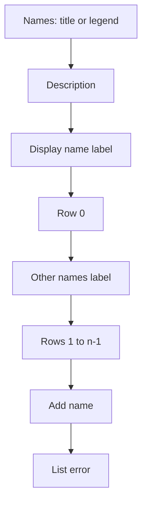
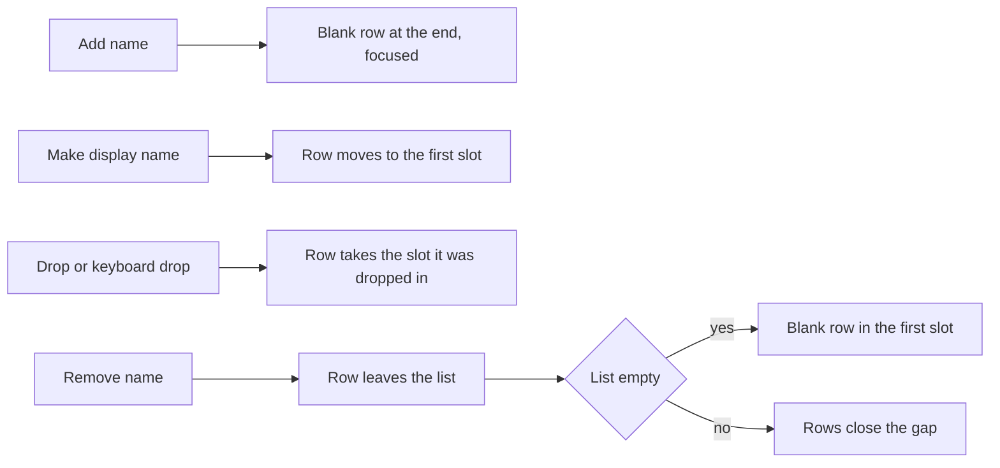
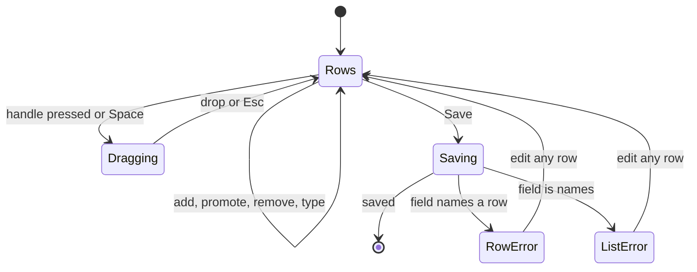

# UI design: One ordered list of names

Sources: [plan.md, Screens](plan.md#screens) and
[contracts/credit-names.md](contracts/credit-names.md);
[design-system.md](../../docs/design-docs/design-system.md) and its rules
([components.md](../../web/registry/rules/components.md),
[patterns.md](../../web/registry/rules/patterns.md),
[foundations.md](../../web/registry/rules/foundations.md));
[people.md, The edit page](../../docs/design-docs/people.md#the-edit-page)
and [Provisional people on the screens](../../docs/design-docs/people.md#provisional-people-on-the-screens);
the current editors `web/src/credits/person/edit/NamesPanel.tsx` and
`web/src/credits/CreditDetailsDialog.tsx`, the row fields of
`web/src/player/detailsEditor/fields.tsx`, and the sortable rows of
`web/src/videoList/reorder.tsx` as the playlist and group pages use them; the
screen text in [web/src/i18n/en.ts](../../web/src/i18n/en.ts)
(`credits.details`, `credits.personEdit`, `credits.row`, `credits.mergeDialog`,
`credits.personPage.pluginFetch`).

## Why this shape

The names of a person or an organization are one list of rows, and the row in
the first slot is the display name: the list is split by two fixed labels,
`Display name` over the first slot and `Other names` over the rest, so the
display name is read from its place and not from a mark on the row. A mark
drawn on the first row was rejected: while a row is dragged, the rows slide
between the slots and the marked row slides out of the first slot, so the mark
would point at a row that is no longer first until the drop. The slot labels
stay where they are, and whichever row sits under `Display name` at any moment
is the display name, during a drag too (the Issue's `UI品質`).

Every other row carries `Make display name`, which moves the row to the first
slot in the draft, so making a name the display name is one press and `Save`;
the former display name slides down to the second slot and keeps its spelling
and language. Up and down buttons on every row were rejected for the plan's
reason ([Screens](plan.md#screens)): the drag handle with its keyboard sorting
already reorders the playlist and group pages, and the one extra button covers
the operation the Issue names.

The two editors keep their skeletons: the person edit page's `FormPage` panel
`Names and links` holds the list in place of the `Name` field and the
`Aliases` rows, and the organization details dialog's `FormDialog` holds it in
its first `FieldSet` in place of `Aliases`. The organization's display name,
which the dialog did not edit, is now its first row. The organizations row's
inline `Rename` stays as it is.

## Words

`Display name` is the screen's word for the first name of the list (W-8); the
word `alias` leaves every screen. Text with `{…}` keeps the existing
formatting helpers.

| Place | Text | Notes |
| --- | --- | --- |
| Person edit page, group title; details dialog, legend | `Names` | Replaces `Name` and `Aliases` in both editors |
| Group description | `The first name is shown on pages, lists and credits. A language is optional, as a tag such as ja or en-US.` | `FieldDescription`, one line, under the title; replaces `languageDescription` |
| First slot label | `Display name` | Drawn as the group's field labels (`FieldLabel` weight) |
| Second slot label | `Other names` | Same weight; drawn even when no row follows it |
| Name input | `Name` | `aria-label`; the placeholder is empty, except on a provisional person's blank first row, whose placeholder is the person's number (`#1042`), as the name field shows it today |
| Language input | `Language`; placeholder `ja` | Unchanged |
| Promote button | `Make display name` | `icon-sm` `ghost` with lucide `ArrowUpToLine`; tooltip and `aria-label` `Make "{name}" the display name`, with `this name` while the row is blank |
| Remove button | `Remove name` | `icon-sm` `ghost` with `X`; tooltip and `aria-label` `Remove "{name}"`, replaces `Remove alias` |
| Drag handle | `Reorder "{name}"` | `ReorderHandle` as the playlist rows; `aria-label` only, since a tooltip would open under the pointer that drags |
| Add button | `Add name` | `outline` `sm` with `Plus`, replaces `Add alias` |
| Reorder announcements | The existing `reorderTexts` with the row's name as the title; a blank row is announced as `(blank)` | Screen-reader only |
| Person edit page, loading | One `Names` skeleton in place of the `Name` and `Aliases` skeletons | |
| Organizations row, second line | `Also known as {names}` | Replaces `Aliases: {names}`; entries keep `{name} ({language})` |
| Person page, under the `h1` | `Also known as {names}` | Unchanged; lists the entries after the first |
| Picker option hint, merge target hint | `Also known as {name}` | Replaces `Alias: {name}` in the credit picker and the merge dialog |
| Merge dialog warning | `"{source}" isn't on any videos. Its names and IDs join "{target}"'s, and it leaves the list. This can't be undone.` and `The {videos} with "{source}" get "{target}" instead. "{source}"'s names and IDs join "{target}"'s, and "{source}" leaves the list. This can't be undone.` | Replaces the two sentences that name aliases |
| Plugin fetch, item label; bulk editor, assistant argument | `Names` | Replaces `Aliases` |
| Plugin fetch, skipped reason | `over the limit for names` | Replaces `over the limit for aliases` |

## The names list

One `NameRows` group, `web/src/credits/NameRows.tsx`, used by both editors.
The diagram shows its parts from top to bottom.

A row is one `h-8` line from `sm`: the drag handle, the `Name` input (two
thirds of the input width), the `Language` input (one third), then
`Make display name` and `Remove name`. Row 0 has no `Make display name`; the
space stays, so the inputs of every row end on the same line. The inputs are
the dialog's current `Input`s; the handle and the two buttons are `ghost`
`icon-sm` in `muted-foreground`, as the playlist row's handle and remove
button, so the typed names are the darkest text in the group and the controls
read as a quiet margin. Rows are `gap-2` apart; the two slot labels are the
group's field labels, and the first slot, the second slot and `Add name` are
`gap-4` apart, the `FieldSet` rhythm of both skeletons. `Add name` is the one
`outline` button of the group and sits last, at the left; the save button
stays the band's or the footer's one `default` button.

A row being dragged lifts as the playlist row does: `bg-popover` with
`shadow-elevated`, moving on the vertical axis only, while the other rows slide
to make room. The list keeps its height and the labels their place: the
labels are not sortable items, so a row that slides to make room moves by the
distance to the next slot, label space included, and comes to rest in a slot,
never on a label. The lifted row follows the pointer across the label space
and is drawn above the label, its `bg-popover` covering it while it passes;
the first slot holds either its resting row or the gap the lifted row will
drop into, so the label never sits over two rows. Pointer,
touch and keyboard sorting are the sensors of `reorder.tsx`, with the keyboard
instructions and announcements the playlist uses. A row's error sits under the
row (`FieldError`), the input it names outlined as invalid; the list's error
sits under `Add name`. With 50 rows `Add name` is `disabled`; the plan's limit
error covers a list that already holds more.

The diagram shows what each action does to the list.

An empty list shows one blank row (no name, no language) under
`Display name`, and that row alone is not sent: when the draft is exactly one
blank row, `Save` sends `names: []`. A provisional person's editor opens on
it with the person's number as its placeholder and the focus in it, and
`Save` with the row still blank keeps the person provisional; an organization
whose list was emptied shows the same blank row, and `Save` answers
`work_info_empty` under `Add name`. The blank first row has the handle and the
remove button like any row; removing it leaves the list empty, which shows a
blank row again. In a draft of two or more rows every row is sent, blank or
not, as the plan's blank-entry rule requires
([One ordered list of names](plan.md#one-ordered-list-of-names)): clearing the
display name of a list with other names keeps the row in the first slot, and
`Save` answers `work_info_empty` at `names[0].name` under that row instead of
making the next row the display name.

### Person edit page

The `Names and links` panel holds the group first, then `External IDs` and
`URL` as today. The page opens with the focus in the first row's name input,
where the `Name` field had it, and a save failure that names a row brings
that row into view and focuses its input, as the page does for any field.

### Organization details dialog

The dialog's first `FieldSet` is the group, its legend `Names`, then
`External IDs`, `Parent organization`, `Logo` and `Profile` as today. The
dialog's title keeps the name the organization had when it opened. The
organizations row's inline `Rename` only respells the display name; the order
and the other names are edited in the dialog.

### States

| State | What the screen shows |
| --- | --- |
| Loading (edit page) | The panel's skeleton rows: one `Names` field, then the IDs and URL fields |
| Empty list | `Display name`, one blank row, `Other names`, `Add name`; on a provisional person the blank row shows `#1042` as its placeholder |
| One name | The row under `Display name`; `Other names` with only `Add name` under it |
| Several names | Row 0 under `Display name`, the rest under `Other names` in list order, each with `Make display name` |
| Dragging | The lifted row on `bg-popover` with `shadow-elevated`, above the labels it crosses; the other rows slid apart into slots; the labels unmoved; the first slot holds one row or the lifted row's gap |
| Promoting | The pressed row is now row 0 and the former row 0 is row 1 with `Make display name`; nothing is saved until `Save` |
| Saving | Inputs `readOnly`, handle and buttons `aria-disabled`, the save button's `Spinner` |
| Row error | `FieldError` under that row, its name or language input `aria-invalid`; every other row keeps its value and place; a blank row in a list of two or more answers `work_info_empty` here |
| List error | `FieldError` under `Add name`: `work_info_empty` on an organization emptied, `work_info_too_many` over 50 |
| 50 rows | `Add name` `disabled` with the shared `opacity-50` |

The diagram shows how the group moves between its states.

## Responsive behaviour

| Width | Layout |
| --- | --- |
| 360px | Edit page: the aside and the panels stacked; in a row the name input is over the language input, with the handle before them and the two buttons after them on the row's first line. Dialog: spans the screen with the 16px margin, the rows the same two-line shape |
| 768px | Edit page: panels stacked, each row one line. Dialog: `max-w-lg`, each row one line |
| 1280px | Edit page: the aside and two panels side by side; the list scrolls inside the `Names and links` panel; each row one line. Dialog: as at 768px |

The two-line row is the layout for any column narrower than `sm`, so the
group fits a pane of feature `070-tag-workbench`'s width when that feature
places it there ([plan.md, Technical Context](plan.md#technical-context)).

## Review criteria

1. At 1280px on the edit page of a person with five names, the eye lands on
   the row under `Display name` first: the typed names are the darkest text in
   the group, the slot labels have the weight of the panel's other field
   labels, and no row carries a colour, fill or badge of its own.
2. Dragging the third row up to the first slot, by pointer and by keyboard, at
   every moment the first slot under `Display name` holds one row or the gap
   for the lifted row; the rows that slide come to rest in slots and never on
   a label, and only the lifted row crosses a label, drawn above it; after the
   drop the dropped row has no `Make display name` and the former display
   name, now second, has one.
3. Pressing `Make display name` on the third row moves it under `Display name`
   with its language kept, the former display name becomes the first row under
   `Other names`, and no request is sent until `Save`.
4. At 768px and 1280px every row is one `h-8` line whose handle, inputs and
   buttons share one baseline; rows are `gap-2` apart and the labels, the
   rows and `Add name` keep the `gap-4` rhythm of the fields around them, so
   twelve names read as one list, not as twelve fields.
5. `Add name` is the only outlined control of the group and sits last at the
   left; the per-row controls stay `ghost` and `muted-foreground`, so the one
   `default` button of the screen is still `Save`.
6. At 360px each row is two lines with the name over the language, the handle
   and the two buttons on the first line, the page without horizontal scroll;
   the dialog's rows have the same shape inside the 16px margin.
7. A `work_info_duplicate` answered at `names[2].name` outlines the third row's
   name input and shows the reason under that row; the other rows keep their
   values and places, and a `work_info_empty` at `names` after an organization's
   list is emptied shows under `Add name` with the blank row above it.
8. A provisional person's edit page opens with the focus in a blank first row
   whose placeholder is the person's number in `muted-foreground`; typing a
   name there and pressing `Save` is the whole operation.
9. In the organization dialog at 1280px, `Names` is the first group, the row
   under `Display name` holds the name in the dialog's title, and the groups
   below it keep their order and spacing from today.
