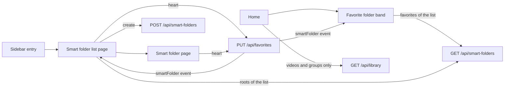
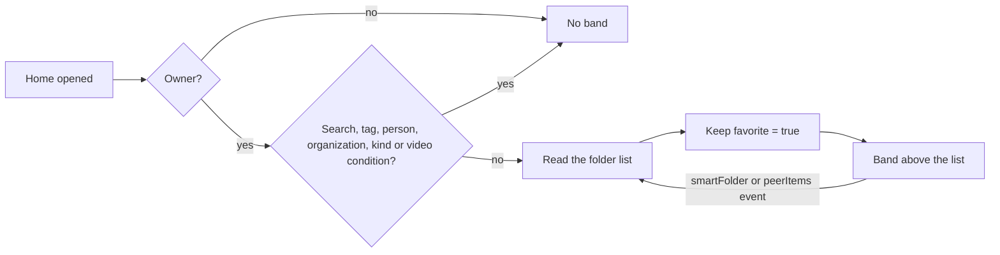

# Implementation Plan: Smart folders as a sidebar menu, with only the favorites on the home

**Branch**: `feature/073-smart-folder-menu` | **Parent Issue**: #1896

**Input**: The parent Issue. It is this feature's specification.

## Summary

The owner gets a `Smart folders` entry in the sidebar that opens a list page
of the root smart folders, with creation and a favorite heart on every row;
the smart folder page gets the same heart; and the home shows only the
favorite folders, at any depth, in a band above the list. `GET /api/library`
stops leading its first page with smart folders, and the band and the list
page read `GET /api/smart-folders`, which already carries `parentId` and
`favorite`, and re-read it on the `smartFolder` event, which every favorite
change of a folder already raises, and on the `peerItems` event of a link that
connects or drops.

The diagram shows the screens this feature adds or changes and what each one
reads.



## Technical Context

**Canonical definitions**: [ARCHITECTURE.md](../../ARCHITECTURE.md) for the
layers, the store roles, the audience rule and the web layer;
[home.md](../../docs/design-docs/home.md) for the home list and the
onboarding folders;
[library-ui.md](../../docs/design-docs/library-ui.md) for the favorite mark,
the sidebar and the server-side list conditions;
[peer-library.md, Merged lists](../../docs/design-docs/peer-library.md#merged-lists)
for the folders of paired nodes; [api/openapi.yaml](../../api/openapi.yaml) for
the screen API; [design-system.md](../../docs/design-docs/design-system.md)
for the page patterns; [testing.md](../../docs/design-docs/testing.md) and
[web-testing.md](../../docs/design-docs/web-testing.md) for the test levels.

**Feature-specific context**:

| Item | Delta |
| --- | --- |
| Leading folders | `GET /api/library` lists the owner's root folders ahead of the first page when unfiltered and every favorite folder in favorites-only mode, through a folder cursor of its own; this feature removes that section ([contracts/screen-api.md](contracts/screen-api.md)) |
| Folder list read | `GET /api/smart-folders` is unpaginated, in name order, with `parentId` and `favorite` for the owner and nothing for guests; the band and the list page filter it on the client ([Home band of favorite folders](#home-band-of-favorite-folders), [Smart folder list page](#smart-folder-list-page)) |
| Favorite events | The store raises the all-folder `smartFolder` notice when a favorite change names a video, group or folder, so the band and the list page re-read on it; the `updateFavorites` description still says it emits no event and is corrected in the same contract |
| Owner-only route | `/smart-folders` (exact) joins the owner-only paths of the auth gate; `/smart-folders/{id}` stays open, because a folder page checks its own folder for a guest |
| Paired nodes | `GET /api/smart-folders` merges each link's folders with the link's own favorites, so the band and the list page show them as the merged home does today; creation on the list page is local. A peer on an older release still leads its library page with its root folders, which the merged list shows until it is upgraded ([Mixed versions](../../docs/design-docs/peer-library.md#mixed-versions)) |
| Onboarding | The interest folders are created without a favorite today, so requirement 9 needs no store change; the onboarding e2e step that finds them on the home moves to the list page |
| Design stage | The parent carries `ui`, so `ui-design.md` decides the band's frame, the list page's skeleton and the sidebar icon before `plan-to-issues` ([Open for the design stage](#open-for-the-design-stage)) |

## Constitution Check

*GATE: Must pass before Phase 0 research. Re-check after Phase 1 design.*

| Rule | Source | Verdict |
| --- | --- | --- |
| Every read knows its viewer | ARCHITECTURE.md | No new read: `GET /api/smart-folders` already takes the audience and answers guests an empty list; the list page is owner-only in the auth gate, and the home requests the band for the owner only |
| Remote ids carry an offset | ARCHITECTURE.md | The merged folder list and the split of `PUT /api/favorites` by node are reused unchanged; no request is added |
| Store roles | ARCHITECTURE.md | The removal stays inside `LibraryStore`'s library read; `FavoriteStore` and `SmartFolderStore` are unchanged |
| Generated files are not hand-edited | AGENTS.md | Descriptions in `api/openapi.yaml` change, then `task generate` |
| Complexity 25 and no copies | AGENTS.md | The band is its own component next to `LibraryPage`, which is already large; the list page reuses `SmartFolderDialog`, `FavoriteToggle` and the library's folder row instead of copying them |
| Design system first | AGENTS.md, design-system.md | The list page and the band are composed from the page patterns; `ui-design.md` chooses them |
| Documentation close to the code | AGENTS.md | `home.md` and `library-ui.md` change in the unit that changes the behaviour they describe |
| Tests at the lowest level | testing.md, web-testing.md | The removal in store tests, the band and the list page in page tests, the e2e fixtures only where they already open the home or the setup |

No gate is at stake after Phase 1; `## Complexity Tracking` is left out.

## Home band of favorite folders

The home shows the owner's favorite smart folders, at any depth and in the
name order of `GET /api/smart-folders`, in a band above the list, and the
list itself holds videos and groups only.

The diagram shows when the band is requested and shown.



The favorite-only filter keeps the band, as the server's favorites-only
listing keeps the favorite folders today (requirement 8); the band's condition
is the existing `listsSmartFolders` rule of the home's criteria. With no
favorite folder the band is not drawn, so the videos and groups start at the
top (acceptance 5).

| Decision | Rejected | Why |
| --- | --- | --- |
| The band reads `GET /api/smart-folders` and keeps `favorite = true`; `GET /api/library` leads with no folder for anyone | Keep the folders as leading items of `GET /api/library`, with the condition changed from root to favorite | Leading items count toward `limit` and `total`, so a band the design caps would split over pages, and many favorites would fill the first page with folders, the Issue's edge case; the list is unpaginated, so the band needs no cursor |
| Same | A `favorite=true` parameter on `listSmartFolders` | The list already carries `favorite`, and the list page needs the same read with another filter (`parentId` absent); one read with client-side filters instead of two shapes |
| Band items are the library's smart folder cards and rows, so selection, the row heart, the playlist action and the card values stay | Navigation chips without selection | Drops bulk edit, playlist add and favorites of folders from the home for no requirement; `ui-design.md` still decides the band's frame, its cap and the link to the list page for the overflow |
| The band re-reads the whole list on every `smartFolder` event, on every `peerItems` event and on reconnection | Patch the band from the event's ids | The event names every folder when a favorite changes, and the list is one small request; `GET /api/smart-folders` merges each connected link's folders, so a link that connects or drops changes the list without a `smartFolder` event, as `peerItems` already reloads the folder page; the folder cards keep their own value refresh |
| An old folder cursor answers `400 invalid_cursor` | Keep decoding the folder cursor and skip the section | Only a home tab left open across the upgrade holds one, since the list snapshot lives in memory and a reload starts from page one; its next page fails with the existing `invalid_cursor` message and retry, as for a cursor of another list, and reloading starts again from page one. No automatic recovery is added for a one-time upgrade, and the decoder loses a branch |

## Smart folder list page

`/smart-folders` lists the owner's root smart folders in the name order of
`GET /api/smart-folders`, with a favorite heart on each row, a link to each
folder's page and a creation action that opens `SmartFolderDialog` with an
empty rule.

| Decision | Rejected | Why |
| --- | --- | --- |
| The page reads `GET /api/smart-folders` and keeps the folders without `parentId` | A paged root listing of its own | The list is already unpaginated for the parent selectors and the folder trees, so the root folders are a subset of a read that exists; a cursor would serve a count the product keeps small |
| Creation opens `SmartFolderDialog` in its `create` form with an empty rule, the default sort and no parent; the dialog's existing rule validation refuses an empty rule | A dialog of its own with a name only | The folder needs a rule to mean anything; the dialog already edits name, conditions, sort and parent |
| After a creation, on every `smartFolder` and `peerItems` event and on reconnection, the page re-reads the list; after a creation it focuses the new folder's row | Insert the created folder locally in name order | The server's name order folds width, case and kana; a local order would be a second rule |
| The row's heart is `FavoriteToggle` with `smartFolderIds`, as the library's folder row | A favorite column with a checkbox | The favorite mark is one heart everywhere ([Favorite mark](../../docs/design-docs/library-ui.md#favorite-mark)) |
| `/smart-folders` (exact) is an owner-only path of the auth gate | Answer guests an empty page | The gate already sends guests away from owner-only screens before any request; the folder pages below the path keep their own guest check |
| An empty list shows an empty state with the creation action; a failed read shows the error state with retry | A link to the home's filters | Requirement 4: creation without a filter |

## Favorite marks on the folder pages

The smart folder page shows the owner's heart in its header, from the
folder's `favorite`, and toggles it with `PUT /api/favorites` as the row
heart does.

| Decision | Rejected | Why |
| --- | --- | --- |
| `FavoriteToggle` in its `page` form among the header actions, next to Play and the menu | A favorite item in the folder's menu | The mark is both mark and toggle; a menu item hides the state |
| The mark changes after the server answers, and the toggle adds no refetch of its own; the page's existing refresh on a `smartFolder` event naming its folder stays, and re-reads the folder when the all-folder event of the change arrives | Refetch the folder from the toggle as a group card does | The folder read carries the favorite and nothing else the toggle changes, and the existing event refresh already re-reads it; a second refetch from the toggle would read it twice. The same event refreshes the band and the list page |

## Sidebar entry

The owner's sidebar gets `Smart folders` after `Folders`, in the rail and the
drawer, active on `/smart-folders` and the folder pages below it.

| Decision | Rejected | Why |
| --- | --- | --- |
| After `Folders`, before `History` | After `Playlists`, with the other collections | `Folders` and `Smart folders` both browse the library by a grouping; the guest's rail stays `Home`, `Folders`, so the two browse entries stay together |
| `matchDescendants: true` | Active on the list page only | `People` is active on a person's page; a folder page opened from the list keeps its entry lit |

## Project Structure

### Documentation (this feature)

```text
specs/073-smart-folder-menu/
├── plan.md                    # This file
└── contracts/screen-api.md    # The changed descriptions of listLibrary, updateFavorites and LibraryItem
```

`research.md` is not created: the decisions fit the tables above. `data-model.md`
is not created: no table or column changes; the folder favorites already
exist. `quickstart.md` is not created: the automated checks and the visual
review `ui-design.md` prescribes cover the acceptance criteria.

### Source Code

**Affected boundaries**: `internal/store` (the library read drops its folder
section), `api/openapi.yaml` and the generated files (descriptions only),
`web/src/library` (the band), `web/src/smartFolders` (the list page and the
page heart), `web/src/shell` (the entry), `web/src/auth` (the owner-only path),
`web/src/app` (the route), `web/src/i18n`, `web/e2e` (the home and onboarding
fixtures), `docs/design-docs/home.md` and `library-ui.md`.

**New paths**: the list page under `web/src/smartFolders/`, the band under
`web/src/library/`, each with its tests.

**Structure decision**: Follows the existing layout
([Web layer](../../ARCHITECTURE.md#web-layer)); `internal/store/library_smart_folders.go`
and its tests are deleted rather than kept for a mode no screen reads.

## Open for the design stage

| Question | Settled by |
| --- | --- |
| The band's frame: heading, item form, the cap on visible folders and the overflow link to the list page | `ui-design.md` |
| The list page's skeleton (`AdminTablePage` as tags and people, or `ListPage`), its row content and its empty state | `ui-design.md` |
| The sidebar icon | `ui-design.md` |

## Implementation Work

### Remove the smart folders from the library list's first page

**Scope**: `GET /api/library` returns videos and groups only for every
audience and filter; the folder section, its count in `total` and its cursor
go, and an old folder cursor is `400 invalid_cursor`. The `listLibrary` and
`updateFavorites` descriptions follow [contracts/screen-api.md](contracts/screen-api.md),
and [home.md, Collection information and paging](../../docs/design-docs/home.md#collection-information-and-paging)
loses its leading-folders paragraph.

**Dependencies**: None

**Acceptance**: Store tests show the owner's unfiltered and favorites-only
library pages hold no `SmartFolder` item, `total` counts videos and groups,
and a folder cursor answers `invalid_cursor`; a handler test shows the merged
page too. The existing folder-leading tests are removed, not moved. `task check
SCOPE=go` over `internal/store` and `internal/httpapi` passes and `task
generate` leaves no diff.

### Show the favorite smart folders in a band above the home list

**Scope**: The band of [Home band of favorite folders](#home-band-of-favorite-folders),
in the frame `ui-design.md` sets: requested for the owner when the criteria
list smart folders, filtered to favorites, re-read on `smartFolder` events
and reconnection, its items selectable with the page's selection. The home
e2e fixture favorites its folder, and `home.md` and
[library-ui.md, Sidebar navigation](../../docs/design-docs/library-ui.md#sidebar-navigation)
describe the band.

**Dependencies**: Remove the smart folders from the library list's first page

**Acceptance**: Page tests show the band holds the favorite folders at any
depth in name order and nothing else (acceptance 4, 5), is absent under a
search or tag filter and present under the favorite filter (6, 8), re-reads
on a `smartFolder` event so a folder favorited elsewhere appears and one
unfavorited goes (edge case), and a guest gets no band and no request. The
home e2e's playback-from-a-folder test passes with the favorited fixture. The
screen gets a visual review at the widths `ui-design.md` names, including the
many-favorites cap. `task check SCOPE=web` over `src/library` passes.

### Add the smart folder list page and its sidebar entry

**Scope**: The page of [Smart folder list page](#smart-folder-list-page) at
`/smart-folders`, the owner-only path in the auth gate, the route, the entry
of [Sidebar entry](#sidebar-entry) with the icon `ui-design.md` chooses, the
catalog text, and the rows of
[library-ui.md, Favorite mark](../../docs/design-docs/library-ui.md#favorite-mark)
and Sidebar navigation for them. The onboarding e2e finds the interest folders
on this page and opens one from it, and `home.md`'s onboarding section says
the folders are not favorites.

**Dependencies**: Show the favorite smart folders in a band above the home
list (it moves the onboarding e2e off the home)

**Acceptance**: Sidebar tests show the entry after `Folders` for the owner in
the rail and the drawer and not for a guest (acceptance 1). Page tests show
root folders only, in the server's order, each linking to its page (2); a
created folder appearing without a reload with focus on its row (3); the row
heart sending `smartFolderIds` and changing after the answer (4); a re-read
on a `smartFolder` event (edge case); the empty state with the creation
action; and the auth gate test shows a guest sent away from `/smart-folders`
(edge case). The onboarding e2e passes with its step on this page (7). The
screen gets a visual review at the widths `ui-design.md` names. `task check
SCOPE=web` over `src/smartFolders`, `src/shell`, `src/auth` and `src/app`
passes.

### Favorite a smart folder from its page

**Scope**: The heart of [Favorite marks on the folder pages](#favorite-marks-on-the-folder-pages)
in the smart folder page's header, and its row in library-ui.md's favorite
mark table.

**Dependencies**: None

**Acceptance**: Page tests show the heart for the owner only, lit from the
folder's `favorite`, sending `smartFolderIds: [id]` and changing after the
answer, and keeping its state with a toast on failure (acceptance 4). The
header gets a visual review at the widths `ui-design.md` names. `task check
SCOPE=web` over `src/smartFolders` passes.
