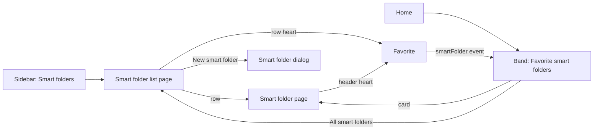
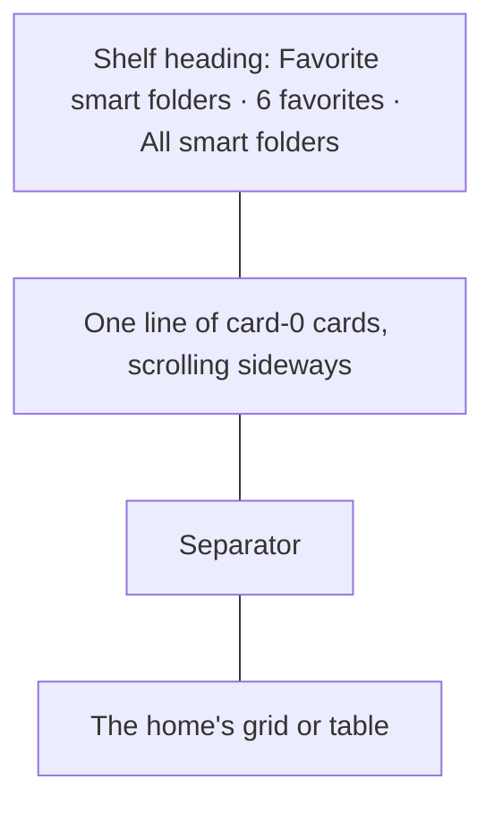
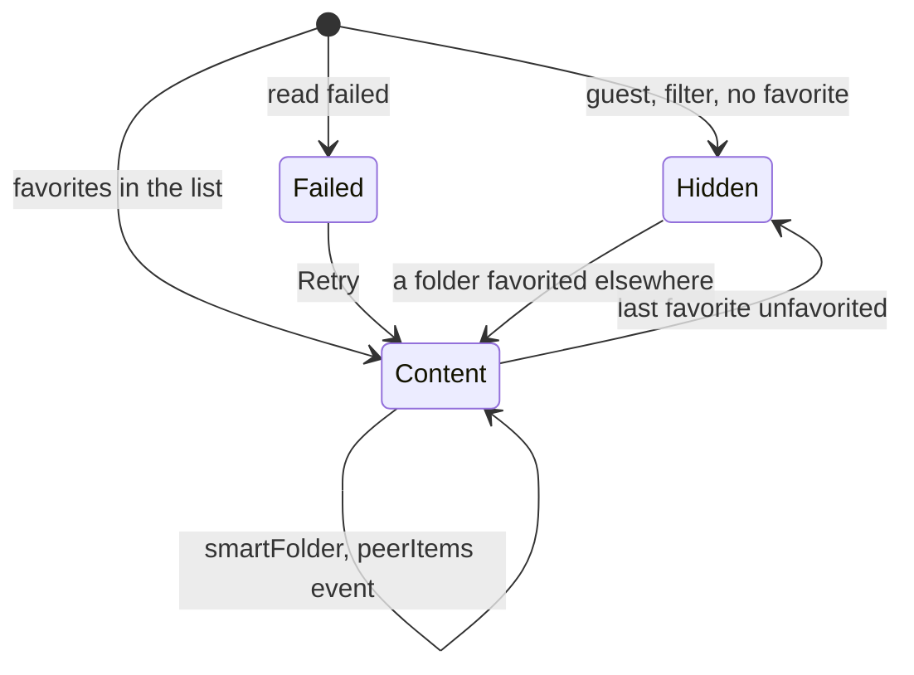
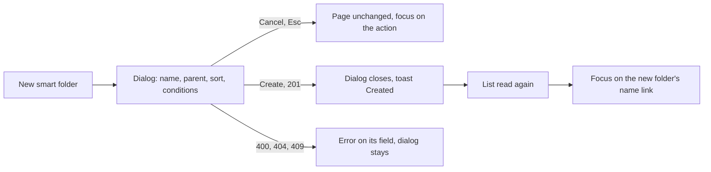
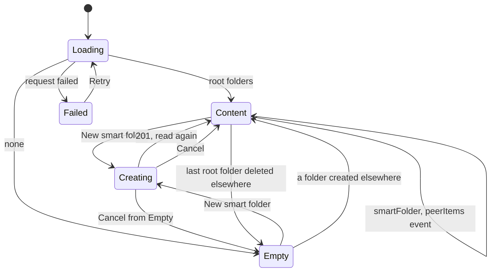

# UI design: Smart folders as a sidebar menu, with only the favorites on the home

Sources: [plan.md](plan.md);
[design-system.md](../../docs/design-docs/design-system.md) and its rules
([patterns.md](../../web/registry/rules/patterns.md),
[components.md](../../web/registry/rules/components.md),
[foundations.md](../../web/registry/rules/foundations.md));
[library-ui.md](../../docs/design-docs/library-ui.md) for the
[favorite mark](../../docs/design-docs/library-ui.md#favorite-mark), the
[cards](../../docs/design-docs/library-ui.md#cards), the
[list view and selection](../../docs/design-docs/library-ui.md#list-view-and-selection),
the [sidebar](../../docs/design-docs/library-ui.md#sidebar-navigation) and the
[width breakpoints](../../docs/design-docs/library-ui.md#width-breakpoints-in-css-and-the-sidebar-exception);
[home.md](../../docs/design-docs/home.md) for the onboarding folders; the
current screens [LibraryPage.tsx](../../web/src/library/LibraryPage.tsx),
[SmartFolderPage.tsx](../../web/src/smartFolders/SmartFolderPage.tsx),
[SmartFolderCard.tsx](../../web/src/smartFolders/SmartFolderCard.tsx),
[SmartFolderDialog.tsx](../../web/src/smartFolders/SmartFolderDialog.tsx),
[PlaylistsPage.tsx](../../web/src/playlists/PlaylistsPage.tsx),
[PeoplePage.tsx](../../web/src/credits/people/PeoplePage.tsx) and
[navigation.ts](../../web/src/shell/navigation.ts); the screen text in
[web/src/i18n/en.ts](../../web/src/i18n/en.ts) (`shell.nav`, `smartFolders`,
`library.smartFolder`, `list.card`). Tokens are named, never valued.

The diagram shows the parts this feature adds or changes and where each press
leads.

## Why this shape

The band is one row of the library's own smart folder cards, scrolling
sideways under its own heading, so it is one card high at every width however
many folders the owner favorites, and the folders are told from the videos by
the shape of the section (a heading, one line of small cards, a hairline),
not by a badge on each card (`UI品質`, the second point). A capped grid with
`Show all` was rejected because at 360px three cards already fill a screen and
a favorite behind the cap is not "on the home" (acceptance criterion 4);
folder rows in the home's list view were rejected because a table of rows
under a second table reads as two tables with two column headers, and the
band would change shape with the view. Plex, Jellyfin and YouTube put a few
highlighted collections above a list in exactly this row.

The band narrows the plan in one place:

| Plan said | This design | Why |
| --- | --- | --- |
| Band items are the library's smart folder cards and rows ([plan.md, Home band of favorite folders](plan.md#home-band-of-favorite-folders)) | Cards in both views, in a row that scrolls sideways | One frame at one height in both views; selection, the favorite and, for a local folder, the playlist of a band folder stay through the selection bar, and the folder page gets its own heart |

The list page is a `ListPage` whose body is the home's list-view rows, because
requirement 5 needs a heart on each folder and grid cards carry none
([Favorite mark](../../docs/design-docs/library-ui.md#favorite-mark)); the row
also shows the count, the watched state and the size the owner compares
folders by. `AdminTablePage`, the tags page's skeleton, was rejected: its
tabs, bulk actions and per-row menus have nothing to hold here, and its
`max-w-4xl` column would narrow the row the home draws at the body's full
width. The people page's face grid was rejected because a folder's art is a
thumbnail stack, not a face. No toolbar: the list is unpaginated and the
product keeps it short, so a search or a sort would be a control over a dozen
rows at most (`UI品質`, the first point: the page is the people page's header
over the home's rows).

The folder page's heart is the `page` form of `FavoriteToggle` among the
header actions, as on the video page, so the owner sees the state and changes
it in one press; a menu item was rejected because it hides the state.

The sidebar icon is lucide `FolderSearch`, the mark every smart folder card
and row already carries, so the entry and the cards share one sign.

## Words

Text in `web/src/i18n/en.ts` under the key named; a folder's name is an
argument. `smartFolders(n)` is the "1 smart folder" / "N smart folders"
helper this feature adds beside `videos(n)`.

| Place | Text | Notes |
| --- | --- | --- |
| Sidebar entry, drawer row; the entry's accessible name | Smart folders | `shell.nav.smartFolders`; the rail link's accessible name too |
| Sidebar entry, rail label | Smart | `shell.nav.smartFoldersShort`; the rail's `rail-item` square is 56px, which cuts `Smart folders` |
| List page title; `document.title` | Smart folders | `smartFolders.list.title`, `.documentTitle` |
| List page count | 1 smart folder; 12 smart folders | `smartFolders.list.count(n)`; after the title, absent while loading or empty |
| List page table accessible name | Smart folders | `smartFolders.list.table` |
| Create action | New smart folder | `smartFolders.list.new`; lucide `Plus` + text |
| Empty list title | No smart folders yet | `smartFolders.list.empty.title` |
| Empty list description | A smart folder keeps the videos that match its conditions. | `smartFolders.list.empty.description` |
| List load failed | Couldn't load the smart folders: {reason} | `smartFolders.listFailed(reason)`, existing; `ErrorState` with `Retry` |
| Band heading | Favorite smart folders | `smartFolders.band.title` |
| Band count | 1 favorite; 6 favorites | `smartFolders.band.count(n)` |
| Band link | All smart folders | `smartFolders.band.all`; lucide `ChevronRight` after the text |
| Band load failed | Couldn't load the smart folders: {reason} | `smartFolders.listFailed(reason)`; `ErrorState` with `Retry` in the row's place |
| Folder page heart | Favorite | `smartFolders.detail.favorite`, the video page's word; below `sm` the word is the accessible name only |
| Favorite change failed | Couldn't change the favorite: {reason} | `list.card.favoriteFailed(reason)`, existing; a toast on the folder page and on the list page |
| Dialog, toasts | New smart folder; Create; Creating…; Created "{name}" | `smartFolders.dialog.*`, `smartFolders.created(name)`, existing |

"Favorite" is one word for the mark, the toggle and the filter, as on the
video page and in the `Favorites only` filter. "Smart folders" names the
sidebar entry, the list page and the band's link, so the three are one place.
The rail alone shows the short `Smart`: it fits the 56px square whole, stays
distinct from `Folders` above it, and keeps the icon as the shared mark, while
the link's accessible name stays `Smart folders`.

## Sidebar entry

`Smart folders` joins `navEntries()` after `Folders` and before `History`,
owner-only, with `matchDescendants: true`, so the entry is lit on
`/smart-folders` and on every folder page under it
([plan.md, Sidebar entry](plan.md#sidebar-entry)).

| Part | Form |
| --- | --- |
| Icon | Lucide `FolderSearch`, `size-4` as every entry's icon |
| Rail (from 640px) | A `rail-item` square: the icon above the label `Smart` in `text-rail`, on one line and whole; the link's accessible name is `Smart folders` |
| Drawer (below 640px) | One row: the icon, then the full label `Smart folders` in `text-sm`, as the rows above and below it |
| Current | `bg-secondary`, `text-foreground`, `font-medium`, the sidebar's current mark |
| Guest | Absent; the guest's rail stays `Home`, `Folders` |

The entry stands between the two entries that browse the library by a
grouping and the entries that list the owner's own records, so the owner's
rail reads `Home`, `Folders`, `Smart`, `History`, `Playlists`, `Tags`,
`People`, `Organizations`, `Duplicates`, `Activity`.

## Home band

The band is the first element of the home's body, above the `Search results`
heading and the `Filtering by` chips when they are drawn, in both the grid
and the list view. When it is drawn and when it is read again is
[plan.md, Home band of favorite folders](plan.md#home-band-of-favorite-folders);
this section decides its frame.

| Part | Form |
| --- | --- |
| Section | A `Shelf` in the row layout of [Shelf row](#shelf-row): the heading `Favorite smart folders` (`h2`), the count `6 favorites`, and the action `All smart folders`, a `ghost` `sm` `Button` around a router link to `/smart-folders` with lucide `ChevronRight` after the text |
| Cards | The library's smart folder cards, `card-0` wide at every zoom, in the name order of the folder list, at any depth; no tag row and no condition chips, so every card is its art and its name and the row is one height |
| Card behaviour | As on the home today: cover promotion opens playback, the resting card and the name open the folder page with `state.from` the home, the check on hover selects the folder, Shift ranges run across the band and the list in display order, and the selection bar offers on it what it offers on a folder card today: favorite, tag and visibility actions on every folder, and `Add to playlist` only while every selected item is on this node, since playlists stay on each node, so a selection with a linked library's folder has no playlist action |
| Scrolling | The row scrolls sideways with a swipe, a trackpad, Shift+wheel, the scrollbar and Tab (the focused card scrolls into view); the body's edge cuts the card that does not fit, so a cut card says more follow; no arrow buttons |
| Marquee | A box drawn on the home selects the band cards it overlaps; a card scrolled out of the row is not selected |
| Drag | A card dragged over a band card shows `Can't drop here`, as over a folder card today |
| After the row | A `Separator`, so at zoom 0, where the grid's cards are `card-0` too, the band's line and the grid's first row never read as one grid |
| Below the band | The home as today: the results heading and chips when a filter applies, then the grid or the table |

Only favorites stand in the band (requirement 7), so the heading says so:
`Favorite smart folders` tells the owner why a folder is here, and
`All smart folders` is where the others are. The count names the number of
favorites because, past the body's edge, the cut card alone does not.

### Shelf row

The design system gains a row layout of `Shelf` (item `shelf`), added by the
unit that builds the band and documented in
[patterns.md, Sections](../../web/registry/rules/patterns.md#sections) and
the `shelf-example` block: `layout="row"` lays the children out in one line,
`gap-3`, scrolling sideways within the body's width instead of wrapping, each
child `card-0` wide; the heading row takes `actions`, drawn at its right end
as `PageHeader`'s. It is for a few highlighted items above a list; a list of
every item of a kind keeps the wrapping `CardGrid`.

### Band states

| State | What the screen shows |
| --- | --- |
| Hidden | Nothing: a guest, a search or a filter other than `Favorites only`, or no favorite folder; the list starts at the top of the body (acceptance criterion 5) |
| Loading | Nothing until the folder list arrives; the band is drawn complete, never as a skeleton, because it may turn out absent |
| Content | The heading, the count, the link, the row of cards, the separator |
| Read again | A `smartFolder` or `peerItems` event re-reads the list in place: a folder favorited elsewhere joins the row in name order, one unfavorited leaves, and the last one leaving removes the band; no skeleton |
| Failed | The heading and the link over an `ErrorState` with `Couldn't load the smart folders: {reason}` and `Retry` in the row's place, so a read that failed is never a band that silently went |

## Smart folder list page

`/smart-folders` is a `ListPage` inside the shell for the owner; `/smart-folders`
joins the owner-only paths of the auth gate, so a guest who opens the URL is
sent to the sign-in page as for `/playlists` and never sees a folder name
([plan.md, Smart folder list page](plan.md#smart-folder-list-page)).
`document.title` is `Smart folders`.

| Part | Form |
| --- | --- |
| Toolbar | None; the top bar holds the brand (and `☰` below 640px), as on the playlists page |
| Header | `PageHeader` with the title `Smart folders` (`text-xl`), the count `12 smart folders` after it, and the `default` `sm` action `New smart folder` (lucide `Plus`) at the right end; the action is absent in the empty state, where the state block holds it |
| Body | A `DataTable` named `Smart folders` with the home's column header without the check column, and one row per root folder (no `parentId`) in the order of `GET /api/smart-folders` |
| Row | The home's smart folder row: the first cover in `list-thumb`, the name as the link to `/smart-folders/{id}` with `state.from` this page, the count line with the `FolderSearch` mark and `12 videos`, the heart, `Add to playlist` from `sm`, then watched, duration, size and date added; no check cell and no `Add to group` cell |
| Heart | `FavoriteToggle` `row`: filled `favorite` when on, the outline on hover or focus when off; a press sends `smartFolderIds: [id]`, the heart changes after the answer, a failure keeps it and shows the toast |
| Child folders | Not listed (requirement 2); a child is found on its parent's page, and a favorited child stands in the home band |
| Onboarding folders | The interest folders of [home.md, Initial setup](../../docs/design-docs/home.md#initial-setup) are root folders and not favorites, so they are rows here and not in the band (requirement 9) |

A row carries no `More` menu: editing, a new child and deleting are on the
folder's page, one press away, where its conditions are in view. Selection
and the selection bar are not on this page; a folder's tags and visibility
are changed from the home band or the folder's page.

### New smart folder

`New smart folder` opens `SmartFolderDialog` in its `create` form with an
empty rule, the default sort and the parent `None (top level)`, as `New child
smart folder…` opens it on a folder page without the parent
([patterns.md, Form dialog](../../web/registry/rules/patterns.md#form-dialog)).

The dialog's fields, errors and failure `Alert` are the dialog's own and do
not change. After the read the new folder's row stands where the server's
name order puts it, and the focus moves to its name link so a keyboard owner
is on the folder they just made.

### List page states

| State | What the screen shows |
| --- | --- |
| Loading | The header with the title and the action, no count; `LoadingState` `layout="table"` of 6 rows |
| Content | The header with the count; the table |
| Empty | The header without the count or the action; `EmptyState` with lucide `FolderSearch`, `No smart folders yet`, its description and the `default` `sm` `New smart folder` |
| Failed | The header without the count; `ErrorState` `Couldn't load the smart folders: {reason}` with `Retry` |
| Creating | The dialog in its `pending` form over the unchanged page |
| Read again | A `smartFolder` or `peerItems` event, a reconnection or a creation re-reads the list in place without a skeleton: a folder created, renamed or deleted in another tab appears, changes or leaves; the heart of a folder favorited elsewhere fills |

## Smart folder page header

The folder page's `PageHeader` actions gain the owner's heart; the trail,
the title, the count and the conditions lines do not change
([plan.md, Favorite marks on the folder pages](plan.md#favorite-marks-on-the-folder-pages)).

| Part | Form |
| --- | --- |
| Order | The heart, then `Play`, then `More`; the two actions the owner knows keep their places at the row's end, and the row reads as a state, the main action, the menu |
| Heart | `FavoriteToggle` `page`: a `sm` pill `Toggle` with the heart and the word `Favorite`; `secondary` fill and `foreground` text when off, `favorite-soft` fill and `favorite` text when on; below `sm` the heart alone, the word as its accessible name |
| Press | `PUT /api/favorites` with `smartFolderIds: [id]`; the pill shows the spinner and is `aria-disabled` until the answer, then changes; the page's existing refresh on the `smartFolder` event re-reads the folder, and the band and the list page follow the same event |
| Failure | The pill keeps its state; the toast `Couldn't change the favorite: {reason}` |
| Empty folder | The heart and `More` without `Play`, as `Play` is absent today |
| Guest, loading, failed, gone | No heart; the header is as today |

`Play` stays the one filled control in the header: the heart's `secondary`
fill is the pill's resting tone, and its `favorite` tone appears only when
the folder is a favorite, which is the one coloured element a favorite
folder's header gains.

## Responsive behaviour

The widths below are the ones the implementation is judged at. The sidebar is
the drawer below 640px and the rail from it; the band's cards are `card-0`
wide at every width and zoom; the list page's row hides the same columns the
home's list view hides at each width.

| Width | Layout |
| --- | --- |
| 360px | Sidebar: `Smart folders` is the third row of the drawer, with its icon and label like the rows around it. Home: the band's heading, count and `All smart folders` share one line (the link's text whole); one whole card and about half of the next show in the row, which scrolls sideways with a swipe; the separator, then the one-column grid or the table. List page: the title and `New smart folder` on one line, the count under the title when the header wraps; a row is the cover, the name and the count line, the heart, and the date column; `Add to playlist` is in no row. Folder page: the header's heart is the pill with the heart alone, before `Play` and `More` |
| 768px | Sidebar: the rail with `Smart` third, its label on one line and whole. Home: two whole cards and most of a third in the row. List page: the header on one line; a row adds `Add to playlist` and the watched and duration columns |
| 1280px | Sidebar: the rail. Home: five whole cards in the row and a sixth cut at the body's right edge when six or more are favorites; the grid under the separator has both edges on the band's. List page: a row shows every column, the heart column `w-8` as on the home; the table's edges are the header's. Folder page: the heart with its word, `Play` and `More` at the header's right end on one line with a name of up to about 40 characters |

## Review criteria

Judged by looking at the screen at 360px, 768px and 1280px, signed in as the
owner, with six root smart folders `A` to `F` of which `A`, `C` and `E` are
favorites, a child `C-1` under `C` that is a favorite, zoom 0 and zoom 2, and
then as a guest.

1. **One sign for smart folders** (`UI品質`, the third point): the rail's
   entry has the same icon size, label size and square as `Folders` above
   it, and its icon is the mark on every folder card and row; its label
   reads `Smart`, whole and not cut, at 768px and 1280px, and its accessible
   name is `Smart folders`. The drawer's row at 360px reads `Smart folders`
   and matches the rows around it in height and type. The guest's rail and
   drawer have no such entry (acceptance criterion 1; `タイポグラフィ`, `余白のリズム`).
2. **The band is told from the list** (`UI品質`, the second point): at zoom 0
   the band's cards and the grid's cards are the same size, and the band is
   still read as a different section by its heading, its one line and the
   hairline under it; at zoom 2 the band's cards are smaller than the grid's
   and the band is one card high. No badge, label, fill or border is added to
   a band card (`視覚的な階層`, `情報密度`).
3. **The videos stay in view**: with `A`, `C`, `C-1` and `E` as favorites the
   first video card is on the first screen at 1280px and the band is one card
   high at 360px, where only the heading, the row and the hairline stand
   above the grid; favoriting all six folders changes the band's height by
   nothing and the count to `7 favorites` (Edge Case).
4. **Favorites only, at any depth, in name order** (acceptance criteria 4
   and 5, requirement 6): the band reads `A`, `C`, `C-1`, `E` and no `B`, `D`
   or `F`; pressing the heart on `B`'s row on the list page puts `B` after
   `A` in the band without a reload, and pressing it again takes it out;
   unfavoriting all four removes the band and the videos start at the top
   of the body.
5. **Filters** (acceptance criterion 6, requirement 8): a search, a tag or a
   person filter removes the band; `Favorites only`, the sort and the zoom
   keep it.
6. **Priority of actions on the home**: `All smart folders` is a `ghost`
   button that does not outrank a card; Tab reaches the band's cards before
   the list's and the link before the cards; a card's check appears on hover
   as in the grid; a Shift-click from a band card to a grid card selects the
   cards between them in display order; the selection bar's `Favorite` on a
   selected band folder changes the band (`操作の優先度`).
7. **The row scrolls, nothing else moves**: at 360px swiping the row brings
   `E` into view while the heading and the grid stay; a vertical wheel over
   the row scrolls the page; the cut card at the row's edge is the only sign
   of more cards besides the count.
8. **The list page is the people page's header over the home's rows**
   (`UI品質`, the first point; acceptance criterion 2): the title is the only
   `text-xl`, the count after it is `text-sm` muted, `New smart folder` is
   the one filled control; the rows are the home's list-view rows with the
   same thumbnail width, name size, count line and column order, without the
   check column; `A` to `F` are listed in that order and `C-1` is not, and
   opening `C` shows `C-1` first in its body (`視覚的な階層`, `情報密度`,
   `タイポグラフィ`).
9. **Creation from the list** (acceptance criterion 3, requirement 4):
   `New smart folder` opens the dialog with no condition, `None (top
   level)` and the default sort; after `Create` the toast shows, the row of
   `G` is last in the table without a reload, and the focus is on its name.
   Pressing `Create` with no condition shows the conditions error and sends
   nothing.
10. **Empty and failed**: with every folder deleted the page shows the
    `FolderSearch` empty state with `New smart folder` as its only action and
    no action in the header; with the server stopped, `Retry` after the
    message reads the list again. The band on the home shows its heading
    and the error block in the row's place, and the list below still loads
    (Edge Case).
11. **The folder page's heart** (acceptance criterion 4, requirement 5): on
    `C`'s page the pill `Favorite` stands before `Play`; pressing it fills
    the heart in the `favorite` colour after the answer, and the home in
    another tab gains `C` without a reload; `Play` is the only cyan control
    before and after. At 360px the pill shows the heart alone and the three
    actions fit one line (`操作の優先度`, `視覚的な階層`).
12. **Another tab** (Edge Cases): a folder renamed, deleted or favorited in
    another tab changes, leaves or joins the open list page and the band
    without a reload and without a skeleton; deleting `C` removes `C-1`
    from the band.
13. **Onboarding** (acceptance criterion 7): after picking two interests in
    setup, the list page lists their folders and the band is absent.
14. **Guests** (acceptance criterion 1, Edge Case): a guest's rail has no
    entry, `/smart-folders` typed into the address bar lands on the sign-in
    page, the home has no band, and a folder page shows no heart.
15. **Failing examples** (`UI品質`): a band of chips without card art; a
    band that wraps into rows or caps the favorites behind a button; a band
    card with a badge, a heart or a different name size from the grid's
    card; a heading-less band; the list page as a narrow centered column, as
    cards without hearts, or with a per-row menu or a search field; `New
    smart folder` as an `outline` button or drawn in the empty state's
    header; the heart in the folder page's `More` menu; a heart after
    `More`; a `Smart folders` entry with an icon other than the card's mark,
    placed away from `Folders`, or shown to a guest; a rail label cut to
    `Smart fol…` or wrapped onto two lines.
