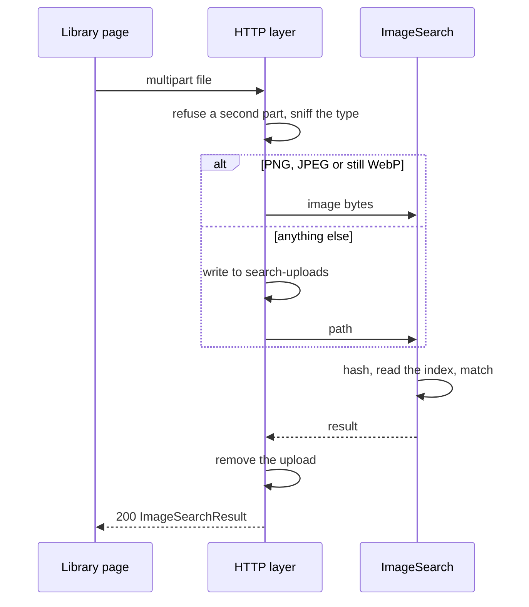

# Contract: Image search

Source of truth: [`api/openapi.yaml`](../../../api/openapi.yaml), operation
`searchByImage` (added by this feature). The operation is owner-only
(`security` as the other owner operations), so the routing test classifies it.

## `POST /api/image-search`

Searches this node's library for videos containing the footage of one
uploaded image or video, and keeps nothing it was given.

| Field | In | Type | Required | Meaning |
| --- | --- | --- | --- | --- |
| `file` | multipart part | binary | Yes | The image or video; exactly one part |

**Response**: `200` with `ImageSearchResult`.

| Field | Type | Meaning |
| --- | --- | --- |
| `query.kind` | `image` or `video` | How the file was read |
| `query.durationMs` | integer, video only | The query's duration |
| `items` | array of `ImageSearchItem`, at most 50 | Ordered as [Results](../plan.md#results) decides; empty when nothing matches |
| `unindexedCount` | integer | File videos visible to the owner that have no current search index |

`ImageSearchItem`:

| Field | Type | Meaning |
| --- | --- | --- |
| `video` | `Video` | The listed item, as the library list returns it (a bundle's representative) |
| `match.videoId` | integer | The video the match was found in: `video.id` or one of its versions; playback opens this id |
| `match.rate` | number, 0 to 1 | The match rate ([Image queries](../plan.md#image-queries), [Video queries](../plan.md#video-queries)) |
| `match.kind` | `frame`, `whole` or `partial` | `frame` for an image query; `whole` or `partial` for a video query |
| `match.positionMs` | integer | Where playback starts: the matched frame, or the first matching entry of the matched section |
| `match.startMs` | integer, video query only | The start of the matched section on `match.videoId`'s timeline ([Video queries](../plan.md#video-queries)) |
| `match.endMs` | integer, video query only | The end of the matched section on `match.videoId`'s timeline |
| `match.queryStartMs`, `match.queryEndMs` | integer, video query only | The same section on the query's timeline |

| Status | `code` | When |
| --- | --- | --- |
| 400 | `invalid_request` | No `file` part, or more than one part |
| 400 | `image_search_unreadable` | Not a PNG, JPEG or still WebP, and ffprobe finds no video stream of at least one second; or decoding fails |
| 400 | `image_search_uninformative` | The image is flat, or the video has fewer than 3 non-flat sampled frames |
| 400 | `image_search_too_long` | A video over 3 hours; `limit` carries the milliseconds |
| 413 | `image_search_too_large` | An image over 64 MiB or 120 million pixels, or a video over 4 GiB; `limit` carries the exceeded limit |
| 401 | `unauthenticated` | A guest, as every owner-only operation |

A cancelled request writes no response; the upload is removed and any
ffmpeg run ends. No error leaves a file behind.

## Client use

`web/src/api/imageSearch.ts` sends the request with an `AbortSignal`; the
library page aborts it on a new file, a text search, clearing the image
search, or leaving the page. Each item's frame is
`GET /api/videos/{match.videoId}/frame?positionMs={match.positionMs}`, which
is unchanged.
