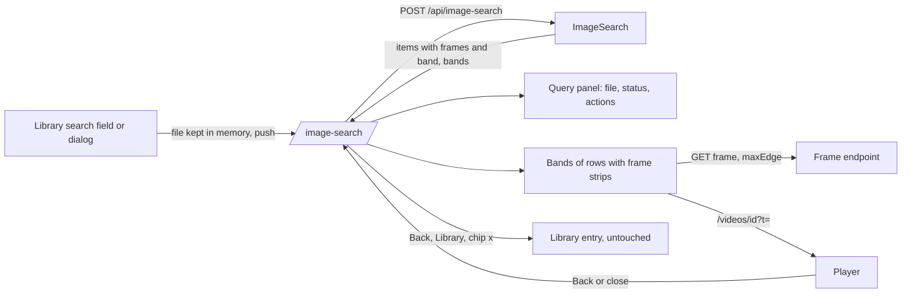
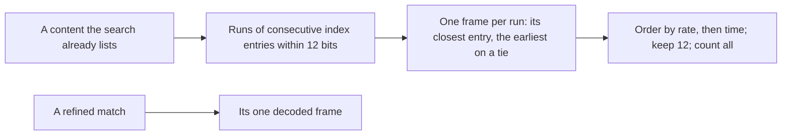
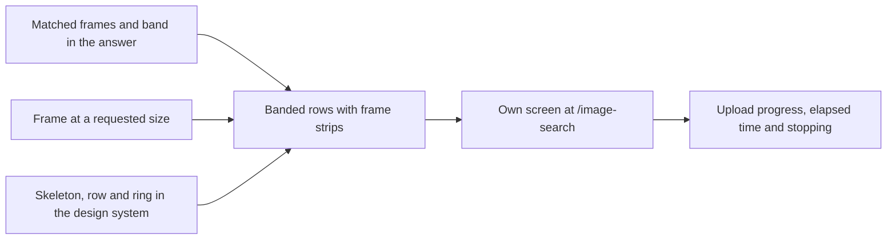

# Implementation Plan: Image search results view

**Branch**: `feature/074-image-search` | **Parent Issue**: #1927

**Input**: The parent Issue, and [ui-design.md](ui-design.md) as revised
after the maintainer rejected the first results view.

## Summary

Image search is built on the feature branch: the seven units of the first
Plan are done and their child Issues are closed. This Plan covers only the
change from that state to the revised design, and its units become
additional child Issues of #1927.

The results move from the library's body to a screen of their own at
`/image-search`: the file stays in a query panel beside the results, and each
video is one row with its match rate, its matched frames and the times they
play from, grouped in match-rate bands. The server's answer gains the matched
frames of each video and the bands; the matching itself does not change.



## Technical Context

**Canonical definitions**:
[image-search.md](../../docs/design-docs/image-search.md) for the index, the
matching rules and what a search returns;
[library-ui.md](../../docs/design-docs/library-ui.md#image-search) for the
search field and the results as built;
[design-system.md](../../docs/design-docs/design-system.md) for the registry
and how an item is added;
[web-testing.md](../../docs/design-docs/web-testing.md) and
[testing.md](../../docs/design-docs/testing.md) for test levels;
[api/openapi.yaml](../../api/openapi.yaml) for the screen API;
[ARCHITECTURE.md](../../ARCHITECTURE.md) for layers and the Web layer rules.

**Feature-specific context**:

| Item | Delta |
| --- | --- |
| Accuracy decision | On hold with the maintainer. The index, `FingerprintMatchMaxDistance`, the refinement gate and limits, the video-query rules, and which videos a search lists are not changed by any unit here |
| Answer shape | Each match gains matched frames and a band; the answer gains the bands ([contracts/image-search-api.md](contracts/image-search-api.md)) |
| Frame pictures | `GET /api/videos/{id}/frame` returns a PNG up to 2048 px on the long edge; a strip slot is `related-thumb` (160 px) wide |
| Process lesson | Issue #1966: evidence built only on hand-made data let the feature pass while it missed real footage. [Real-app check](#real-app-check) is part of the acceptance of every unit that changes what the owner sees |

## Constitution Check

| Rule | Source | Verdict |
| --- | --- | --- |
| Dependency direction | ARCHITECTURE.md | The frame and band rules are pure functions in `internal/domain`; `internal/app` and `internal/httpapi` only carry them |
| Pages never call `fetch` | ARCHITECTURE.md, Web layer | The upload with progress is a function of `web/src/api/imageSearch.ts`; the page calls it |
| Every read knows its viewer | ARCHITECTURE.md | No new read. The search and the frame endpoint stay owner-only; `/image-search` sends a guest to `/` |
| Generated files are not hand-edited | AGENTS.md | `api/openapi.yaml` and `web/registry.json` change, then `task generate` |
| Design system first | AGENTS.md, design-system.md | The skeleton, the row and the ring enter the registry in their own unit before a screen uses them |
| Complexity 25 and no copies | AGENTS.md | The page reuses `SearchBox`, `QueryChip`, `ImageSearchDialog`, `SpanBar` and the existing refusal rules instead of copying them |

No gate is at stake; `## Complexity Tracking` is left out.

## Matched frames and bands

Contract: [contracts/image-search-api.md](contracts/image-search-api.md).



| Decision | Rejected | Why |
| --- | --- | --- |
| A row's frames are found only in a content the search already lists, with the existing 12-bit distance | Listing a content because several weaker frames add up | That changes which videos a search returns, which is the accuracy decision on hold |
| One frame per run of consecutive index entries within 12 bits of the query | Every matching index entry | A held shot in a file with a keyframe every second would fill the strip with one picture and push the shot's other appearances past the limit |
| Same | Frames at least a fixed number of seconds apart | The spacing would be a number with no measurement behind it (Issue #1966, cause 3); a run needs none |
| A refined match has exactly its refined frame | Also listing the other decoded frames within 12 bits | They lie inside one gap of at most 10 s, 250 ms apart: one moment, already shown |
| At most 12 frames a row, the closest first, with `frameCount` for the number found | No limit | 50 rows of a looping video would carry thousands of frames. The design's review asks for rows of eight or more, and 12 leaves more than a strip to scroll at every width |
| Same | The row's count taken from the length of `frames` | `{k} matching frames` would be wrong for a row cut at the limit |
| A version bundle's row carries the frames of the member that matched best | Frames of every member | A frame's time is on one member's timeline, and `Play` and the frames open that member ([image-search.md](../../docs/design-docs/image-search.md#results)) |
| A video query's match has no frames; its row shows the section on a `SpanBar` | The section's matching index entries as frames | A video row's rate is the share of matching entries and a frame's rate is a hash distance: two measures under one `%`. [ui-design.md](ui-design.md#results) makes the frames optional there |
| Two bands, `strong` from 90% and `similar` under it down to the listing floor of the query's kind (81% for an image, 50% for a video), decided on the rate rounded to a whole percent | Thresholds in the screen | [ui-design.md](ui-design.md#why-this-shape) puts them on the server so the accuracy decision can move them without a screen change |
| Same | Deciding the band on the unrounded rate | A row shown as 90% could sit under the heading `81–89%` |
| Same | A third band for exact matches | The design names two bands, and no measurement separates 100% from 95% as evidence |
| The floors are derived from the existing listing rules (`FingerprintMatchMaxDistance`, the 50% rule), and 90 is one constant in `internal/domain` | Floors written a second time as numbers | A later change of a listing rule would leave a band range that no row can reach, or rows under no band |
| The answer lists every band of the query's kind; the screen leaves out a band without rows | Only the bands that have rows | The set a kind can produce is part of the contract, and the screen needs one name per id whether or not a search fills it |

The boundary at 90 is a presentation split of rates the search already
produces. It is not a claim about accuracy: the measurements behind the
on-hold decision show wrong videos listed within 12 bits, and a later
accuracy decision may move the boundary by changing the constant.

## Frame pictures

| Decision | Rejected | Why |
| --- | --- | --- |
| `getVideoFrame` gains an optional `maxEdge` (64 to 2048); the strip asks for 320 | The endpoint as it is | A 1080p frame is a PNG of megabytes for a 160 px slot, times up to 12 a row |
| Same | A new thumbnail endpoint | It would repeat the position check, the audience lookup and the `internal/mediafs` read of the existing one for a different scale filter |
| Same | Frames from the seek sprite | A sprite frame is at the sprite's interval, not at the matched time, so the picture and the caption's time would differ |
| The picture stays PNG | JPEG for small sizes | A second encoder path in `internal/media` for a strip that loads only the frames near the viewport (`VideoThumbnailImage`) |
| The screen builds the picture's URL from `videoId` and `positionMs` | A URL in each frame of the answer | `web/src/api` already builds the frame path (`videoFramePath`); the answer stays free of routes |

## Screen and history

The states, the layout and the words are in [ui-design.md](ui-design.md).
These are the decisions it leaves to the Plan.

| Decision | Rejected | Why |
| --- | --- | --- |
| The page is `web/src/library/imageSearch/ImageSearchPage.tsx`, routed at `/image-search` in `web/src/app/App.tsx`; the library page keeps only the field's entry | A mode of `LibraryPage` | The rejected design was that mode; a route gives browser Back and the untouched library entry for free |
| An accepted file is handed over in memory under a token that the pushed entry's state names; the request starts on `/image-search` | The `File` in the history entry's state | The browser copies it into session history, and a reload would find a file where [ui-design.md](ui-design.md#entry-and-leaving) wants Idle |
| Same | Starting the request on the library page and navigating with it | The library page unmounts on the push; the request, its abort and its progress belong to the page that shows them |
| The pushed entry's state also records that a library entry is under it; a new file replaces the entry and keeps that state. In-app ways back go one entry back with it, and replace with `/` without it | Deciding from `history.length` or the referrer | Neither tells which entry is under this one, and the design forbids leaving the app |
| The search stays in the existing in-memory store keyed by the history entry (`imageSearchState`), now with the expanded rows, the panel toggle and the last focused frame | A new store, or the URL | The store already restores a search after the player; the file cannot be in a URL |
| The phases become `uploading`, `searching`, `results`, `refused`, `failed` and `stopped`; no match is `results` without items, and Idle is no phase | `refused` with a `retry` flag, as today | The panel and the results column show a failure, a refusal and a stop with different words and actions |
| Upload progress comes from `XMLHttpRequest.upload` in `web/src/api/imageSearch.ts`, with the same abort signal and error mapping as `request` | `fetch` with a streamed body | Request streams need HTTP/2 and are not in Firefox or Safari |
| A video query's length before the answer is read from the panel's `<video>` metadata; the answer's `query.durationMs` replaces it | Waiting for the answer | The file line is shown while the upload runs |
| The rows are first mounted in the existing results body, then the page moves under them | The screen first, holding the old cards | The old card cannot show several frames, so the frames of the new answer would reach no screen until the last unit |

## Real-app check

Every unit that changes what the owner sees runs the real app and looks at
it. Component tests on hand-built answers cover the states a real search
cannot be made to produce on demand; they are never a unit's only evidence.

| Part | Decision |
| --- | --- |
| Stack | The e2e stack ([`web/e2e/run-e2e.mjs`](../../web/e2e/run-e2e.mjs)): the built server, the real `frame_index` job, ffmpeg and Chromium, run as `task test-e2e -- e2e/image-search.e2e.ts` |
| Media | Generated by [`web/e2e/media-fixtures.mjs`](../../web/e2e/media-fixtures.mjs), replacing the drifting-gradients video |
| Widths | 375, 768, 1280 and 1920 px, the owner signed in ([ui-design.md](ui-design.md#review-criteria)) |
| Screenshots | The spec attaches one per width at each state it asserts. The implementer opens every one and lists, in the PR's validation section, each review criterion the unit names with its verdict per width |

The generated media and the queries cut from it:

| Media | Query | What the app has to show |
| --- | --- | --- |
| Pan: a camera panning and zooming over a detailed still, a keyframe every 5 s (the footage of `panFixture` in [`cmd/mdm/image_search_test.go`](../../cmd/mdm/image_search_test.go)) | The frame at 6 s, cut with the frame endpoint | One row with one frame at 6 s ± 0.25 s, `Best candidate`, and playback from there |
| Recurring shot: a held shot A that returns nine times between moving footage, and a held shot B once | A frame of A, 1.5 s into a hold | One row with nine frames, one per appearance, the ninth reached by scrolling the strip |
| A second video that holds shot B | A frame of B | Two rows at the same shown rate, no `Best candidate`, every `Play` `secondary` |
| | The pan re-encoded at 160 px wide | A video-query row: `Whole video`, a `SpanBar` block that fills the lane |

Neither image query is on a keyframe. The frame at 6 s is 1 s after the
keyframe at 5 s and 14 bits from it, so the current matching finds it by
refinement (`TestImageSearchFindsMovingFootageThroughReencodesAndBetweenKeyframes`
proves this on the same footage). The frame of shot A is between keyframes of
a shot that does not move, so it is within 12 bits of its neighbours. The
current matching does not find a moment in the middle of a group of pictures
of moving footage (2.5 s after a keyframe, 32 bits from both neighbours) or a
moment just before a keyframe; no spec searches by one, and that gap is the
accuracy decision on hold.

| Decision | Rejected | Why |
| --- | --- | --- |
| The e2e queries are frames between keyframes that the current matching finds | A frame on a keyframe, as the spec has today | That spec passed while a frame one second later found nothing (Issue #1966, cause 5) |
| Same | A mid-group moment of moving footage | The spec would fail on the matching, which no unit here may change |
| When a real-app check fails because the search does not find a query above, the unit stops and reports it | Moving the query, or changing a threshold, to pass | Either hides the failure the check exists to show |
| A lower-band row and a `Part of video` row are produced by queries the implementer confirms through the API first (a caption drawn over the pan frame; the pan from 5 s to 25 s), and the spec asserts that the screen shows the band and kind the API answered | Fixed expectations for them here | This Plan has not measured either query. A fixed band would be a number without a measurement |
| No `quickstart.md` | A manual guide beside the Plan | The first Plan's guide was never run, because no unit owned it; these checks are in each unit's acceptance |

## Project Structure

### Documentation (this feature)

```text
specs/074-image-search/
├── plan.md              # This file
├── ui-design.md         # The revised design
└── contracts/
    └── image-search-api.md   # The answer's frames and bands; the frame size
```

No `research.md`: every choice is settled from the repository's documents,
the design and the code. No `data-model.md`: nothing stored changes. No
`quickstart.md`: see [Real-app check](#real-app-check).

### Source Code

**Affected boundaries**:

| Package | Change |
| --- | --- |
| `internal/domain` | Matched frames of a listed content, the bands and a match's band |
| `internal/app`, `internal/httpapi` | Carry frames and bands in the answer; `maxEdge` on the frame |
| `internal/media` | The frame's scale takes the requested cap |
| `web/src/ui`, `web/registry.json`, `web/registry/rules` | `QueryResultsPage` with `ResultBand`, `ResultRow`, `RateRing`, three tokens |
| `web/src/library/imageSearch` | The page, the query panel, the rows and the frame strip; the store's phases |
| `web/src/api/imageSearch.ts` | Types, the frame picture path, the upload with progress |
| `web/src/app`, `web/src/library/LibraryPage.tsx` | The route; the library keeps the entry and hands the file over |
| `web/e2e` | The generated media and the spec |

**Replaced and removed** (work of the closed children #1946 and #1947):

| Kept | Replaced or removed |
| --- | --- |
| The search field's button, drop, paste and drag-over states; the refusal of a drop outside the field | Where an accepted file leads: a push of `/image-search` instead of a body swap |
| `ImageSearchDialog`, `QueryChip`, `refuseFiles`, `refuseError`, the in-memory store | `ImageSearchBody.tsx`, `ResultCard.tsx` and its test |
| `searchByImage` as the only caller of the operation | `imageSearchToolbar`'s `lockedReason`, `withoutImageSearch`, and the toolbar's `lockedReason` prop when nothing else passes it |
| The refusal texts, the dialog and field texts in `t.library.imageSearch` | The texts `matches`, `rate`, `at`, `notUsed`, and `clear` as the no-match action |
| `e2e/image-search.e2e.ts` as the one spec | Its keyframe query, its drifting-gradients video and its result-card steps |

**Structure decision**: Follows the existing layout
([ARCHITECTURE.md](../../ARCHITECTURE.md#intended-dependency-direction)).

## Implementation Work

The seven units of the first Plan are done (#1941 to #1947, closed). The
units below are additional children of #1927. The graph shows what each
waits for.



### Return the matched frames and a match-rate band with each image search result

**Scope**: [Matched frames and bands](#matched-frames-and-bands) and
[the contract](contracts/image-search-api.md#post-apiimage-search): the frame
and band rules in `internal/domain`, the answer in `internal/app` and
`internal/httpapi`, `api/openapi.yaml` and `task generate`, the types in
`web/src/api/imageSearch.ts`. Updates the `Results` section of
image-search.md. The current result card keeps working, since no field is
removed.

**Dependencies**: None

**Acceptance**: A test in `cmd/mdm` through the real router, index job,
hashing and ffmpeg, on generated media: a frame cut 1.5 s into a held shot
that returns nine times answers one item whose `frames` are nine, one inside
each appearance, best first, with `frameCount` 9 and `frames[0]` equal to the
match's `rate` and `positionMs`; the pan frame at 6 s answers one frame within
250 ms of 6 s; the pan re-encoded at 160 px answers no frames and the video
bands; every item's `band` holds its rounded rate. The existing `cmd/mdm`
image search tests pass unchanged, which shows the listed videos and their
order did not move. Domain table
tests cover what generated media cannot be made to hit: the limit of 12 with
a larger `frameCount`, the earliest entry on a tie inside a run, a rate that
rounds up into `strong`, and a bundle carrying the best member's frames.

### Serve a video frame at a requested size

**Scope**: [Frame pictures](#frame-pictures) and
[the contract](contracts/image-search-api.md#get-apivideosidframe):
`maxEdge` on `getVideoFrame` in `api/openapi.yaml`, the handler, the frame
source's scale in `internal/media`, and the frame path builder in
`web/src/api`.

**Dependencies**: None

**Acceptance**: A media test on a generated 320×180 video: `maxEdge` 160
returns a PNG 160 px wide at the same aspect, 640 returns it at 320 px (never
enlarged), and no `maxEdge` returns what it returns today. A handler test:
63 and 2049 answer 400 `invalid_request`, and the existing callers' requests
are unchanged.

### Add the query-results page skeleton, result row and rate ring to the design system

**Scope**: [ui-design.md, Additions to the design system](ui-design.md#additions-to-the-design-system):
`QueryResultsPage` with `ResultBand`, `ResultRow` and `RateRing` in
`web/src/ui`, their registry items and one example block in
`web/registry.json` with `task generate`, their rules in
`web/registry/rules/patterns.md` and `components.md`, the tokens
`query-aside`, `query-preview-max` and `query-preview-max-sm` in `tokens.css`
and foundations.md, and their entries on the `/design-system` page.

**Dependencies**: None

**Acceptance**: `task check` passes with the new registry items built.
Component tests: `RateRing` exposes its whole percent as text and is not
focusable; `ResultRow` shows and hides its body from the caller's `expanded`
and names its button with `toggleLabel`; `QueryResultsPage` without a `query`
gives the body the full width. This unit changes a screen: the example block
on the dev server's `/design-system` page is opened in a browser at 375, 768,
1280 and 1920 px with Playwright, and the screenshots show two columns with
the query column stuck from 1280 px, one column below, a `primary` and a
`muted` ring at the same size, and a wider gap above a band heading than
between rows (review criteria 4 to 6 of ui-design.md).

### Show image search results as banded rows with frame strips

**Scope**: [ui-design.md, Results](ui-design.md#results) and the strip's keys
in [Keyboard and focus](ui-design.md#keyboard-and-focus): the summary line
with `Collapse all` and `Expand all`, the bands, the image-query and
video-query rows, `Best candidate`, the frame strip and its links, their
texts, mounted in the existing results body in place of the card grid.
Removes `ResultCard` and the texts `matches`, `rate` and `at`. Replaces the
e2e media and the spec's query as [Real-app check](#real-app-check) decides.
Updates the result paragraph of library-ui.md.

**Dependencies**: Return the matched frames and a match-rate band with each
image search result; Serve a video frame at a requested size; Add the
query-results page skeleton, result row and rate ring to the design system

**Acceptance**: [Real-app check](#real-app-check) with all four queries of
its table. The e2e spec drops the pan frame at 6 s on the search field,
finds the pan video's row first with `Best candidate`, opens its frame and
plays within 0.5 s of 6 s; drops the frame of shot A and finds nine frame
links whose times lie in the nine holds, the strip scrolling without the page
scrolling sideways; drops the frame of shot B and finds two rows and no
`Best candidate`. Screenshots at the four widths for those three results and
the video-query row are judged against review criteria 4 to 10 and 17.
Component tests on hand-built answers: a band without rows is not drawn; the
row cut at the limit shows `frameCount` in its meta; a tie in the shown rate
draws no badge; the arrow keys, `Home` and `End` move the strip's one tab
stop; a video row without frames is a `SpanBar` alone.

### Open image search on its own screen at /image-search with a query panel

**Scope**: [ui-design.md](ui-design.md) from `Entry and leaving` to
`Refused and failed`, without the parts the next unit names, and
[Screen and history](#screen-and-history): the route and the guest redirect,
the hand-over of the file and the push, the replace on another file, the
in-app ways back, the top bar with the field and the chip, the query panel
(preview, file line, status, not searched, `Choose another file…`, the
collapsed bar below `lg`), Idle, the row skeletons, No match and the refusal
`Alert`, focus, and restoring after the player. Removes `ImageSearchBody`,
the toolbar lock and the texts `notUsed` and the no-match `clear`. Rewrites
the `Image search` section of library-ui.md and the page named in
image-search.md's first diagram.

**Dependencies**: Show image search results as banded rows with frame strips

**Acceptance**: [Real-app check](#real-app-check). The e2e spec, starting
from a library with a text filter and a scroll position: dropping the pan
frame opens `/image-search` with the preview and the first row's frames
inside the viewport at 1280 px; opening a frame and going back shows the same
rows, collapsed rows and scroll position with no second search request;
browser Back, the `Library` button and the chip's `×` each show the library
with its filter and scroll; `/image-search` opened directly shows Idle, and
its `Library` button opens `/` inside the app; at 375 px the collapsed panel
bar stays under the top bar while the rows scroll. Screenshots at the four
widths for Results, a video query, No match (searched by a portrait image,
so the preview shows one), a refusal and Idle are judged against review
criteria 1 to 3 and 12 to 16.
Component tests with a fake API: a guest is sent to `/`; another file
replaces the entry and aborts the running request; several files and a text
file show their reason in the results column without a request; `Enter` with
text opens `/` with that search.

### Show upload progress, elapsed time and stopping in the image search query panel

**Scope**: The rest of [ui-design.md, Query panel](ui-design.md#query-panel)
and [Stopped](ui-design.md#stopped): the upload with progress in
`web/src/api/imageSearch.ts`, the phases `uploading`, `failed` and `stopped`,
`Progress`, the elapsed time and `Took {time}`, `Cancel`, `Retry` and
`Search again`. Adds them to the `Image search` section of library-ui.md.

**Dependencies**: Open image search on its own screen at /image-search with
a query panel

**Acceptance**: [Real-app check](#real-app-check). The e2e spec uploads a
re-encoded copy of the pan, generated large enough to report progress,
through a throttled connection and sees `Uploading…` with a percentage, then
`Searching…`, then `Found 1 video` with `Took {time}` and no bar; `Cancel`
during the upload shows `Search stopped`, and `Search again` finds the video.
Screenshots at the four widths for Uploading, Searching, Stopped and Failed
(the request cut off in the browser) are judged against review criterion 11.
The removal of a cancelled upload keeps its existing use-case and `cmd/mdm`
tests and is not tested again. Tests with fake
timers and a fake transport: the time reads `0.8 s`, `12 s` and `1:05`; an
image goes straight to Searching; a network failure shows `Search failed`
with `Retry`, which sends the same file.
