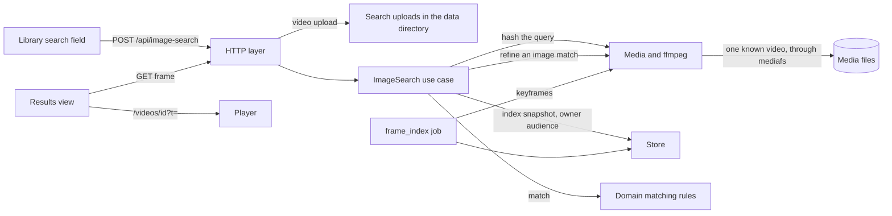
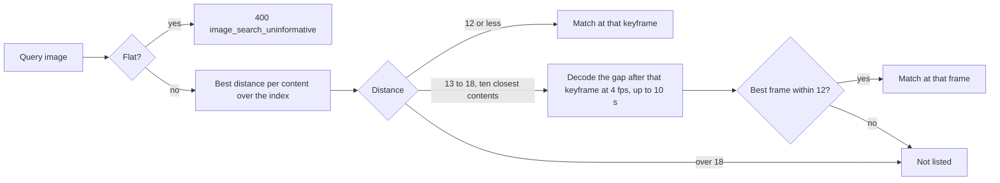
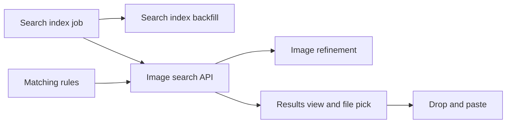

# Implementation Plan: Image search

**Branch**: `feature/074-image-search` | **Parent Issue**: #1927

**Input**: The parent Issue. It is this feature's specification.

## Summary

The owner drops, pastes or picks an image or a video in the library search
field and gets the videos that contain the same footage, each with a match
rate and the matched frame or section, which plays from that position. A new
per-content **search index** holds a hash of every keyframe, built by a
background job from one sequential read of the file. The search hashes the
query the same way as the existing video fingerprint
([seek-sprite-generation.md](../../docs/design-docs/seek-sprite-generation.md#frame-size-and-quality)),
compares it with the index in memory and keeps nothing it was given.

The diagram shows the parts this feature adds and what each one reads.



## Technical Context

**Canonical definitions**: [ARCHITECTURE.md](../../ARCHITECTURE.md) for
layers, store roles, the file-opening and generated-file owners and the
audience rule; [duplicate-judging.md](../../docs/design-docs/duplicate-judging.md)
and [`internal/domain/fingerprint.go`](../../internal/domain/fingerprint.go)
for the frame hash and its match distance;
[`internal/media/fingerprint.go`](../../internal/media/fingerprint.go) for
black-band trimming and shrinking;
[job-scheduling.md](../../docs/design-docs/job-scheduling.md) for job kinds,
slots and priority classes;
[process-lifecycle.md](../../docs/design-docs/process-lifecycle.md#backfills-run-as-jobs-after-the-listener-opens)
for startup backfills; [library-ui.md](../../docs/design-docs/library-ui.md)
for the library toolbar and search field;
[authentication.md](../../docs/design-docs/authentication.md) for owner-only
operations; [api/openapi.yaml](../../api/openapi.yaml) for the screen API.

**Feature-specific context**:

| Item | Delta |
| --- | --- |
| Existing fingerprint | At most 81 frames per video (one per `max(1 s, duration / 81)`), so a screenshot of an arbitrary moment of a long video rarely lands on one of them; the search does not use it ([Search index](#search-index)) |
| Keyframe spacing | The x264/x265 default is 250 frames, 8.3 s at 30 fps, and some files have keyframes only at scene changes ([live-transcode-seek.md](../../docs/design-docs/live-transcode-seek.md#bounded-keyframe-sampling)); image matches between keyframes are refined from the file ([Image queries](#image-queries)) |
| Scale assumption | 10,000 videos averaging 30 minutes with a keyframe every 3 s: about 6 million index entries, 72 MB, read once per search |
| New storage | Table `video_search_index` keyed by content key, rebuildable ([data-model.md](data-model.md)) |
| New job kinds | `frame_index` and `queue_frame_index` ([Search index](#search-index)) |
| Upload limits | Images under the thumbnail upload limits (64 MiB, 120 million pixels, PNG, JPEG or still WebP); videos up to 4 GiB and 3 hours ([contracts/image-search-api.md](contracts/image-search-api.md)) |
| External API, MCP, peers | Unchanged; the operation is screen API only and reads this node's index (the Issue's `対象外`) |

## Constitution Check

*GATE: Must pass before Phase 0 research. Re-check after Phase 1 design.*

| Rule | Source | Verdict |
| --- | --- | --- |
| Dependency direction | ARCHITECTURE.md | Matching rules are pure functions in `internal/domain`; `internal/app` (`ImageSearch`) reaches the index, ffmpeg, the upload area and file resolution through interfaces it declares; adapters stay unaware of each other |
| The domain decides, the store enforces | ARCHITECTURE.md | `video_search_index` is written only by `IngestStore.ApplySearchIndexForJob`, which re-checks the claimed content and location as `ApplyFingerprintForJob` does |
| Store roles | ARCHITECTURE.md | Writes belong to `IngestStore`; the search's snapshot read and the unindexed count belong to `LibraryStore` |
| One owner for opening files | ARCHITECTURE.md | The `frame_index` job and the image refinement open one known video through `internal/mediafs`; the invariant's list of such reads gains both ([Search index](#search-index), [Image queries](#image-queries)) |
| Only a scan walks the media folders | ARCHITECTURE.md | Neither reads a directory; both read one known video |
| One owner for generated files | ARCHITECTURE.md | `internal/artifacts` owns the search-upload area, including its removal ([Uploads leave nothing behind](#uploads-leave-nothing-behind)) |
| User data survives a rebuild | ARCHITECTURE.md | `video_search_index` is a rebuildable index keyed by content key and released with it, like `video_fingerprints`; no user data is added |
| Every read knows its viewer | ARCHITECTURE.md | The operation is owner-only in `api/openapi.yaml`, so the routing test covers it; the snapshot read takes the owner's `domain.Audience`, which leaves switched-off folders out (requirement 8) |
| Pages never call `fetch` | ARCHITECTURE.md, Web layer | `web/src/api/imageSearch.ts` is the only caller |
| Generated files are not hand-edited | AGENTS.md | `api/openapi.yaml` changes, then `task generate` |
| Complexity 25 and no copies | AGENTS.md | Index hashing reuses the fingerprint's trimming, shrinking and `domain.HashFrame`; image decoding reuses the thumbnail upload's decoder and limits ([Shared code](#shared-code)) |
| Design system first | AGENTS.md, design-system.md | The `ui` label sends the screens through `design`; the search field's drop and paste behaviour and the results view are drawn there before implementation |

No gate is at stake after Phase 1; `## Complexity Tracking` is left out.

## Search index

Every video content with a file gets one `video_search_index` row: the time
and the 64-bit hash of each keyframe, hashed by the fingerprint's rule
(black bands trimmed, 32×32 luma, `domain.HashFrame`), with flat frames left
out ([data-model.md](data-model.md)).

| Decision | Rejected | Why |
| --- | --- | --- |
| Index every keyframe, read in one sequential pass (`ffmpeg -skip_frame nokey`), frames scaled to 320 px on the long side in gray | Use the existing 81-frame fingerprint | Its frames are up to 1/81 of the video apart (44 s in an hour), so most screenshots have no frame of their scene to match (requirement 3, acceptance 1) |
| Same | Decode every frame and keep one per second | A full decode of an hour of 1080p H.264 costs minutes of CPU per video; over a library it is days of background CPU, against one read per file for keyframes |
| Same | Seek to each keyframe from the packet index, as seek sprites do | One random read per keyframe; with thousands of keyframes per video a sequential pass reads less time on spinning disks ([seek-sprite-generation.md](../../docs/design-docs/seek-sprite-generation.md#speed-and-limits)) |
| Keep keyframes at least 1 s apart, at most 20,000 per content (a longer video keeps one per `duration / 20,000`) | Keep every keyframe | Videos encoded with a keyframe every few frames would grow the index without adding scenes; 20,000 covers 5.5 hours at the 1 s floor |
| Drop flat frames when building | Store them with a flag, as the fingerprint does | Nothing searches for a flat frame, and an uninformative query is refused before matching (the Issue's edge case) |
| `frame_index` is a background kind outside import tracking: the probe result's transaction queues it at backfill class, and `queue_frame_index` queues it at startup for each content without a current-version row | An import stage | The import would wait for a whole-file read and every activity pipeline would gain a stage for an index only search reads |
| Same | Build only while a setting is on | Requirement 8 searches every enabled folder's videos; a switch would leave the search empty until the owner finds it |
| Demand one read slot and one CPU slot, concurrency 1 | CPU only, like `fingerprint` | It reads the source file |
| `SearchIndexVersion` starts at 1; a row of another version counts as missing, and `queue_frame_index` rebuilds it | Rebuild on a fingerprint version bump | The two hashes are versioned apart so that changing one does not reread every file for the other |
| A forced rescan does not queue it again; a content change does, through the new content key's probe | Rebuild on every forced rescan | The index is a function of the content, which a forced rescan of the same content does not change |
| The row is deleted in `releaseContentIndex` with the content's fingerprint | A sweep of orphan rows | The existing release already runs in the transaction that removes the last reference |

Videos with no `video_search_index` row of the current version are not
searched; their count comes with every result (requirement 8).

## Image queries

An image query is one hash; a content matches at its nearest indexed
keyframe, and a near miss is checked against the frames between keyframes.



| Decision | Rejected | Why |
| --- | --- | --- |
| A match is a distance of at most 12 of 63 bits (`FingerprintMatchMaxDistance`) | A looser limit | Two unrelated random hashes are within 12 bits once in 2.7 million comparisons but within 18 once in 2,200, which over 6 million entries would list thousands of unrelated videos (requirement 4) |
| Contents whose best keyframe is 13 to 18 bits away, at most the ten closest, are refined by decoding the source from that keyframe to the next index entry, at most 10 s, at 4 frames a second | Listing only keyframe matches | A screenshot taken several seconds after the preceding keyframe in a moving shot misses by more than 12 bits, and acceptance 1 expects the video first |
| Same | Refine every content | Each refinement opens a file; ten bounds a search to ten short decodes |
| The match rate is `(63 − distance) / 63`, so a listed image match is 81% or more | The share of matching frames | A single image has one frame, which would make every match 100% and leave nothing to rank by |
| The matched position is the keyframe's or the refined frame's time | The keyframe time always | Playback starts at the scene the owner asked for, not up to 10 s before it (requirement 6) |
| PNG, JPEG and still WebP are decoded in memory with the thumbnail upload's decoder and limits; any other file is treated as a video | Decode other image formats with ffmpeg | Screenshots and clipboard images are PNG or JPEG, and the existing decoder already refuses animation and oversized pixels |

## Video queries

A video query is sampled densely, and the index's keyframes are compared
with the query frame nearest to them under one time offset.

| Decision | Rejected | Why |
| --- | --- | --- |
| Decode the query at 1 frame a second (at most 10,800), hashed as the index is | Keyframes of the query | The two files' keyframes fall at different times; with a dense query every indexed keyframe has a query frame within 0.5 s |
| Seeds: one non-flat query frame per 10 s, at least 64 (all, when fewer) and at most 512, each compared with every index entry; a seed within 12 bits votes for (content, offset), offsets binned by 2 s | Compare every query frame with every entry | 10,800 × 6 million comparisons take minutes; 512 seeds take seconds, spread over the CPUs |
| A (content, offset bin) with two votes, or one when the query has a single seed, is verified: every index entry of the content inside the overlap is compared with the query frame within 0.5 s of it at that offset, and the offset with the most matching entries is kept | Accept the votes as the result | Votes say where to look; the rate must count the whole overlap |
| Match rate: matching entries ÷ compared entries in the overlap; listed at 50% or more with at least 3 compared entries (`FingerprintMinComparableFrames`) | The versions frame rule (at most 5% differ) | A partial copy with a logo or subtitles differs in more frames and is still the same footage (requirement 3) |
| Each index entry stands for the span up to the next entry; the first entry's span starts at 0 and the last one's ends at the video's end. The matched section runs from the start of the first matching entry's span to the end of the last one's, on the result video's timeline, and the query's section is the same span under the offset, clipped to the query | The first to the last matching entry's time | With keyframes 8 s apart, a 30 s video whose every entry matches would cover only 0 to 24 s, 80%, and a whole re-encode would read as partial |
| Playback starts at the first matching entry's time | The section's start | The section of a first entry starts at 0, which may be before the matched keyframe (requirements 5, 6) |
| Whole match when the matched section covers at least 90% of both the result video and the query; otherwise partial | Equal durations | A re-encode trims or pads a few seconds at the ends; 90% of each side still means one is not a part of the other (requirement 7, acceptance 3 and 4) |
| Up to 4 GiB and 3 hours | A few minutes | Acceptance 3 passes a whole re-encoded video; 3 hours is 10,800 sampled frames |

## Results

| Decision | Rejected | Why |
| --- | --- | --- |
| One entry per listed library item: version bundle members collapse to the listed representative, which carries the best member's match; the match names the member it was found in, and playback opens that member at the match position | Play the representative at the member's position | Versions can be shifted by seconds, so the position belongs to the member that matched (requirement 9) |
| Groups are not collapsed; a grouped video is listed on its own | Show the group card | A group card has no single video or position to play |
| Ordered by match rate, then matched section length, then the newer video; at most 50 entries | Paging | The list ends where the rate falls under the threshold; 50 is more than one screen at every zoom |
| The unindexed count is the number of file videos visible to the owner, including bundle members, without a current-version index row | Count listed items | A member without an index is a place the search did not look, even when its representative has one |
| The matched frame is shown with the existing owner-only `GET /api/videos/{id}/frame` | A new frame endpoint or stored thumbnails | It already cuts a frame at a position through `internal/mediafs`; results are owner-only too |

## Uploads leave nothing behind

The request body is read as one multipart part. An image stays in memory; a
video is written to `MDM_DATA_DIR/search-uploads/` through `internal/artifacts`,
read there by `ffprobe` and `ffmpeg`, and deleted when the request ends,
whether it succeeded, failed or was cancelled.

| Decision | Rejected | Why |
| --- | --- | --- |
| Video uploads go to a file in the data directory | Pipe the upload to ffmpeg | An MP4 with its index at the end cannot be read from a pipe |
| Same | The OS temporary directory | In a container it is often a small tmpfs, and acceptance 7 names the data area as the place to check |
| Startup empties `search-uploads/` before the listener opens | Rely on deferred removal only | A crash or kill during a search would otherwise leave a file (requirement 10) |
| A cancelled request (the client aborts) ends ffmpeg and removes the file | Finish the search in the background | The Issue's edge case discards a search the owner replaced or left |
| One search runs at a time; a second request waits, and its wait ends when it is cancelled | Run searches in parallel | Each search reads the whole index and may decode a long video; the client cancels its previous request before sending the next |
| One synchronous request returns the result | A search job with polling | Nothing must survive the request, and the screen shows only that the search is running |

## Library search field

The owner's search field on the library page (`/`) accepts a file; folder,
group and smart-folder pages and guests are unchanged. The visuals, states and
widths are decided in `ui-design.md`.

| Decision | Rejected | Why |
| --- | --- | --- |
| Drop on the search field, paste into the focused field, or a pick-file control in the field start a search | A separate image search page | Requirements 1 and 2 put the entry in the library search field |
| A paste with an image or a file in the clipboard starts a search and inserts no text; a paste of text only keeps the default | Starting a search for any paste with files and text | Acceptance 2: pasting text types it |
| Files dropped elsewhere on the library page are refused without navigating: the page cancels the browser's default of opening the file | Leave the browser default | The page would be replaced by the file, which is not "the search does not start" (acceptance 5) |
| More than one file, or a file that is neither an image nor a video by its type, is refused in the browser before uploading; the server refuses them too | Server-side checks only | Uploading a 4 GiB file to be told it is two files wastes the upload |
| Image search state lives in memory, keyed by the history entry, and is not in the URL; returning from the player restores the results | Nothing restored | Checking several results means going back and forth to the player (requirement 6) |
| Same | Put the query in the URL | The file cannot be in the URL, and it must not be kept on the server (requirement 10) |
| A new file, clearing the image search, a text search or leaving the page aborts the running request | Let it finish | The Issue's edge case discards it |

## Shared code

| Shared piece | Used by |
| --- | --- |
| `media` luma plane, black-band trimming and 32×32 shrinking, exposed as one function from a gray frame to `domain.FrameHash` | Fingerprints from sprites, the `frame_index` job, query images and videos, image refinement |
| `domain.HashFrame`, `FingerprintMatchMaxDistance`, `FingerprintMinComparableFrames` | Fingerprints and the search |
| The thumbnail upload's decoder and limits in `internal/app` | Thumbnail, person and work-info cover uploads, and image queries |

## Project Structure

### Documentation (this feature)

```text
specs/074-image-search/
├── plan.md              # This file
├── data-model.md        # video_search_index and the job kinds
├── quickstart.md        # Acceptance checks with real videos
└── contracts/
    └── image-search-api.md   # POST /api/image-search
```

No `research.md`: every choice above is settled from the repository's own
measurements and documents, which the decision rows link.
`ui-design.md` is added by the `design` stage.

### Source Code

**Affected boundaries**:

| Package | Change |
| --- | --- |
| `internal/domain` | `SearchIndex` encoding and version, image and video matching, the result order, the job kinds and their demand |
| `internal/store` | Migration, `IngestStore.ApplySearchIndexForJob`, the probe-result queueing, `queue_frame_index` selection, the release, `LibraryStore` index snapshot and unindexed count |
| `internal/media` | Keyframe hashes of a file, query frames of a video, the refinement decode, the shared frame hash |
| `internal/artifacts` | The search-upload area and its startup emptying |
| `internal/app` | `ImageSearch` use case, the `frame_index` handler and the `queue_frame_index` backfill |
| `internal/httpapi` | `POST /api/image-search` |
| `cmd/mdm` | Wiring and the startup emptying |
| `web/src/api`, `web/src/videoList/SearchBox`, `web/src/library` | Client, the field's file entry, the results view |

**New paths**: `internal/domain/search_index.go`, `internal/domain/image_search.go`,
`internal/store/search_index.go`, `internal/media/search_index.go`,
`internal/artifacts/search_uploads.go`, `internal/app/image_search.go`,
`internal/app/search_index.go`, `internal/httpapi/image_search.go`,
`web/src/api/imageSearch.ts`, `web/src/library/imageSearch/`,
`docs/design-docs/image-search.md`.

**Structure decision**: Follows the existing layout
([ARCHITECTURE.md](../../ARCHITECTURE.md#intended-dependency-direction)).

## Implementation Work

The graph shows the units and what each waits for.



### Build a keyframe search index for each video content

**Scope**: [Search index](#search-index) and [data-model.md](data-model.md):
`SearchIndex` type, encoding and version; the migration; the shared frame
hash in `internal/media` ([Shared code](#shared-code)) and the keyframe
reader; the `frame_index` kind, its demand and handler;
`ApplySearchIndexForJob`; queueing from the probe result; release with the
content. Updates job-scheduling.md's kind tables and ARCHITECTURE.md's
file-reading list.

**Dependencies**: None

**Acceptance**: A media test on a generated fixture video with keyframes
every 2 s returns entries 2 s apart whose hashes equal the frame hash of
the same frames from the sprite path, and none for a black section. Domain
tests show encode and decode round-trip and the 1 s floor and 20,000 cap. A
store test shows a probe result queues one backfill-class `frame_index` job,
a stale job (content or location changed) writes nothing, and releasing the
last reference deletes the row. The existing fingerprint tests pass
unchanged after the hash is shared.

### Backfill the search index for videos imported before it existed

**Scope**: `queue_frame_index` at startup and its handler, selecting
contents with a file and without a current-version row
([Search index](#search-index)); process-lifecycle.md's backfill list.

**Dependencies**: Build a keyframe search index for each video content

**Acceptance**: A store test with contents that have a current row, an
old-version row, no row, and no file shows jobs queued for exactly the
old-version and no-row contents at backfill class, and a second run queues
none while they are queued.

### Match an image or video query against the search index

**Scope**: Pure functions in `internal/domain/image_search.go`:
[Image queries](#image-queries) up to the refinement choice (which contents
to refine), [Video queries](#video-queries) (seeds, votes, verification,
rate, section, whole or partial) and the order and limit of
[Results](#results).

**Dependencies**: None

**Acceptance**: Table tests on hand-built hashes: an image at distance 12 is
listed and at 13 goes to refinement; refinement takes at most the ten
closest; a query identical to an index with shifted keyframe times is a
whole match at 100%; a 30 s video with keyframes at 0, 8, 16 and 24 s
matched in full is a whole match whose section is 0 to 30 s; a query that is the middle third of an indexed content
is a partial match whose section is that third; an index that is a third of
a longer query is a partial match; under 3 compared entries or under 50%
is not listed; order breaks ties by section length then the newer video.

### Search the library by an uploaded image or video

**Scope**: [contracts/image-search-api.md](contracts/image-search-api.md):
the operation in `api/openapi.yaml` and `task generate`; the handler; the
`ImageSearch` use case (query hashing, index snapshot under the owner's
audience, matching, collapse to listed items, unindexed count, one search
at a time); query frames of a video in `internal/media`; the search-upload
area and its startup emptying ([Uploads leave nothing behind](#uploads-leave-nothing-behind));
`web/src/api/imageSearch.ts`. Adds `docs/design-docs/image-search.md` with
the decisions above, linked from the index, and its row in ARCHITECTURE.md's
subsystem map. Image matches in the 13 to 18 range are not refined yet.

**Dependencies**: Build a keyframe search index for each video content;
Match an image or video query against the search index

**Acceptance**: Handler tests with a fake use case: a guest gets 401; two
files, an unreadable file, an oversized image and a too-long video get their
codes; the response maps the result fields. Use-case tests with fakes: a
switched-off folder's match is left out, bundle members collapse to the
representative with the member's id and position, the unindexed count is
returned, and a cancelled context removes the upload. An `internal/media`
test on a fixture video: frames sampled 1 s apart. An artifacts test: startup
empties the area. With the real stack in a handler test, a PNG frame cut
from a fixture video at a keyframe returns that video first; the upload
directory is empty after the response.

### Refine image matches between keyframes from the source file

**Scope**: The refinement in [Image queries](#image-queries): the decode
from a keyframe to the next index entry at 4 fps in `internal/media`, opened
through `internal/mediafs`, and its call from `ImageSearch` for the ten
closest contents; a file that cannot be opened is skipped.

**Dependencies**: Search the library by an uploaded image or video

**Acceptance**: A media test on a fixture video with keyframes 8 s apart
and moving content: a frame cut 6 s after a keyframe is over 12 bits from
that keyframe and within 12 of a refined frame, whose time is returned
within 250 ms of 6 s. A use-case test shows at most ten refinements and a
missing file leaving that content out without failing the search.

### Show image search results on the library page, with a pick-file control

**Scope**: The results view and the search field's pick-file control on the
owner's library page, as `ui-design.md` draws them: running state, the query
shown in the field with a control back to text search, results with match
rate, matched frame or section, whole or partial, the unindexed count, no
match, refusals with their reason, playback at the position, restoring after
returning from the player, aborting on a new file, a text search or leaving
([Library search field](#library-search-field), [Results](#results)).
Updates library-ui.md.

**Dependencies**: Search the library by an uploaded image or video

**Acceptance**: Component tests with a fake API: a picked file sends one
request and shows the running state; a result opens `/videos/{memberId}?t=`
at its position; a new file aborts the previous request; going to the player
and back shows the same results without a request; no match shows the
unindexed count; a guest has no control. Visual review of the states at the
widths in `ui-design.md`.

### Start an image search by dropping or pasting a file on the library search field

**Scope**: Drop on the field with its drag-over state, paste of an image or
file into the focused field, refusal of drops elsewhere on the library page
without navigation, and the browser-side refusal of several files or a file
that is not an image or a video ([Library search field](#library-search-field)).

**Dependencies**: Show image search results on the library page, with a
pick-file control

**Acceptance**: Component tests: a drop on the field and a paste of an image
start one search with that file; a paste of text inserts the text and sends
nothing; a drop outside the field sends nothing and the page stays; two
files or a text file show the reason and send nothing. An e2e spec on the
fixture library drops a frame cut from a fixture video and plays the first
result at its position. Visual review of the drag-over state.
