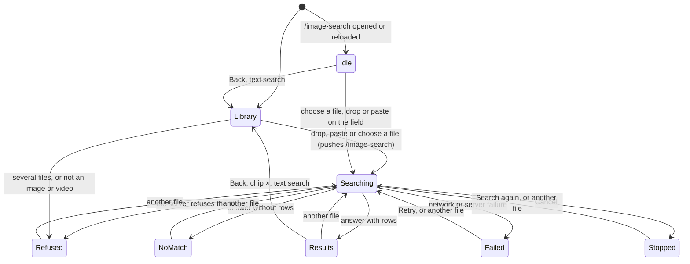
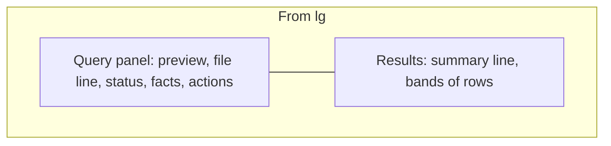
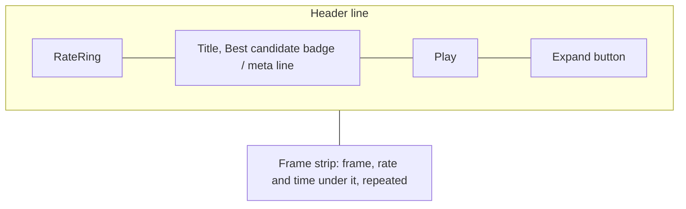

# UI design: Image search

Sources: parent Issue #1927;
[design-system.md](../../docs/design-docs/design-system.md) and its rules
([patterns.md](../../web/registry/rules/patterns.md),
[components.md](../../web/registry/rules/components.md),
[foundations.md](../../web/registry/rules/foundations.md));
[library-ui.md](../../docs/design-docs/library-ui.md#image-search) for the
search field and the results as built;
[image-search.md](../../docs/design-docs/image-search.md) for what a search
returns today; the current screens `web/src/library/imageSearch/`,
`web/src/videoList/SearchBox.tsx` and `web/src/ui/ImageUploadDialog.tsx`; the
screen text in [web/src/i18n/en.ts](../../web/src/i18n/en.ts)
(`library.imageSearch`).

This is a revision. The first design drew the results as library cards in the
library's `ListPage`; the maintainer rejected that after using it. The entry
(the search field, its drop, paste and dialog) is unchanged and stays as
[library-ui.md](../../docs/design-docs/library-ui.md#image-search) records it.
Everything from the moment a file is accepted is redesigned here.

## Why this shape

The task is "which video, and where in it, is this picture or clip". The
owner compares the file with each candidate, so the file has to stay in view
at a size that can be compared, and each candidate has to show its evidence:
how close, how many frames, at what times. A library card answers none of
that: it shows one frame, the file is a chip 32 px high, and a toolbar of
disabled controls takes the top of the screen.

| Decision | Rejected | Why |
| --- | --- | --- |
| A screen of its own at `/image-search`, pushed as a history entry when a search starts | Results in the library's `ListPage` body (the first design) | The library body is a card grid sized by zoom, with a toolbar that does not apply. Browser Back and the chip's `×` return to the library entry untouched, which the first design had to rebuild by hand |
| The file sits in a query panel beside the results and stays in view | The file only as a chip in the search field | The owner checks each candidate against the file; a chip cannot be compared with anything |
| One row per video, holding every matched frame the server returns | One card per matched frame | The answer is a video. Several frames of one video are one answer with more evidence, not several answers |
| Rows grouped in match-rate bands under a heading with the range and a count | One flat list ordered by rate | A band says how far to trust a row before its number is read, and where the certain matches end |
| The band boundaries, and how many frames a row has, come from the server | Thresholds or a frame count fixed in the screen | The accuracy decision is on hold. A row works with one frame or many, and a band is drawn only when it has rows |
| The search field stays the only place that takes a dropped or pasted file | A drop zone in the query panel | Requirement 1 limits the drop to the search field. The panel offers `Choose another file…`, which opens the existing dialog |
| The rate and time of a frame are a caption under it | Text over the image, as the reference does | [VideoThumbnail](../../web/registry/rules/components.md#videothumbnail) allows only the duration, the notice and the credits on an image |

## Additions to the design system

No registry skeleton has a subject that stays beside its items: `ListPage`'s
`aside` is a right-hand column read after the body, and `ProfilePage` puts the
subject above. The implementation adds these to the registry, with rules and
an example block, before the screen uses them.

| Addition | Tier | What it is |
| --- | --- | --- |
| `QueryResultsPage` (`query-results-page`) | Page skeleton | A shell page at library density: `header`, a `query` column at the start and the results as children. Layout in [Layout](#layout) |
| `ResultBand` | Part of the skeleton | A band of rows: an `h2` (`text-sm font-semibold`) with a `detail` after a `·` in `text-xs` muted and a count at the row's end, then its rows `gap-3` apart; bands `gap-6` apart. Headings do not stick |
| `ResultRow` (`result-row`) | Section | One candidate on `card` with a `border` line and `rounded-md`: a header line (`mark`, `title`, `meta`, `actions`, then the expand button) and a body shown while expanded, under one `border-t`. It uses `Collapsible`; the caller passes `expanded`, `onExpandedChange` and `toggleLabel` as `CardListItem` `members` does |
| `RateRing` (`rate-ring`) | vv component | A `size-12` ring whose arc is `value` of 100, with the whole percent inside in `text-sm font-semibold tabular-nums`. `tone="primary"` draws the arc in `primary`, `tone="muted"` in `muted-foreground`, both on a `muted` track |

Named steps the skeleton adds to `tokens.css`: `query-aside` (the column's
width, wide enough for two `related-thumb` frames side by side),
`query-preview-max` (the preview's greatest height from `lg`, about half the
viewport under the top bar) and `query-preview-max-sm` (below `lg`, about a
third).

`RateRing` has no behaviour: it is not a control, takes no focus and has no
hover state. Its value is that the eye finds the closest rows by the length
of the arc before reading a number. It can be mistaken for a loading ring or
a button, so it never animates, always has its number inside, and sits in the
`mark` slot where a row has no control.

Everything else is an existing item: `PageHeader`, `Button`, `Badge`,
`Progress`, `Spinner`, `Alert`, `Empty`, `Skeleton`, `Collapsible`,
`Tooltip`, `FactList`, `VideoThumbnail`, `SpanBar` and `ImageUploadDialog`.

## Entry and leaving

The owner's library search field and its dialog start a search exactly as
today. What changes is where the search is shown.

- Accepting a file on `/` pushes `/image-search`; the library entry under it
  keeps its filters, scroll and selection. A file given while on
  `/image-search` replaces the search in the same entry, so Back never walks
  through old searches.
- The search lives in memory under its history entry, never in the URL.
  Opening a result and coming back shows the same panel, rows, expanded
  states and scroll position without a request. A reload, or the address
  opened directly, has no file and shows [Idle](#idle).
- The top bar holds only the library search field, with the query chip as
  today. The filter, sort, view and zoom controls are not drawn, because none
  applies. `Enter` with text opens `/` with that text search; the chip's `×`,
  and `Escape` in the empty field, go back to the library entry.
- Every in-app way back to the library (the `Library` button, the chip's
  `×`, `Escape` in the empty field and `Back to library`) returns to the
  library entry the search was pushed from, as browser Back does, only when
  that entry is the one under `/image-search`. When it is not (the address
  opened directly, in a new tab or from another site), they replace
  `/image-search` with `/` instead, so they never leave the app or do
  nothing. Browser Back itself stays the browser's.
- `Cancel`, another file, and leaving the screen abort the request.
- A guest who opens `/image-search` is sent to `/`.

## Layout

`QueryResultsPage` stacks the header and then the query column and the
results, with `p-3` (`p-4` from `sm`) around them.

| Width | Layout |
| --- | --- |
| From `lg` (1024 px) | Two columns `gap-6` apart: the query panel `query-aside` wide at the start, stuck under the top bar and scrolling inside itself when taller than the viewport; the results take the rest |
| Below `lg` | One column: the query panel full width above the results. Collapsed, it is one bar that sticks under the top bar; expanded, it scrolls with the page |

Without a `query` (Idle) the body takes the full width.

The header is a `PageHeader` with the title `Image search`, and as `leading` a
`ghost` `sm` `Library` button with `ArrowLeft`, which goes back to the
library as [Entry and leaving](#entry-and-leaving) defines. It has no count and no actions; it stays in every state.

## Query panel

A `card` surface with a `border` line and `rounded-md`, `p-3`, its parts
`gap-3` apart, top to bottom:

| Part | Content |
| --- | --- |
| Preview | An image at its own ratio, as wide as the panel and no taller than `query-preview-max`, on `muted`, never cropped. A video plays in place, muted, with the browser's controls, from the file in memory; when the browser cannot read it, and for a file that is neither, a `size-8` `Film` or `File` icon on a `muted` `aspect-video` frame |
| File line | The file name in `text-sm font-medium` on one line, truncated with the full name in a tooltip; under it in `text-xs` muted the kind and size: `Image · 1.2 MB`, `Video · 2:31 · 48 MB` |
| Status | One line: an icon, the status in `text-sm font-medium`, and the elapsed time in `text-xs tabular-nums` muted at the line's end. While the search runs, a `Progress` under it |
| Not searched | `{m} videos aren't indexed yet and weren't searched.` in `text-xs` muted, after an answer with `unindexedCount` over 0 |
| Actions | One row of `outline` `sm` buttons, by state |

| State | Icon and status | `Progress` | Elapsed time | Actions |
| --- | --- | --- | --- | --- |
| Uploading (video queries) | `Spinner`, `Uploading… {p}%` | The share of bytes sent | Counts up each second | `Cancel` |
| Searching | `Spinner`, `Searching…` | Indeterminate | Counts up each second | `Cancel` |
| Results | `CircleCheck` in `success`, `Found {n} videos` | None | `Took {time}` | `Choose another file…` |
| No match | `SearchX` in `muted-foreground`, `No match` | None | `Took {time}` | `Choose another file…` |
| Refused | `CircleAlert` in `destructive`, `Not searched` | None | None | `Choose another file…` |
| Failed | `CircleAlert` in `destructive`, `Search failed` | None | None | `Retry`, `Choose another file…` |
| Stopped | `CircleSlash` in `muted-foreground`, `Stopped` | None | None | `Search again`, `Choose another file…` |

The elapsed time is measured by the screen, from the request's start to its
answer; under 10 s it reads to a tenth (`0.8 s`), from there in whole seconds
and then `m:ss`. An image goes straight to Searching, so the bar does not flash a
measure for a blink. `Choose another file…` opens the search-by-file dialog;
the file stays in memory for `Retry` and `Search again` until the entry is
left.

Below `lg` the panel starts with a header line that is its collapsed form:
the preview as a 16:9 thumbnail `h-9` high (an icon for a video), the file
name truncated, the status icon and text, and a `ghost` `icon-sm` button
(`Show your file`, `Hide your file`). The preview there is no taller than
`query-preview-max-sm`. The panel is expanded while Uploading, Searching,
Refused, Failed and Stopped, and collapses when an answer arrives, so the
first rows are on screen; the owner's own toggle then holds for that search.

## Results column

The results column shows the rows or exactly one state block
([States](../../web/registry/rules/patterns.md#states)).

### Idle

`Empty` with `ScanSearch`, the title `Search by an image or a video`, the
description `Find the videos that contain the same footage, and where.` and a
`default` `sm` `Choose a file…`, which opens the dialog.

### Uploading and searching

Three `ResultRow` skeletons under one band-heading skeleton: a ring, two text
lines, and three frame shapes. Never a page-wide spinner.

### Results

A summary line, then the bands in the server's order, strongest first.

The summary line holds `{n} videos` in `text-sm` muted as a status, and at its
end a `ghost` `sm` `Collapse all` or `Expand all`, drawn from two rows up.

A band's heading is its name, its range as `detail` and its row count at the
end: `Strong match · 90–100%` … `3 videos`. The screen has the names; the
server gives each band's id and range. A band without rows is not drawn, and
one band alone still has its heading. Rows keep the server's order inside a
band.

A row, image query:

| Part | Content |
| --- | --- |
| `mark` | `RateRing` with the row's best rate as a whole percent, rounded to the nearest; `tone="primary"` in the first band, `muted` in the others |
| `title` | The video's title in `text-sm font-medium` on one line, a link that plays as `Play` does. After it, on the first row of the results only, a `soft` `Badge` with `Target` and `Best candidate` |
| `meta` | `text-xs` muted: `{k} matching frames · best at {time}` |
| `actions` | `Play` with the `Play` icon and its name at every width: `default` `sm` on the best candidate, `secondary` `sm` on every other row. It opens `/videos/{videoId}?t=` at the best frame's time |
| Expand button | `ghost` `icon-sm`, `Hide frames` or `Show frames` |
| Body | The frame strip |

`Best candidate` is drawn only when the first row's rate, as shown, is above
the second row's, or it is the only row. With a tie the badge is not drawn
and every `Play` is `secondary`, so the screen never names one of two equal
rows the answer.

The frame strip is one line of frames `gap-3` apart, each `related-thumb`
wide, in the server's order, the best first. It scrolls sideways inside the
row (swipe, trackpad, Shift+wheel, arrow keys) with no arrow buttons, and the
row's edge cuts the frame that does not fit, so a cut frame says more follow,
as a row [`Shelf`](../../web/registry/rules/patterns.md#sections) does. A
frame is one link:

| Part | Content |
| --- | --- |
| Image | The matched frame in `VideoThumbnail` with `VideoThumbnailImage`, so it loads near the viewport; no duration, mark or hover preview |
| Caption | `text-xs` on one line under the image: `{rate}%` in `font-medium` `foreground`, then the time in `tabular-nums` muted at the line's end |
| Target | `/videos/{videoId}?t=` at that frame's time; the link's name is `Play from {time}` |

The best frame is first and carries the row's rate and time. A row with one
frame draws one frame; the row does not change shape.

Rows are expanded when the answer arrives. A version bundle is one row under
its representative's title; its frames and `Play` belong to the member that
matched, as today.

A row, video query. The header changes its `meta`, and the body starts with
the matched section:

| Part | Content |
| --- | --- |
| `meta` | A `secondary` `Badge` `Whole video` or `Part of video`, then `{start}–{end}` in `text-xs` muted, and `· {k} matching frames` when the row has frames |
| `Play` | Opens at the section's start |
| Body | A `SpanBar` with one block for the matched section on the video's length, with `onPress` playing from the section's start; the lane's ends carry `0:00` and the video's length in `text-2xs` muted `tabular-nums`. Under it the frame strip, when the server sends frames for the row; without frames the `SpanBar` is the whole body |

### No match

`Empty` with `SearchX`, the title `No video has this footage`, and as
description `{m} videos aren't indexed yet and weren't searched.` when over
0, else `Every video in your library was searched.`; the content is an
`outline` `sm` `Choose another file…` and a `ghost` `sm` `Back to library`.

### Refused and failed

A `destructive` `Alert` at the top of the results column, with
`Choose another file…` in `AlertAction`, and `Retry` first for a failure. The
panel's status line names the state in two words; the reason and what to do
are here, where the results would be.

| Cause | Title | Description |
| --- | --- | --- |
| Two or more files | `Search with one file at a time` | `{n} files were given.` |
| Not an image or a video, or unreadable (`image_search_unreadable`) | `This file can't be searched` | `Use a PNG, JPEG or WebP image, or a video.` |
| Too large (`image_search_too_large`) | `This file is too large` | `The limit is {limit}.` |
| Too long (`image_search_too_long`) | `This video is too long` | `The limit is {limit}.` |
| Plain picture (`image_search_uninformative`) | `There's nothing to compare in this file` | `A blank or single-colour picture matches no footage.` |
| Network or server failure | `The search failed` | The error's message; `Retry` shown |

With several files the panel shows the first one. The refusals the screen can
decide by itself (several files, a type that is neither) are shown without a
request.

### Stopped

After `Cancel`: `Empty` with `CircleSlash`, the title `Search stopped`, and an
`outline` `sm` `Search again`.

## Keyboard and focus

| Key or event | Effect |
| --- | --- |
| The screen opens from a search | Focus stays in the search field, where the file was given; from the dialog it goes to the page title (`titleRef`) |
| An answer arrives | Focus does not move; the summary line and the panel's status are announced as statuses |
| `Tab` | Search field, `Library`, the panel's controls, `Collapse all`, then per row: title, `Play`, expand button, frame strip |
| `Tab` into a frame strip | One stop per strip, on the frame last focused there, else the first |
| `ArrowLeft`, `ArrowRight`, `Home`, `End` in a strip | Move between frames and scroll the focused frame into view |
| `Enter` on a frame or a `SpanBar` block | Plays from that time |
| `Enter` or `Space` on the expand button | Toggles the row; focus stays on the button |
| `Escape` in the empty search field | Back to the library, as the chip's `×` |
| Back from the player | Focus returns to the frame, block or `Play` that opened it |

Every control shows the shared focus ring; a focused frame shows it around
its image and caption together.

## Words

New and changed text in `t.library.imageSearch`. Text of the search field,
the dialog and the refusals stays as `en.ts` holds it. Removed with the old
results: `matches`, `rate`, `at`, `notUsed`, `clear` as the no-match action.

| Place | Text | Notes |
| --- | --- | --- |
| Header | `Image search` / `Library` | Title; the back button |
| Panel, file line | `Image`, `Video`, `File` | Then the size, and a video's length, in the existing formats |
| Panel, status | `Uploading… {p}%`, `Searching…`, `Found {n} videos`, `No match`, `Not searched`, `Search failed`, `Stopped` | Plural form for `n` |
| Panel, time | `Took {time}` | `0.8 s`, `12 s`, `1:05` |
| Panel, not searched | `{m} videos aren't indexed yet and weren't searched.` | Existing `unindexed` |
| Panel, actions | `Cancel`, `Retry`, `Search again`, `Choose another file…` | |
| Panel toggle | `Show your file` / `Hide your file` | Below `lg`; label and tooltip |
| Idle | `Search by an image or a video` / `Find the videos that contain the same footage, and where.` / `Choose a file…` | |
| Summary | `{n} videos`, `Collapse all`, `Expand all` | |
| Band | `Strong match`, `Similar`; detail `{min}–{max}%`; count `{n} videos` | One name per band id the plan defines |
| Row | `Best candidate`, `{k} matching frames · best at {time}`, `Play`, `Show frames`, `Hide frames` | Plural form for `k` |
| Row, video query | `Whole video`, `Part of video`, `{start}–{end}` | Existing |
| Frame | `{rate}%`; link name `Play from {time}` | |
| `SpanBar` | Lane `Matched section`, block `Play from {start}` | Existing |
| No match | `No video has this footage` / `Every video in your library was searched.` / `Choose another file…` / `Back to library` | |
| Stopped | `Search stopped` | |

`Image search` stays the screen's name for a search by an image or a video
(W-8). A row is a `video`, never a `match` or a `result`: the count is of
videos, and frames are counted inside a row.

## Review criteria

Judge at 375, 768, 1280 and 1920 px wide, owner signed in, with an image
query and a video query, and with rows of one frame and of eight or more.

1. At 1280 and 1920 px the file and the first row's frames are on screen
   together without scrolling, and the file's preview is the largest picture
   on the screen. Scrolling the results to the end keeps the preview in view.
2. At 375 and 768 px, after an answer the collapsed panel bar and at least
   the first row's header and frames are on screen without scrolling, and the
   bar stays under the top bar while the rows scroll.
3. A portrait image and a 16:9 image are both shown whole, with no cropping
   and no stretched frame.
4. In a row the eye goes ring, title, `Play`: the ring's number is the
   heaviest text in the row, the meta line is quieter than the title, and no
   row but the best candidate has a cyan button.
5. Band headings read as headings of their rows: the gap above a heading is
   wider than the gap between rows, and the range and count are quieter than
   the name.
6. A first-band ring is cyan and a lower-band ring is grey, at the same size
   and position in every row, so the column of rings lines up down the page.
7. A row with one frame and a row with eight have the same header and the
   same frame size; the eighth frame is cut by the row's edge at 1280 px, and
   the strip scrolls without moving the page sideways.
8. Each frame's rate and time are under its image, on one line, and the first
   frame's values equal the ring and `best at`.
9. With two rows at the same shown rate, no `Best candidate` badge and no
   cyan `Play` appears.
10. A video query's row shows whole or part, the section's times, and a
    `SpanBar` block where the section is on the video's length; a whole match
    fills the lane.
11. While searching, the panel shows the file, a moving bar and a time that
    counts up; the results column shows row skeletons. A 1 GB video shows the
    upload percentage before `Searching…`.
12. After an answer the panel says how many videos were found and how long it
    took, and names the videos not searched when there are any; no bar
    remains.
13. A refusal names its reason and offers `Choose another file…` in the
    results column, the panel keeps the refused file in view, and no toast
    appears.
14. The top bar has the search field with the chip and nothing else; the
    `Library` button, the chip's `×` and browser Back each show the library
    with the filters and scroll it had; with `/image-search` opened
    directly in a new tab, the `Library` button and the chip's `×` open `/`
    and stay in the app.
15. After opening a frame and going back, the panel, the rows, which rows are
    collapsed and the scroll position are the same.
16. Reloading `/image-search` shows Idle with one `Choose a file…`; dropping a
    file anywhere but the search field starts nothing.
17. With the keyboard alone, `Tab` reaches each row in three stops plus one
    for its strip, the arrow keys move along the strip, and `Enter` plays
    from the focused frame.
