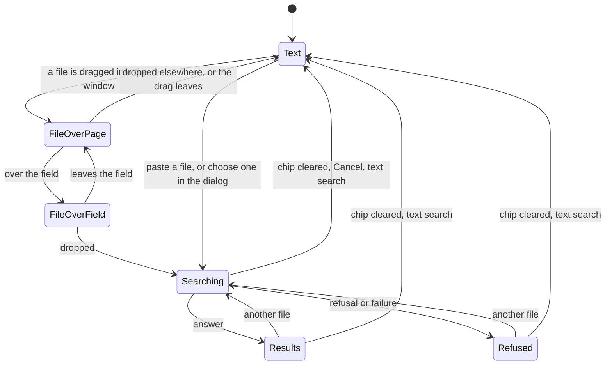
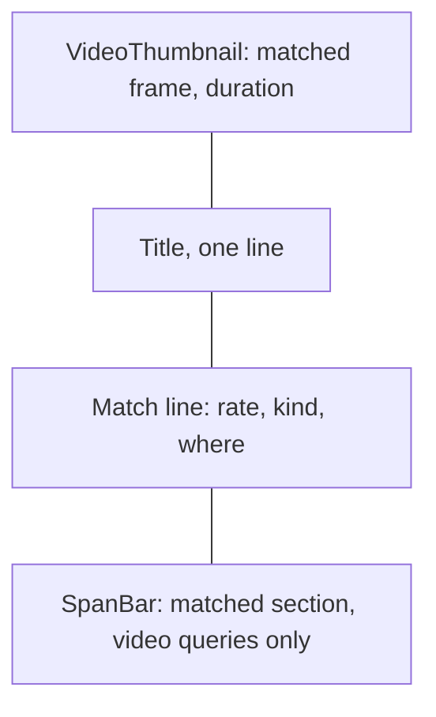

# UI design: Image search

Sources: [plan.md](plan.md), its
[Library search field](plan.md#library-search-field) and
[Results](plan.md#results);
[design-system.md](../../docs/design-docs/design-system.md) and its rules
([patterns.md](../../web/registry/rules/patterns.md),
[components.md](../../web/registry/rules/components.md),
[foundations.md](../../web/registry/rules/foundations.md));
[library-ui.md](../../docs/design-docs/library-ui.md) for the top-bar toolbar,
the card grid, zoom and the search field; the current screens
`web/src/library/LibraryPage.tsx`, `web/src/videoList/SearchBox.tsx` and
`web/src/ui/ImageUploadDialog.tsx`; the screen text in
[web/src/i18n/en.ts](../../web/src/i18n/en.ts) (`list.search`, `library`,
`common.imageUpload`).

## Why this shape

The search field is the one entry: the owner drops a file on it, pastes into
it, or presses its search-by-file button, and the field then shows the file
as a chip, so the field says which search the list below answers. The results
replace the library's body in the same `ListPage`, as text search results do,
so the header and the toolbar do not move and clearing the chip returns to
the library where it was. Rejected: a separate results page, because the
Issue puts the entry in the library search field and returning to text
search would be a navigation instead of clearing a chip.

This design narrows two existing rules:

| Rule | This design | Why |
| --- | --- | --- |
| [components.md, ImageUploadDialog](../../web/registry/rules/components.md#imageuploaddialog): "Do not take files dropped or pasted on the page itself" | The library search field takes a dropped file and a file pasted into the focused field; nothing else on the page does | Requirements 1 and 2 put the drop and the paste on the search field. The exception is written into the rule, naming the field |
| `ImageUploadDialog` takes images, with image wording in its zone | It takes an optional `zone` and `zoneHint`, so the search-by-file dialog says "image or video" | The dialog's drop zone, picker and paste are what the pick-file control needs; a second dialog would copy it |

## Search field

The owner's library search field (`SearchBox` on `/`) gains file intake. Folder,
group and smart-folder pages, and guests, keep today's field.

| State | Field |
| --- | --- |
| Text | As today, plus an `icon-sm` ghost button with `ScanSearch` before the syntax help, tooltip and label `Search by image or video`; it opens the [search-by-file dialog](#search-by-file-dialog) |
| File over the page | The field's outer frame turns `border-primary` with a dashed edge, and the placeholder reads `Drop here to search by this file`; the rest of the page does not change |
| File over the field | The frame stays `border-primary`, solid, and the field fills with `primary-soft`; the `ScanSearch` icon replaces the search icon in `primary` |
| Searching, Results, Refused | A query chip at the field's start replaces the search icon; the text input keeps the rest of the width with the placeholder `Or search by text` |

The query chip is a `Badge` `secondary` holding, in order: a 16:9 preview of
the file at the field's inner height (an image's own picture; a `Film` icon
on `muted` for a video), the file name truncated to one line, and a `×`
button labelled `Clear image search`. Below `sm` the name is not drawn; the
preview and `×` remain. The chip never takes more than half the field.

| Input | Effect |
| --- | --- |
| A file dropped on the field | Starts a search with it |
| A file dropped anywhere else on the page | Nothing: the page stays, no search starts, nothing is shown |
| Paste into the focused field with an image or a file in the clipboard | Starts a search; no text is inserted |
| Paste of text only | Inserts the text, as today |
| `Enter` with text while the chip shows | Clears the chip and runs the text search |
| `Escape` with no text while the chip shows | Clears the chip, as `×` does |
| `×` on the chip | Ends the image search; the library returns as it was before it |

Two or more files, or a file whose type is neither an image nor a video, are
refused without a request: the chip shows the first file and the body shows
the refusal ([Refused](#refused)).

## Search-by-file dialog

`ImageUploadDialog` titled `Search by image or video`, with the description
`PNG, JPEG or WebP images up to 64 MB, or a video up to 4 GB and 3 hours. The
file is used for this search only and is not kept.` Its zone reads `Drop an
image or a video here, or click to choose a file` and the hint `You can also
paste an image while this is open.` A chosen file closes the dialog and starts
the search; a refused one keeps the dialog open with the reason, as the
dialog does today.

## Results body

While an image search is active, the `ListPage` body holds the image search's
header and one of its states; the favorite smart folder band, the filter
chips and the selection bar are not drawn. The toolbar keeps every control in
place: the filter, sort and view controls are disabled, and zoom stays
active and sets the result cards' width.

The header is a level-2 `PageHeader` titled `Image search`:

| State | Count slot | Description | Actions |
| --- | --- | --- | --- |
| Searching | `Spinner` and `Searching…` (status) | `Reading {file}. A long video takes a while.` for a video; none for an image | `outline` `sm` `Cancel` |
| Results | `{n} matches` (status) | `{m} videos aren't indexed yet and weren't searched.` when `unindexedCount` is over 0 | None |
| No match, refused | None | None | None |

### Searching

`LoadingState` `grid` at the current zoom. `Cancel`, the chip's `×`, a new file
and leaving the page abort the request.

### Results

The library's `Grid` at the current zoom, one result card per item, in the
order the server returns. A card is one link to `/videos/{match.videoId}?t=`
at `match.positionMs`:

| Part | Content |
| --- | --- |
| Thumbnail | The matched frame (`GET /api/videos/{match.videoId}/frame`) in `VideoThumbnailImage`, so it loads near the viewport; `VideoThumbnailDuration` as on a library card |
| Title | As on a library card |
| Match line | `{rate}% match` in `font-medium` `foreground`, then `·` and the where in `muted-foreground`: `at {time}` for an image, `{start}–{end}` for a video; then a `secondary` `Badge`: `Whole video` or `Part of video` for a video query |
| `SpanBar` | One block for the matched section on the video's length, with `onPress` playing from the section's start; video queries only |

A result card has no selection check, favorite, tag row, credits, hover
preview or drag: it answers where the footage is, and the video's own actions
are on its page. The rate is a whole percent, rounded to the nearest, so the
weakest listed image match reads `81%` and the weakest video match `50%`.

Returning from the player shows the same chip, header and cards at the same
scroll position without a new request.

### No match

`Empty` with `SearchX`, title `No video has this footage`, and as description
`{m} videos aren't indexed yet and weren't searched.` when over 0, else
`Every video in your library was searched.`; the content is an `outline`
`sm` `Clear image search`.

### Refused

A `destructive` `Alert` in the body, titled with the reason, with
`Choose another file…` in `AlertAction`, which opens the search-by-file
dialog. A failure that retrying can help also has `Retry`, which sends the
same file again; the file stays in memory until the chip is cleared.

| Cause | Title | Description |
| --- | --- | --- |
| Two or more files | `Search with one file at a time` | `{n} files were given.` |
| Not an image or a video, or unreadable (`image_search_unreadable`) | `This file can't be searched` | `Use a PNG, JPEG or WebP image, or a video.` |
| Too large (`image_search_too_large`) | `This file is too large` | `The limit is {limit}.` |
| Too long (`image_search_too_long`) | `This video is too long` | `The limit is {limit}.` |
| Plain picture (`image_search_uninformative`) | `There's nothing to compare in this file` | `A blank or single-colour picture matches no footage.` |
| Network or server failure | `The search failed` | The error's message; `Retry` shown |

## Words

New text in `t.library.imageSearch` and changed text in
`t.common.imageUpload`. Unchanged text stays as `en.ts` holds it.

| Place | Text | Notes |
| --- | --- | --- |
| Field button | `Search by image or video` | Tooltip and label of the `ScanSearch` button |
| Field placeholder, file over the page | `Drop here to search by this file` | |
| Field placeholder, chip shown | `Or search by text` | |
| Chip `×` | `Clear image search` | Label and tooltip |
| Dialog | Title, description, zone and hint as in [Search-by-file dialog](#search-by-file-dialog) | `zone` and `zoneHint` become props with today's text as the default |
| Header | `Image search` | Level-2 title |
| Header, searching | `Searching…` / `Reading {file}. A long video takes a while.` / `Cancel` | |
| Header, results | `{n} matches` / `{m} videos aren't indexed yet and weren't searched.` | Plural forms for `n` and `m` |
| Card | `{rate}% match`, `at {time}`, `{start}–{end}`, `Whole video`, `Part of video` | Times use the existing duration format |
| `SpanBar` | Lane `Matched section`, block `Play from {start}` | |
| No match | `No video has this footage` / `Every video in your library was searched.` / `Clear image search` | |
| Refusals | As in [Refused](#refused), plus `Choose another file…` and `Retry` | |
| Disabled toolbar controls | Tooltip `Not used by image search` | On the filter, sort and view triggers |

`Image search` is the screen's name for a search by an image or a video
(W-8): the Issue's word, and short enough for the header.

## Review criteria

Judge at 375, 768, 1280 and 1920 px wide, owner signed in, at the smallest
and largest zoom.

1. Dragging a file into the window turns the search field's frame dashed
   cyan with the drop text before the pointer reaches it, and nothing else on
   the page changes; over the field the frame is solid with the soft fill.
2. With the chip shown, the field reads as one search: the chip's preview and
   name sit at its start on one line, the typed-text area keeps at least half
   the field, and at 375 px only the preview and `×` show.
3. The toolbar's controls are in the same places in text search, searching,
   results, no match and refused; only the body below the header changes.
4. In a result card the eye goes from the frame to the rate: the rate is the
   heaviest text under the title, and the whole-or-part badge and the times
   are quieter than it.
5. Result cards line up with library cards at the same zoom: same width,
   thumbnail ratio and title line.
6. The `SpanBar` block of a partial match sits where the section is on the
   video's length; a whole match fills the lane.
7. While searching a video, the header names the file and has `Cancel`; the
   body shows grid skeletons, never a page-wide spinner.
8. No match shows why and how many videos were not searched, in the body,
   with the header unchanged.
9. Each refusal shows its reason and `Choose another file…` in the body, not
   in a toast.
10. After opening a result and going back, the chip, the header and the cards
    are the same, at the same scroll position.
11. A guest sees the field exactly as before: no button, and dropping a file
    on it starts nothing.
