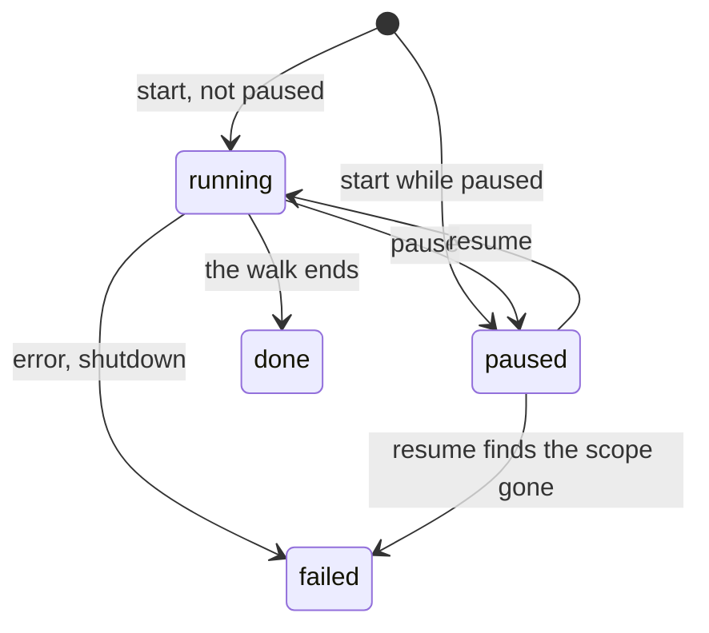

# Data model: Pause and resume background work

The rest of the model is unchanged:
[`internal/store/migrations`](../../internal/store/migrations).

## Migration

One migration, numbered after the latest on the feature branch when the unit
is implemented. It rebuilds `scans` to widen the `state` check, because SQLite
cannot alter a check constraint, and creates `held_watch_directories`. The
rebuild keeps every row, the ids, and the unique index on the `running` state.
`scan_videos` and `scan_issues` reference `scans` with `on delete cascade`,
and the store opens connections with `foreign_keys(on)`, so dropping the old
table would delete their rows: the migration copies both tables' rows aside
before the drop and writes them back after the rename. This is the first
rebuild of a table with cascading references.

## `settings`

| Key | Value | Absent | Meaning |
| --- | --- | --- | --- |
| `settings.background.paused` | `true` or `false` | `false` | Background work is paused |

## `scans`

| Field | Type | Null | Meaning |
| --- | --- | --- | --- |
| `state` | text | no | Gains the value `paused`: the scan stopped for a pause, or was requested during one, and no scanner runs for it |

A `paused` row keeps its scope, progress counters, video set, issues and
`forced` marks. `finished_at` stays null. Reopening it keeps `completed` as the
base of the resumed pass's counts and deletes the scan-sourced issues its
scope covers ([Scans](plan.md#scans)).

## `held_watch_directories`

| Field | Type | Null | Meaning |
| --- | --- | --- | --- |
| `path` | text | no | A dirty directory, cleaned, as the watcher reported it |
| `recursive` | integer | no | 1 when the report covers the directory's tree |

The primary key is (`path`, `recursive`), the identity of
`domain.DirtyDirectory`.

**Relationships**: None. A row is not tied to a media folder row, because the
dirty set is not either; the rearm after a folder change deletes rows outside
the registered folders.

## Rules

| Rule | Enforced in |
| --- | --- |
| At most one scan is `running` | The existing unique index |
| At most one scan is `paused`, and it is the latest scan | The store transaction that closes or creates a paused scan |
| A scan becomes `paused` only from `running`, or at creation while the setting is on | `internal/domain` rule, re-read in the store transaction |
| Only the latest `paused` scan is reopened, and only while no scan is `running` | The store transaction that reopens it |
| A media folder change is refused while a scan is `running`, not while one is `paused` | The existing store check, unchanged |
| A held directory row exists only for a directory in the dirty set | `AutoImport`, which writes and deletes the rows with the set |

## State transitions

## What does not change

- `jobs`: a job stopped by a pause returns to `queued` through the existing
  snooze, so no state or column is added.
- Activity entries: a paused scan's entry stays `running` with the reason
  `waiting`.
- The dirty set's rules: `held_watch_directories` mirrors it and adds none.
