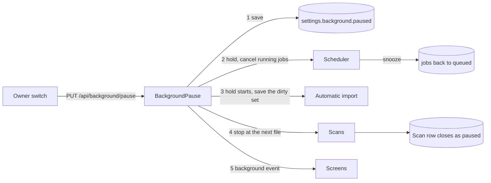
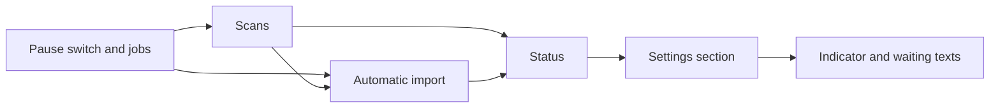

# Implementation Plan: Pause and resume background work

**Branch**: `feature/075-background-pause` | **Parent Issue**: #1929

**Input**: The parent Issue. It is this feature's specification.

## Summary

The owner stops every scan and every scheduler job with one switch, sees what
runs and how much is left per kind of work, and resumes when they choose. One
use case in `internal/app`, `BackgroundPause`, saves the switch, tells the
scheduler to hold, holds automatic import and closes the running scan as
`paused`; resuming reverses each. A status read reports the running work and the
remaining counts, and the screens follow it through one SSE event.

The diagram shows what a pause request stops, in order.



## Technical Context

**Canonical definitions**: [ARCHITECTURE.md](../../ARCHITECTURE.md) for layers,
store roles, events after commit and the audience rule;
[job-scheduling.md](../../docs/design-docs/job-scheduling.md) for kinds, grants,
snoozes and paused kinds;
[process-lifecycle.md](../../docs/design-docs/process-lifecycle.md) for startup,
recovery and shutdown;
[folder-watching.md](../../docs/design-docs/folder-watching.md) for dirty
directories and watch scans;
[force-rescan.md](../../docs/design-docs/force-rescan.md) for scopes and the
`forced` marks;
[import-pipeline.md](../../docs/design-docs/import-pipeline.md) for the scan's
video set; [activity.md](../../docs/design-docs/activity.md) for `waiting`
entries;
[library-ui.md](../../docs/design-docs/library-ui.md#scan-entry-and-progress)
for `Scan status` and the bottom-right indicator;
[media-folder-switches.md](../../docs/design-docs/media-folder-switches.md) for
which reads leave a switched-off folder out;
[windows-app.md](../../docs/design-docs/windows-app.md) for the close prompt;
[api/openapi.yaml](../../api/openapi.yaml) for the screen API.

**Feature-specific context**:

| Item | Delta |
| --- | --- |
| Folder changes during a scan | The store refuses adding, replacing or deleting a media folder while a scan row is `running`; the Issue's edge case requires them to take effect during a pause ([Scans](#scans)) |
| Startup recovery | Requeues a `running` job without refunding its claim, so a job stopped that way three times fails ([Jobs](#jobs)) |
| Dirty directories | Held in memory only, so a restart drops them ([Automatic import](#automatic-import)) |
| Force mode | Reads the content key of an unchanged file again, also after a resume ([Scans](#scans)) |
| Current activity | `app.Scans` keeps the running import-stage jobs and shows the newest one; the other kinds are not tracked ([Status](#status)) |
| New storage | The setting `settings.background.paused`, the scan state `paused`, the tables `scan_read_locations` and `held_watch_directories` ([data-model.md](data-model.md)) |
| Image search (#1927) | Its `frame_index` and `queue_frame_index` kinds are on another feature branch. Every scheduled kind must belong to a group ([Status](#status)), and a domain test fails for a kind without one, so whichever feature reaches `main` second adds the two kinds to the `backfill` group |
| External API, MCP | Unchanged ([Scans](#scans)) |
| Paired VVMDM | Unchanged; its work is not paused (the Issue's `対象外`) |

## Constitution Check

*GATE: Must pass before Phase 0 research. Re-check after Phase 1 design.*

| Rule | Source | Verdict |
| --- | --- | --- |
| Dependency direction | ARCHITECTURE.md | `BackgroundPause` is in `internal/app` and reaches the scheduler, the scans, automatic import and the setting through interfaces it declares; `internal/jobs` gains `Hold` and `Release` without importing `app` |
| The domain decides, the store enforces | ARCHITECTURE.md | Which scan may be reopened and which kinds form a group are `internal/domain` rules; the store re-reads the scan's state in the transaction that reopens it |
| Store roles | ARCHITECTURE.md | The setting belongs to `SettingsStore`, the scan transitions to the scans role, the held directories to the scans role, the counts to `IngestStore` |
| Events after commit | ARCHITECTURE.md | `domain.BackgroundChanged` is published after the setting or a job row commits |
| Every read knows its viewer | ARCHITECTURE.md | Both operations are owner-only in `api/openapi.yaml`, so the routing test covers them; the count read takes the owner's `domain.Audience` ([Status](#status)) |
| One owner for generated files | ARCHITECTURE.md | A cancelled stage removes its `.tmp` output through the existing deferred removal in `internal/artifacts`; no new path writes generated files |
| Only `cmd/mdm/events.go` registers subscribers | ARCHITECTURE.md | The screen subscription for `BackgroundChanged` is added there |
| Generated files are not hand-edited | AGENTS.md | `api/openapi.yaml` changes, then `task generate` |
| Complexity 25 and no copies | AGENTS.md | Job stopping reuses the snooze outcome; holding automatic import reuses `holdStarts`; reopening a scan reuses the scanner's unchanged-file path |
| Design system first | AGENTS.md, design-system.md | The `ui` label sends the section, the indicator and the waiting texts through `design` before implementation |

No gate is at stake after Phase 1; `## Complexity Tracking` is left out.

## Pause state

| Decision | Rejected | Why |
| --- | --- | --- |
| The switch is the setting `settings.background.paused`; an absent key is not paused | Memory only | Requirement 6: a restart or a crash keeps the pause |
| A pause saves the setting before it stops anything | Stop first, then save | A crash between the two steps would restart unpaused with work the owner stopped |
| After the save, a pause holds the scheduler before it holds automatic import or stops a scan | Hold the scheduler last | Holding automatic import and stopping a scan wait for the scan to finish the file it reads, and `scanner.ContentKey` takes no context, so a share that stopped answering would let the scheduler start jobs during the wait |
| `BackgroundPause` runs pause and resume one at a time, and the last request decides the state; a request for the current state changes nothing and answers the status | Reject a request while another is applied | Two tabs or a fast double press must end in the last state without an error (the Issue's edge case) |
| A pause answers once the setting is saved, the scan run has closed and the running jobs are cancelled; it does not wait for the jobs to return | Wait for every job | A read from a share that stopped answering does not return on cancellation, and the status shows a job as running until it returns |
| The desktop close prompt does not count queued jobs or a paused scan as busy while paused | Keep `Scans.Busy` as is | The prompt warns that closing interrupts an import; while paused nothing runs that closing would interrupt |
| The hardware encoder checks and the face runtime's model download are not paused | Pause them too | Neither reads a media file, and requirement 1 lists scans and jobs only |

## Jobs

`Scheduler.Hold` stops granting and cancels the running jobs;
`Scheduler.Release` grants again and wakes the scheduler.

| Decision | Rejected | Why |
| --- | --- | --- |
| The hold is a state inside the scheduler, checked where a job is granted | `BackgroundPause` reports every kind through `Options.Paused` | The paused kinds are read once before a round, so a round already running would grant a job after the running ones were cancelled |
| Each running job gets its own context; a hold cancels it with the cause `domain.ErrJobPaused`, and the scheduler records the job as snoozed: queued, due at once, the claim not counted | Leave the row `running` and requeue it as startup recovery does | That counts an attempt, so a preview paused three times would fail (requirement 2 restarts it from the beginning) |
| Same | Let running jobs finish | Requirement 2 stops them at once, and one encode takes minutes |
| Same | Suspend the ffmpeg process | Windows has no documented call to suspend another process ([job-scheduling.md](../../docs/design-docs/job-scheduling.md#playback-holds-its-disk-to-one-background-read)) |
| A scheduler started while the setting is on starts held | Hold after the first round | Startup recovery has requeued the jobs, and the first round would grant them |
| Kinds paused by a feature that is off stay paused after a release, as today | Release everything | The Issue's edge case: they run when the feature is turned on |
| Startup still queues the backfill jobs while paused; they wait like any job | Skip them until a resume | The queueing is one insert per kind, and skipping would need a second trigger at resume |

Requests that queue a job (a retry, a re-probe, `Suggest tags`,
`Judge again`, `Tag all videos again`) are accepted as today and wait as
queued jobs; requirement 7's work (streaming, live transcoding, the editing
frame, link fetches, image search) never passes through the scheduler and is
unchanged.

## Scans

A scan the pause stops, or one requested during a pause, is a scan row in the
new state `paused`; a resume reopens that row ([data-model.md](data-model.md#scans)).

| Decision | Rejected | Why |
| --- | --- | --- |
| A pause cancels a running manual scan or force rescan with the cause `domain.ErrScanPaused`; it stops at the next file, removes nothing and closes as `paused` | Keep the row `running` and block the scanner at a gate | Media folder changes are refused while a scan is `running`, and the Issue's edge case applies them during a pause; a blocked goroutine also does not survive a restart |
| Same | Close it `failed` with a `paused` reason and resume it as an interrupted scan | Every reader of `failed` (the result notice, the activity log, the import status) would need an exception so that a pause is not shown as a failure |
| A resume sets the same row back to `running` and runs the scanner for it with the row's scope, video set, issues, `forced` marks and read locations | Start a new scan through `ResumeScan` | Each pause and resume would end one scan and start another, so the indicator's per-scan dismissal and the result notice would fire on every toggle |
| The reopened row keeps its `completed` count as a base: the resumed pass reports `total` and `completed` as that base plus its own counts, and `failed` as its own count | Let the resumed pass overwrite the counters | The pass skips the files read before the pause, and `UpdateScanProgress` replaces the counters, so 4 of 10 files read before the pause and 6 after would end at 6 of 6 |
| Same | Keep `failed` as a base too | A file that failed is not indexed or not repaired, so the resumed pass reads it again and would count it twice; a file read before the pause and changed during it is read again and counted again, as a new change |
| Reopening deletes the row's scan-sourced issues (`ScanIssueKind.FromScan`) that its scope covers, the rule `carryPreviousIssues` applies to a new scan, and keeps stage issues and those carried from outside the scope | Keep every issue of the row | A successful ingest clears no issue, so a file repaired during the pause would keep its issue; the resumed pass reports again each file that still fails |
| The reopened scan lists the directories again and reads no file whose size and modification time match the index; in force mode it also skips the content key of an unchanged file the scan already read, recorded per scan and location in `scan_read_locations`. The video's `forced` mark only keeps the scan from queueing its forced jobs twice | Store a walk position | Directory order is not stable across a change, and listing reads no file; the size and time check already identifies what was read (requirement 3) |
| Same | Skip every unchanged location of a video already marked `forced` | A video with several locations is marked at its first location, so a pause after it would skip the others unread, and a location replaced with the same size and time would keep its stale content key |
| `Scan library` during a pause creates the row as `paused` and answers it; a second request answers the same row. A force rescan creates its row as `paused` too, and is refused with `409 scan_in_progress` while a paused scan exists | Queue any number of requests | The one-scan rule already says which request wins, and one waiting scan is what the screen can name (requirement 5) |
| A paused scan does not block media folder changes. On resume a manual scan reads the folders registered then; a `folder` rescan whose folder is gone or points elsewhere fails as a resumed one does today | Refuse folder changes while a scan is paused | The Issue's edge case |
| Startup skips resuming an interrupted manual scan while paused; a resume reopens the paused scan, or resumes the interrupted scan when there is none | Resume it at startup | Acceptance 5: nothing runs after a restart until the owner resumes |
| `Scan.state` gains `paused` in the screen API; the external API's `ExternalScan.status` reports a paused scan as `running` | A new external status | The external contract is versioned, its `running` already means "work remains", and a pause is not an outcome a client acts on |
| The scan's activity entry stays `running` with the reason `waiting` while its row is `paused` | Close the entry | The entry is one run of the scan, which has not ended |

## Automatic import

| Decision | Rejected | Why |
| --- | --- | --- |
| The watches stay armed during a pause and the watcher keeps reporting dirty directories | Remove the watches | Requirement 4: a file added during the pause must be imported after it; the watcher reads directory entries only when something changes |
| A pause holds watch-scan starts with the existing start hold and supersedes a running batch, whose directories return to the dirty set | A separate paused flag in `AutoImport` | Folder changes already hold starts and requeue the batch the same way |
| Once the batch is back in the dirty set, a pause writes the whole set to `held_watch_directories`, including directories still in their quiet or settle time; directories reported while paused are written as they arrive; startup loads the table into the dirty set, and a batch deletes the rows it takes | Write only the directories reported while paused and the superseded batch | A directory reported just before the pause is in neither, and a restart during the pause would drop it, against requirements 4 and 6 |
| Same | Start a full scan at resume after a restart | The full scan stays manual ([folder-watching.md](../../docs/design-docs/folder-watching.md)) |
| Turning automatic import off, or rearming after a folder change, deletes the held rows that the dirty set drops | Leave the rows | They would start a batch for a folder the owner removed or stopped watching |
| A file changed while the server is down is not found at resume, as today | Compare the tree at startup | Nothing reads the media folders while nothing reports a change |

## Status

`GET /api/background` answers the switch, the running work and the remaining
counts ([contracts/background-api.md](contracts/background-api.md)).

| Group | Kinds or source | Remaining counts |
| --- | --- | --- |
| `scan` | The latest scan row | Files not yet read of a `running` or `paused` scan, plus `waiting` when a paused scan or held directories exist |
| `import` | `probe`, `thumbnail`, `seek_thumbnail`, `preview`, `fingerprint` | Videos with an unfinished job of these kinds |
| `auto_tag` | `auto_tag` | Unfinished jobs |
| `face` | `face`, `face_image`, `face_cast`, `queue_face_images` | Unfinished jobs |
| `version_judge` | `version_judge` | Unfinished jobs |
| `backfill` | `keyframes`, `media_info`, `queue_keyframes`, `queue_media_info`, `virtual_thumbnails` | Unfinished jobs |

| Decision | Rejected | Why |
| --- | --- | --- |
| `domain.JobGroup(kind)` maps every scheduled kind to one group | Group by priority class | An owner's re-probe is class 0 and still import work; the Issue's kinds follow what the job does |
| `import` counts videos, the other groups count jobs | Count jobs everywhere | A video's stages are queued one after another, so its job count rises while it progresses; a count of videos only falls (acceptance 7) |
| Unfinished means `queued` or `running`, including a job waiting out a retry delay or parked under an unreadable folder | Count due jobs only | A job in a retry delay is still left to do |
| The count read takes the owner's `domain.Audience`: a job whose video has no location under a switched-on folder is not counted; a job without a video is counted | Count every row | The Issue's edge case, and the invariant that counts leave a switched-off folder out |
| A `queue_*` job counts as one until it runs and queues its per-video jobs | Run the queueing kinds during a pause to make the count exact | A pause runs nothing |
| A group carries `featureOff` when its feature holds its kinds back (`app.JobPauser`), also while not paused | A text on the feature's page only | The Issue's edge case: the remaining display says why the count does not fall after a resume |
| The running list holds every running job and the file a scan is registering, each with its group, its kind and its video when it has one and the owner's audience includes it | Extend `Scan.activity`, which shows one entry | Several jobs run at once, and requirement 8 asks what is running |
| `domain.BackgroundChanged` is sent as the SSE event `background` without a payload when the switch, the running list or a count changes, at most once a second with a trailing send; the client reads the status again | An event per job | A probe backlog finishes tens of jobs a second |
| Same | Polling | The screens already follow `/api/events` |

## Screens

The visuals, texts, states and widths are decided in `ui-design.md`.

| Decision | Rejected | Why |
| --- | --- | --- |
| A `Background work` section opens the Settings `Scan` page, above `Scan status`, with the switch, the running list and the count of each group | A new Settings page | `Scan status` and the automatic import state are already there, and the indicator links to that page |
| For the owner the bottom-right indicator shows the paused state and the total remaining on every screen while paused, and its summary lists the groups and carries the same switch | A link to Settings only | `UI品質`: the switch is where the counts are, and requirement 9 shows both on other screens |
| While paused the indicator cannot be dismissed, and an earlier dismissal does not hide it | Keep the per-scan dismissal | `UI品質`: the owner must not forget that work is stopped |
| The web reads the status in one provider beside `ScanProvider`; the existing waiting presentations (a `paused` scan in `Scan status`, a `waiting` activity entry, the queue line of auto-tagging, face recognition and duplicate judging, a pending stage on the video page) say they wait for the resume while the provider reports paused | A waiting reason on every job-bearing API response | The cause is one global switch, so one flag tells every screen (requirement 5) |
| A guest's screens render none of it and never read the status | Hide by CSS | Requirement 10; the read is refused to a guest anyway |

## Project Structure

### Documentation (this feature)

```text
specs/075-background-pause/
├── plan.md              # This file
├── data-model.md        # The setting, the scan state and the held directories
├── quickstart.md        # Acceptance checks with real videos and a restart
└── contracts/
    └── background-api.md   # GET /api/background, PUT /api/background/pause, the background event
```

No `research.md`: every choice above is settled from the repository's code and
design documents, which the decision rows link. `ui-design.md` is added by the
`design` stage.

### Source Code

**Affected boundaries**:

| Package | Change |
| --- | --- |
| `internal/domain` | `ErrJobPaused`, `ErrScanPaused`, `ScanPaused`, `JobGroup`, the status values, `BackgroundChanged`, the scan tally for a paused scan |
| `internal/store` | The setting, the migration, closing, creating and reopening a paused scan, the read locations, the held directories, the group counts |
| `internal/jobs` | `Hold`, `Release`, the per-job context and the snooze of a paused job |
| `internal/scanner` | The force-mode skip of a location the scan already read, and marking each location it reads |
| `internal/app` | `BackgroundPause`, the status read, `Scans` pause and resume, `AutoImport` hold and held directories, the running list, `Busy` while paused |
| `internal/httpapi` | The two operations and the `background` event |
| `cmd/mdm` | Wiring, the held start, skipping the scan resume while paused |
| `web/src/api`, `web/src/shell`, `web/src/settings` | Client, provider, the section, the indicator, the waiting texts |

**New paths**: `internal/domain/background.go`, `internal/app/background_pause.go`,
`internal/app/background_status.go`, `internal/store/background.go`,
`internal/httpapi/background.go`, `web/src/api/background.ts`,
`web/src/shell/BackgroundProvider.tsx`,
`web/src/settings/BackgroundWorkSection.tsx`,
`docs/design-docs/background-pause.md`.

**Structure decision**: Follows the existing layout
([ARCHITECTURE.md](../../ARCHITECTURE.md#intended-dependency-direction)).

## Implementation Work

The graph shows the units and what each waits for.



### Pause and resume every background job with one owner switch

**Scope**: [Pause state](#pause-state) and [Jobs](#jobs): the setting;
`BackgroundPause` with serialized pause and resume; `Scheduler.Hold` and
`Release`, the per-job context and the snooze; the held start in `cmd/mdm`;
`Busy` while paused; `GET /api/background` answering `paused` only and
`PUT /api/background/pause`
([contracts/background-api.md](contracts/background-api.md)), with
`task generate`; `BackgroundChanged` and the `background` event on a switch
change. Adds `docs/design-docs/background-pause.md` with the decisions of both
sections, linked from the index and ARCHITECTURE.md's subsystem map, and
updates job-scheduling.md and windows-app.md.

**Dependencies**: None

**Acceptance**: Scheduler tests with fake handlers: `Hold` cancels a running
handler, the queue records a snooze and no attempt, and no job is granted
until `Release`; a hold during a round grants nothing after it; a kind paused
by a feature stays unclaimed after `Release`; a scheduler created held grants
nothing. A store test: a job snoozed by a pause three times keeps its
attempts. Use-case tests with fakes: pause saves the setting before the hold,
and holds the scheduler before it holds automatic import or waits for the
scan; pause, resume and pause in a row end held once; a repeated pause changes
nothing; `Busy` is false while paused with queued jobs. Handler tests: both
operations answer the status, an invalid body `400`, and no session `401`.
An ingest test with the real artifact store: a preview stage cancelled
mid-run leaves no file under `.tmp`.

### Pause a running scan and reopen it where it stopped

**Scope**: [Scans](#scans) and [data-model.md](data-model.md#scans): the
migration; `Scans` pause (cancel with `ErrScanPaused`, close as `paused`) and
resume (reopen the row, or resume the interrupted scan); start requests during
a pause; folder changes with a paused scan; the startup skip; the force-mode
skip in `internal/scanner`; `paused` in `Scan.state` and its text in
`Scan status`; the external status. Updates process-lifecycle.md,
force-rescan.md, import-pipeline.md and background-pause.md.

**Dependencies**: Pause and resume every background job with one owner switch

**Acceptance**: Use-case tests with a fake scanner: a pause closes the running
scan as `paused` and removes nothing; a resume reopens the same id with its
scope; `Scan library` during a pause answers a `paused` scan and a second
request answers the same one; a force rescan over a paused scan gets
`ErrScanRunning`; startup while paused resumes nothing and a later resume
resumes the interrupted scan. A domain test of the tally: a base of 4
completed with a resumed pass of 6 gives 10 of 10; a file added during the
pause adds one to `total`; a failed file read again counts once. Store tests:
the migration keeps existing rows with their `scan_videos` and `scan_issues`
rows and accepts `paused`; reopening keeps the video set, the stage issues and
the `forced` marks and read locations, and deletes the scan-sourced issues in scope while keeping
those outside it; a media folder can be added and deleted while a scan is
`paused`. A scanner test on a temporary tree: a force rescan stopped after two
of four files and run again reads the content key of the other two only, and
one stopped after the first location of a two-location video reads, after the
resume, the second location changed with the same size and time and not the
first. A
use-case test with a fake scanner: a file whose read failed before the pause
and succeeds after the resume has no issue when the scan ends, and one that
fails again has one. A `cmd/mdm` test with the real stack: a scan paused
mid-walk and resumed registers every file once and ends with `completed`
equal to `total`. A component test: `Scan status` shows the waiting text for
a `paused` scan. The screen changes, so the implementation owes a
visual review.

### Hold automatic import while background work is paused

**Scope**: [Automatic import](#automatic-import) and
[data-model.md](data-model.md#held_watch_directories): the hold from
`BackgroundPause`, superseding and requeueing the batch, writing, loading and
deleting held directories. Updates folder-watching.md and background-pause.md.

**Dependencies**: Pause and resume every background job with one owner switch;
Pause a running scan and reopen it where it stopped, whose migration creates
`held_watch_directories`

**Acceptance**: `AutoImport` tests with the fake clock and fake scans: a
change reported while paused starts no watch scan after the quiet time and
starts one after the resume; a pause during a batch supersedes it and its
directories are scanned after the resume; a change reported before a pause
and still in its quiet time is written to the held rows by the pause; a new
`AutoImport` over a store with held rows scans them after a resume; turning
automatic import off deletes the rows. A store test: the rows round-trip and
a taken batch deletes them.

### Report running background work and remaining counts per kind

**Scope**: [Status](#status): `JobGroup` and its test over
`domain.ScheduledJobKinds`; the count read under the owner's audience; the
scan group from the tally, the paused scan and the held directories;
`featureOff`; the running list over every kind; the `running` and `groups`
fields of `GET /api/background`; the coalesced `background` event on job and
scan changes. Updates background-pause.md.

**Dependencies**: Pause a running scan and reopen it where it stopped; Hold
automatic import while background work is paused

**Acceptance**: A domain test: every scheduled kind has a group. Store tests:
the `import` group counts a video with two unfinished stages once; a job in a
retry delay is counted; a job whose video lies only under a switched-off
folder is not; done and failed jobs are not. Use-case tests with fakes: a
running `auto_tag` job appears in the list with its video and leaves it when
finished; a video outside the audience is listed without its video;
`featureOff` is set for `auto_tag` while auto-tagging is off; `scan` reports
`waiting` for a paused scan and for held directories. An events test with the
fake clock: ten job completions within a second send one event at once and
one trailing event.

### Show the background work section with the pause switch in Settings

**Scope**: The section of [Screens](#screens) as `ui-design.md` draws it:
`web/src/api/background.ts`, `BackgroundProvider`, the switch, the running
list, the group counts with the feature-off and waiting states, the error of a
failed switch request. Updates library-ui.md.

**Dependencies**: Report running background work and remaining counts per kind

**Acceptance**: Component tests with a fake API: the switch sends
`paused: true` and shows the paused state from the answer; a `background`
event reads the status again and the counts change; a group with `featureOff`
says so; a failed request shows the error and leaves the switch as the server
has it; a guest's Settings has no section and sends no status request. Visual
review of the running, paused, empty and feature-off states at the widths in
`ui-design.md`.

### Show the paused state and remaining work on every screen

**Scope**: The indicator, its summary with the switch, the dismissal rule and
the waiting texts of the existing presentations in [Screens](#screens), as
`ui-design.md` draws them. Updates library-ui.md.

**Dependencies**: Show the background work section with the pause switch in
Settings

**Acceptance**: Component tests: while paused the indicator shows the paused
state and the total on a library route, also with a stored dismissal; its
summary lists the groups and its switch resumes; a guest sees no paused
state; a `waiting` activity entry and the auto-tagging queue line show the
waiting text while paused and not otherwise. An e2e spec on the fixture
library: pause, request `Scan library`, see the waiting text, open the
library and see the paused indicator, resume, and see the scan finish. Visual
review of the indicator and its summary at the widths in `ui-design.md`.
