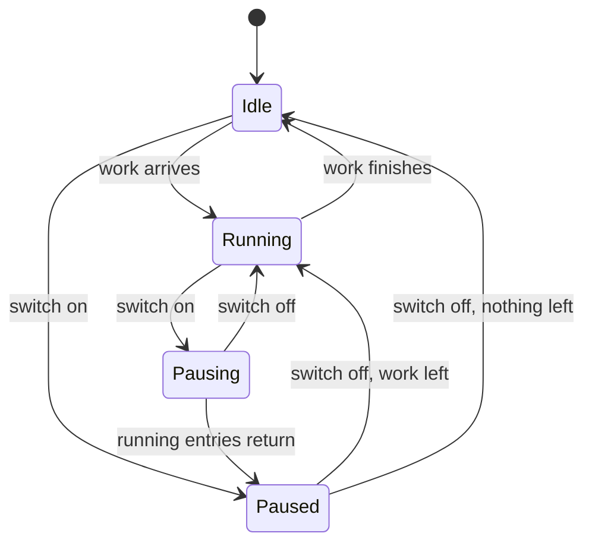

# UI design: Pause and resume background work

Sources: [design-system.md](../../docs/design-docs/design-system.md) for the
components and page patterns;
[patterns.md](../../web/registry/rules/patterns.md) for `SettingsPage`,
`PageSection`, `FormRow` and `FactList`;
[components.md](../../web/registry/rules/components.md) for `Switch`, `Badge`,
`Popover` and `Alert`;
[foundations.md](../../web/registry/rules/foundations.md) for the colour roles;
[library-ui.md](../../docs/design-docs/library-ui.md#scan-entry-and-progress)
for `Scan status` and the bottom-right indicator; [plan.md](plan.md#screens)
for where each part lives;
[contracts/background-api.md](contracts/background-api.md) for the status
fields. Only the owner's screens change; a guest's screens show none of this.

## Why this shape

The owner decides between stopping and running while reading what is left, so
the switch and the counts are one `PageSection` at the top of the Settings
`Scan` page, and the same switch and the same counts are in the summary of the
bottom-right indicator. Both places draw the counts with one component, so
they never disagree.

The paused state takes the `warning` role, which the design system gives to
something that waits on the owner. While paused the indicator stays on every
screen and has no hide button, and nothing in these parts animates, so a
stopped library does not look like a working one.

| Decision | Rejected | Why |
| --- | --- | --- |
| The control is a `Switch` named `Pause background work`; on means paused | A `Pause` button that turns into `Resume` | The Issue asks for one switch, and a `Switch` is the settings control that takes effect at once; naming it by the pause makes the on position read as paused |
| The state is said once per place, by a `Badge` in the section header and by the indicator's word | A state word before the switch track as well | Two words for one state in one row; the badge is read before the row |
| Every place that says `Waiting` says `Waiting for resume` while paused | A separate notice on each screen | One phrase tells the owner the cause wherever work waits, and the screens keep their layout |
| The indicator's total leaves out a group whose feature is off | Sum every group | The total is what a resume starts; work held back by a feature that is off does not start |
| A job outside the `import` group is worded by its group | One text per job kind | The owner tells the groups apart, not the kinds, and a kind added later needs no new text |
| While running, the indicator and its summary are unchanged; pausing starts in Settings | A pause switch in the running scan summary | The indicator shows manual scans only, so most running work would have no place to pause from; one press on the indicator opens the section |

## Words

Counts use `formatNumber` and the catalog's plural forms.

| Place | Text | Notes |
| --- | --- | --- |
| Section heading | `Background work` | Anchor `background-work` |
| Section badge | `Paused`, `Running`, `Idle` | See [States](#states) |
| Switch label | `Pause background work` | The same in the indicator's summary |
| Switch description | `Stops scans, imports and analysis until you turn this off. Playback, browsing and editing keep working.` | Section only |
| Request in flight | `Pausing…`, `Resuming…` | |
| Request failed | `Couldn't pause background work: {reason}`, `Couldn't resume background work: {reason}` | |
| Running list label | `Running now` | |
| Running list, nothing running | `Nothing is running.` | Not paused |
| Running list, nothing running | `Nothing runs while paused.` | Paused |
| Running entry | `{action} · {video title or file name}` | The existing `activityLine`; the action alone when the entry names neither |
| Running entry after a pause | `Stopping · {video title or file name}` | Until the entry leaves the list |
| Action, `scan` and `import` | The existing `t.shell.scan.activity` texts | `Adding to the library`, `Analyzing`, and so on |
| Action, other groups | `Auto-tagging`, `Analysing faces`, `Judging duplicates`, `Catching up older videos` | `auto_tag`, `face`, `version_judge`, `backfill` |
| Counts label | `Left to do` | |
| Group names | `Scan`, `Import`, `Auto-tagging`, `Face recognition`, `Duplicate check`, `Catch-up` | In the contract's order |
| Count values | `{n} files`, `{n} videos`, `{n} tasks` | Files for `Scan`, videos for `Import`, tasks for the rest |
| `Scan` waits | `Waiting for resume` after the name | `waiting` is set |
| `Scan` waits with 0 left | No value; `Waiting for resume` after the name stands alone | `waiting` is set and `remaining` is 0, which the status reports both before a paused scan has counted its files and after it has read them all |
| Feature off | `Off` | A `secondary` `Badge` after the group name |
| Feature off, under the list | `Work for a feature that is off stays here until you turn the feature on.` | Shown while any group is off |
| Status loading | `Loading background work` | Name of the skeleton |
| Status failed | `Couldn't load background work: {reason}` | With `Retry` |
| Indicator | `Paused`, then `{n} left` | The total |
| Indicator name | `Background work is paused, {n} left. Open the background work settings` | Without the count part when the total is 0 |
| Summary heading | `Background work is paused` | |
| `Scan status` badge | `Waiting for resume` | A scan in the state `paused` |
| `Scan status` detail | `Starts when background work resumes.` | No file read yet |
| `Scan status` detail | `Continues when background work resumes.` | Some files read |
| `Scan status` blocked reason | `A scan is waiting for resume. You can start another when it finishes.` | Under the start buttons |
| Waiting elsewhere | `Waiting for resume` | See [Waiting texts](#waiting-texts) |

## Background work section

The section is the first `PageSection` of the Settings `Scan` page, above
`Scan status`. Its rows, in order:

| Row | Composition |
| --- | --- |
| Header | The title, and in `description` one `Badge` with the state |
| Switch | A `FormRow` with the label, the description and the `Switch`; under it the in-flight line or the failure, as `SaveStatus` draws them for `Auto import` |
| `Running now` | The label in `text-xs` `muted-foreground`, then one `text-sm` line per entry, truncated, with the full text in `title`; a running entry starts with a `Spinner`, a stopping one has none and is `muted-foreground` |
| `Left to do` | The label, then a `FactList variant="divided"` of the six groups in the contract's order, always all six |

The switch is the row the eye reaches first after the badge, and the counts
are the last row, in one column of right-aligned figures, so the six numbers
compare by position. A group with 0 left keeps its row with `0` in
`muted-foreground`; a row does not appear or disappear as work finishes.

The switch moves at once when pressed and carries `aria-disabled` until the
answer arrives. On a failure it returns to the state the server reports and
the failure stays under the row until the next press.

### States

| State | Badge | Running list | Counts |
| --- | --- | --- | --- |
| Loading | A `Skeleton` in place of the badge | One `Skeleton` row | One `Skeleton` the height of six rows |
| Load failed | None | An `ErrorState` with `Retry` replaces the rows under the header | — |
| Idle: not paused, nothing running | `Idle`, `secondary` | `Nothing is running.` | As reported |
| Running: not paused, one or more entries | `Running`, `secondary`, with a `Spinner` | The entries, oldest first | Fall as work finishes |
| Pausing: paused, entries not yet returned | `Paused`, `warning`, with the `Pause` icon | The entries as `Stopping · …` | Do not fall |
| Paused: no entries | `Paused`, `warning`, with the `Pause` icon | `Nothing runs while paused.` | Do not change, except when the owner requests work |
| Feature off, paused or not | As above | As above | The group has the `Off` badge, and the line under the list explains it |

The diagram shows how the owner moves between the states.

## Paused indicator

While background work is paused, the bottom-right indicator shows the paused
state on every screen that mounts it for the owner, instead of the scan
states. Not paused, it follows the existing rules unchanged.

| Part | Paused |
| --- | --- |
| Frame | The existing frame; the `Pause` icon in `warning`, `Paused` in `font-medium`, then the total in `tabular-nums`; no hide button and no empty space where it was |
| Total | The sum of `remaining` over the groups without `featureOff`; left out when it is 0 |
| Press | Opens `/settings/scan#background-work` |
| Summary | Opens and closes by the existing rules. Heading `Background work is paused` with the `Pause` icon, the six-row count list of the section, then the switch row with its in-flight line or failure |
| Focus | `Tab` from the indicator moves to the switch in the summary, and the summary stays open while the focus is inside it |
| Dismissal | A stored dismissal does not hide the paused indicator. After a resume the reopened scan has the same id, so a scan hidden before the pause stays hidden |
| Selection bar | While a list's selection bar shows, the paused indicator sits above it, by the bar's published height, as notices do |
| Scan result | A result notice due while paused is not shown; `Scan status` keeps the result |

Turning the switch off in the summary resumes. The summary shows `Resuming…`
until the answer, then the paused indicator goes, and the scan indicator
takes its place when a scan runs.

## Scan status

A scan in the state `paused` is a state of its own in `Scan status`, between
running and ended.

| Part | A `paused` scan |
| --- | --- |
| Badge | `Waiting for resume` with the `Pause` icon, not spinning |
| Progress bar | Keeps its fill when the scan has counts; not drawn otherwise. It never animates |
| Progress text | The counts read before the pause, as while running |
| Detail line | `Starts when background work resumes.` or `Continues when background work resumes.` |
| `Scan library`, `Force rescan` | Disabled, with the blocked reason under them |

While paused with no waiting scan, both buttons are enabled. Pressing
`Scan library`, or confirming a force rescan, shows the waiting state above at
once, and the `Scan` group of the section gains `Waiting for resume`.

## Waiting texts

While the status reports paused, each place below says `Waiting for resume`
where it says `Waiting` (or `Waiting to be judged`, `Waiting in the queue`)
today. Its icon, colour and position do not change. Not paused, and for a
guest, the texts are today's.

| Screen | Place |
| --- | --- |
| Activity | The status icon's name, the result text of a `waiting` entry, the `Waiting · {done} of {total} tasks done` line and a waiting stage row |
| Settings, `Auto-tagging` and `Face recognition` | The first figure of the `Progress` queue line: `Waiting for resume {n} · …` |
| Duplicates | The automatic judgement state of a waiting pair |
| Video page | A waiting stage under `Getting ready to play` |

## Responsive behaviour

| Width | Section | Indicator and summary |
| --- | --- | --- |
| 360px | The page alone under its back link; the switch row stacks, label above the `Switch`; each count row is one line, name left and value right | `Pause` icon, `Paused` and the number alone, at the indicator's existing offsets; the summary is `w-popover` and stays inside the viewport |
| 768px | Beside the settings page list; the switch at the right end of its row | `Paused`, then `{n} left`, at the existing `sm` offsets |
| 1280px | The same, in the column's maximum width | The same |

## Review criteria

Judge at 360px, 768px and 1280px, in the idle, running, pausing, paused and
feature-off states.

1. Visual hierarchy: on the Settings `Scan` page the badge and the switch are
   read before any count, and the section is above `Scan status`, so the
   paused state is seen without scrolling at every width.
2. Paused against running: the paused section and the paused indicator each
   show the `Pause` icon in the `warning` colour, and nothing in the section,
   the indicator or `Scan status` moves once the running list is empty; a
   running section shows a `Spinner` and no `warning` colour.
3. Information density: the six count rows stay six rows in every state, each
   on one line at 360px with its value fully visible, and no count is
   truncated at four digits with separators.
4. Spacing rhythm: the section's rows use only the padding and dividers of
   `PageSection`, `FormRow` and `FactList`, and the section's edges line up
   with `Scan status` below it.
5. Typography: the count values are one right-aligned column of tabular
   figures, and a value does not shift sideways as it falls from four digits
   to one.
6. Priority of actions: the switch is the only control in the section and in
   the summary; cyan appears on it only while it is on, and nothing else in
   either place is cyan.
7. The switch and the counts are in one view: in the summary at every width
   the switch and all six counts are visible together without scrolling, and
   in the section only the running list stands between them.
8. Not forgotten: while paused the indicator is on the library, a folder, a
   video page and Settings, has no hide button, and stays visible above a
   selection bar without covering its actions.
9. Waiting is explained: after `Scan library` during a pause, `Scan status`
   reads `Waiting for resume` and the `Scan` row of the counts says the same,
   and neither shows a moving bar or a spinning icon.
10. Feature off: a group whose feature is off has the `Off` badge at every
    width, its count stays readable, and the explaining line is under the
    list only while such a group exists.
11. Failure: a failed pause or resume leaves the switch showing the server's
    state, with the failure directly under the switch row and not as a
    passing notice.
12. Guest: a guest's library, video page and Settings show no paused
    indicator, no section and today's `Waiting` texts.
