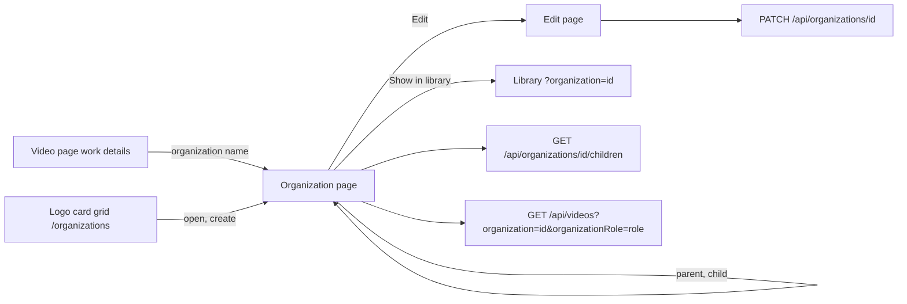
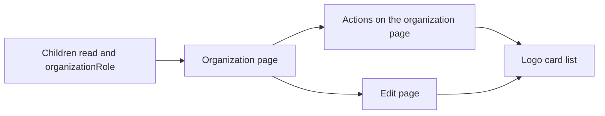

# Implementation Plan: Organization cards and organization pages

**Branch**: `feature/076-organization-pages` | **Parent Issue**: #1991

**Input**: The parent Issue. It is this feature's specification.

## Summary

The organizations screen stops being an admin table with a details dialog and
takes the people screens' shape: a grid of logo cards at `/organizations`, an
organization page at `/organizations/:id` that leads with the details and then
shows the parent, the child organizations and one shelf of videos per role, and
an edit page at `/organizations/:id/edit`. The screen API gains a read of an
organization's children and an `organizationRole` filter on the video list.
The video page's organization names open the organization page.

The diagram shows the screens and the reads this feature adds or changes.



## Technical Context

**Canonical definitions**: [ARCHITECTURE.md](../../ARCHITECTURE.md) for layers
and the web layer;
[people.md](../../docs/design-docs/people.md) for the people grid, the person
page, the edit page and the organization profile, logo and favorite;
[credit-names.md](../../docs/design-docs/credit-names.md) for the names list;
[library-ui.md](../../docs/design-docs/library-ui.md) for the current
organizations table, the library filters and the video list parameters;
[peer-library.md](../../docs/design-docs/peer-library.md) for remote ids and
vocabulary by name; [design-system.md](../../docs/design-docs/design-system.md)
and [web/registry/rules/patterns.md](../../web/registry/rules/patterns.md) for
`ListPage`, `CardGrid`, `ProfilePage`, `FormPage` and `Shelf`;
[api/openapi.yaml](../../api/openapi.yaml) for the screen API;
[testing.md](../../docs/design-docs/testing.md) and
[web-testing.md](../../docs/design-docs/web-testing.md) for test levels.

**Feature-specific context**:

| Item | Delta |
| --- | --- |
| Parent | `organizations.parent_id` exists, with `on delete set null`; a merge moves the merged organization's children to the target. No read lists an organization's children today |
| Roles | An organization is on a video as `maker` or `label` (`WorkOrganizationRole`); the video list filters by `organization` in any role only |
| Audience | Every `/api/organizations` operation and the `organization` video filter are owner-only; the new reads are too |
| Storage | No table, column or migration changes |
| External API and MCP | Unchanged |

## Constitution Check

*GATE: Must pass before Phase 0 research. Re-check after Phase 1 design.*

| Rule | Source | Verdict |
| --- | --- | --- |
| Every read knows its viewer | ARCHITECTURE.md | The children read and `organizationRole` are owner-only in `api/openapi.yaml`, so the routing test covers them |
| Remote ids carry an offset | ARCHITECTURE.md, peer-library.md | The children read sits under `/api/organizations/{id}`, so a remote id is forwarded by the existing boundary; `organizationRole` goes to links by name as `personRole` does ([Reads](#reads)) |
| Pages never call `fetch` | ARCHITECTURE.md, Web layer | `web/src/api/credits.ts` and `web/src/api/useVideos.ts` are the only callers of the new reads |
| Generated files are not hand-edited | AGENTS.md | `api/openapi.yaml` changes, then `task generate` |
| Complexity 25 and no copies | AGENTS.md | The organization page, edit page and card list reuse the person screens' pieces ([Screens](#screens), [Shared pieces](#shared-pieces)) instead of copying them |
| Design system first | AGENTS.md, design-system.md | The screens use existing patterns; a logo card size, if the design needs one, is added to the registry before the list uses it |

No gate is at stake after Phase 1; `## Complexity Tracking` is left out.

## Reads

Two owner-only reads are added
([contracts/organization-reads.md](contracts/organization-reads.md)).

| Decision | Rejected | Why |
| --- | --- | --- |
| `GET /api/organizations/{id}/children` returns the organization's direct children as an `OrganizationList`, ordered by name, unpaged | A `parent` filter on `GET /api/organizations` | That list merges every node's organizations by name, so a filter by one node's id would need translating per link; a path under `{id}` is forwarded for a remote id with no change |
| Same | A `children` field on `Organization` | Every list item and every write answer would carry it, and the card grid never shows it |
| Same | Paging the children | Children are entered by the owner one parent at a time; the list read already returns every match when unpaged |
| Children are read from the node that holds the id, as the parent is | Merging children across nodes by name | A parent is a per-node link; a merged answer would show children whose parent the other node does not record |
| `organizationRole` (`maker`, `label`) on `GET /api/videos` narrows `organization` to one role, with the same rules as `personRole`: it requires `organization` or `organizationName`, and goes to links by name | Filtering the page's videos in the browser | Totals and paging must stay the server's, as the person page's shelves do |
| Same | A shelf-only endpoint under `/api/organizations/{id}/videos` | The library list already applies the audience, the order and the peer join |

## Screens

| Decision | Rejected | Why |
| --- | --- | --- |
| `/organizations` is a `ListPage` with a `CardGrid` of organization cards led by the logo, read 100 at a time as the people grid is; search, `favorite` and the sort stay in the URL | Keeping the `AdminTablePage` table | Requirement 1 |
| Same | Virtualizing the grid | The people grid is not virtualized and reads 100 at a time; organizations are fewer than people |
| `/organizations/:id` is a `ProfilePage`: the logo in the face slot, the names and the actions in the identity, the profile and external IDs in the facts card, then the parent and children, then the videos | `RecordEditorPage` from #1480 | It is for organizing one record and is not on `main`; this page is read first and edited elsewhere, which is `ProfilePage`'s rule |
| Same | A side panel beside the card grid | Requirement 4 puts the details first, and a page has a URL to return to |
| The parent and children form one block above the videos: the parent as one link, the children as links in name order | A tree of the whole family | Out of scope in the Issue; the page shows one level up and one down |
| The videos are one `Shelf` per role with videos, `maker` then `label`, each read with `organizationRole`, plus `Show in library` in the identity's actions opening `?organization=id` | One grid with a role switch | people.md rejected it for the person page: it hides that an organization is both maker and label |
| Same | A link per role to the library | The library has no role filter in its URL, and one link to every video in any role is what the shelves add up to |
| Favorite, the logo's upload and removal, `Merge…` and `Delete…` are on the page; a merge opens the target's page and a delete the list, each with a toast | Keeping them in the list's row menu | The list has no rows any more, and the person page settled the same moves |
| `/organizations/:id/edit` is a `FormPage` outside the shell that edits the names list, external IDs, profile and parent and saves one `PATCH` of the changed properties | Keeping the details dialog | Requirement 8; the person edit page already has the band, the discard check and the return |
| A `404 organization_not_found` without a `field` (the organization itself is missing, as `isCreditGone` decides) turns the page and the edit page into a gone state with a link to `/organizations`; the same answer with `field: parentId` stays on the edit page under the parent field | Redirecting to the list | The person page settled the gone state; a redirect hides why the page left |
| Same | Treating every `organization_not_found` as gone | A parent deleted while the edit page is open answers it with `field: parentId`, and the owner can pick another parent and save |
| The video page's organization name links to `/organizations/:id` | Keeping the filtered library link | Requirement 9; the page's `Show in library` is one press away |

The layout, the card, the states and the widths are decided in `ui-design.md`.

## Shared pieces

| Decision | Rejected | Why |
| --- | --- | --- |
| The organization page and edit page reuse the person screens' pieces: `MergeCreditDialog`, `DeleteCreditDialog`, `NameRows`, `OrganizationProfileFields`, the image upload dialog and the edit page's save hook, generalized by kind where they are person-only today | Copying the person page and edit page for organizations | The rules (field-wise patch, problem mapping, merge and delete answers) are the same for both kinds |
| The helpers the person edit page imports from `CreditDetailsDialog` (`maxExternalIds`, `idRowsOf`, `idsToSend`, `problemOf`) move to a module of their own before the dialog is deleted | Keeping the dialog file for its helpers | A file named after a removed dialog misleads |
| The card list uses the list pieces `PeoplePage` uses from `web/src/tags/` today | Copying them | #1480 moves those pieces to a shared home; whichever feature lands second updates the imports |
| `CreditsPage`, `CreditRow`, `CreditDetailsDialog` and the row helpers only they use are removed with the table | Keeping `CreditsPage` for people | People already have their own grid |
| `AdminTablePage` stays | Removing it here | The tags screen and the assistant review page still use it; #1480 owns its removal |

## Project Structure

### Documentation (this feature)

```text
specs/076-organization-pages/
├── plan.md                              # This file
├── contracts/organization-reads.md      # The children read and organizationRole
└── ui-design.md                         # design stage: list, page, edit page
```

No `research.md`: every choice is settled by the person screens and the
documents above. No `data-model.md`: no entity or field changes. No
`quickstart.md`: the checks are the units' tests and visual reviews.

### Source Code

**Affected boundaries**: `api/openapi.yaml` and the generated code;
`internal/store` (children query, organization role filter) and
`internal/httpapi` (handlers, video list parameters, peer list parameters);
`web/src/api/` (the new reads); `web/src/credits/` (the screens);
`web/src/app/App.tsx` (routes); `web/src/player/WorkInfo.tsx` (the link).

**New paths**: `web/src/credits/organization/` for the organization page and
edit page, beside `person/`; `web/src/credits/organizations/` for the card
list, beside `people/`; `docs/design-docs/organizations.md`.

**Structure decision**: The organization screens get a design doc of their own,
`docs/design-docs/organizations.md`, linked from the index; the profile, logo
and favorite storage stays in people.md, which links to it. Rejected: growing
people.md, whose sections are about people and faces.

## Implementation Work

The diagram shows the units and what has to land first.



### Read an organization's children and filter videos by organization role

**Scope**: `GET /api/organizations/{id}/children` and `organizationRole` on
`GET /api/videos`, with the peer list parameter
([contracts/organization-reads.md](contracts/organization-reads.md)); the
`web/src/api/` functions for both; the reads in library-ui.md.

**Dependencies**: None

**Acceptance**: Store tests show the children of a parent in name order and
none for a leaf, and videos narrowed to `maker` or `label`; handler tests show
`400` for `organizationRole` without `organization` or with an unknown role,
and `404 organization_not_found` for a missing parent; the routing test covers
the new operation as owner-only; `task generate-check` passes.

### Show each organization on a page of its own

**Scope**: `/organizations/:id` on `ProfilePage` with the logo, names, profile,
external IDs, parent and children, one shelf per role, `Show in library`, the
loading, error and gone states; the video page's organization name linking to
it; `docs/design-docs/organizations.md` with the page and the index link
([Screens](#screens)).

**Dependencies**: Read an organization's children and filter videos by
organization role

**Acceptance**: Component tests show the details, a parent and children that
link to their pages, a shelf per role with videos and none for an empty role,
and the gone state on `404`; the work-info test shows the organization name
linking to `/organizations/:id`. A visual review of the page at the widths in
`ui-design.md`.

### Act on an organization from its page

**Scope**: Favorite, logo upload and removal, `Merge…` and `Delete…` on the
organization page, reusing the person page's dialogs generalized by kind;
organizations.md updated ([Screens](#screens), [Shared pieces](#shared-pieces)).

**Dependencies**: Show each organization on a page of its own

**Acceptance**: Component tests show a merge opening the target's page, a
delete opening `/organizations`, the favorite toggling, and the logo replacing
the placeholder; the person page tests still pass. A visual review of the
actions.

### Edit an organization on its own edit page

**Scope**: `/organizations/:id/edit` on `FormPage` with the names list,
external IDs, profile and parent, one `PATCH` of the changed properties, the
discard check and the return to the page; the helpers move out of
`CreditDetailsDialog`; organizations.md updated ([Screens](#screens),
[Shared pieces](#shared-pieces)).

**Dependencies**: Show each organization on a page of its own

**Acceptance**: Component tests show a save sending only the changed
properties and returning to the page, `Cancel` with changes asking before it
leaves, a parent cycle answer and a missing parent (`404` with
`field: parentId`) shown at the parent field, and the gone state;
the person edit page tests still pass. A visual review of the edit page.

### Replace the organizations table with a grid of logo cards

**Scope**: `/organizations` as a `ListPage` of organization cards with search,
favorite filter and sort in the URL, `New organization` opening the new page,
the empty and no-match states; removal of `CreditsPage`, `CreditRow`,
`CreditDetailsDialog` and their tests; library-ui.md and people.md updated to
the new screens ([Screens](#screens), [Shared pieces](#shared-pieces)).

**Dependencies**: Act on an organization from its page; Edit an organization on
its own edit page

**Acceptance**: Component tests show the criteria restored from the URL, a card
with and without a logo, creating an organization opening its page, and both
empty states; one e2e spec creates an organization from the list, edits it on
its edit page and finds the change on its page (it crosses the routes and the
server); `grep -r "CreditsPage\|CreditDetailsDialog" web/src` finds nothing. A
visual review of the grid.
