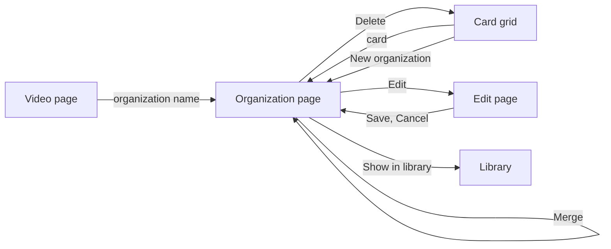
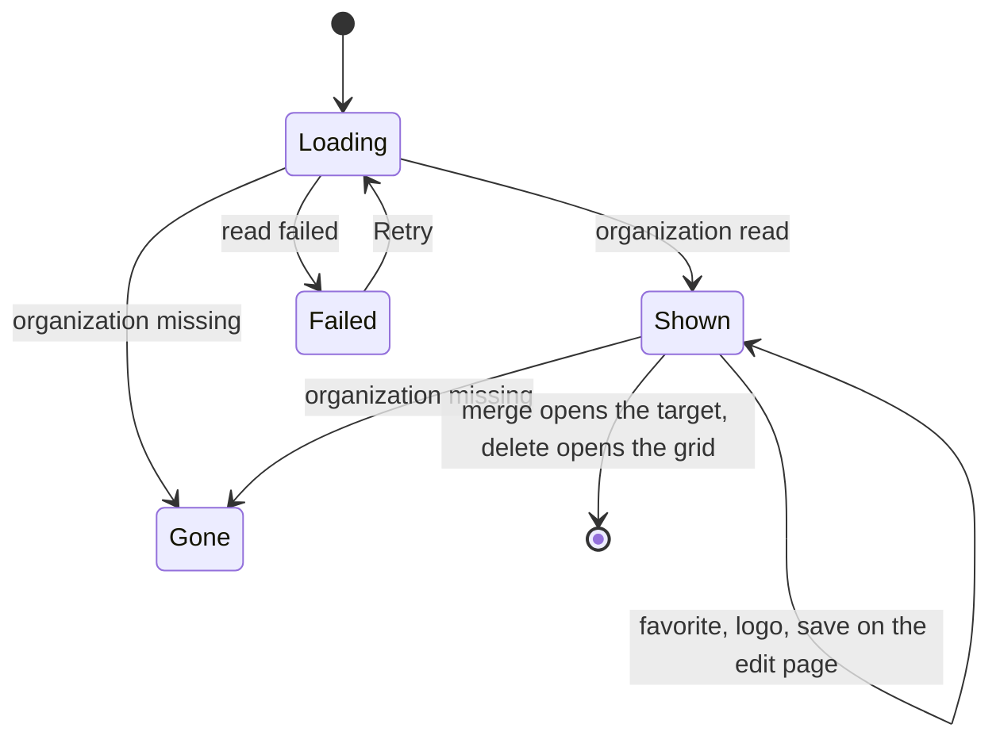

# UI design: Organization cards and organization pages

Sources: [design-system.md](../../docs/design-docs/design-system.md);
[patterns.md](../../web/registry/rules/patterns.md) for `ListPage`,
`ProfilePage`, `FormPage`, `Shelf`, `FactList` and the state blocks;
[components.md](../../web/registry/rules/components.md) for `FavoriteToggle`,
`PersonFace` and `ImageUploadDialog`;
[people.md](../../docs/design-docs/people.md) for the people grid, the person
page and the edit page, which these screens follow; [plan.md](plan.md) for the
routes, the reads and the pieces shared with the person screens.

## Why this shape

The three organization screens are the three people screens with a logo where
the face is: the same skeletons, the same order of regions, the same place for
each action. An owner who knows `/people` finds the favorite heart, `Edit`,
`Show in library` and the `More actions` menu in the same places on
`/organizations`. This design decides only what a logo, a parent and two roles
change.

The diagram shows the screens and what moves between them.

| Decision | Rejected | Why |
| --- | --- | --- |
| A logo is drawn whole (`object-contain`) in a rectangular frame, never cropped | The round, `object-cover` frame of `PersonFace` | A cropped wordmark cannot be read, and a round frame says "person" |
| A card's frame is landscape (`aspect-video`); the page's frame is square | Square cards in a grid as dense as the face grid | Most logos are wide wordmarks; in a face-sized square one is a few pixels tall and no longer tells organizations apart |
| A card without a logo shows the display name in its frame, on up to three lines | The same icon on every card without a logo | Logos are added by hand, so a new library is mostly cards without one; the one-line name under a card truncates, and the frame has room for the whole name |
| The parent and the children are one `Shelf` of text links between the profile and the videos | Logo cards for the parent and each child | The Issue attaches the family below the details; a card row for one parent pushes the videos down by a card's height |
| Same | Parent and children in the facts card | The Issue makes details, family and videos three clusters, and from `lg` the facts card sits beside the identity, not under it |
| The favorite heart is on the logo and the logo menu in the frame's corner, as on the person page | A `Favorite` button in the actions row | Two pages built from the same parts keep the same action in the same place |

No element on these screens is a placeholder without behaviour (Q-5).

## Design system additions

The design system has no logo, so these are added to the registry, with their
rules and example blocks, by the first unit of the Plan that uses each.

| Item | Addition |
| --- | --- |
| `OrganizationLogo` (new vv component) | An organization's logo in a frame, or the placeholder in the same frame. Shapes: `card` (full width, `aspect-video`, `rounded-md`) and `profile` (full width, `aspect-square`, `rounded-md`). The frame is `bg-muted` with a `border`; the image is `object-contain`, centred. Marks sit in its `top-end` and `bottom-end` corners; the mark holder is shared with `PersonFaceMark`, not copied |
| `OrganizationLogo` placeholder | `profile`: lucide `Building2` in `muted-foreground`, and a button that adds a logo when `onAdd` is passed, as `PersonFace` does. `card`: the display name in `text-sm font-semibold` `muted-foreground`, centred, at most three lines, then cut with an ellipsis. Both also stand in when the image fails to load |
| `card-logo` (new spacing token) and `CardGrid size="logo"` | The minimum width of a logo card: two columns at 360px, six at 1280px with the full sidebar |
| `LoadingState layout="grid" size="logo"` | Landscape frames with two lines under each |
| `ProfilePage` rule | The `face` slot also takes `OrganizationLogo profile` |
| `Shelf` rule | A shelf's body may be one `FactList` of the subject's relations to other subjects, in place of a `CardGrid` |
| `PersonFace` rule | Its last sentence points organizations to `OrganizationLogo` |

`OrganizationLogo` is used on the three organization screens only. Pickers,
filter chips and the video page keep organizations as text, as
[people.md](../../docs/design-docs/people.md#faces-elsewhere-on-the-screens)
leaves them.

## Words

Text that exists today is reused from its current key and is not listed:
the list's title, count, search, sort, `Favorites only`, `New organization`,
the empty, no-match, failed and stale lines (`t.credits.organization`,
`t.list`), `Edit`, `Show in library`, `More actions`, `Also known as …`,
`No profile yet.`, `Show more`, `Show less`, `Links`, `External IDs`,
`No videos yet`, the video load lines and `Merged into "…"`
(`t.credits.personPage`), the field labels, `Add logo`, `Remove logo`, `Upload a logo` and
`Couldn't change the logo: …` (`t.credits.details`), `Names`, `Display name`,
`Other names` (`t.credits.names`), `Discard changes?` and its text
(`t.credits.personEdit`), and `+N more`, `Show fewer` (`t.player.workInfo`).

| Place | Text | Notes |
| --- | --- | --- |
| Grid, favorites filter with no result | `No favorite organizations yet` | |
| Grid, new dialog title | `New organization` | The dialog of `New person` |
| Grid, new dialog failure | `Couldn't create the organization: {reason}` | |
| Card, favorite heart | `Add to favorites`, `Remove from favorites` | Existing text |
| Page, profile region name | `Organization` | Read by screen readers, as `Person` is |
| Page, load failure | `Couldn't load this organization: {reason}` | |
| Page, logo menu button | `Change logo` | Accessible name of the corner button |
| Page, logo menu item | `Upload an image…` | Existing text of the face menu |
| Page, upload dialog description | `PNG, JPEG or still WebP, up to 64 MB. The whole image is shown; it is not cropped.` | |
| Page, refused file | `This image can't be used. Choose a PNG, JPEG or still WebP.`, `This image is over {limit}.` | Existing text of the face upload |
| Page, remove confirmation title | `Remove the logo of "{name}"?` | |
| Page, remove confirmation text and action | `The image is deleted. You can upload another one later.`, `Remove`, `Removing…` | Existing text |
| Page, family shelf heading | `Related organizations` | |
| Page, family terms | `Parent organization`, `Child organizations` | The first is existing text |
| Page, family links | `Open {name}` | Accessible name; the visible text is the name |
| Page, shelf headings | `Maker`, `Label` | Each with `{n} videos` as its count |
| Page, gone state | `This organization no longer exists`, `Back to organizations` | |
| Edit page, right panel legend | `Names and parent` | The left legend is `Profile` |
| Edit page, aside link | `Back to the organization` | |
| Video page, organization name | `Open {name}` | Accessible name; replaces `Show videos with {name}` |

## Card grid

`/organizations` is the people grid
([people.md](../../docs/design-docs/people.md#the-people-grid)) with logo
cards: the toolbar in the top bar with the search, the sort and a filter
popover holding `Favorites only`; the header with `Organizations`, the count
and `New organization` as its one `default` button; the body a
`CardGrid size="logo"`, read 100 at a time. The sorts are the three the table
has today (`Name`, `Video count`, `Date created`). `q` and `sort` keep their
URL names, and the filter, which the table does not have, is `favorite=true`
as on `/people`.

A card is one link to `/organizations/:id` (`rounded-md`, `p-1`,
`hover:shadow-card-hover`, as a face card), holding from top to bottom:

| Part | Form |
| --- | --- |
| Frame | `OrganizationLogo card` |
| Name | `text-sm font-medium`, one line, truncated, the full name in `title` |
| Meta | `{n} videos` in `text-xs` `muted-foreground` `tabular-nums`, one line |

The two lines are left-aligned with the frame's edge, as a video card's are,
and `gap-2` under the frame. The favorite heart is the only control: a
`FavoriteToggle card` at the frame's `top-end`, outside the link. Other names
and the parent are not on the card; the page shows them.

`New organization` opens the name dialog of `New person` and then the new
organization's page.

### States

| State | What the screen shows |
| --- | --- |
| Loading | `LoadingState layout="grid" size="logo"`, 12 cards |
| No organizations | `EmptyState`: `Building2`, `No organizations yet`, `Add them from a video's details, or create one here.`, and `New organization` |
| Search without a match | `EmptyState`: `SearchX`, `No organizations match "{query}"`, and `Clear search`, which empties and focuses the search |
| `Favorites only` without a result | `EmptyState`: `Heart`, `No favorite organizations yet` |
| First read failed | The failed block of the people grid with `Retry` |
| A later read failed with cards shown | The cards kept under the stale notice of the people grid |
| Loading more, load more failed | `LoadMoreRow` after the cards |

## Organization page

`/organizations/:id` is a `ProfilePage`. Its three clusters are the profile
spread, the family and the videos, `gap-8` apart; every cluster under the
spread starts with an `h2` row, so the page reads as one rhythm.

| Slot | Content, in order |
| --- | --- |
| `face` | `OrganizationLogo profile` with the favorite heart (`FavoriteToggle card`) at `top-end` and the logo menu at `bottom-end`; an error line under the frame when a logo change fails |
| `identity` | The display name as `h1` (`text-xl font-semibold`, at most three lines); `Also known as A · B` in `text-sm` `muted-foreground` when there are other names; the bio, six lines then `Show more`; the actions row |
| `facts` | A `FactList` of `Founded`, `Dissolved` and `Location`, the dates as stored and in `tabular-nums`; then the links, one host per line; then the external IDs as `source: value` in `text-xs` `muted-foreground` |
| children | The family shelf, then one video shelf per role |

The identity has no row of key figures: an organization has no number that
outranks its dates, and the dates read aligned in the facts card. With no
facts, links or IDs the card is left out; with no bio either it shows
`No profile yet.` and an `Edit` link, as the person page does.

### Actions

| Action | Where | Form |
| --- | --- | --- |
| Favorite | On the logo, `top-end` | The heart; shown on hover and focus when off, always on touch and when on |
| Add, replace or remove the logo | On the logo, `bottom-end` | A `ghost` `icon-sm` button named `Change logo` opening a menu: `Upload an image…`, and `Remove logo` (`destructive`) while a logo exists. The placeholder itself is an `Add logo` button |
| `Edit` | Actions row, first | `secondary` `sm` with `Pencil`; opens the edit page |
| `Show in library` | Actions row, second | `secondary` `sm` with `LibraryBig`; opens the library filtered by this organization in any role |
| `Merge into another organization…` | `More actions` menu | Opens the merge dialog |
| `Delete` | `More actions` menu, after a separator | `destructive`; opens the delete confirmation |

An uploaded image is saved at once, with no framing step, and the frame shows
it when the save answers. `Remove logo` asks first in a `ConfirmDialog`. A
merge opens the target's page with the toast `Merged into "{name}"`, and a
delete opens `/organizations` with `Deleted "{name}"`.

### Family

The family shelf is a `Shelf` titled `Related organizations`, without a count,
whose body is one `FactList`:

| Term | Value |
| --- | --- |
| `Parent organization` | The parent's display name, one link to its page |
| `Child organizations` | The children's display names in name order, joined by commas, each a link to its page; past 12 the rest fold behind `+N more`, and `Show fewer` folds them again, as the video page folds names |

The links are `text-foreground` and turn `primary` on hover, as the video
page's organization names do. A row without a value is left out, and an
organization with neither a parent nor children has no family shelf. While the
children are being read the row shows a one-line `Skeleton`; if the read fails
the row shows the reason in `text-destructive` with a `Retry` link, and the
rest of the page stays.

### Videos

One `Shelf` per role with videos, `Maker` then `Label`, each with `{n} videos`
as its count over a `CardGrid size={0}` of video cards that loads more as its
end comes into view. These are the person page's shelves
([people.md](../../docs/design-docs/people.md#the-person-page)) with
`organizationRole` in place of `personRole`, with one difference: a role whose
first read fails keeps its shelf and shows the failure, where the person page
leaves that shelf out.

### States

The diagram shows the page's states and what moves between them.

"Organization missing" is the answer the plan names for the gone state: `404
organization_not_found` without a `field`, meaning the organization this page
shows no longer exists. Any other 404, such as the `field: parentId` answer on
the edit page or one about something other than this organization, is that
request's failure and is shown where the request was made, with the page kept.

| State | What the screen shows |
| --- | --- |
| Loading | A square `Skeleton` in `face`, three line `Skeleton`s in `identity`, and a video grid `LoadingState` under them |
| Failed | `ErrorState`: `Couldn't load this organization: {reason}` with `Retry`, in place of the shelves |
| Gone | `EmptyState` in place of the whole page: `Building2`, `This organization no longer exists`, and `Back to organizations` (`outline` `sm`) to `/organizations` |
| No logo | The `Building2` placeholder as an `Add logo` button; the name is the `h1` beside it |
| No videos | The spread and the family, then one `EmptyState`: `Film`, `No videos yet` |
| Videos loading, videos failed | The person page's blocks, in the videos' place |
| One role's first read failed | That role's shelf keeps its heading, without a count, and shows `ErrorState`: `Couldn't load videos: {reason}` with `Retry` in place of its cards; the other role's shelf stays. A failed role is never left out, so it cannot be read as a role without videos |
| Logo change failed | `Couldn't change the logo: {reason}` in `text-sm` `text-destructive` under the frame; the previous logo stays |

## Edit page

`/organizations/:id/edit` is the person edit page
([people.md](../../docs/design-docs/people.md#the-edit-page)) with an
organization's fields: the same band (`Edit "{name}"`, `Cancel`, `Save`), the
same `Discard changes?`, the same return to the page, and the first name input
focused on arrival.

| Region | Content, in order |
| --- | --- |
| `aside` | `OrganizationLogo profile`, read only, at the widths the person's face has there; the display name in `font-medium`; `{n} videos` in `muted-foreground` `tabular-nums`; `Back to the organization` |
| Left panel, `Profile` | `Founded`, `Dissolved`, `Location`, `About`, `Links`: the fields of the details dialog, unchanged |
| Right panel, `Names and parent` | `Names` (the sortable list with `Display name` and `Other names`), `External IDs`, `Parent organization` |

`Parent organization` is the searchable select the details dialog has, with
`None` first and every other organization after it. The logo is not edited
here: it is saved at once on the organization page, and the aside shows the
current one.

### States

| State | What the screen shows |
| --- | --- |
| Loading | The band with `Edit` and a disabled `Save`, `Skeleton`s in the aside and under each field label |
| Load failed | `ErrorState` with `Retry` in place of the columns |
| Gone | The organization page's gone block in place of the columns |
| Saving | `Save` shows its spinner; the inputs are read only |
| A field refused | The reason under that field, every other input kept; a parent that would make a cycle, or that no longer exists, shows its reason under `Parent organization` |
| Save failed otherwise | The failure line under the band |
| Parent candidates failed | The reason under `Parent organization`; the select stays disabled, showing the current parent |

## Video page

In the work details row, each organization name is one text link to
`/organizations/:id`, named `Open {name}`, in the colours it has today. The
row's height, the role labels and the fold after three names do not change.

## Responsive behaviour

| Width | Card grid | Organization page | Edit page |
| --- | --- | --- | --- |
| 360px | Two cards per row; the toolbar's sort and filter collapse as on `/people` | The logo at half the width, centred, above the identity; the facts card full width under it; the family's terms and values in the two columns of `FactList`; video cards one per row | The aside, `Profile`, then `Names and parent` stacked; the page scrolls as one; the aside's logo a third of the width |
| 768px | Four cards per row | The logo `profile-face` wide beside the identity; the facts card full width under them; two or three video cards per row | Stacked as at 360px; the aside's logo a quarter of the width |
| 1280px | Six cards per row with the full sidebar | One row: logo, identity, then the facts card `profile-facts` wide; the family and the shelves across the full width under it | The aside column, then the two panels 5:6, each scrolling inside itself |

No screen scrolls sideways at any of the three widths.

## Review criteria

Each is judged at 360px, 768px and 1280px, in the light and the dark theme,
with a library holding organizations with and without a logo, one organization
with a parent, one with at least 13 children, and one with videos in both
roles.

1. **Same parts as people**: with `/people` and `/organizations` side by side,
   and a person page beside an organization page, the header, toolbar, action
   row, `More actions` menu and shelves sit in the same places with the same
   sizes; only the image frames and the family shelf differ.
2. **Hierarchy on the page**: the logo and the `h1` are the first things read;
   the family and the video headings are smaller than the `h1` and equal to
   each other; no action is a `default` button, and nothing in the actions row
   is larger or more saturated than the name.
3. **Logos are whole**: a wide wordmark and a tall emblem both show every edge
   inside their frame, on the card and on the page, with no cropping and no
   stretching.
4. **Density of the grid**: at 1280px a wordmark logo on a card is legible
   without opening the page, and a screen holds at least three rows of cards;
   at 360px two cards fit a row with neither frame cut.
5. **Without a logo**: two cards without a logo whose names share their first
   ten characters can be told apart from the frames alone, and a card with a
   logo draws the eye before a card without one.
6. **Rhythm**: on the organization page the gaps between the spread, the
   family and each video shelf are equal, and larger than any gap inside a
   cluster; on a card the gap under the frame is the same on every card,
   with or without a logo, so the name lines of a row share one baseline.
7. **Typography**: the display name is heavier and larger than the other
   names, which are muted; `Founded` and `Dissolved` values start at the same
   column, and the video counts of cards in one row and of the shelf headings
   use figures of equal width.
8. **Priority of actions**: the favorite heart and `Edit` are reached with one
   press and no menu; merging and deleting need the `More actions` menu first,
   and `Delete` is the only `destructive` item, after a separator.
9. **Family stays modest**: the family shelf of an organization with one
   parent and no children is one heading and one line; with 13 children it
   shows 12 names and `+1 more`, and the first video shelf starts within one
   screen of the top at 1280px.
10. **No videos**: an organization without videos shows its full profile and
    family above one `No videos yet` block, with no empty shelf headings.
11. **Gone**: after the organization is deleted in another tab, the next
    action on the page or a save on the edit page replaces the screen with
    the gone block and its link to `/organizations`; no stale profile remains
    beside it.
12. **Edit page**: at 1280px both panels and the aside are visible without
    page scroll and the band's `Save` never leaves the top; a refused parent
    shows its reason directly under `Parent organization` with every other
    edit still in its input.
