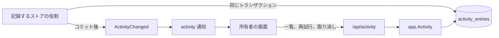
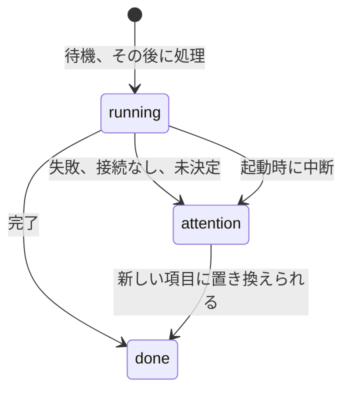

# 活動ログ {#activity-log}

VVMDM は、動画または組に対して実行する処理と、所有者のタグとバージョンの操作を、実行と対象ごとに 1 つの活動項目として永続的なログに残し、新しい順に所有者へ一覧表示する。項目とその規則は [`internal/domain/activity_entry.go`](../../internal/domain/activity_entry.go)、テーブルと一覧は [`internal/store/activity.go`](../../internal/store/activity.go) で、再試行と取り消しは [`internal/app/activity_log.go`](../../internal/app/activity_log.go) が振り分ける。各規則の理由は [055 research](../../specs/055-activity/research.md) にあり、スキーマは [055 data-model](../../specs/055-activity/data-model.md) だ。活動項目は、取り込みがいま実行している内容を示すメモリ上の行であるスキャンの活動とは別物だ ([R-1](../../specs/055-activity/research.md#r-1-a-persistent-activity-log-named-apart-from-the-scan-activity))。

図は、項目を書く場所と、所有者がそれを読む方法を示す。

## 項目はその変更のトランザクションで書く {#an-entry-is-written-in-the-transaction-of-its-change}

記録対象を実行、完了、または決定するストアの役割は、自身のトランザクションの中で 1 つのパッケージ非公開のヘルパーを通して項目を書くか更新し、コミットが `ActivityChanged` を発行する。そのため項目とそれが記録する変更は常に一致し、どの役割も他の役割のメソッドを呼ばない ([R-2](../../specs/055-activity/research.md#r-2-an-entry-is-written-in-the-transaction-of-the-change-it-records))。`ActivityStore` がするのは、一覧、1 つの項目の読み取り、起動時の回復だけだ。

テーブルはユーザーデータだ。決して再構築も間引きもせず、対象を内容の鍵と書いた時点のラベルで示すので、項目はその動画より長く残る ([R-10](../../specs/055-activity/research.md#r-10-the-subject-is-a-content-key-with-a-label-kept-at-write-time))。

## 状態、理由、結果 {#status-reason-and-outcome}

項目は理由を伴う `running` か `attention`、または結果を伴う `done` だ。項目を書くと、同じ種類と対象の古い `attention` 項目を `done`/`superseded` として閉じるので、attention の数はまだ解決していない問題の数になる。`version_judgement` は組ごとに 1 つの項目を持ち、この方法で閉じることは決してない ([R-4](../../specs/055-activity/research.md#r-4-three-statuses-with-a-reason-and-a-newer-run-closes-an-older-problem))。

## 取り込みと失敗したスキャン {#imports-and-failed-scans}

動画の取り込みは、その 5 つの取り込み段階に対する 1 つの `import` 項目だ ([R-3](../../specs/055-activity/research.md#r-3-one-entry-per-run-and-subject-an-import-is-one-entry-for-all-its-stages))。各ジョブの行は、それが属する項目の id を保持する ([`internal/store/activity_import.go`](../../internal/store/activity_import.go))。

| 出来事 | 項目 |
| --- | --- |
| 項目が `running` である保留中のジョブを持つ動画にジョブが積まれる | ジョブはその項目に加わる |
| そのような項目のない動画にジョブが積まれる | 積んだ者の決定者を持つ新しい `running`/`waiting` 項目 |
| ジョブが取得され、その項目が `running` でない (起動時に中断された、またはこの機能より前に積まれた) | `rule` による新しい項目。動画の保留中のジョブをすべて引き取り、古い項目を置き換える |
| 項目のジョブが完了または失敗する | 項目を集約し直す |
| 動画が削除される、または動画が登録済みの場所を失ったために最後の保留中のジョブが取り除かれる | 項目は `done`/`gone` として閉じる |

集約 (`ImportActivityState`) は、項目のジョブのいずれかが保留中の間は `running` (いずれかが取得されるまでは `waiting`)、段階が諦めたときは `attention`/`failed` で、その段階を `stage` に、そのメッセージを `detail` に持ち、それ以外は `done`/`completed` だ。完了した項目は決して `running` に戻らないので、ジョブを再び積む再スキャン、再プローブ、再試行は新しい項目を開く。スキャンは動画に必要なすべてのジョブを 1 つのトランザクションで積むので、その間に完了した段階が、後の段階が加わる前に項目を閉じることはない。`processing` 項目の進捗は、動画のすべてのジョブにわたって完了した段階を数える。再試行の項目は、それが再び積んだジョブだけを持つからだ。

決定者は実行を開始した者だ ([R-5](../../specs/055-activity/research.md#r-5-the-decider-is-who-made-the-recorded-decision-else-who-started-the-run))。

| 実行 | 決定者 |
| --- | --- |
| 手動スキャン、再プローブ、活動ログからの再試行 | `owner` |
| 監視スキャン、起動時の再開、新しい項目を開く取得 | `rule` |

取り込みキューのポート (`scanner.Queue`) は決定者を受け取り、`app.Scans` はスキャンの開始時の決定者を渡す。

スキャンは、`interrupted` 以外の理由で `failed` として終わったときにだけ `scan` 項目を書く。その対象はスキャンの id で、ラベルはスキャンの起点だ。次に `done` で終わったスキャンが、開いているすべての `scan` 項目を `superseded` として閉じる。起動時に `interrupted` として閉じたスキャンは何も書かない。起動がそれを再開するからだ。

## 所有者の操作は動画ごとに done 項目を書く {#owner-operations-write-a-done-entry-per-video}

動画のタグまたはバージョンのまとまりを変える、メディアフォルダを削除する、または作品情報を取得するか適用する所有者の操作は、`owner` が決定した `done` 項目をその操作のトランザクションで書く ([R-6](../../specs/055-activity/research.md#r-6-the-owner-operations-recorded)、[`internal/store/owner_activity.go`](../../internal/store/owner_activity.go))。

| 操作 | 項目 |
| --- | --- |
| まとめる (動画ページ、Duplicates、ドラッグでの整理) | 新しいまとまりのメンバーごとに 1 つの `bundle` |
| 代表にする、バージョンから外す | 動画について 1 つ |
| "Different videos" | 組について 1 つの `dismiss` |
| タグを付ける、外す (動画ページ、ライブラリの選択、`/api/v1`) | 手動のタグの行が変わった動画とタグごとに 1 つ。`detail` はタグの名前 |
| 提案したタグを残す、却下する | 1 つの `tag_keep` または `tag_reject`。`detail` はタグの名前 |
| 取得した作品情報を適用する | 1 つの `work_info_apply`。そのタグはタグの項目を書かない |
| 作品情報を取得する | プラグインの実行ごとに 1 つの `work_info_fetch`。実行が失敗したときはプラグインのメッセージ (なければ失敗のコード) を伴う `done`/`failed` で、決して再試行しない ([R-11](../../specs/055-activity/research.md#r-11-a-failed-work-information-fetch-is-a-finished-entry-not-a-problem)) |
| メディアフォルダを削除する | フォルダのパスについて 1 つの `media_folder_remove`。`detail` は、それが取り除いた動画の数 |
| ドラッグでの整理の取り消し | それがまとまりを元に戻した動画ごとに 1 つの `organize_undo` |

タグはユーザーキーに付くので、まとまりの項目はその代表を示す。1 つの操作の動画の項目は 1 つの SQL 文で書き、外部 API の動画とタグの組は SQLite の中で求めるので、20000 本の動画の選択でも余分な SQL 文はかからない。所有者の項目は決して `attention` にならないので、何も閉じない。

## 起動は取得済みの項目を中断として記録する {#startup-marks-claimed-entries-interrupted}

ワーカーが開始する前に、理由が `processing` の `running` 項目はすべて `attention`/`interrupted` になる。`waiting` 項目は開始されたことがなく、そのまま残る ([process-lifecycle.md](process-lifecycle.md))。

## 一覧は id でページ分けし、同じ読み取りで数える {#the-list-pages-by-id-and-counts-in-the-same-read}

`GET /api/activity` は不透明なカーソルとともに項目を id の降順で返すので、所有者がスクロールする間に書かれた項目で次のページがずれることはない ([R-9](../../specs/055-activity/research.md#r-9-keyset-paging-by-id-newest-first-filtered-by-status))。ページ、状態ごとの数、機能ごとの数は 1 つの読み取り専用スナップショットから得る。

| 絞り込み | 状態ごとの数 | 機能ごとの数 |
| --- | --- | --- |
| `status` | 無視する | 適用する |
| `feature` | 適用する | 無視する |
| `decider`、`since`、`q` | 適用する | 適用する |

`q` は大文字と小文字を区別せずに対象のラベルに一致する。`undo` 項目は、それが取り消した項目の機能を持つ。契約は [055 screen-api.md](../../specs/055-activity/contracts/screen-api.md) だ。

## 再試行と取り消しは種類ごとに振り分ける {#retry-and-undo-are-dispatched-by-kind}

`app.Activity` は、再試行を提供する項目 (再試行できる種類で、理由が `failed` または `interrupted` の `attention`) に対してだけ再試行に応じ、まだ取り消していない自動の決定に対してだけ取り消しに応じ、その後、その種類に登録されたユースケースへ項目を渡す。何も登録されていない種類は `409 activity_not_retryable` または `409 activity_not_undoable` で応答する。

| 種類 | 再試行 | 取り消し |
| --- | --- | --- |
| `import` | `IngestStore.RetryImport` は、再プローブと同じように動画の失敗した段階を再び積み、中断の後にまだ待機しているジョブも積む。所有者の新しい項目が古い項目を置き換える。自身のトランザクションの中で項目を読み直すので、同じ項目の 2 回目の再試行、なくなった動画、または積むものがない場合は `409 activity_not_retryable` で応答する | — |
| `scan` | `Scans.RetryActivity` はすべてのメディアフォルダの手動スキャンを開始する。スキャンの実行中は `409 scan_in_progress` | — |
| `auto_tag` | `AutoTagger` が動画を再びキューに入れる。機能がオフの間は `409 auto_tagging_off` | 1 回に 1 つのタグを、1 つの `ActivityStore` トランザクションで取り消す ([auto-tagging.md](auto-tagging.md#activity-entries-and-undo)) |

## 画面は activity 通知で更新する {#the-screen-refreshes-on-an-activity-notification}

`ActivityChanged` は `/api/events` 上のペイロードのない `activity` イベントになり、所有者のストリームにだけ送られ、`candidates` と同じように接続ごとにまとめられる ([R-8](../../specs/055-activity/research.md#r-8-the-screen-refreshes-on-an-activity-notification))。

| 採用しなかった案 | 理由 |
| --- | --- |
| 通知のペイロードに項目を含める | ほかの通知はすべて状態を読み直させるものだ。ペイロードには独自の順序付けとページ分けが必要になる |
| 項目を書くイベントバスの購読者 | コミット後にクラッシュすると項目が失われ、イベントは決定者も確率も持たない |
