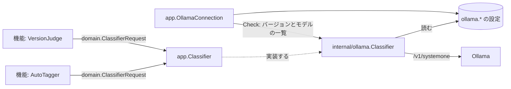

# AI 層: 分類器のポートとプロバイダ {#ai-layer-classifier-port-and-providers}

VVMDM の機能は、タスクに依存しない 1 つのポート `app.Classifier` を通じてのみ判定モデルに届き、その背後のプロバイダは `cmd/mdm` で選ぶアダプタだ。機能は、どのプロバイダが答えるか、それがどこで動くか、1 回の呼び出しで何個の質問を受け付けるかを知らない。プロバイダは、どの機能が問い合わせるか、質問が何を意味するかを知らない。

## ポート {#port}

ポートは、事実、画像、yes/no の質問からなるリクエストで、質問ごとの確率で答えられる。[`internal/domain/classifier.go`](../../internal/domain/classifier.go) と [`internal/app/classifier.go`](../../internal/app/classifier.go) で定義している。

| 値 | 持つもの |
| --- | --- |
| `ClassifierInput.Facts` | `title`、`file_name`、`folder` などの名前付きのテキストの手がかり |
| `ClassifierInput.Images` | 順に示す JPEG 画像 |
| `ClassifierQuestion` | リクエスト内で一意なキーと、英語の質問文 |
| 結果 | 答えたキーごとの 0 から 1 の確率。答えなかったキーは含まない |

リクエストの質問の数に上限はない。事実と質問の文言は機能が組み立て、確率を判断に変えるのも機能だ。

| 機能 | リクエスト | 文書 |
| --- | --- | --- |
| 自動タグ付け | 候補のタグごとに質問 1 つ。サムネイル、8 フレーム、事実 `title`、`file_name`、`folder` | [auto-tagging.md](auto-tagging.md) |
| 重複判定 | 質問 1 つ。フレーム A の横にフレーム B を並べた画像を最大 4 枚、事実はなし。Ollama の接続を保存した後にだけ送る | [duplicate-judging.md](duplicate-judging.md) |

## Ollama のプロバイダ {#ollama-provider}

[`internal/ollama`](../../internal/ollama) は、Ollama の判定 API (`POST /v1/systemone`) と Clef のモデルでポートを実装する。このプロバイダに固有のことはすべてここが持つ。

| 事項 | ルール |
| --- | --- |
| 接続 | 保存した URL とモデル (`ollama.endpoint`、`ollama.model`) を呼び出しのたびに読むので、変更は再起動なしで反映される |
| 送信形式 | 事実は `state` オブジェクトに、画像は base64 の `images` に、質問はすべて `noul` の質問になる |
| バッチ | 1 回の呼び出しに 16 個の質問を、すべて同じ入力で送る。回答はまとめる |
| 時間 | 1 回の呼び出しは 10 分でタイムアウトする。モデルは呼び出しの後 10 分間読み込まれたままになる (`keep_alive`) |
| エラー | Ollama の JSON 応答の `error` の文言だけを伝える。それ以外の本文は捨てる |

Ollama は 1 回のリクエストで 64 個の質問を受け付けるが、64 個の質問とサムネイルで入力は約 7,400 トークンになり、15 GB の CPU マシン上の Clef-flash はメモリ不足で強制終了された。16 個の質問では、サムネイルだけのとき約 2,000 トークンになる。画像はバッチごとに処理し直されるので、リクエスト 1 回あたりの時間は質問の数に応じて増える。GPU のない 4 コアの CPU では、質問が 9 個のとき、Clef-flash はサムネイル 1 枚に約 100 秒かかった。公表されている GPU での遅延は 0.2 秒未満だ。

`app.OllamaConnection` は、Settings の Ollama (`/api/settings/ollama`、`/api/settings/ollama/check`) で、URL とモデルを保存し、接続テストを実行する。どの機能の設定とも別なので、それを使う機能がすべてオフの間も接続を設定してテストできる。サーバーはリクエスト本文の URL には決してリクエストを送らない。そうしなければ、リクエストによってサーバーに到達可能な任意のアドレスを取得させ、その応答を表示させることができてしまう。

テストは何を証明するかで分けるので、どの失敗もその原因を示し、接続テストはモデルが何に使われるかに依存しない。

| テスト | 証明すること | リクエスト | 時間 |
| --- | --- | --- | --- |
| 接続 (Settings、Ollama) | URL で Ollama が動いていて、モデルを持っていること (タグのない名前は `:latest` を意味する) | `GET /api/version`、`GET /api/tags` | 数秒。モデルは読み込まない |
| 判定 (Settings、Auto-tagging、"Test judging") | 分類器のポートが質問に確率で答えること | `app.Classifier` を通じた 1 つの質問 | モデルを読み込むので、最大で数分 |

接続テストは、Ollama に到達できない、サーバーが Ollama ではない、モデルがない、のいずれかを報告する。判定テストはポートを使う機能に属するので、背後にどのプロバイダがあっても動く。

| 設定 | 既定値 |
| --- | --- |
| Ollama URL | `http://127.0.0.1:11434` |
| Model | `clef-flash` (`clef` は 27B で、より正確) |

## 画像編集のプロバイダ {#image-edit-provider}

[`internal/comfyui`](../../internal/comfyui) は画像編集のプロバイダだ。1 つのアダプタがセルフホストの ComfyUI と Comfy Cloud の両方を扱い、両者の違いはこのパッケージの中に閉じ込める ([045 research R-1、R-5](../../specs/045-comfyui-thumbnails/research.md#r-1-an-image-edit-port-in-internalapp-one-internalcomfyui-adapter-for-both-providers))。`internal/app` は自身が使うインターフェースを宣言し、`cmd/mdm` がアダプタを渡す。depguard は `internal/app` がアダプタを import しないようにする。

`app.ComfyUIConnection` は、`/api/settings/comfyui` と `/api/settings/comfyui/check` で、接続を保存し、接続テストを実行する。`app.OllamaConnection` が自動タグ付けと別であるように、プロバイダを使うサムネイルの機能とは別だ。

| 設定 | 持つもの | 使うもの |
| --- | --- | --- |
| `comfyui.provider` | `self_hosted` または `cloud`。所有者が保存するまではない | 両方 |
| `comfyui.url` | ベース URL。`ollama.endpoint` と同じように正規化する | セルフホスト |
| `comfyui.api_key` | Comfy Cloud の API キー | Comfy Cloud |
| `comfyui.model` | 編集を実行するモデル。`flux2_klein_4b` または `qwen_image_edit_2511`。ない場合は `flux2_klein_4b` | 両方 |

所有者がもう一方のプロバイダに切り替えても、それぞれのプロバイダは自身の値を保持するので、元に戻しても URL やキーを再び求めない。

各モデルは同梱のワークフローを 2 つ 1 組で持つ。`vv:reference` を使わないものと使うものの 2 つで、どちらの組も同じ `vv:*` ノードを埋める。違うのは指示の入力だけだ。FLUX.2 [klein] では `CLIPTextEncode` の `text`、Qwen-Image-Edit では `TextEncodeQwenImageEditPlus` の `prompt` になる。実行は、開始時に保存されているモデルの組を使う。

| モデル | 強み | モデルファイル | Comfy Cloud での編集 1 回あたりの時間 |
| --- | --- | --- | --- |
| FLUX.2 [klein] 4B fp8 (既定) | 字幕を最も確実に消す | 約 12 GB | 8〜16 秒 ([R-12](../../specs/045-comfyui-thumbnails/research.md#r-12-the-model-is-flux2-klein-4b-fp8)) |
| Qwen-Image-Edit-2511 fp8mixed、Lightning 4 ステップ LoRA | 参照画像の色と雰囲気を取り込む | 約 31 GB | アップロードを含めて約 23 秒 |

Qwen-Image-Edit の時間は合成した 1 枚のフレームで計測した。セルフホストの ComfyUI でこのモデルを使うには 24 GB の GPU が必要だ。このモデルの既知の弱点は POC から得たものだ。日本語の指示を一度読み違え、フレーム内の画面にモザイクをかけた (R-12)。所有者が Settings でモデルを選ぶので、既定は主な用途に最も優れたモデルのままにする。

API キーは書き込み専用だ。`GET` は `apiKeySet` を答え、キーは決して答えない。`Cache-Control: no-store` を付ける。`apiKey` のない `PUT` は保存済みのキーを保持し、空文字列はキーを消す。キーは平文で保存する。暗号化の鍵は同じデータフォルダに置かれることになるので、暗号化してもデータベースを読む者から何も守れない ([R-9](../../specs/045-comfyui-thumbnails/research.md#r-9-the-api-key-is-write-only))。

| 接続テスト | リクエスト | 利用できないと判断する条件 |
| --- | --- | --- |
| セルフホスト | 保存した URL への `GET /system_stats` | URL に到達できない、または応答が ComfyUI のシステム情報ではない |
| Comfy Cloud | `X-API-Key` を付けた `GET https://cloud.comfy.org/api/jobs?limit=1` | Comfy Cloud に到達できない、またはキーに対して `401` か `403` を返す |

プロバイダが応答すると、テストは `GET /object_info` を読み、vv が [`internal/comfyui/workflows`](../../internal/comfyui/workflows) に同梱する、保存済みのモデルの 2 つのワークフローを確認する。ワークフローが使うすべての `class_type` が存在しなければならず、ローダーノードが指定するすべてのモデルファイルがそのローダーの選択肢に含まれていなければならない。確認は `missing` の一覧を付けて利用できないと答える。一覧には、各モデルファイルをその `models` 以下のフォルダとダウンロードページとともに並べ、続いて欠けている各ノードの型を並べる。ノードの型の対処は ComfyUI の更新だ ([R-13](../../specs/045-comfyui-thumbnails/research.md#r-13-the-connection-test-checks-the-workflows-nodes-and-model-files))。ワークフローの正は埋め込んだファイルだ。所有者向けの手順は [comfyui-thumbnails.md](../how-to/comfyui-thumbnails.md) にある。`GET /api/thumbnail-edits/readiness` は接続が保存されているかを答える。動画ページが編集を有効にするのに必要なのはこの情報だ。このエンドポイントはテストを実行しない。

テストは、何も保存されていないときもそれを報告する。原因ごとに別のメッセージがあり、どのメッセージも応答の本文を含まない。テストはリダイレクトをたどらないので、キーが別のホストに送られることはない。Ollama と同じく、サーバーは保存した接続にのみリクエストを送り、リクエスト本文の URL には決して送らない。

## プロバイダの追加 {#adding-a-provider}

新しいプロバイダは、`Classify(ctx, domain.ClassifierRequest)` を実装し、自身の設定を読み、自身の上限に合わせてリクエストを分割する新しいアダプタのパッケージだ。`cmd/mdm` は `internal/ollama` の代わりにそれを機能に渡す。機能は変わらない。depguard は `internal/app` がプロバイダのパッケージを import しないようにする ([.golangci.yml](../../.golangci.yml))。

| 採用しなかった案 | 理由 |
| --- | --- |
| 機能がリクエストごとに URL とモデルを渡す | すべての機能がプロバイダの設定を読むことになり、プロバイダを変えるとすべての機能が変わる |
| 機能が質問をプロバイダの上限に合わせて分割する | 上限は 1 つのプロバイダのメモリ使用量から来ており、別のプロバイダの上限は異なる |
| Ollama の設定と接続テストを自動タグ付けのユースケースの中に置く | 分類器を使う 2 つ目の機能が自動タグ付けに依存することになる |
| 1 つの質問を判定させて接続をテストする | モデルの読み込み中は数分かかり、読み込みのタイムアウトが接続の失敗に見え、判定できないモデル (一般的なチャットモデル) では必ず失敗する |
