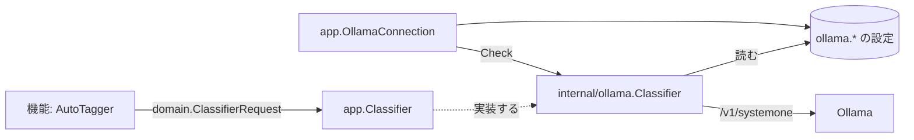

# AI 層: 分類器のポートとプロバイダ {#ai-layer-classifier-port-and-providers}

VVMDM の機能は、タスクに依存しない 1 つのポート `app.Classifier` を通じてのみ判定モデルに届き、その背後のプロバイダは `cmd/mdm` で選ぶアダプタだ。機能は、どのプロバイダが答えるか、それがどこで動くか、1 回の呼び出しで何個の質問を受け付けるかを知らない。プロバイダは、どの機能が問い合わせるか、質問が何を意味するかを知らない。

## ポート {#port}

ポートは、事実、画像、yes/no の質問からなるリクエストで、質問ごとの確率で答えられる。[`internal/domain/classifier.go`](../../internal/domain/classifier.go) と [`internal/app/classifier.go`](../../internal/app/classifier.go) で定義している。

| 値 | 持つもの |
| --- | --- |
| `ClassifierInput.Facts` | `title`、`file_name`、`folder` などの名前付きのテキストの手がかり |
| `ClassifierInput.Images` | 順に示す JPEG 画像 |
| `ClassifierQuestion` | リクエスト内で一意なキーと、英語の質問文 |
| 結果 | 答えたキーごとの 0 から 1 の確率。答えなかったキーは含まない |

リクエストの質問の数に上限はない。事実と質問の文言は機能が組み立て、確率を判断に変えるのも機能だ。自動タグ付けでは [auto-tagging.md](auto-tagging.md) がそれにあたる。

## Ollama のプロバイダ {#ollama-provider}

[`internal/ollama`](../../internal/ollama) は、Ollama の判定 API (`POST /v1/systemone`) と Clef のモデルでポートを実装する。このプロバイダに固有のことはすべてここが持つ。

| 事項 | ルール |
| --- | --- |
| 接続 | 保存した URL とモデル (`ollama.endpoint`、`ollama.model`) を呼び出しのたびに読むので、変更は再起動なしで反映される |
| 送信形式 | 事実は `state` オブジェクトに、画像は base64 の `images` に、質問はすべて `noul` の質問になる |
| バッチ | 1 回の呼び出しに 16 個の質問を、すべて同じ入力で送る。回答はまとめる |
| 時間 | 1 回の呼び出しは 10 分でタイムアウトする。モデルは呼び出しの後 10 分間読み込まれたままになる (`keep_alive`) |
| エラー | Ollama の JSON 応答の `error` の文言だけを伝える。それ以外の本文は捨てる |

Ollama は 1 回のリクエストで 64 個の質問を受け付けるが、64 個の質問とサムネイルで入力は約 7,400 トークンになり、15 GB の CPU マシン上の Clef-flash はメモリ不足で強制終了された。16 個の質問では、サムネイルだけのとき約 2,000 トークンになる。画像はバッチごとに処理し直されるので、リクエスト 1 回あたりの時間は質問の数に応じて増える。GPU のない 4 コアの CPU では、質問が 9 個のとき、Clef-flash はサムネイル 1 枚に約 100 秒かかった。公表されている GPU での遅延は 0.2 秒未満だ。

`app.OllamaConnection` は、Settings の Ollama (`/api/settings/ollama`、`/api/settings/ollama/check`) で、URL とモデルを保存し、接続テストを実行する。どの機能の設定とも別なので、それを使う機能がすべてオフの間も接続を設定してテストできる。テストは同じアダプタを通じて、保存した URL に質問を 1 つ送る。サーバーはリクエスト本文の URL には決してリクエストを送らない。そうしなければ、リクエストによってサーバーに到達可能な任意のアドレスを取得させ、その応答を表示させることができてしまう。

| 設定 | 既定値 |
| --- | --- |
| Ollama URL | `http://127.0.0.1:11434` |
| Model | `clef-flash` (`clef` は 27B で、より正確) |

## プロバイダの追加 {#adding-a-provider}

新しいプロバイダは、`Classify(ctx, domain.ClassifierRequest)` を実装し、自身の設定を読み、自身の上限に合わせてリクエストを分割する新しいアダプタのパッケージだ。`cmd/mdm` は `internal/ollama` の代わりにそれを機能に渡す。機能は変わらない。depguard は `internal/app` がプロバイダのパッケージを import しないようにする ([.golangci.yml](../../.golangci.yml))。

| 採用しなかった案 | 理由 |
| --- | --- |
| 機能がリクエストごとに URL とモデルを渡す | すべての機能がプロバイダの設定を読むことになり、プロバイダを変えるとすべての機能が変わる |
| 機能が質問をプロバイダの上限に合わせて分割する | 上限は 1 つのプロバイダのメモリ使用量から来ており、別のプロバイダの上限は異なる |
| Ollama の設定と接続テストを自動タグ付けのユースケースの中に置く | 分類器を使う 2 つ目の機能が自動タグ付けに依存することになる |
