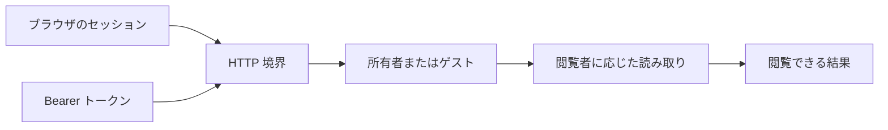

# 認証と公開範囲 {#authentication-and-visibility}

VVMDM には 1 つの所有者アカウントとゲストの閲覧者がいる。認証は HTTP 境界で閲覧者を選び、ストレージは動画、場所、フォルダを返す前にすべての読み取りを絞り込む。

図は 2 つの認証方法と共通の公開範囲の境界を示す。

## アカウントと認証情報 {#account-and-credentials}

初期設定ではアカウントと最初のセッションを 1 つのトランザクションで作るため、同時に届いた設定要求でも所有者を 2 人作れない。パスワードは PHC 形式の Argon2id を使う。認証情報を変更すると既存のセッションと API トークンを同時に無効にし、古い認証情報によるアクセスを防ぐ。

アプリケーションは初期設定とログインの試行制限を担当し、`internal/password` はハッシュ化、`internal/store` はアカウント、セッション、トークンを担当する。

## データ境界での公開範囲 {#visibility-at-the-data-boundary}

`domain.Audience` の既定値はゲストだ。各読み取りは閲覧者を受け取り、非公開の動画は存在しない動画と同じ `404` を返す。ページ分けと集約の前に絞り込むため、個々の動画の読み取りだけでなく、件数、グループ、関連する結果、後続のページにも非公開の項目は現れない。

公開フラグは再構築できる動画の行ではなく、永続的な内容の識別子に属する。再スキャンによって所有者の公開設定は変わらない。

## ブラウザと外部 API {#browser-and-external-api}

画面 API はセッション Cookie を使う。外部 API と MCP は Bearer トークンを使い、同じアプリケーションとストレージの操作を使う。[画面 API スキーマ](../../api/openapi.yaml)の操作ごとのセキュリティ宣言は、HTTP ルートの分類と照合される。外部操作は[外部スキーマ](../../api/external-v1.yaml)で定義され、トークンの設定と例は[外部 API の手順書](../how-to/external-api.md)にある。
