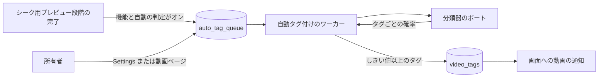
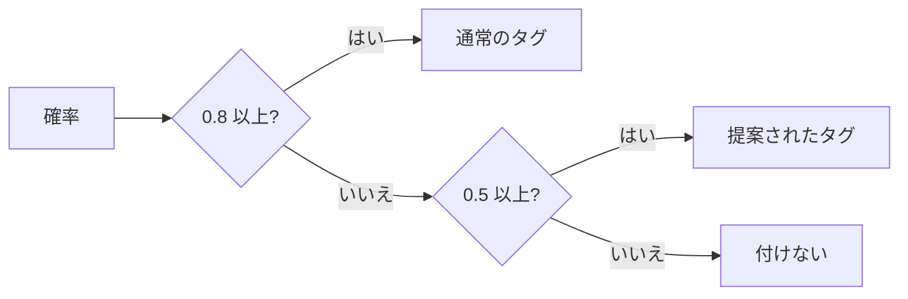
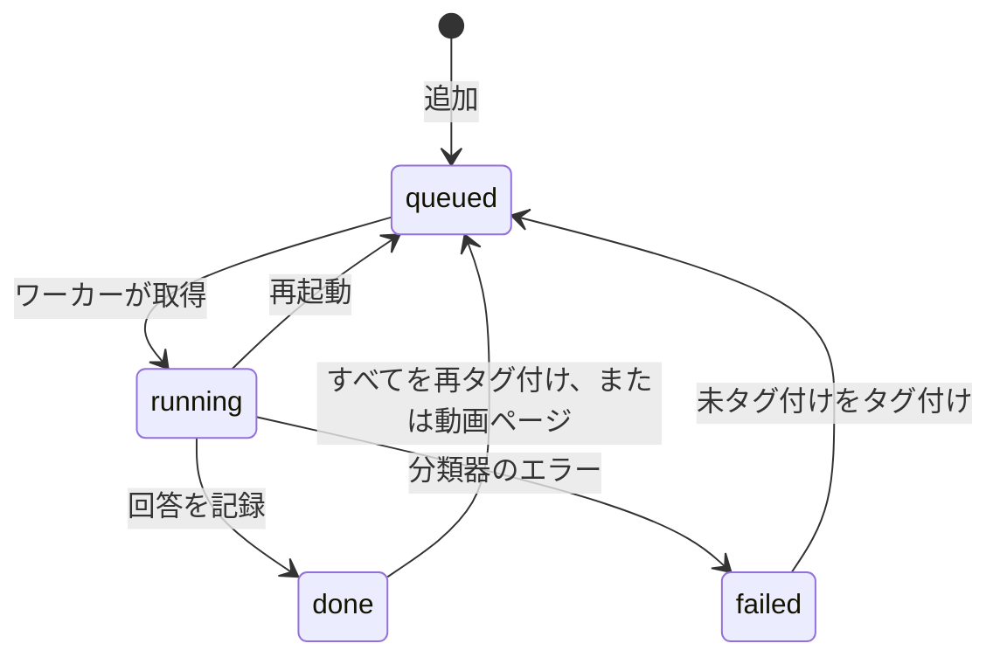

# 判定モデルによる自動タグ付け {#auto-tagging-with-a-decision-model}

VVMDM は、判定モデルに動画に合う既存のタグを問い合わせ、確率がしきい値に達したタグを追加する。ユースケースは [`internal/app/auto_tag.go`](../../internal/app/auto_tag.go)、キューは [`internal/store/auto_tags.go`](../../internal/store/auto_tags.go) にある。モデルには分類器のポートを通じて届き、そのプロバイダは現在、Ollama 上の Cloudflare の Clef または Clef-flash だ ([ai-layer.md](ai-layer.md))。自動タグ付けはプロバイダを知らない。

図は、動画が分類器に届く流れと、タグが戻る流れを示す。

## 分類器へのリクエスト {#classifier-request}

候補のタグはそれぞれ 1 つの yes/no の質問になり、動画はライブラリのサムネイル、動画全体に散らばった 7 枚のフレーム、事実 `title`、`file_name`、`folder` として送る。1 本の動画についてのすべての質問は 1 回のリクエストでポートに渡し、ポートはそのプロバイダの必要に応じてそれらを分割する。

サムネイルは 1 つの場面を映すので、場面ごとに内容が異なる動画もその 1 つの場面だけで判定されてしまう。フレームによって分類器は残りの場面も見られる。フレームは取り込みがすでに作ったシーク用プレビューのシートから切り出すので、ffmpeg の処理は増えない。また、各フレームは 320 px 以下なので、サムネイルより少ない入力トークンで済む。Ollama は 8 枚を超える画像を含むリクエストを拒否する (`400 too many images, the maximum is 8`) ので、フレームは 7 枚にし、リクエストはサムネイルと合わせて 8 枚の画像を運ぶ。

| 入力 | 取得元 | ないとき |
| --- | --- | --- |
| 画像 | ライブラリのサムネイル (640 px)、続いてシーク用プレビューを 7 等分した各部分の中央の 7 枚のフレーム | 読める画像。1 枚も読めないときはテキストのみ |
| `title` | 表示名、なければファイルのタイトル | ないことはない |
| `file_name` | 代表の所在のファイル名 | ないことはない |
| `folder` | 代表の所在のフォルダを、そのメディアフォルダからの相対パスで、区切りを `/` にしたもの (メディアフォルダ `/mnt/nas/videos` にある `/mnt/nas/videos/trips/kyoto/bamboo.mp4` なら `trips/kyoto`) | メディアフォルダの直下にある動画では空 |

候補は、その回答がまだ動画のタグを変えうるタグだ。それ以外を問い合わせると、リクエストのたびに時間がかかり、結果は変わらない。

| タグ | 問い合わせるか |
| --- | --- |
| 動画に付いていない | はい |
| 動画に提案された (未確定の) タグとして付いている | はい。後の回答が "Probability to add" 以上なら確定する |
| 動画に通常のタグとしてすでに付いている | いいえ |
| 動画について却下された | いいえ |
| 仮のタグ (提案ではなく、タグの状態) | いいえ |

バージョンのまとまりのメンバーはタグを共有するので、付いているタグと却下はまとまりのものだ。

質問は、タグが動画のいずれかの部分に現れるか当てはまるかを尋ね、その同義語を挙げ、画像が動画全体から取ったものだと伝える。

フレームが役立つかどうかは質問の文言で決まる。猫、ロケット、コーヒー 1 杯が映る 30 秒の動画で、サムネイルに猫が映っている場合 (Ollama がリクエストを 8 枚の画像に制限する前に、8 枚のフレームで測定した):

| 画像と質問 | cat | coffee | rocket | 無関係なタグ |
| --- | --- | --- | --- | --- |
| サムネイル、"appears in any part" | 0.96 | 0.01 | 0.00 | 0.02 以下 |
| サムネイルと 8 枚のフレーム、"describes this video" | 0.60 | 0.61 | 0.17 | 0.01 以下 |
| サムネイルと 8 枚のフレーム、"appears in any part" | 0.93 | 0.85 | 0.70 | 0.00 |

タグが動画を説明しているかを尋ねると、モデルは動画全体を比べて判断するので、1 つの場面に合うタグはしきい値を下回る。

動画 1 本あたりの時間は候補の数に応じて増える。Ollama のプロバイダのバッチと測定した時間は [ai-layer.md](ai-layer.md#ollama-provider) にある。

| 採用しなかった案 | 理由 |
| --- | --- |
| サムネイルだけ | 1 つの場面しか映さないので、動画の残りの部分のタグを見落とす |
| 9 × 9 のシーク用プレビューのシート全体を 1 枚の画像として送る | 幅が最大 2,880 px あり、7 枚のフレームの数倍のトークンを使う |
| フォルダの絶対パス | メディアフォルダより上の部分は動画について何も表さず、マシンや OS によって異なり、リモートの Ollama ホストに届く |
| すべての動画ですべてのタグを問い合わせる | 動画にすでに付いているタグや動画について却下されたタグは変わりえず、1 つごとに時間が増える |

## 追加するタグ {#tags-it-adds}

確率によってタグの付け方が決まる。"Probability to add" (既定は 0.8) 以上なら通常のタグとして付け、"Probability to suggest" (既定は 0.5) 以上で "Probability to add" 未満なら提案された (未確定の) タグとして付け、"Probability to suggest" 未満なら付けない。タグは作成しない。

提案されたタグは、カードと動画ページに仮のマークを表示し、動画ページでは外す操作の代わりに残す操作と却下する操作を示す。残す、同じタグを手で追加する、または後の判定で "Probability to add" 以上になると、通常のタグになる。却下すると、タグを外し、その動画のタグとして `auto_tag_rejections` に記録するので、自動タグ付けはそのタグをその動画に二度と付けない。手で追加することは引き続きできる。2 つの確率を同じ値にすると、提案はオフになる。

中間の帯があるのは、しきい値付近の分類器の確率がどちらの側にも信頼できないからだ。試行では、誤ったタグ 1 つと正しいタグ 1 つ (3 つの場面を持つ動画のロケット、0.70) がどちらも 0.5 から 0.8 の間に入った。提案されたタグは、仮のタグと同じく、タグの絞り込みで通常のタグと同様に数える。

| 採用しなかった案 | 理由 |
| --- | --- |
| モデルの提案からタグを作成する | Clef は与えられた選択肢を採点するだけで、名前を生成しない |
| タグ自体を仮にする | 仮はすべての動画にわたるタグの状態であり、提案は 1 本の動画についてのものだ |
| しきい値を 1 つにする | その付近のタグは、落とされるか、確認されないまま付けられる |

## キューと動画を判定するとき {#queue-and-when-a-video-is-judged}

各動画の内容の鍵は `auto_tag_queue` に 1 行を持ち、その行は判定後も `done` のまま残る。これにより、その動画で自動の判定が繰り返されることはない。

| きっかけ | キューに入れるもの |
| --- | --- |
| シーク用プレビュー段階が完了し、"Tag new videos automatically" がオン | 行のない動画 |
| Settings の "Tag videos not yet tagged" | 行がないか、行が `failed` の動画 |
| Settings の "Tag all videos again" | `running` でないすべての動画 |
| 動画ページの "Suggest tags" | その動画。`running` のときを除く |
| オンボーディングでの興味の選択 | "Tag all videos again" と同じく、`running` でないすべての動画 |

どのきっかけも "Use auto-tagging" がオンであることを必要とする。オフの間は Settings の実行ボタンと動画ページのボタンが隠れ、API は `409 auto_tagging_off` でキューへの追加を拒否する。興味の選択は例外である。興味のタグと棚はそれでも作り、何もキューに入れず、`queued: 0` を返す。

興味の選択は、行のない動画だけでなく、すべての動画をキューに入れる。興味のタグが存在する前に判定された動画は、そのタグについて一度も問われていないからである ([057 research, R-6](../../specs/057-home/research.md#r-6-a-picked-interest-becomes-an-owner-shelf-and-auto-tagging-is-asked-again))。

`done` の行を残すので、所有者が外したタグは、同じ内容の次の取り込みで再び追加されない。1 つのワーカーが一度に 1 本の動画を判定するので、遅い CPU のみのプロバイダに、処理できない並列リクエストを送らない。

## 失敗 {#failures}

失敗したリクエストは、その行をプロバイダのメッセージとともに `failed` にし、ワーカーは次へ進む。所有者が再びキューに入れるまで、何も再試行しない。

Ollama が止まっていると、キューを塞ぐ代わりに、キューにある動画はすべて数秒以内に失敗し、Settings ページにその件数と最後のメッセージが表示される。終了時にまだ `running` の行は、次の起動時に `queued` に戻る。

## 設定 {#settings}

Settings の Auto-tagging セクション (`/api/settings/auto-tagging`) は、機能を使うかどうか、取り込み後の自動の判定、2 つの確率、キューの件数を持つ。プロバイダへの接続は別のセクションとリソースだ ([ai-layer.md](ai-layer.md#ollama-provider))。"Test judging" (`POST /api/auto-tagging/check`) は、機能がオンでもオフでも分類器のポートに質問を 1 つ送り、プロバイダが判定できることを示す。

自動タグ付けは任意で、既定ではオフだ。"Use auto-tagging" がオフの間は:

- ワーカーはキューにある動画を取得せず、プロバイダに接続しない。キューにある行は、機能が再びオンになるまで待つ。
- 取り込み、Settings、動画ページのいずれからも、何もキューに入らない。
- 動画ページに "Suggest tags" ボタンはない。
- すでに付いた提案されたタグは、引き続き残すことも却下することもできる。

| 設定 | 既定値 |
| --- | --- |
| Use auto-tagging | オフ |
| Tag new videos automatically | オフ (機能がオフの間は効果がない) |
| Probability to add | 0.8 |
| Probability to suggest | 0.5 ("Probability to add" と同じ値にすると提案はオフになる) |

| 採用しなかった案 | 理由 |
| --- | --- |
| 接続と機能のスイッチを 1 つのフォームにする | 接続のテストや変更が機能の設定の編集を意味し、機能をオフにすると接続を失ったように見える |
