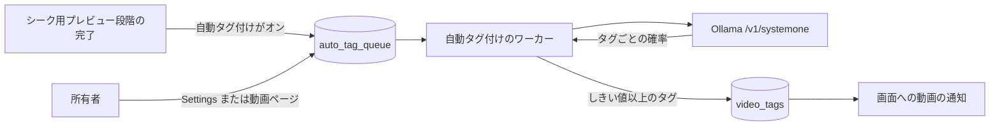
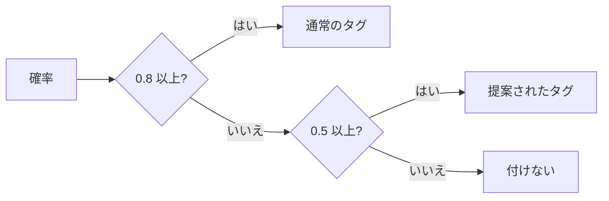
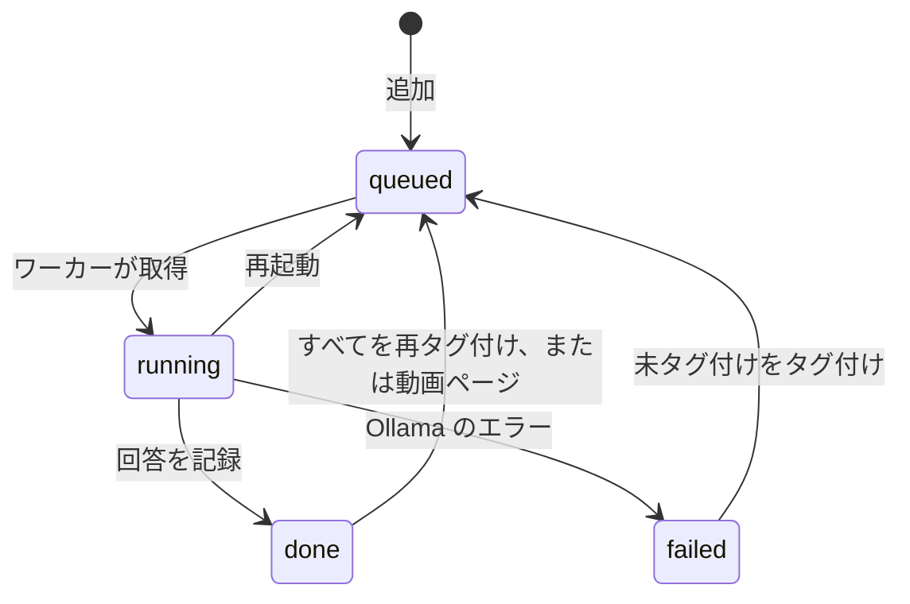

# Ollama 上の Clef 分類器による自動タグ付け {#auto-tagging-with-a-clef-classifier-in-ollama}

VVMDM は、Ollama で動く判定モデル (Cloudflare の Clef または Clef-flash) に、動画に合う既存のタグを問い合わせ、確率がしきい値に達したタグを追加する。ユースケースは [`internal/app/auto_tag.go`](../../internal/app/auto_tag.go)、キューは [`internal/store/auto_tags.go`](../../internal/store/auto_tags.go)、Ollama クライアントは [`internal/clef`](../../internal/clef) にある。

図は、動画が分類器に届く流れと、タグが戻る流れを示す。

## 分類器へのリクエスト {#classifier-request}

既存のタグはそれぞれ 1 つの yes/no (`noul`) の質問になり、動画はライブラリのサムネイル、動画全体に散らばった 8 枚のフレーム、タイトル、ファイル名、フォルダを入れた JSON の状態として送る。

サムネイルは 1 つの場面を映すので、場面ごとに内容が異なる動画もその 1 つの場面だけで判定されてしまう。フレームによって分類器は残りの場面も見られる。フレームは取り込みがすでに作ったシーク用プレビューのシートから切り出すので、ffmpeg の処理は増えない。また、各フレームは 320 px 以下なので、サムネイルより少ない入力トークンで済む。

| 入力 | 取得元 | ないとき |
| --- | --- | --- |
| 画像 | ライブラリのサムネイル (640 px)、続いてシーク用プレビューを 8 等分した各部分の中央の 8 枚のフレーム | 読める画像。1 枚も読めないときはテキストのみ |
| `title` | 表示名、なければファイルのタイトル | ないことはない |
| `file_name`、`folder` | 代表の所在のパス | ないことはない |

Clef はすべての質問を非自己回帰の 1 回の処理で採点し、質問ごとに確率を返す。1 回のリクエストは 16 個のタグを運び、タグがそれより多いライブラリは、同じ画像とともに 16 個ずつに分けて送る。質問は、タグが動画のいずれかの部分に現れるか当てはまるかを尋ね、その同義語を挙げ、画像が動画全体から取ったものだと伝える。仮のタグについては問い合わせない。

フレームが役立つかどうかは質問の文言で決まる。猫、ロケット、コーヒー 1 杯が映る 30 秒の動画で、サムネイルに猫が映っている場合:

| 画像と質問 | cat | coffee | rocket | 無関係なタグ |
| --- | --- | --- | --- | --- |
| サムネイル、"appears in any part" | 0.96 | 0.01 | 0.00 | 0.02 以下 |
| サムネイルと 8 枚のフレーム、"describes this video" | 0.60 | 0.61 | 0.17 | 0.01 以下 |
| サムネイルと 8 枚のフレーム、"appears in any part" | 0.93 | 0.85 | 0.70 | 0.00 |

タグが動画を説明しているかを尋ねると、モデルは動画全体を比べて判断するので、1 つの場面に合うタグはしきい値を下回る。

Ollama は 1 回のリクエストで 64 個の質問を受け付けるが、64 個の質問とサムネイルで入力は約 7,400 トークンになり、15 GB の CPU マシン上の Clef-flash はメモリ不足で強制終了された。16 個の質問では、サムネイルだけのとき約 2,000 トークンになる。画像はバッチごとに処理し直されるので、動画 1 本あたりの時間はタグの数に応じて増える。GPU のない 4 コアの CPU では、タグが 9 個のとき、Clef-flash はサムネイル 1 枚に約 100 秒かかった。公表されている GPU での遅延は 0.2 秒未満だ。

| 採用しなかった案 | 理由 |
| --- | --- |
| サムネイルだけ | 1 つの場面しか映さないので、動画の残りの部分のタグを見落とす |
| 9 × 9 のシーク用プレビューのシート全体を 1 枚の画像として送る | 幅が最大 2,880 px あり、8 枚のフレームの数倍のトークンを使う |

## 追加するタグ {#tags-it-adds}

確率によってタグの付け方が決まる。"Probability to add" (既定は 0.8) 以上なら通常のタグとして付け、"Probability to suggest" (既定は 0.5) 以上で "Probability to add" 未満なら提案された (未確定の) タグとして付け、"Probability to suggest" 未満なら付けない。タグは作成しない。

提案されたタグは、カードと動画ページに仮のマークを表示し、動画ページでは外す操作の代わりに残す操作と却下する操作を示す。残す、同じタグを手で追加する、または後の判定で "Probability to add" 以上になると、通常のタグになる。却下すると、タグを外し、その動画のタグとして `auto_tag_rejections` に記録するので、自動タグ付けはそのタグをその動画に二度と付けない。手で追加することは引き続きできる。2 つの確率を同じ値にすると、提案はオフになる。

中間の帯があるのは、しきい値付近の分類器の確率がどちらの側にも信頼できないからだ。試行では、誤ったタグ 1 つと正しいタグ 1 つ (3 つの場面を持つ動画のロケット、0.70) がどちらも 0.5 から 0.8 の間に入った。提案されたタグは、仮のタグと同じく、タグの絞り込みで通常のタグと同様に数える。

| 採用しなかった案 | 理由 |
| --- | --- |
| モデルの提案からタグを作成する | Clef は与えられた選択肢を採点するだけで、名前を生成しない |
| タグ自体を仮にする | 仮はすべての動画にわたるタグの状態であり、提案は 1 本の動画についてのものだ |
| しきい値を 1 つにする | その付近のタグは、落とされるか、確認されないまま付けられる |

## キューと動画を判定するとき {#queue-and-when-a-video-is-judged}

各動画の内容の鍵は `auto_tag_queue` に 1 行を持ち、その行は判定後も `done` のまま残る。これにより、その動画で自動の判定が繰り返されることはない。

| きっかけ | キューに入れるもの |
| --- | --- |
| シーク用プレビュー段階が完了し、"Tag new videos automatically" がオン | 行のない動画 |
| Settings の "Tag videos not yet tagged" | 行がないか、行が `failed` の動画 |
| Settings の "Tag all videos again" | `running` でないすべての動画 |
| 動画ページの "Suggest tags" | その動画。`running` のときを除く |

`done` の行を残すので、所有者が外したタグは、同じ内容の次の取り込みで再び追加されない。1 つのワーカーが一度に 1 本の動画を判定するので、遅い CPU のみの Ollama に、処理できない並列リクエストを送らない。

## 失敗 {#failures}

失敗したリクエストは、その行を Ollama のメッセージとともに `failed` にし、ワーカーは次へ進む。所有者が再びキューに入れるまで、何も再試行しない。

Ollama が止まっていると、キューを塞ぐ代わりに、キューにある動画はすべて数秒以内に失敗し、Settings ページにその件数と最後のメッセージが表示される。終了時にまだ `running` の行は、次の起動時に `queued` に戻る。

## 設定 {#settings}

所有者は Settings の Auto-tagging で、Ollama の URL、モデル、2 つの確率、自動の判定を設定する。"Save and test connection" はフォームを保存し、保存した URL に質問を 1 つ送る。

サーバーは保存した URL にだけリクエストを送り、リクエスト本文の URL には決して送らない。また、Ollama の JSON 応答のうちエラーの文言だけを伝える。そうしなければ、リクエストによってサーバーに到達可能な任意のアドレスを取得させ、その応答を表示させることができてしまう。

| 設定 | 既定値 |
| --- | --- |
| Tag new videos automatically | オフ |
| Ollama URL | `http://127.0.0.1:11434` |
| Model | `clef-flash` (`clef` は 27B で、より正確) |
| Probability to add | 0.8 |
| Probability to suggest | 0.5 ("Probability to add" と同じ値にすると提案はオフになる) |
