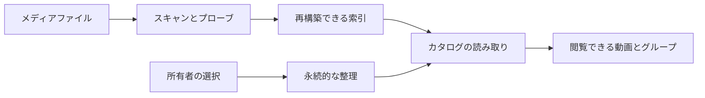

# カタログの整理と永続的な識別子 {#catalog-organization-and-persistent-identity}

カタログは再構築できるファイル索引と、所有者による永続的な整理を分ける。ユーザーの選択は内容の鍵またはそれぞれのエンティティ ID を使うため、索引を再構築しても消えない。

図は、閲覧者に応じた読み取りで 2 種類のデータを結び付ける様子を示す。

## 識別子と回復 {#identity-and-recovery}

内容の識別子はファイルの移動や名前の変更後も保たれる。場所は、索引付けされた内容を再生できる位置を示すもので、タグ、お気に入り、視聴履歴、表示の上書き、作品情報を所有しない。フォルダから作るグループは安定したフォルダの識別子を使う。手動のグループ、プレイリスト、人物、組織はそれぞれ独自の ID を持つ。

データベースのマイグレーションがスキーマを定義する。回復時の区別は[データと回復](../how-to/running-vv.md#data-and-recovery)に、起動時の再構築は[プロセスのライフサイクル](process-lifecycle.md)に記載されている。

## 動画を整理する方法 {#ways-to-organize-videos}

| 仕組み | 意味 |
| --- | --- |
| バージョンのまとまり | 同じ動画を表す異なるファイル。カタログの結果には代表を 1 つ表示する |
| グループ | フォルダから作る、または手動で配置する、動画とグループの集まり |
| プレイリスト | 順序を持つ再生列 |
| スマートフォルダ | 現在のカタログに対して評価する、保存された条件 |
| タグとタグの種類 | 再利用できるラベルとその分類 |
| 作品情報 | 永続的な人物と組織に結び付いた動画の情報 |
| お気に入りと視聴履歴 | スキャンを越えて保持される所有者の選択と再生履歴 |

フォルダの閲覧と自動的な所属判定は、ファイルシステムを新たに走査せず、データベースを使う。スマートフォルダへの所属はその条件に従い、動画 ID を複製した集合ではない。バージョンの検出とファイルをまとめる選択は別の判断だ（[重複判定](duplicate-judging.md)）。

## 検索と公開範囲 {#search-and-visibility}

保存された検索キーと並び順のキーによって、場所とタグ名の照合と並び順が一貫する。起動時には正規化のバージョンが変わったキーを更新する。すべてのカタログの読み取りは、件数を数えたりページを分けたりする前に閲覧者に応じて絞り込むため、ゲストはコレクションや検索から非公開の動画を見つけられない。

画面の操作とフィールドの定義は[画面 API スキーマ](../../api/openapi.yaml)にある。仮のタグと却下した名前を含む外部からのタグ操作は[外部 API の手順書](../how-to/external-api.md)に記載されている。レイアウトとコントロールは[デザインシステム](design-system.md)と[ライブラリ UI](library-ui.md)に従う。
