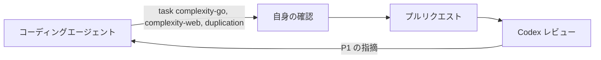

# 複雑度と重複 {#complexity-and-duplication}

変更は、追加する関数と複雑にする関数のそれぞれの複雑度を 25 以下に保ち、コードをコピーせずに共有する。[AGENTS.md](../../AGENTS.md) は、コーディングエージェントにこれを確認するよう指示し、Codex レビューに違反を指摘するよう指示する。

図は、ルールが変更のどこで働くかを示す。

## 上限 {#the-limits}

25 を超える関数は分割すると分かりやすくなる関数であり、コピーしたブロックは共有すると揃ったまま保てるブロックだ。

| 上限 | 測定するツール | 確認の方法 |
| --- | --- | --- |
| Go の関数の複雑度は 25 以下 | gocyclo | `task complexity-go`。`reports/quality/complexity-go/gocyclo.txt` は最も複雑な関数を先頭に並べる |
| Web の関数の複雑度は 25 以下で、`switch` は 1 と数える | ESLint の `complexity`、`variant: "modified"` | `web/` で `npx eslint --rule 'complexity: [error, {max: 25, variant: modified}]' <files>` |
| コードはコピーせずに共有する | jscpd | `task duplication`。`reports/quality/duplication/jscpd-report.json` は各クローンの 2 つの場所を示す |

Go は `if err != nil` ごとに 1 を加えるため、データベースを読む単純な関数は 15 を超える。`modified` 方式は、`case` の多い対応付けを複雑と数えないようにする。テストと生成コードは上限の対象外で、変更が移動しただけのコードは新しいコードではない。

## ルールはエージェントとレビューを導き、CI を失敗させない {#the-rules-guide-the-agent-and-the-review-and-do-not-fail-ci}

コーディングエージェントと Codex レビューは `AGENTS.md` の上限を読む。CI のどの確認も上限によって失敗しない。既存のコードには 25 を超える Go の関数が 5 つと Web のファイルが 9 つ、Web のクローンが 5 つあり、lint ルールにするなら、これらを例外として列挙するか、すべて直るまで待つか、指摘を変更行に絞り込む必要がある。変更そのものを判断すれば、移動した関数と新しい関数を区別でき、上限を超えて大きくなる既存の関数も見つけられる。

## レビューは違反を P1 として指摘する {#the-review-raises-a-breach-as-p1}

`AGENTS.md` の `Review guidelines` 節は違反を P1 の指摘とする。GitHub 上の Codex レビューは P0 と P1 の指摘だけを投稿するためだ。プルリクエストを進めるエージェントはレビューの指摘をそれぞれ検証して本物の指摘を直すため、エージェントの変更にある違反はマージ前に直る。手でマージされるプルリクエストは止められない。

| 採用しなかった案 | 理由 |
| --- | --- |
| 既存の違反を名前で列挙したうえで lint を失敗させる | 9 つの Web ファイルをファイルごと除外する必要があったため、その中の新しいコードが確認されず、一覧には所有者がいなかった |
| lint ルールを追加する前に既存の違反をすべて直す | エージェントがすでに上限に従っている間は、リファクタリングのコストがルールの価値を上回る |
| 変更行だけで lint を失敗させる（reviewdog、`new-from-merge-base`） | 複雑度の指摘は関数の最初の行に付くため、内部で大きくなる関数を見逃し、移動したコードは古い違反で失敗し、ツールも 1 つ増える |
| 変更行に対するミューテーションテスト | スライスの容量のように、どのテストでも区別できないミュータントを避ける手段がない |
| 閾値 15 | Go のエラー確認により、定型的なデータベースの関数がこれを超える |
