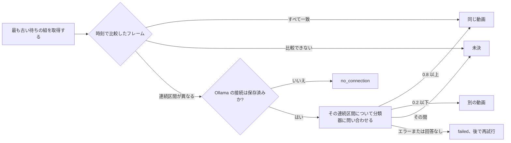

# 重複の候補を自動で判定する {#judging-possible-duplicates-automatically}

VVMDM は重複の候補をそれぞれ 1 組ずつ、まず保存済みの 2 つの指紋から判定し、フレームが異なる区間についてだけ、その後で分類器のポートに問い合わせて判定する。ワーカーは [`internal/app/version_judge.go`](../../internal/app/version_judge.go)、フレームのルールは [`internal/domain/version_frames.go`](../../internal/domain/version_frames.go)、待ち行列と結果は [`internal/store/version_judgements.go`](../../internal/store/version_judgements.go) だ。各ルールの理由は [054 research](../../specs/054-auto-dup/research.md) にある。

図は、1 つの候補を取得から結果まで示す。

## フレームのルールが先に判定する {#the-frame-rule-decides-first}

フレームは候補の検査が組にするのと同じように時刻で組にして平坦なフレームを飛ばし、組は距離が 12 (`FingerprintMatchMaxDistance`) を超えると異なるとする。候補の検査が使う中央値は差し替えられた区間を隠すが、フレームごとの一覧はそれを示す ([R-1](../../specs/054-auto-dup/research.md#r-1-the-fingerprints-decide-first-the-model-is-asked-only-when-a-section-differs))。

| フレーム | 結果 | モデルに見せるフレーム |
| --- | --- | --- |
| 異なるのが 5% 以下で、2 つ続けて異なることがない | 同じ動画。リクエストなし | なし |
| 2 つ以上続けて異なる | モデルに問い合わせる | 最も長い連続区間 (同じ長さなら前のもの) |
| 5% を超えて異なるが、続けて異なるものはない | モデルに問い合わせる | 異なるすべてのフレーム |
| 比較できる組が 3 未満、または指紋のバージョンが異なる | 未決。所有者に任せる | なし |

4 つを超えるフレームは連続区間全体に散らして選ぶので、リクエストが運ぶ画像は最大 4 枚だ。

## モデルは名前ではなくフレームを見る {#the-model-sees-the-frames-not-the-names}

各画像は左にフレーム A、右にそれと組になるフレーム B を置いたもので、[`internal/artifacts`](../../internal/artifacts/seek_frames.go) が 2 つのシーク用プレビューから切り出し、B は A のフレームの大きさに合わせて拡大縮小する。リクエストは事実を持たない: ファイル名もフォルダも長さもない ([R-2](../../specs/054-auto-dup/research.md#r-2-the-model-sees-the-frames-where-the-two-files-differ)、[R-11](../../specs/054-auto-dup/research.md#r-11-the-request-carries-no-file-names))。質問と、しきい値の 0.8 と 0.2 は `internal/domain` に固定している ([R-3](../../specs/054-auto-dup/research.md#r-3-the-question-wording-and-two-fixed-thresholds))。

| 採用しなかった案 | 理由 |
| --- | --- |
| ffmpeg でメディアファイルから取り出したフレーム | メディアフォルダのファイルを読むのはスキャンだけだ |
| 質問のキーを含まない返答を確率 0 とみなす | モデルが一度も判定していない組を退けてしまう |

## ワーカーは有効な間だけ動く {#the-worker-runs-only-while-it-is-on}

`AutoTagger` と同じく 1 つの goroutine が、`version_judging.enabled` が true の間は組を 1 つずつ取得し、それ以外は眠る。

| 起こすもの | 理由 |
| --- | --- |
| 起動 | サーバーが止まっている間に見つかった組 |
| `ProcessingChanged` | 終わった指紋のジョブが候補を書いたかもしれない |
| `VersionCandidatesChanged` | バージョンを外すと、その組が再び一覧に出る |
| 設定の保存 | 有効にすると、待っているすべての組を判定する |
| Ollama の接続の保存 | `no_connection` の組が待ちに戻る |
| 活動ログからの再試行または取り消し | 再試行した組はすぐに取得できる |
| 失敗した組の最も早い `retry_at` | 再試行は所有者に何も求めない ([R-5](../../specs/054-auto-dup/research.md#r-5-a-failed-judgement-retries-on-a-backoff-that-never-ends)) |

ワーカーはリクエストの前に `ollama.endpoint` の行があるかをストアに問い合わせるので、組が、所有者が一度も設定していない既定のアドレスに送られることは決してない ([R-13](../../specs/054-auto-dup/research.md#r-13-the-model-is-asked-only-once-the-owner-has-saved-a-connection))。各組のフレームのルールの結果、フレームの数、判定、確率は `component=duplicate-judging` でログに出る。

## 組ごとに 1 つの活動項目を持つ {#each-pair-keeps-one-activity-entry}

判定できるすべての候補は、活動ログ ([activity.md](activity.md)) に 1 つの `version_judgement` 項目を持ち、項目は判定が有効な間に候補が現れたとき、または判定を有効にしたときに開く。候補の行の `activity_id` がそれを指し、その状態は行の `judgement` に従うので、同じ項目が `no_connection` や `failed` から結果に変わる ([055 R-4](../../specs/055-activity/research.md#r-4-three-statuses-with-a-reason-and-a-newer-run-closes-an-older-problem))。コードは [`internal/store/activity_judgements.go`](../../internal/store/activity_judgements.go) だ。

| 候補の行 | 項目 |
| --- | --- |
| 待ち、または待ちに戻った (接続の保存、判定中に判定を無効にした、再試行) | `running`/`waiting` |
| 取得済み。再起動で `interrupted` のまま残った項目を含む | `running`/`processing` |
| `undecided`、`failed` (再試行の時刻を伴う)、`no_connection` | その理由を伴う `attention` |
| 判定がまとめた、または退けた | `done`/`same` または `done`/`different` |
| 鍵の 1 つについて作り直した | 組の開いている項目に再び結び付ける。項目は 2 つの鍵で見つける |
| 所有者がまとめた、または退けた | `done`/`decided_by_owner` |
| 項目を閉じたドラッグでの整理のまとめを取り消して戻った | 同じ項目が行の状態で再び開く |
| 同じパスで鍵の内容が変わった | 引き継ぎが決まるまで開いたままにする。引き継がれるときはキーを付け替え、引き継がれないときは `done`/`gone` |
| 鍵がライブラリから出た | `done`/`gone` |
| 別の組の自動のまとめによって 1 つのまとまりに取り込まれた、または両方の鍵がライブラリに残ったまま作り直しで落ちた | `done`/`superseded` |

decider は、モデルの回答が決めたときは確率を伴う `ai`、それ以外は `rule` だ ([055 R-5](../../specs/055-activity/research.md#r-5-the-decider-is-who-made-the-recorded-decision-else-who-started-the-run))。自動のまとめは、加わった側、つまり代表がまとまりの代表にならなかった側のメンバーの鍵とその元の代表を `undo_keys` に保つ。

## 自動の決定の取り消しは保たれる {#undo-of-an-automatic-decision-is-held}

所有者は活動ログから自動の `same` または `different` を、先に状態を読み直す 1 つの `ActivityStore` トランザクションで取り消す ([055 R-7](../../specs/055-activity/research.md#r-7-undo-restores-the-state-and-always-records-the-exclusion))。状態が変わっていれば、ほかには何も変わらず、`undo` 項目は `already_reverted` を示す。所有者がその後に変えたかどうかは、行の時刻ではなくログから読む。項目の id は単調に増えるので、同じ対象に対する所有者の項目で、id が取り消す項目の `decided_mark` (判定が結果を書いたときの最大の項目 id) より大きいものは、同じ 1 秒の中であっても、所有者が結果の後に再び決めたことを意味する。組が待っている間や判定されている間に所有者が行った変更は数えない。`same` では、後の所有者の `bundle`、`unbundle`、`organize_undo` 項目を持つ、加わった側のメンバーは、もう自動のまとめの一部とは数えず、取り消しはそれを所有者が置いた場所に残す。分けるメンバーが残っていないときは、取り消しは `already_reverted` になる。`different` では、退けた行は誰が書いたかを示さないので、同じ組に対する後の所有者の `dismiss` 項目は、所有者がその組を再び決めたことを意味し、取り消しは退けた行を残す。

| 取り消すもの | 状態の変化 | ワーカーが再び決めないようにするもの |
| --- | --- | --- |
| `same` | 加わった側は `Unbundle` が 1 つの動画を外すのと同じようにまとまりから出る。2 つ以上の側は、元の代表と、統合したまとまりのユーザーデータの写しを持つ 1 つのまとまりとして出る | `video_version_unbundles`。2 つの側をまたぐ組についてだけ |
| `different` | 退けた組を削除し、両方の鍵の候補を作り直すので、組は Duplicates に再び一覧される | `video_version_judging_holds` |

取得は、まとまりから外した組を飛ばすのと同じように保留した組を飛ばし、同じパスの内容の変化は両方のテーブルと、終わった項目も含めて項目が持つすべての鍵を付け替えるので、変化の後の取り消しも新しい鍵でまとまりのメンバーやタグを見つける。
