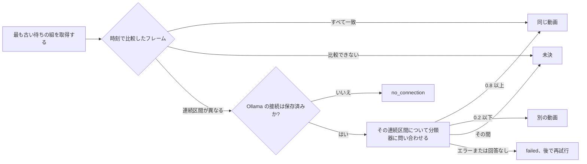

# 重複の候補を自動で判定する {#judging-possible-duplicates-automatically}

VVMDM は重複の候補をそれぞれ 1 組ずつ、まず保存済みの 2 つの指紋から判定し、フレームが異なる区間についてだけ、その後で分類器のポートに問い合わせて判定する。ワーカーは [`internal/app/version_judge.go`](../../internal/app/version_judge.go)、フレームのルールは [`internal/domain/version_frames.go`](../../internal/domain/version_frames.go)、待ち行列と結果は [`internal/store/version_judgements.go`](../../internal/store/version_judgements.go) だ。各ルールの理由は [054 research](../../specs/054-auto-dup/research.md) にある。

図は、1 つの候補を取得から結果まで示す。

## フレームのルールが先に判定する {#the-frame-rule-decides-first}

フレームは候補の検査が組にするのと同じように時刻で組にして平坦なフレームを飛ばし、組は距離が 12 (`FingerprintMatchMaxDistance`) を超えると異なるとする。候補の検査が使う中央値は差し替えられた区間を隠すが、フレームごとの一覧はそれを示す ([R-1](../../specs/054-auto-dup/research.md#r-1-the-fingerprints-decide-first-the-model-is-asked-only-when-a-section-differs))。

| フレーム | 結果 | モデルに見せるフレーム |
| --- | --- | --- |
| 異なるのが 5% 以下で、2 つ続けて異なることがない | 同じ動画。リクエストなし | なし |
| 2 つ以上続けて異なる | モデルに問い合わせる | 最も長い連続区間 (同じ長さなら前のもの) |
| 5% を超えて異なるが、続けて異なるものはない | モデルに問い合わせる | 異なるすべてのフレーム |
| 比較できる組が 3 未満、または指紋のバージョンが異なる | 未決。所有者に任せる | なし |

4 つを超えるフレームは連続区間全体に散らして選ぶので、リクエストが運ぶ画像は最大 4 枚だ。

## モデルは名前ではなくフレームを見る {#the-model-sees-the-frames-not-the-names}

各画像は左にフレーム A、右にそれと組になるフレーム B を置いたもので、[`internal/artifacts`](../../internal/artifacts/seek_frames.go) が 2 つのシーク用プレビューから切り出し、B は A のフレームの大きさに合わせて拡大縮小する。リクエストは事実を持たない: ファイル名もフォルダも長さもない ([R-2](../../specs/054-auto-dup/research.md#r-2-the-model-sees-the-frames-where-the-two-files-differ)、[R-11](../../specs/054-auto-dup/research.md#r-11-the-request-carries-no-file-names))。質問と、しきい値の 0.8 と 0.2 は `internal/domain` に固定している ([R-3](../../specs/054-auto-dup/research.md#r-3-the-question-wording-and-two-fixed-thresholds))。

| 採用しなかった案 | 理由 |
| --- | --- |
| ffmpeg でメディアファイルから取り出したフレーム | メディアフォルダのファイルを読むのはスキャンだけだ |
| 質問のキーを含まない返答を確率 0 とみなす | モデルが一度も判定していない組を退けてしまう |

## ワーカーは有効な間だけ動く {#the-worker-runs-only-while-it-is-on}

`AutoTagger` と同じく 1 つの goroutine が、`version_judging.enabled` が true の間は組を 1 つずつ取得し、それ以外は眠る。

| 起こすもの | 理由 |
| --- | --- |
| 起動 | サーバーが止まっている間に見つかった組 |
| `ProcessingChanged` | 終わった指紋のジョブが候補を書いたかもしれない |
| `VersionCandidatesChanged` | バージョンを外すと、その組が再び一覧に出る |
| 設定の保存 | 有効にすると、待っているすべての組を判定する |
| Ollama の接続の保存 | `no_connection` の組が待ちに戻る |
| 失敗した組の最も早い `retry_at` | 再試行は所有者に何も求めない ([R-5](../../specs/054-auto-dup/research.md#r-5-a-failed-judgement-retries-on-a-backoff-that-never-ends)) |

ワーカーはリクエストの前に `ollama.endpoint` の行があるかをストアに問い合わせるので、組が、所有者が一度も設定していない既定のアドレスに送られることは決してない ([R-13](../../specs/054-auto-dup/research.md#r-13-the-model-is-asked-only-once-the-owner-has-saved-a-connection))。各組のフレームのルールの結果、フレームの数、判定、確率は `component=duplicate-judging` でログに出る。
