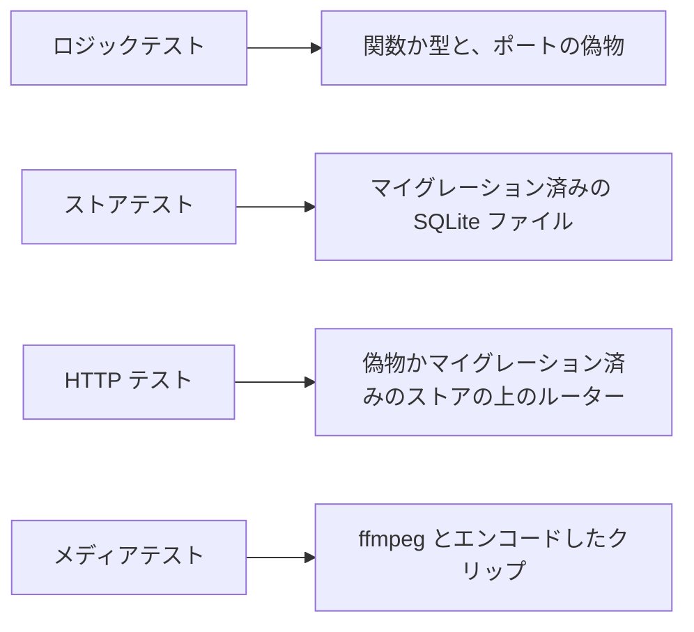
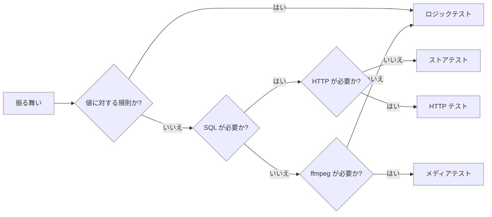

# Go のテストレベル {#go-test-levels}

Go サーバーの振る舞いは、その振る舞いが壊れたときに失敗する最も低いレベルでテストする。1 つのパッケージのテストは順に実行され、最も遅いパッケージが `go test` の CI グループ (`task test-go`) の長さを決めるからである。

図は 4 つのレベルと、それぞれが準備するものを示す。

## テストレベル {#test-levels}

各レベルは異なる種類の振る舞いを、テスト 1 件あたり異なるコストで証明する。

| レベル | 証明するもの | 準備するもの | テスト 1 件あたりのコスト |
| --- | --- | --- | --- |
| ロジックテスト | `internal/domain` の規則、偽のポートを使う `internal/app` の規則、またはその他の純粋な関数 | なし | 0.01 秒 |
| ストアテスト | クエリ、書き込み、マイグレーション、またはストアの不変条件 | `internal/store` の `migratedDB`: すべてのマイグレーションを実行する新しいファイル | 0.23 秒。そのうち 0.14 秒がマイグレーション |
| HTTP テスト | HTTP の契約: ステータス、本文の形、認証、ポートへの呼び出しの順序 | 偽のポートを使う `internal/httpapi` の `newTestServer`、またはマイグレーション済みのストアの上の `newAuthEnvWith` | 偽物なら 0.01 秒。ストアの上なら 0.20 秒 |
| メディアテスト | ffmpeg だけが示すもの: プローブ、トランスコード、スプライト、プレビュー | ffmpeg と、テストがエンコードするクリップ | 1 秒から 28 秒 |

コストは、4 コアでの `go test -count=1 ./...` の 1 回の実行における中央値である。`internal/store` (580 件のテスト)、`internal/httpapi` (500 件)、`internal/media` (139 件) はそれぞれ 2 分から 3 分かかる。その他のパッケージはすべて 2 秒未満である。

## レベルの選び方 {#choosing-the-level}

その振る舞いが壊れたときにテストが失敗する、図の中で最初のレベルを選ぶ。

ストアテストか HTTP テストでしか届かない規則は、その規則がクエリかハンドラーの中にあるしるしである。その規則はロジックテストとともに `internal/domain` か `internal/app` の関数に移し、ストアテストか HTTP テストには規則が使われることを示すケースを 1 つ残す。これは [規則をページの外へ](web-testing.md#rules-out-of-pages) の Go での形である。

| 振る舞い | レベル |
| --- | --- |
| 一致とみなす距離の中にある 2 つのフィンガープリントは同じ動画である | ロジック |
| キューにあるジョブは、取得されると実行中に移る | ストア |
| ゲストは書き込みのエンドポイントから 403 を受け取る | HTTP |
| すでに使われているタグ名は、カタログの理由とともに拒否される | ロジックと、ステータスのための HTTP のケース 1 つ |
| シーク用のスプライトは、回転したクリップの縦長の縦横比を保つ | メディア |

## テストごとのフィクスチャ {#fixtures-per-test}

HTTP テストは、それが証明する契約がストアの返すものに依存しない限り、偽のポートの上で動く。偽物の準備にはコストがかからず、ストアにはマイグレーションの 0.14 秒がかかる。トップレベルのストアテストか HTTP テスト 1 つは 1 つのデータベースを開き、そのケースが読むだけなら、ケースはそのデータベースの上のサブテストにする。書き込むケースは、それ自身のトップレベルのテストを持つか、触れた行をリセットする。

## メディアのクリップ {#media-clips}

メディアテストは、その振る舞いを示す最も短く最も小さいクリップをエンコードし、2 つのテストが必要とするクリップはパッケージごとに 1 回だけエンコードする。最も遅い 4 つのテストは合わせて 92 秒かかり、これは `internal/media` の半分を超える。そのうち 3 つは 60 秒から 410 秒のクリップをエンコードする。

## 待機 {#waiting}

テストは `time.Sleep` ではなく、チャネル、コールバック、または偽の時計で待つ。負荷のかかった CI ランナーで通るほど長いスリープは、それ以外のすべての実行で待ち時間になり、短すぎるスリープは負荷のかかったランナーで失敗する。

## 変更のコストを確かめる {#checking-the-cost-of-a-change}

`task test-cost` はブランチが追加するテストを、そのレベルと測定した所要時間とともに一覧にする ([development.md](../how-to/development.md#validate-changes))。ストアテスト、HTTP テスト、メディアテスト、または Web のページテストか E2E テストを追加するプルリクエストは、それぞれについて、その下のレベルではなぜ失敗しないかを述べる。

| 採用しなかった案 | 理由 |
| --- | --- |
| CI を失敗させる、テストごとの時間の上限 | 所要時間はランナーの負荷で変わる。レビュアーが判断できるのはレベルとその理由である |
| ストアテストと HTTP テストでの `t.Parallel` | 多くのテストが環境変数、パッケージ変数、またはファイルを共有する。パッケージどうしはすでに並列に動いている ([`.golangci.yml`](../../.golangci.yml)) |
| ストアテストにインメモリの SQLite データベースを使う | ストアは 1 つのファイルに対して、ロックモードの異なる 2 つの接続を開く。インメモリのデータベースでは別の構成をテストすることになる |
| プルリクエストではメディアテストを省く | 壊れたエンコーダーの経路が `main` に届く。代わりにクリップを切り詰める |
