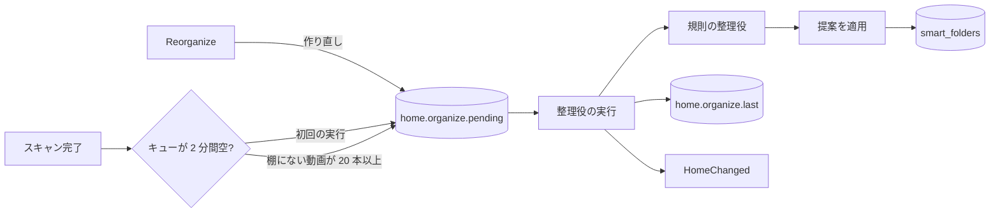
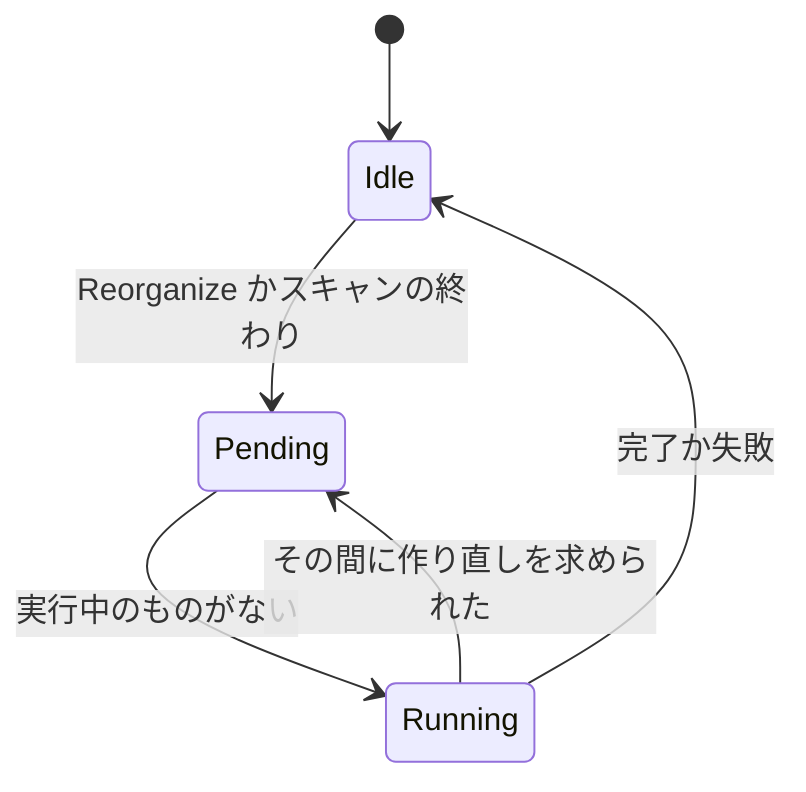

# ホームの棚と規則の整理役 {#home-shelves-and-the-rule-organizer}

ホームは棚の一覧であり、各棚はホームでの位置を持つスマートフォルダである。規則の整理役は、よく使われたタグ、人物、組織の棚を AI なしで加える。整理役は [`internal/app/home_organizer.go`](../../internal/app/home_organizer.go)、棚の選び方は [`internal/domain/home_rules.go`](../../internal/domain/home_rules.go)、適用のトランザクションは [`internal/store/home.go`](../../internal/store/home.go) にある。この文書の背後にある判断は [057 research](../../specs/057-home/research.md) にある。

図は、何が実行を始めるかと、実行が何を読み書きするかを示す。

## タグ、人物、組織からの棚 {#shelves-from-tags-people-and-organizations}

規則の整理役は、見える動画の少なくとも 5 本に付いたタグ、人物、組織ごとに、その名前を持つ棚を 1 つ提案する。1 回の実行で最大 24 個である ([R-2](../../specs/057-home/research.md#r-2-the-rule-organizer-makes-shelves-from-tags-people-and-organizations))。5 本は、棚がカード 1 枚だけになるのを防ぐ。仮のタグは、所有者が受け入れたタグではなく自動タグ付けの推測なので除く。

| 元 | 棚の規則 | 順序 |
| --- | --- | --- |
| 種類を持つタグ | `{"tags": [id]}` | 1 番目。種類の id 順、次に動画の数の順 |
| 種類を持たないタグ | `{"tags": [id]}` | 2 番目。動画の数の順 |
| 人物 | `{"person": id}` | 3 番目。動画の数の順 |
| 組織 | `{"organization": id}` | 最後。動画の数の順 |

数は、棚の規則が所有者に見せる動画の数である。そのため、タグは手で付けたタグとフォルダ名からのタグの両方を数える。

## 作り直しと追加 {#rebuild-and-extend}

作り直しは見えるすべての動画から提案し、整理役の棚を置き換える。追加は棚にない動画だけから提案し、加えるだけである ([R-8](../../specs/057-home/research.md#r-8-a-rebuild-replaces-the-organizers-folders-in-one-transaction-an-extend-only-adds))。どちらの実行も、所有者が加えた、動かした、または保った棚や、オンボーディングが選んだ興味から作った棚を変えない。どれも `owner_kept` 1 を持つからである。

| 実行 | 始めるもの | 提案の元 |
| --- | --- | --- |
| `rebuild` | `Reorganize` (`POST /api/home/organize`)、または実行が 1 つも終わっていないときの最初のスキャン | 見えるすべての動画 |
| `extend` | 見える動画の 20 本以上が棚にない状態で終わるスキャン | 棚にない動画だけ |

## 実行は一度に 1 つ {#one-run-at-a-time}

待つ実行は設定 `home.organize.pending` の中に最大 1 つで、作り直しは待っている追加を吸収する ([R-9](../../specs/057-home/research.md#r-9-one-run-at-a-time-queued-in-settings-triggered-by-events))。設定は待っている実行を再起動の後まで保ち、シャットダウンで止まった実行もそこに残るので、次の起動がそれをもう一度実行する。

図は整理役の状態を示す。

終わった実行は、その結果 (`done`、`failed`、または提案が何も変えなかったときの `unchanged`) と、加えた棚と取り除いた棚の数を `home.organize.last` に書く。状態が変わるたびに `HomeChanged` を発行するので、開いている画面はホームを読み直す。

## スキャンの後にキューを待つ {#waiting-for-the-queues-after-a-scan}

スキャンが起こす実行は、スキャンが `done` として終わった後、ジョブのキューと自動タグ付けのキューがどちらも 2 分間空のままになるまで待つ ([R-10](../../specs/057-home/research.md#r-10-an-extend-runs-when-20-or-more-shown-videos-are-unshelved))。新しい動画はスキャンの後に自動タグ付けからタグを得るので、それより早い実行は、新しい動画をどれもタグを持つ前に棚にない動画として数えてしまう。失敗したスキャンや取り消したスキャンは何も始めない。

| 採用しなかった案 | 理由 |
| --- | --- |
| `jobs` テーブルの種類 | `jobs` の行は 1 つの動画とその場所に属する |
| 数時間ごとのタイマー | 要件 8 は棚の追加をスキャンの終わりに結びつける |
| 追加のしきい値にライブラリの割合を使う | 20,000 本の動画では 2,000 本の棚にない動画を待つ |
