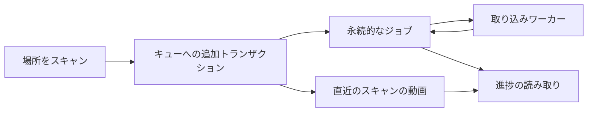

# 取り込みの進捗と回復 {#import-progress-and-recovery}

取り込みの進捗は、別の完了カウンターではなく永続的なジョブの状態を使い、直近のスキャンで準備が必要な動画を数える。

図は、検出と準備が進捗の読み取りで合流する様子を示す。

## 安定した分母 {#a-stable-denominator}

準備をキューに追加すると、同じトランザクションでその動画を直近のスキャンの集合に加える。キューにあるジョブも実行中のジョブも残っていないとき、動画の準備は完了したとみなす。プローブの結果と後続の準備は一緒にコミットされるため、段階の間で動画が一時的に完了したようには見えない。動画の完了後も集合に残すことで、作業が進むにつれて分母が減ることを防ぐ。

新しいスキャンは前のスキャンの集合を置き換え、未完了のジョブがある動画を引き継ぐ。手動スキャンは新しい問題の一覧から始め、自動スキャンは読み直すディレクトリの外にある問題を保持する。中断したスキャンを再開するときも、その動画の集合と準備に関する問題を引き継ぐ。検出が閉じられ、集合に準備のジョブが残っていないときに取り込みは完了する。

## 回復と報告 {#recovery-and-reporting}

起動時は通常のワーカーが進む前に、中断したスキャンとジョブを回復する（[プロセスのライフサイクル](process-lifecycle.md)）。直近のスキャンの問題はそのスキャンの問題を説明し、永続的な[活動ログ](activity.md)は実行と所有者の操作を別に記録する。ユーザーが始めた全体スキャンと、変更されたディレクトリの自動スキャンは準備処理を共有し、[フォルダ監視](folder-watching.md)はディレクトリの変更だけを監視する。

ジョブキューとスキャンへの所属は `internal/store` にあり、アプリケーションのユースケースがそれらを調整する。HTTP ハンドラーはファイルシステムを走査しない。[画面 API スキーマ](../../api/openapi.yaml)が進捗と問題の応答を定義する。
