# 取り込み時のプローブから得るメディア情報 {#media-information-from-the-import-probe}

取り込み時の 1 回の `ffprobe` 実行は、映像ストリームの詳細、すべての音声トラックと字幕トラック、埋め込みタグ、チャプターも読み、動画ごとにバージョン付きの JSON 1 行として `video_media_info` に保存する ([`internal/media/probe_media.go`](../../internal/media/probe_media.go)、[`internal/domain/media_info.go`](../../internal/domain/media_info.go)、[`internal/store/media_info.go`](../../internal/store/media_info.go))。背景: [research.md](../../specs/056-media-info/research.md)。

図は、値の各部分をどこで読み、どこで判断し、どこに保存するかを示す。

```mermaid
flowchart LR
  ffprobe[ffprobe を 1 回: format、streams、chapters] --> parser[internal/media のパーサー]
  parser -->|生の値| rules[internal/domain の規則]
  rules --> info[domain.Probe の domain.MediaInfo]
  info --> apply[ApplyProbeForJob]
  apply -->|videos と同じトランザクションと同一性の確認| row[(video_media_info)]
  row --> read[LibraryStore.MediaInfo]
  read --> detail["GET /api/videos/{id} の mediaInfo"]
```

値を運ぶのは動画の詳細だけで、所有者にも公開動画のゲストにも同じく運ぶ。一覧の項目、関連動画、所有者の `PUT` の応答は値を省く ([`internal/httpapi/video_media_info.go`](../../internal/httpapi/video_media_info.go))。動画ページは値を技術情報の行の下にグループとして描く ([`MediaInfoGroups.tsx`](../../web/src/player/MediaInfoGroups.tsx))。

## 1 回の実行ですべてを読み、TS ファイルは長く読む {#one-run-reads-everything-and-a-ts-file-is-read-longer}

`media.Probe` は取り込みの実行に `-show_chapters` を加え、`.ts`、`.m2ts`、`.mts` のファイルには `-analyzeduration 30M -probesize 100M` も加える。

プローブのコストの大半はプロセスの起動なので、すべての項目を、インデックスの値をすでに読んでいる実行から得る。`ffprobe` は既定では TS の解析を 5 秒か 5 MB で止め、放送の録画で後から始まる音声や字幕のストリームを見落とすが、MP4 や MKV はヘッダーにストリームを列挙するので、長い上限はそれを遅くするだけだ。ライブ変換のリクエスト時のプローブは、変換がその上限を待たないように既定の上限のままにする。

| 採用しなかった案 | 理由 |
| --- | --- |
| 項目ごとに 2 回目の `ffprobe` | 動画 10,000 本のライブラリでは、さらに 10,000 個のプロセスを起動する |
| すべてのコンテナに長い上限 | ヘッダーのあるコンテナでは何も変わらない |

## パーサーが読み、ドメインが判断する {#the-parser-reads-the-domain-decides}

`internal/media` のパーサーは `ffprobe` の値をグループ (映像、トラック、埋め込みタグ、チャプター) ごとにコピーし、`internal/domain` の純粋関数がそれを分類し整える。

| 項目 | 規則 |
| --- | --- |
| HDR の種類 | Dolby Vision (`DOVI configuration record`、または `dvh1`、`dvhe`、`dvav`、`dva1`、`dav1` のコーデックタグ)、なければ HDR10 (`smpte2084`)、なければ HLG (`arib-std-b67`)、なければ SDR |
| インターレース | `tt`、`bb`、`tb`、`bt` はインターレース、`progressive` はインターレースではない。`unknown` は省く |
| ビット深度 | `bits_per_raw_sample`、なければ `pix_fmt` の深度 (`yuv420p10le` は 10) |
| 文字列 | 不正な UTF-8 と改行以外の制御文字を除き、前後の空白を除き、2,000 文字で切る。空なら省く |
| 件数 | 音声トラックは最大 64、字幕トラックは最大 64、チャプターは最大 1,000 |
| 記録日時 | オフセットの有無を問わない RFC 3339 (Apple の `+0900` を含む)、または `YYYY-MM-DD HH:MM:SS`。オフセットは保持し、オフセットがなければ UTC とする |
| 位置 | 度、度と分、または度と分と秒で表した ISO 6709 で、高度は任意。±90 または ±180 の範囲外は省く |
| チャプター | 開始位置の順に並べる。開始が再生時間以上なら捨てる。終了は再生時間で切り、開始より前にならないようにする。重なりは保持する |

解析できない値は省き、プローブを失敗させることはなく、プローブを失敗させるのは再生時間がないときだけだ。パーサーが期待する JSON の型と異なる型のタグの値は、出力全体を失敗させずに読み飛ばす。規則をパーサーの外に置くので、各ケースをプロセスなしの単体テストにできる。

## 動画ごとにバージョン付きの 1 行 {#one-versioned-row-per-video}

プローブのジョブは `ApplyProbeForJob` のトランザクションの中で、`videos` の更新を守る同一性の確認のもとで `video_media_info` を書き、`version` が `domain.MediaInfoVersion` と異なる行は存在しないものとして読む。

そのため、プローブ中に置き換えられたファイルは古いファイルの行を残さず、動画を削除するとその行も削除される。この値を読むものはほかにないので、JSON 1 行は `video_id` による検索 1 回で済み、形が変わったときはマイグレーションを加えずにバージョンを上げる。このテーブルは再構築できるインデックスだ ([データと復旧](../how-to/running-vv.md#data-and-recovery))。

| 採用しなかった案 | 理由 |
| --- | --- |
| `videos` の列 | すべての一覧クエリが読む、NULL を許す約 30 列 |
| 項目ごとのテーブル (ストリーム、チャプター、タグ) | それらを結合やフィルタに使うクエリがない |
