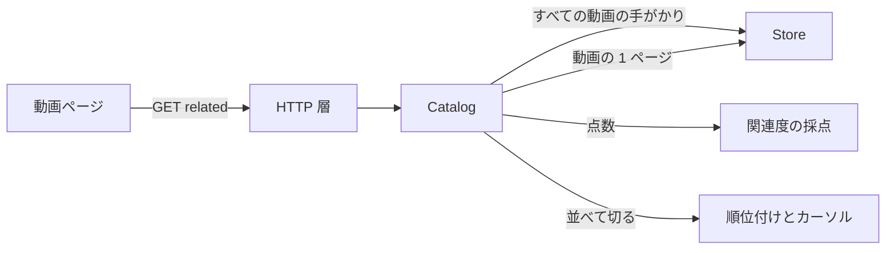
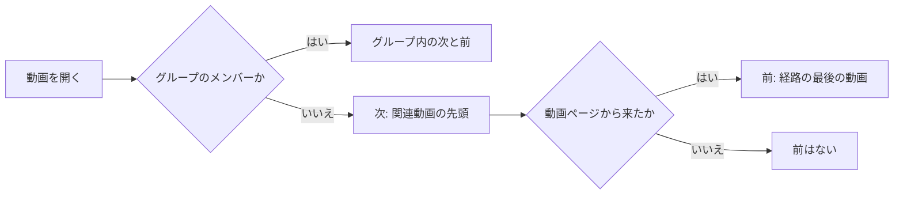

# 関連動画と前後の動画 {#related-videos-and-the-previous-and-next-video}

動画ページは、閲覧者が見てよい他のすべての動画を、開いている動画に近い順に並べ、次の動画はその一覧の先頭である。順位付けは [`internal/domain/relatedness.go`](../../internal/domain/relatedness.go) にある。

図は、関連動画の一覧の 1 ページをどう作るかを示す。

## 近さの点数 {#closeness-score}

一覧での動画の位置は、開いている動画と比べた 5 つの手がかりの合計で決まり、高いものが先に来る。同点なら後に追加した動画が先に来て、その次に id の大きいものが先に来る。

重みは、場所より内容が勝つようにする。同じタグを持つ別のフォルダの動画は、フォルダを共有するだけの動画より上に来て、フォルダは依然としてタグの部分一致より上に来る。

| 手がかり | 点 | 測り方 |
| --- | --- | --- |
| 動画の指紋 | 40 | 相手の動画のどこかに似た場面がある場面の割合。時刻は揃えない |
| タグ | 30 | 両方の動画にあるタグの数を、どちらかにあるタグの数で割る。確定したタグ、仮のタグ、フォルダ名のタグを同じに数え、珍しいタグに重みは付けない |
| タイトルとファイル名 | 25 | 数字と記号を除いた後、共有する語の数をすべての語の数で割る |
| 同じディレクトリ | 20 | 両方の代表の場所が同じディレクトリの直下にある |
| 追加日 | 5 | 1 日以内なら満点、その後は 30 日ごとに半分になる |

| 場合 | その手がかりの点 |
| --- | --- |
| 指紋がない、比べられるフレームが 3 未満、または平坦なフレームしかない | 指紋 0 |
| どちらかの動画にタグがない | タグ 0 |
| 空白のない仮名と漢字 | 2 文字の組で比べる |
| 共通の手がかりがない | 日付だけ。動画は末尾に来る |

ちょうど 3 分の 2 のタグが共通のとき、タグの点 (20) はフォルダの点と等しくなり、その 2 本の間は日付で決まる。

| 採用しなかった案 | 理由 |
| --- | --- |
| バージョンと同じく、時刻で揃えた指紋の距離 | 切り詰めたり並べ替えたりした複製は別の時刻に場面を共有し、点が 0 になる |
| 珍しいタグを重くする | 要件はすべてのタグを同じに数える |

## 差し替えられる採点 {#replaceable-scorer}

点は 1 つの `RelatedScorer` から来て、store、catalog、API は結果の数値だけを見る。

手がかり、重み、または方法全体を変えるには、その 1 つの型を差し替えるか編集する。catalog は `CatalogOptions.Scorer` で別の採点を受け取る。

## 重複のないページ送り {#paging-without-duplicates}

一覧に長さの上限はない。ページは 30 行ずつ読み、最後の行が近づくと次のページを求める。

ページは、最後に返した行のカーソル `score.addedAt.id` のちょうど後から始まる。点は 2 本の動画だけで決まるので、別の動画の追加、削除、公開が、すでに表示した行を動かすことはなく、同じ行が 2 回出ることもない。ページは、すでに持っている id も飛ばす。

| 採用しなかった案 | 理由 |
| --- | --- |
| オフセットによるページ送り | 動画の追加や削除が後ろのすべてのオフセットをずらし、行が繰り返されるか飛ばされる |

## 前後の動画 {#previous-and-next-video}

次の動画 (› と再生終了後の動画) は関連動画の一覧の先頭で、‹ は直前に見た動画へ戻る。

ページは、たどってきた動画の id の経路をナビゲーションの状態に持つ。そのため、URL や一覧から動画を開くと ‹ はない。‹ を表示する前に、ページはその動画を取得し、削除された動画やゲストが見てはいけない動画なら ‹ を隠す。戻るとその動画を経路から外すので、もう一度 ‹ を押すとさらに 1 つ前へ戻る。グループのメンバーは、両方の矢印でグループの順序を保つ ([017 フォルダのグループ](../../specs/017-folder-groups/ui-design.md))。

## 除外する動画 {#excluded-videos}

開いている動画、そのバージョンのまとまりの他のバージョン、そのグループのメンバー (`Up next` の一覧) は関連動画の一覧に決して現れず、ゲストには公開された動画だけが見える。
