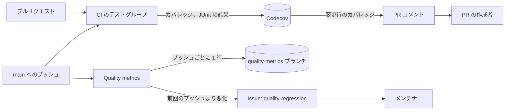

# テストと CI の品質監視 {#test-and-ci-quality-monitoring}

`main` へのプッシュのたびに、コード、テスト、CI の品質を測定し、履歴を残し、測定値が悪化したときは Issue を開く。測定は [`ci.yml`](../../.github/workflows/ci.yml)、[`quality-metrics.yml`](../../.github/workflows/quality-metrics.yml)、[`scripts/qualitymetrics`](../../scripts/qualitymetrics) にある。

図は、各測定値の行き先と、それを読む人を示す。

## 測定値と保存先 {#measures-and-where-they-are-kept}

各測定値の置き場所は 1 つなので、推移は 1 か所で読める。

| 測定値 | ツール | 測定のタイミング | 保存先 |
| --- | --- | --- | --- |
| 行カバレッジ（`go` と `web` のフラグ別、ファイル別） | Go の `-coverprofile`、Vitest v8 | `main` へのすべてのプッシュとすべてのプルリクエスト | [Codecov](https://app.codecov.io/gh/syudead/vv) |
| すべてのテストの所要時間と結果、不安定なテスト | gotestsum、Vitest、Playwright の JUnit | 同上。E2E は `main` へのプッシュのみ | Codecov Test Analytics |
| すべての関数の循環的複雑度 | Go は `go/ast`、Web は ESLint の `complexity` ルール | コードを変更する `main` へのすべてのプッシュ | `quality-metrics` ブランチの `history.jsonl` |
| 重複行 | jscpd | 同上 | 同上 |
| CI の所要時間（実行全体とジョブ別。直近 20 回の成功した実行の p50、p90） | `gh` を通した GitHub API | 同上 | 同上 |

Markdown、`docs/`、`specs/` だけを変更するプッシュは測定しない。CI の変更フィルタと同じ分け方だ。

## 悪化した測定値は Issue を開く {#a-measure-that-gets-worse-opens-an-issue}

プッシュが、前回測定したプッシュより次のいずれかの量だけ悪化したとき、`Save history` ジョブは `quality-regression` ラベルの付いた開いている Issue にコメントを追加するか、Issue を開く。

| 測定値 | 悪化の基準 |
| --- | --- |
| 複雑度 15 を超える関数（Go、Web） | 前より 1 つ増える |
| 複雑度の平均（Go、Web） | 0.1 上がる |
| 重複行 | 0.2 パーセントポイント上がる |
| CI の実行全体の p90 | 20% かつ 30 秒上がる |

1 つの PR は複雑度と重複の値をおよそこの量だけ動かすので、悪化は 1 つのプッシュを指し示す。20 回の実行の窓はそれだけで数秒ずれるので、CI の p90 には比率と秒数の両方が要る。メンテナーは、悪化を直すか受け入れたあとで Issue を閉じる。

## カバレッジはプルリクエストに情報を示し、ブロックしない {#coverage-informs-a-pull-request-and-does-not-block-it}

Codecov はプルリクエストに変更行のカバレッジをコメントし、そのステータスは情報提供のみだ（[`.github/codecov.yml`](../../.github/codecov.yml)）。必須のカバレッジの数値は数値のために書かれたテストを招く。[Web のテストレベル](web-testing.md)は、振る舞いが壊れたときに失敗する最も低いレベルを選ぶことで、それを排除している。

## 測定は書き込みトークンなしで動く {#measures-run-with-no-write-token}

npm の依存やリポジトリのコードを実行するジョブは読み取り専用のトークンを持つ。どちらも実行しない `Save history` だけが、履歴と Issue を書き込む。そうしなければ、同じリポジトリからの依存の更新が、リポジトリにプッシュできるトークンでそのパッケージのインストールスクリプトを実行することになる。

| 採用しなかった案 | 理由 |
| --- | --- |
| 週次のスケジュール | 1 週間分のプッシュが 1 回の測定にまとまるので、悪化がそれを起こしたプッシュに結び付かない |
| カバレッジの低下や複雑度の上昇で CI を失敗させる | 基準値が数日前のものだ。しきい値はまず履歴で調整する |
| qlty を唯一のツールにする | テストの所要時間、不安定なテスト、CI の所要時間を測定せず、その lint 層は golangci-lint と ESLint と重複する |
