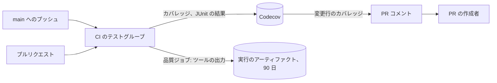

# テストと CI の品質監視 {#test-and-ci-quality-monitoring}

CI はカバレッジとテスト結果を Codecov に送り、すべての関数の複雑度と重複コードを測定値ごとに 1 つのジョブでアーティファクトとして残す。測定は [`ci.yml`](../../.github/workflows/ci.yml) と、[`Taskfile.yml`](../../Taskfile.yml) の `complexity-go`、`complexity-web`、`duplication` タスクにある。

図は、各測定値の行き先と、それを読む人を示す。

## 測定値と保存先 {#measures-and-where-they-are-kept}

各測定値の置き場所は 1 つで、どれも既存のツールの出力だ。

| 測定値 | ツール | 測定のタイミング | 保存先 |
| --- | --- | --- | --- |
| 行カバレッジ（`go` と `web` のフラグ別、ファイル別） | Go の `-coverprofile`、Vitest v8 | `main` へのすべてのプッシュとすべてのプルリクエスト | [Codecov](https://app.codecov.io/gh/syudead/vv) |
| すべてのテストの所要時間と結果、不安定なテスト | gotestsum、Vitest、Playwright の JUnit | 同上。E2E は `main` へのプッシュのみ | Codecov Test Analytics |
| すべての Go の関数の循環的複雑度 | gocyclo | `main` へのすべてのプッシュとすべてのプルリクエスト | `complexity-go` アーティファクトの `gocyclo.txt` |
| すべての Web の関数の循環的複雑度 | 最大値を 0 にした ESLint の `complexity` ルール | 同上 | `complexity-web` アーティファクトの `eslint.json` |
| 重複コード（場所別） | jscpd | 同上 | `duplication` アーティファクトの `jscpd-report.json` |

各アーティファクトはツールの出力を書き出されたままの形で、すべての関数と重複箇所のファイルと行とともに保持する。何も要約されず、以前のプッシュと比較されず、アーティファクトの 90 日を超えて保持されない。各測定値は確認グループと並んで、それぞれ専用の `Quality` ジョブで実行される。測定は 1 分未満で終わるので実行の時間を延ばさず、測定が失敗しても実行は失敗せず、ほかの測定値も失われない。CI の所要時間は CI 実行の Actions のページで読む。

## カバレッジはプルリクエストに情報を示し、ブロックしない {#coverage-informs-a-pull-request-and-does-not-block-it}

Codecov はプルリクエストに変更行のカバレッジをコメントし、そのステータスは情報提供のみだ（[`.github/codecov.yml`](../../.github/codecov.yml)）。必須のカバレッジの数値は数値のために書かれたテストを招く。[Web のテストレベル](web-testing.md)は、振る舞いが壊れたときに失敗する最も低いレベルを選ぶことで、それを排除している。

| 採用しなかった案 | 理由 |
| --- | --- |
| `quality-metrics` ブランチに要約した測定値の履歴を残し、前回のプッシュと比較する | 件数や丸めた平均は関数もプルリクエストも示さず、履歴を読む人はいなかった |
| 測定値がしきい値を超えたときに Issue を開く | Issue はメンテナーに判断の材料を何も与えなかった。平均を丸めたことで、誤った悪化も報告された |
| リポジトリ独自の複雑度カウンター | gocyclo は同じ方法で数え、すでに golangci-lint に同梱されている |
| 測定のための別のワークフロー | CI の完了を待ち、履歴を残していた。そのどちらもなければ、測定はほかの確認とともに `ci.yml` に属する |
| `main` のみで、lint グループの最後に測定する | 測定が順に実行され、lint グループの所要時間を延ばした。並列のジョブは時間を延ばさないので、プルリクエストも測定する |
| GitHub API から CI の所要時間を集める | Actions のページがすでにすべての実行とジョブの所要時間を示している |
| カバレッジの低下や複雑度の上昇で CI を失敗させる | 必須の数値は数値のために書かれたコードを招く |
| qlty を唯一のツールにする | テストの所要時間も不安定なテストも測定せず、その lint 層は golangci-lint と ESLint と重複する |
