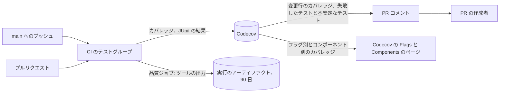

# テストと CI の品質監視 {#test-and-ci-quality-monitoring}

CI はカバレッジとテスト結果を Codecov に送り、すべての関数の複雑度と重複コードを測定値ごとに 1 つのジョブでアーティファクトとして残す。測定は [`ci.yml`](../../.github/workflows/ci.yml) と、[`Taskfile.yml`](../../Taskfile.yml) の `complexity-go`、`complexity-web`、`duplication` タスクにある。

図は、各測定値の行き先と、それを読む人を示す。

## 測定値と保存先 {#measures-and-where-they-are-kept}

各測定値の置き場所は 1 つで、どれも既存のツールの出力だ。

| 測定値 | ツール | 測定のタイミング | 保存先 |
| --- | --- | --- | --- |
| 行カバレッジ（`go` と `web` のフラグ別、コンポーネント別、ファイル別） | Go の `-coverprofile`、Vitest v8 | `main` へのすべてのプッシュとすべてのプルリクエスト | [Codecov](https://app.codecov.io/gh/syudead/vv) |
| すべてのテストの所要時間と結果、不安定なテスト | gotestsum、Vitest、Playwright の JUnit | 同上。E2E は `main` へのプッシュと Renovate の PR | Codecov Test Analytics |
| すべての Go の関数の循環的複雑度 | gocyclo | `main` へのすべてのプッシュとすべてのプルリクエスト | `complexity-go` アーティファクトの `gocyclo.txt` |
| すべての Web の関数の循環的複雑度 | 最大値を 0 にした ESLint の `complexity` ルール | 同上 | `complexity-web` アーティファクトの `eslint.json` |
| 重複コード（場所別） | jscpd | 同上 | `duplication` アーティファクトの `jscpd-report.json` |

各アーティファクトはツールの出力を書き出されたままの形で、すべての関数と重複箇所のファイルと行とともに保持する。何も要約されず、以前のプッシュと比較されず、アーティファクトの 90 日を超えて保持されない。各測定値は確認グループと並んで、それぞれ専用の `Quality` ジョブで実行される。測定は 1 分未満で終わるので実行の時間を延ばさず、測定が失敗しても実行は失敗せず、ほかの測定値も失われない。CI の所要時間は CI 実行の Actions のページで読む。

## カバレッジはプルリクエストに情報を示し、ブロックしない {#coverage-informs-a-pull-request-and-does-not-block-it}

Codecov はコードを変更するすべてのプルリクエストについて報告し、設定するステータスはすべて情報提供のみだ（[`.github/codecov.yml`](../../.github/codecov.yml)）。必須のカバレッジの数値は数値のために書かれたテストを招く。[テスト方針](testing.md)は、振る舞いが壊れたときに失敗する最も低いレベルを選ぶことで、それを排除している。

| Codecov の設定 | プルリクエストが得るもの |
| --- | --- |
| フラグ `go`（`cmd/`、`internal/`）と `web`（`web/src/`） | フラグごとの patch ステータス。低下がどちらの側で起きたかを示す。フラグ別のカバレッジは Codecov の Flags ページにある |
| コンポーネント | [ARCHITECTURE.md](../../ARCHITECTURE.md) の層と `web/src` のディレクトリ別のカバレッジ（Codecov の Components ページ） |
| `test_analytics.flake_detection` | 失敗したテストと不安定なテスト。コメントで名前を示す |

リポジトリは Codecov の無料の Developer プランを使っており、Codecov はこれを Team 階層として扱う。この階層では、プルリクエストのコメントは固定の形（変更行のカバレッジ、テスト結果、カバーされていない変更行を含むファイル）で、`comment.layout` を無視し、設定されるのは patch ステータスだけで、project ステータスは設定されない。そのため設定ではどちらも指定せず、フラグとコンポーネントの表は Codecov のページで読む。

1 回の実行はカバレッジを 4 回アップロードする。`go test` から 1 回、3 つの Vitest シャードからそれぞれ 1 回だ。Codecov は、コメントやステータスの設定の前に 4 回すべてを待つ（`after_n_builds: 4`）。それより少ないと、部分的なレポートを比較してしまう。アップロードが欠けたフラグは、0 として数えられず、最後のカバレッジを引き継ぐ。新しいプッシュは、プルリクエストでは実行中の CI 実行をキャンセルする。`main` では各コミットが専用の concurrency グループで実行されるため、待機中に実行がキャンセルされることも置き換えられることもなく、`main` のすべてのコミットがカバレッジと E2E の結果をアップロードし、プルリクエストには常に比較の基準がある。差分への Codecov の行注釈は無効にしている。フラグやコンポーネントを設定すると機能しないためだ。

| 採用しなかった案 | 理由 |
| --- | --- |
| `quality-metrics` ブランチに要約した測定値の履歴を残し、前回のプッシュと比較する | 件数や丸めた平均は関数もプルリクエストも示さず、履歴を読む人はいなかった |
| 測定値がしきい値を超えたときに Issue を開く | Issue はメンテナーに判断の材料を何も与えなかった。平均を丸めたことで、誤った悪化も報告された |
| リポジトリ独自の複雑度カウンター | gocyclo は同じ方法で数え、すでに golangci-lint に同梱されている |
| 測定のための別のワークフロー | CI の完了を待ち、履歴を残していた。そのどちらもなければ、測定はほかの確認とともに `ci.yml` に属する |
| `main` のみで、lint グループの最後に測定する | 測定が順に実行され、lint グループの所要時間を延ばした。並列のジョブは時間を延ばさないので、プルリクエストも測定する |
| GitHub API から CI の所要時間を集める | Actions のページがすでにすべての実行とジョブの所要時間を示している |
| カバレッジの低下や複雑度の上昇で CI を失敗させる | 必須の数値は数値のために書かれたコードを招く |
| フラグとコンポーネントの表を含むコメントのレイアウトと project ステータス | Developer プランのコメントは固定の形で、このプランは patch ステータスだけを設定する。両方を許す Pro プランは有料だ |
| 新しいプッシュで、実行中の `main` の実行をキャンセルする | キャンセルされたコミットのカバレッジと E2E の結果が Codecov に届かず、後のプルリクエストが比較の基準を失った |
| Bundle Analysis と E2E のカバレッジ | どちらもまだ読む人がいない。どちらも新しい測定値であり、既存の測定値の修正ではない |
| qlty を唯一のツールにする | テストの所要時間も不安定なテストも測定せず、その lint 層は golangci-lint と ESLint と重複する |
