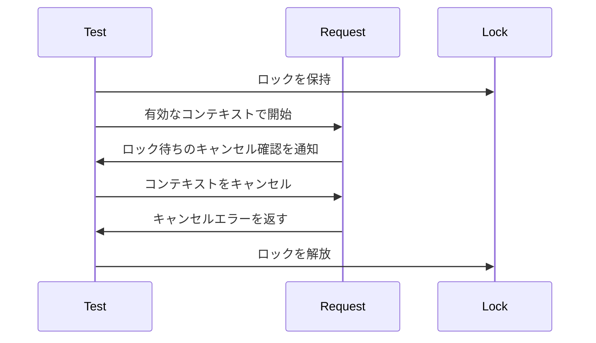

# テストでの時間と同期 {#time-and-synchronization-in-tests}

テストは実時間を待たずに、共通の[テスト方針](testing.md)を適用する。

この手順は、前段の判定による拒否ではなく、ロック待ち中のキャンセルを証明する。

## 時計と状態 {#clocks-and-state}

時計に依存する単体テストは仮想時刻を進め、並行処理のテストはテスト対象の状態と同期する。固定のスリープでは、別の goroutine や promise がその状態に達したことを証明できない。期限切れのコンテキストは、より前の判定で失敗し、テスト対象の待ちを飛ばす場合がある。

| 振る舞い | 仕組み |
| --- | --- |
| 期限または保持期間が切れる | 本番環境で使う長さだけ仮想時刻を進める |
| リクエストが期限後に始まる | すでに期限切れのコンテキストまたは期限を渡す |
| 作業がブロック中にキャンセルされる | 該当する待ちを確認してから、明示的にキャンセルする |
| 作業がまだ完了していない | 結果を確認する前に、そのブロック状態と同期する |
| エラーが失敗コードに対応づけられる | 分類ロジックにエラーを直接渡す |
| テストがハングする | 期待するイベントが届き次第戻る失敗時のガードを使う |

## Go のツール {#go-tools}

Go の単体テストは、直接の呼び出し、プロセス内のフェイク、以下の同期ツールを使う。実際の I/O、サブプロセス、mutex の待ちは、synctest の仮想時計では進まない。競合検出で問題が見つからずに通っても、意図した分岐に達したことは証明できない。

| 必要なこと | ツール |
| --- | --- |
| 協調する goroutine 内のタイマーと期限 | `testing/synctest` |
| synctest の bubble 内で継続してブロックされていることを確認する | `synctest.Wait`。あらゆる種類のブロックを観測できるわけではない |
| synctest の外での待ちを含め、アプリケーションの状態に到達する | チャネルまたはコールバックによるハンドシェイク |
| タイマーを使わずにキャンセルする | ハンドシェイク後の `context.WithCancel` |
| 並行するメモリアクセスのエラーを検出する | 対象を絞った `go test -race` |
