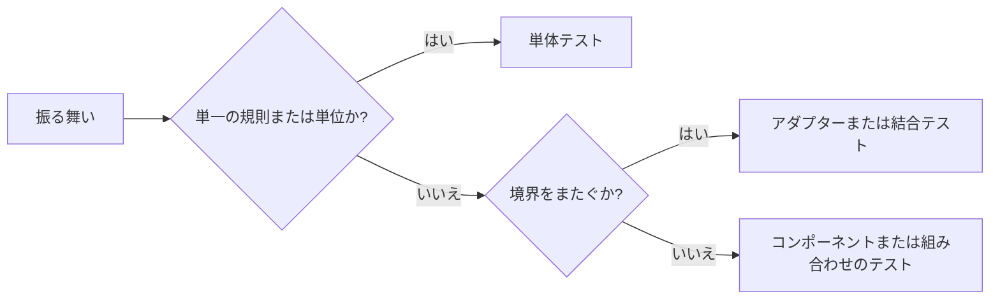
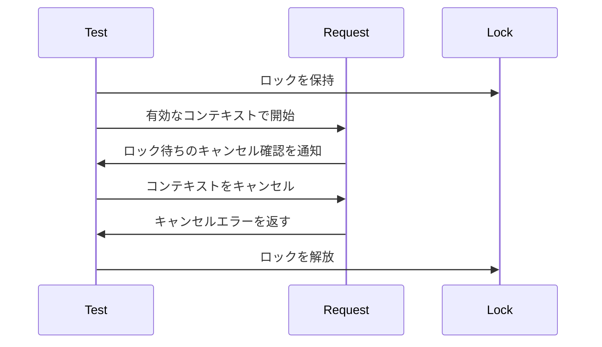

# テスト方針 {#testing-policy}

Go と Web のテストは、振る舞いが壊れたときに失敗する最も低いレベルで、それぞれの振る舞いを確認する。この文書は共通の方針と Go の指針を定める。[Web のテストレベル](web-testing.md)は Web 固有のレベルとツールを説明する。

図は、テストが証明する振る舞いに応じて、その範囲がどう決まるかを示す。

## 範囲とテストレベル {#scope-and-test-levels}

各テストは、証明する振る舞いと境界を明示する。実行に使うランナーによってレベルは決まらない。`go test` は SQLite、サブプロセス、WASM を使う既存のテストも実行するが、単体テストはそれらの依存なしに規則を確認する。テスト数と行カバレッジからは、テストが壊れた振る舞いを検出するかどうかは分からない（[品質監視](test-quality-monitoring.md)）。

| ケース | 対応 |
| --- | --- |
| 規則のバリエーション | 大きな流れを繰り返さず、規則を直接テストする |
| 大きな流れを通してしか到達できない規則 | 規則を切り出し、呼び出し元がそれを使うことを確認する焦点を絞ったテストを残す |
| 上位レベルのテストが下位レベルの保証を繰り返す | 重複を取り除く |
| 結合テストが意図した範囲の外にある | そのテストを取り除き、確認しなくなる境界を明示する |
| 削除した結合テストの一部を単体テストが扱う | 境界全体が引き続き確認されると主張せず、その部分を説明する |

## 時間と同期 {#time-and-synchronization}

時計に依存する単体テストは仮想時計を進める。並行処理のテストは、キャンセルを起こすか作業を完了させる前に、テスト対象の状態を通知する。ハングしたテストを制限する失敗時のガードは、期待するイベントが届き次第戻るため、成功するテストに固定の待ち時間を加えない。

この手順は、ロック待ち中のキャンセルと、リクエストがそのロックに達する前の拒否を区別する。

| 振る舞い | テストの仕組み |
| --- | --- |
| 期限または保持期間が切れる | 本番環境で使う長さだけ仮想時刻を進める |
| リクエストが期限後に始まる | すでに期限切れのコンテキストまたは期限を渡す |
| 作業がブロック中にキャンセルされる | 該当する待ちへの到達を確認してから、明示的にキャンセルする |
| 作業がまだ完了していない | 結果を確認する前に、そのブロック状態と同期する |
| エラーが失敗コードに対応づけられる | 分類ロジックにエラーを直接渡す |

固定のスリープでは、別の goroutine や promise が特定の状態に達したことを証明できない。すでに期限切れのコンテキストは、より前の判定で失敗する場合があり、後の待ちの間に起こるキャンセルの代わりにはならない。

## フィクスチャとビルドのコスト {#fixtures-and-build-cost}

フィクスチャには、テスト対象の境界を動かすのに必要な最小限の入力と依存関係を含める。小さく、共有でき、事前にビルドされたフィクスチャは、引数とリクエスト処理のテストでビルドと実行時コンパイルを繰り返すコストを減らす。

| フィクスチャの目的 | 形 |
| --- | --- |
| CLI 引数の検証 | 検証に到達する最小限の有効な入力 |
| プラグインのリクエストと応答の処理 | リクエストを読み、関連するインポートを動かす小さな WASM フィクスチャ |
| コンパイラまたはツールチェーンの互換性 | そのツールチェーンでソースをビルドする専用テスト |
| ビルド済みバイナリの保守 | バイナリのそばに置くソースと再現可能な再生成コマンド |

## Go のツール {#go-tools}

Go の単体テストは、パッケージが担う規則に対して、直接の呼び出し、プロセス内のフェイク、チャネルを使う。[アーキテクチャ](../../ARCHITECTURE.md#intended-dependency-direction)のアプリケーションインターフェースにより、それらの規則はストレージ、メディアプロセス、HTTP サーバーから独立している。

| 必要なこと | ツール |
| --- | --- |
| 協調する goroutine 内のタイマーと期限 | `testing/synctest` |
| synctest の bubble 内で goroutine が継続してブロックされていることを確認する | `synctest.Wait` |
| アプリケーションの特定の状態に到達する | チャネルまたはコールバックによるハンドシェイク |
| タイマーを待たずにキャンセルする | ハンドシェイク後の `context.WithCancel` |
| 並行するメモリアクセスのエラーを検出する | 対象を絞った `go test -race` |

実際の I/O、サブプロセス、mutex の待ちは、synctest の仮想時計では進まない。それらを含むテストは、`synctest.Wait` があらゆる種類のブロックを観測できると仮定せず、明示的な通知を使う。

## 既存のテストの変更 {#changes-to-existing-tests}

テストの変更では、そのテストが確認すると主張する振る舞いを保つか、範囲を明示的に狭める。テストはスイート全体を書き直すのではなく、対象の振る舞いの変更に合わせて適切なレベルへ移す。

キャンセルや同期のテストを変更するときは、確認対象の振る舞いを一時的に無効にし、対象を絞ったテストが失敗することを確かめる。その変更はコミットしない。競合検出で問題が見つからずに通っても、観測されたデータ競合がなかったことを示すだけで、テストが意図した分岐に達したことは証明しない。性能はテスト結果のキャッシュを無効にして測定し（Go では `go test -count=1`）、パッケージの所要時間を、パッケージが並列に実行されうるスイート全体の所要時間と分けて報告する。
