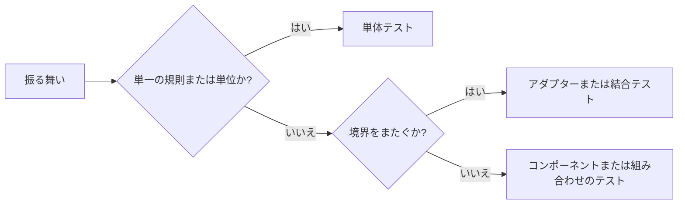

# テスト方針 {#testing-policy}

Go と Web のテストは、それぞれの振る舞いの失敗を検出できる最も低いレベルで確認する。[時間と同期](testing-time.md)は待機と Go のツールを扱い、[Web のテストレベル](web-testing.md)は Web のツールと境界を扱う。

図は、テストが証明する振る舞いからテストレベルを選ぶ。

## 範囲とテストレベル {#scope-and-test-levels}

各テストは、ランナーとは関係なく、証明する振る舞いと境界を明示する。`go test` は SQLite、サブプロセス、WASM のテストも実行する。単体テストは[アプリケーションインターフェース](../../ARCHITECTURE.md#intended-dependency-direction)を通して、それらの依存関係から規則を切り離す。テスト数とカバレッジは[欠陥の検出](test-quality-monitoring.md)を証明しない。

| ケース | 対応 |
| --- | --- |
| 規則のバリエーション | 規則を直接テストする |
| 大きな流れを通してしか到達できない規則 | 規則を切り出し、呼び出し元との接続を確認する焦点を絞ったテストを残す |
| 上位レベルのテストが下位レベルの保証を繰り返す | 重複を取り除く |
| 結合テストが意図した範囲の外にある | そのテストを取り除き、確認しなくなる境界を明示する |
| 削除した結合テストの一部を単体テストが扱う | 境界全体ではなく、その部分だけを確認していると述べる |

## フィクスチャとビルドのコスト {#fixtures-and-build-cost}

フィクスチャには、テスト対象の境界に必要な最小限の入力と依存関係を含める。共有するビルド済みのフィクスチャは、ビルドと実行時コンパイルを繰り返すコストを減らす。

| 目的 | フィクスチャ |
| --- | --- |
| CLI 引数の検証 | 検証に到達する最小限の有効な入力 |
| プラグインのリクエスト処理 | リクエストを読み、関連するインポートを動かす小さな WASM |
| ツールチェーンの互換性 | そのツールチェーンでソースをビルドする専用テスト |
| ビルド済みバイナリの保守 | バイナリのそばに置くソースと再現可能な再生成コマンド |

## 既存のテストの変更 {#changes-to-existing-tests}

テストの変更では、そのテストが確認すると主張する振る舞いを保つか、範囲を明示的に狭める。変更は、スイート全体を書き直すのではなく、対象の振る舞いに沿って進める。

| 変更 | 検証 |
| --- | --- |
| キャンセルまたは同期 | 振る舞いを一時的に無効にしてテストの失敗を確かめる。その変更はコミットしない |
| 性能 | 結果のキャッシュを無効にする（`go test -count=1`） |
| 所要時間の報告 | パッケージは並列に実行されうるため、パッケージとスイート全体の所要時間を分ける |
