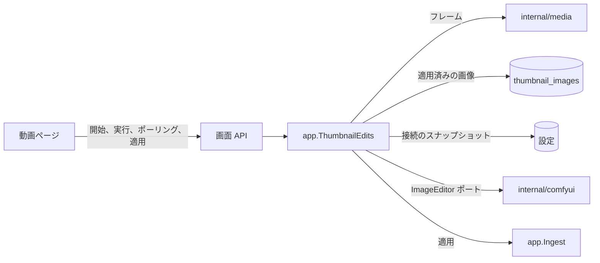
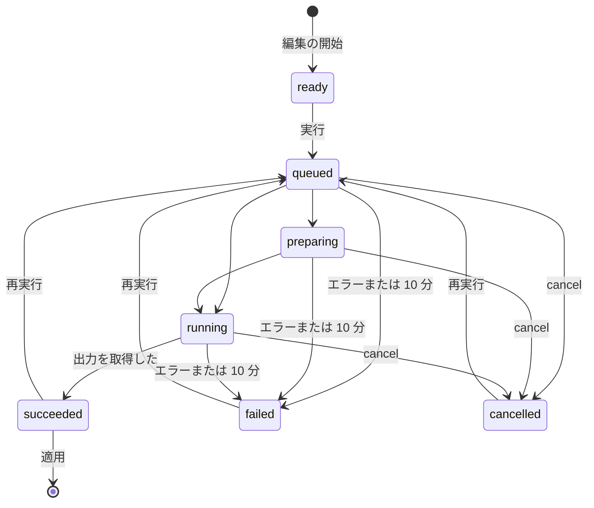
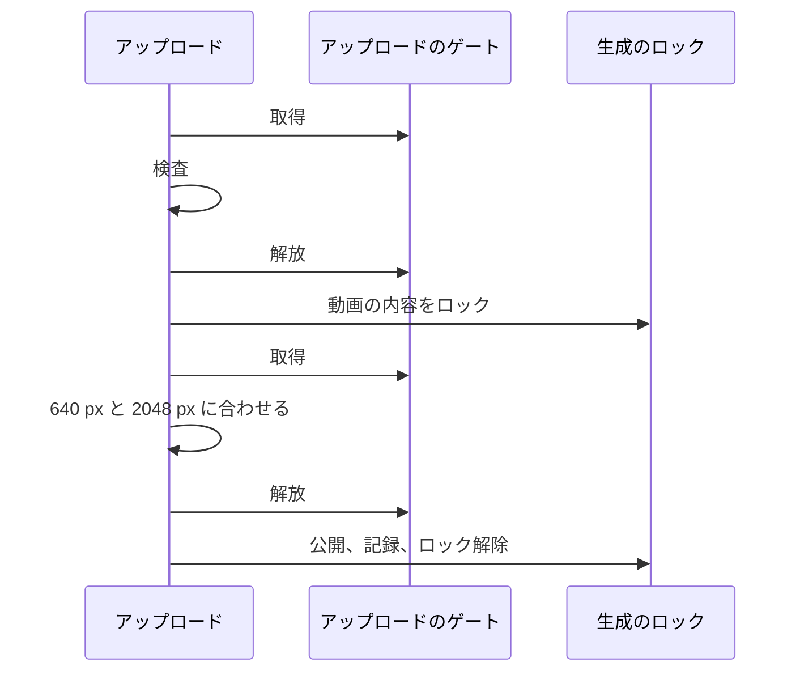

# サムネイル編集のセッション {#thumbnail-editing-sessions}

ComfyUI による動画フレームまたは現在のサムネイルの編集は、[`app.ThumbnailEdits`](../../internal/app/thumbnail_edits.go) にある動画ごとのメモリ上のセッションで、`/api/thumbnail-edits` のルートが動画ページに提供する ([契約](../../specs/045-comfyui-thumbnails/contracts/screen-api.md))。

図は、セッションがやり取りする相手を示す。

## セッションはメモリ上にあり、ポーリングで読まれる {#a-session-lives-in-memory-and-is-read-by-polling}

セッションはフレーム、現在の実行、結果の画像をメモリに保持し、実行の進行中はページがそれを毎秒読み、読むたびにプロバイダに実行の状態を問い合わせる ([R-4](../../specs/045-comfyui-thumbnails/research.md#r-4-an-edit-is-an-in-memory-session-per-video-read-by-polling))。実行は開いている 1 つのページに属し、再起動の後に適用されてはならないので、キューのジョブでもドメインイベントでもなく、再起動ですべてのセッションが破棄される。各読み取りはページのハートビートだ。5 分間読まれなかったセッションは、プロバイダでの実行を取り消して終了する。

図は、セッションの状態を示す。

破棄、5 分間読まれないこと、同じ動画の新しい編集、再起動は、どの状態のセッションも終了させ、進行中の実行はその前にプロバイダで取り消される。送信から 10 分後に終了状態にない実行は、取り消されて `timed_out` として失敗する ([R-11](../../specs/045-comfyui-thumbnails/research.md#r-11-a-new-session-replaces-the-previous-one-a-run-is-limited-to-10-minutes))。30 秒ごとのバックグラウンドの掃除が、誰も読まないセッションに両方の制限を適用し、各リクエストは自身のセッションにそれらを適用する。新しい編集は、新しいセッションが見えるようになる前に、前のセッションをそのセッションのロックの中で終了させるので、前のセッションで進行中の適用または実行が先に終わり、セッションを取り除くのはセッションの終了だけなので、取り除かれたセッションは `404` を返す。

プロバイダが確認しない取り消しでも実行は `cancelled` と示すが、vv はプロバイダのジョブを保持し、セッションが終了した後も、最長 1 時間、掃除のたびに取り消しを再試行する。その取り消しが確認されるまで、同じ動画の新しい実行は送信されず `unreachable` (`502 provider_failed`) として失敗するので、確認されていないジョブが vv にもう取り消せないジョブに置き換えられることはない。1 つのジョブの再試行は一度に 1 つだけ進行し、新しい実行は、その動画のジョブの再試行があればそれが終わるのを待ってから送信される。遅れて届いた Comfy Cloud の中断は、アカウントの実行中のジョブをすべて止めるからだ。異なるジョブの再試行は並行して進むので、確認されていないジョブが多い掃除でも、かかる時間はプロバイダのタイムアウト 1 回分ほどだ。

プロバイダが成功を報告すると、読み取りが出力を取得する。届かなかった取得 (`unreachable` またはタイムアウト) は実行をその状態のままにし、次の読み取りが 10 分の制限の中で再び取得する。出力がないかデコードできないときは実行が `no_output` として失敗するので、`succeeded` には常に適用が読める画像がある。

| 採用しなかった案 | 理由 |
| --- | --- |
| 永続キューのジョブの種類 | 再試行と `failed` の記録がページより長く残り、取り込みの問題に表示される |
| `/api/events` による進捗 | このストリームは確定したドメインイベントをすべての閲覧者に届けるが、実行の状態は 1 つのページのものだ |

## 編集の元 {#edit-source}

編集の開始時には `source` を指定する。`frame` はプレーヤーの `positionMs` にあるフレーム、`thumbnail` は現在のサムネイルだ ([R-4](../../specs/046-thumbnail-image-upload/research.md#r-4-an-edit-from-the-current-thumbnail-starts-from-the-stored-source-or-from-the-thumbnails-frame))。`positionMs` のない `frame` は、長さの外の位置と同じく `400 thumbnail_position_out_of_range` を返す。`thumbnail` では、セッションの画像は次のうち最初に存在するものだ。

| 場合 | 画像 | `positionMs` |
| --- | --- | --- |
| 画像が適用されている | 行の `source` を PNG にデコードしたもの。`source` のない行では `image` | なし |
| 位置が記録されている | その位置のフレーム | その位置 |
| どちらでもない | サムネイルのジョブの自動の位置にあるフレーム。その位置でフレームが得られないときは最初のフレーム | 自動の位置、または `0` |

自動の位置と、最初のフレームへの代替は `media.AutoThumbnailPositions` から来る。これはサムネイルのジョブと編集の両方が使う唯一の規則なので、所有者が編集するフレームはサムネイルが示すフレームと同じだ。デコードできない保存済みの画像は、切り出せないフレームと同じく `409 thumbnail_frame_unavailable` を返す。`frameWidth` と `frameHeight` は元が何であれセッションの画像を表し、マスクはその大きさに対して検査する。セッションは開始時から画像をメモリに保持するので、後のアップロード、位置の変更、元に戻す操作は、進行中の編集もその実行が送るものも変えない。適用済みの画像と記録された位置は、リクエストが先に読んだ動画からではなく 1 つのクエリでまとめて読むので、その間に確定したアップロード、位置の変更、元に戻す操作に対しては、その前か後のサムネイルが得られ、両者が混ざることはない。

## 実行は開始時の接続を使う {#a-run-uses-the-connection-it-started-with}

実行の開始時に保存済みの ComfyUI 接続を読んで実行の中に保持するので、その間に所有者が接続を変更または削除しても、読み取り、取り消し、出力の取得はそのプロバイダに送られる。接続の削除後に開始した実行は `409 thumbnail_edit_not_ready` を返す。セッションの新しい実行は、送信の前に進行中の実行を取り消す。

## 入力はアップロードの前に検査する {#inputs-are-checked-before-anything-is-uploaded}

マスクはフレームのピクセルサイズの PNG、参照画像は 20 MiB 以下の PNG、JPEG、WebP でなければならず、どちらかを満たさないときはアップロードせずに `400` を返す。どちらも最後までデコードするので、途中で切れたファイルや壊れたファイルはここで失敗し、偽造したヘッダーでデコードに際限なく割り当てをさせられないよう、8192 × 8192 ピクセルを超える画像は読めないものとして扱う。WebP は `golang.org/x/image/webp` でデコードし、これは静止画しか読まないので、アニメーション WebP は拒否される。プロバイダの出力も実行が成功する前に同じ検査を通り、WebP の出力を適用するときは ffmpeg のために PNG に変換する。フレームはサーバーが動画のサイズで切り出し、長辺を 2048 px までに抑える ([R-8](../../specs/045-comfyui-thumbnails/research.md#r-8-the-frame-is-extracted-by-the-server-at-up-to-2048-px)) ので、ページはプロバイダが受け取るのと同じピクセルに描く。プロバイダが拒否したアップロードまたは送信は、失敗の理由を付けて `502 provider_failed` を返し、セッションは同じ理由を `failed` として示す。

## 適用は生成のロックを通る {#applying-goes-through-the-generation-lock}

適用は結果を `Ingest.ApplyThumbnailImage` に渡し、これが内容のサムネイル生成のロックの中で結果を収まる大きさに合わせて公開するので、適用、元に戻す操作、位置の上書きのうち最後に確定したものが勝つ ([R-10](../../specs/045-comfyui-thumbnails/research.md#r-10-apply-revert-and-the-position-override-are-ordered-by-the-generation-lock))。セッションは、適用が成功した後と、動画がなくなったか別の内容を持つときの `content_changed` の後に終了し、デコードできない結果ではセッションが残るので、所有者は再実行できる。

適用は、`thumbnail_state` を `done` にするトランザクションの中で `thumbnail_images` の行を 1 つ書く ([データモデル](../../specs/046-thumbnail-image-upload/data-model.md))。

| 列 | 内容 |
| --- | --- |
| `image` | 動画の縦横比に合わせた 640 px の JPEG。サムネイルのファイルはここから公開する |
| `source` | 同じ切り抜きを長辺 2048 px 以下にした JPEG で、現在のサムネイルから始める編集に使う ([R-3](../../specs/046-thumbnail-image-upload/research.md#r-3-the-row-keeps-the-applied-images-source-at-up-to-2048-px-and-its-origin))。マイグレーション `00041` より前に書かれた行では null |
| `origin` | 編集の結果なら `generated`、アップロードした画像なら `uploaded`。所有者の `Video` はこれを `thumbnailImage` として返す ([R-5](../../specs/046-thumbnail-image-upload/research.md#r-5-thumbnailimage-names-the-applied-images-origin-in-place-of-thumbnailgenerated)) |

位置の変更と元に戻す操作は行全体を削除する。サムネイルのジョブは `image` を公開し直し、`source` は決して読まない。

## アップロードした画像 {#uploaded-images}

`POST /api/videos/{id}/thumbnail-image` は、所有者の端末にある画像を、同じ `Ingest.ApplyThumbnailImage` を通して origin `uploaded` でサムネイルにする ([R-1](../../specs/046-thumbnail-image-upload/research.md#r-1-an-uploaded-image-is-applied-within-its-request-through-the-same-apply-as-a-generated-image)、[契約](../../specs/046-thumbnail-image-upload/contracts/screen-api.md#post-apivideosidthumbnail-image))。ComfyUI 接続を必要とせず、セッションも持たない。ルートは本文より前に動画の内容の鍵を読み、`image` パートをメモリに保持し、収まる大きさに合わせた画像を公開するまでディスクに何も書かないので、本文が届く前に切れたリクエストは何も残さない。本文が届いた後は、検査と適用をクライアントから切り離した 5 分を上限とするコンテキストの下で実行するので、ページが離れても、送信し終えたアップロードは中断されない。この 5 分は生成のロックを待つ時間の上限でもある。待っている間にコンテキストが終わった適用は自分の順番を手放して何も書かず、ロックは他のものに対する順序を保つ。

下のゲートが制限するのはデコードで、メモリに保持する本文ではない。本文を読む前に、ルートは上限 65 MiB の本文 4 つ分にあたるプロセス全体の予算から本文のサイズを取り、応答するまでそれを保持する。サイズは、`Content-Length` が上限以内ならその値、そうでなければ上限だ。予算を使い切っていたリクエストは、本文を読む前に、クライアントのコンテキストの下でそこで待つ。

検査は、編集の画像の検査をピクセルの上限を大きくして使うものだ ([R-2](../../specs/046-thumbnail-image-upload/research.md#r-2-an-upload-is-a-png-jpeg-or-still-webp-of-at-most-64-mib-and-120-megapixels-decoded-one-at-a-time))。

| 上限 | アップロード | 編集の参照画像 |
| --- | --- | --- |
| バイト数 | パートは 64 MiB。本文はマルチパートの枠のために 1 MiB 大きくてよい | 20 MiB |
| ヘッダーのピクセル数 | 1 億 2000 万。`limit` を付けて `thumbnail_upload_too_large` として拒否する | 8192 × 8192。読めないものとして拒否する |
| 形式 | 最後までデコードする PNG、JPEG、静止画の WebP。アニメーション WebP は `VP8X` ヘッダーで拒否する | 同じ |

1 億 2000 万ピクセルの PNG はデコードすると 480 MB になるので、プロセス全体で 1 つのアップロードのゲートが、元の画像をデコードする各段階に一度に 1 つのアップロードだけを通す。図は、アップロードがゲートを保持する時点を示す。

自分の動画のロックを待つアップロードはゲートを保持しないので、他の動画へのアップロードを止めない。生成した画像の適用はゲートを取らない。その入力はプロバイダの出力で、編集の検査ですでに制限されている。ロックはアップロードを位置の変更や生成した画像の適用と順序付け、最後に確定したものが残る。
