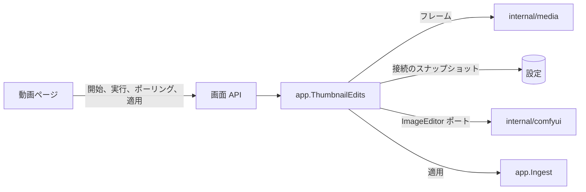
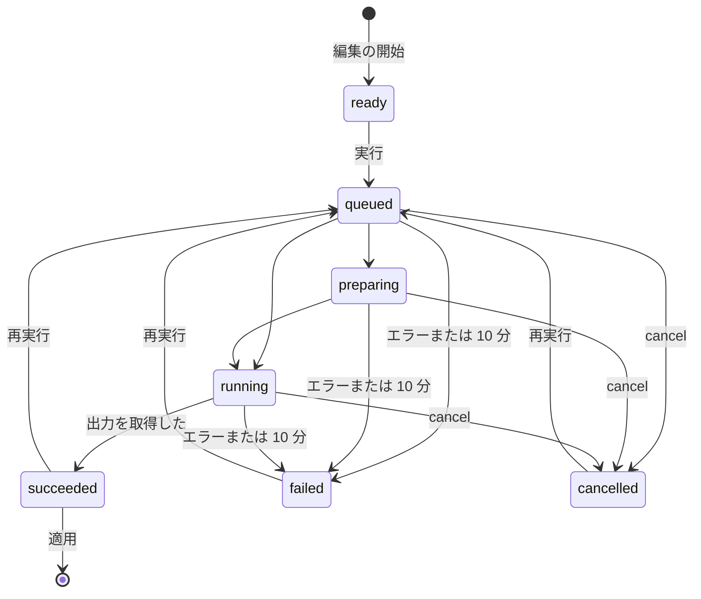

# サムネイル編集のセッション {#thumbnail-editing-sessions}

ComfyUI による動画フレームの編集は、[`app.ThumbnailEdits`](../../internal/app/thumbnail_edits.go) にある動画ごとのメモリ上のセッションで、`/api/thumbnail-edits` のルートが動画ページに提供する ([契約](../../specs/045-comfyui-thumbnails/contracts/screen-api.md))。

図は、セッションがやり取りする相手を示す。

## セッションはメモリ上にあり、ポーリングで読まれる {#a-session-lives-in-memory-and-is-read-by-polling}

セッションはフレーム、現在の実行、結果の画像をメモリに保持し、実行の進行中はページがそれを毎秒読み、読むたびにプロバイダに実行の状態を問い合わせる ([R-4](../../specs/045-comfyui-thumbnails/research.md#r-4-an-edit-is-an-in-memory-session-per-video-read-by-polling))。実行は開いている 1 つのページに属し、再起動の後に適用されてはならないので、キューのジョブでもドメインイベントでもなく、再起動ですべてのセッションが破棄される。各読み取りはページのハートビートだ。5 分間読まれなかったセッションは、プロバイダでの実行を取り消して終了する。

図は、セッションの状態を示す。

破棄、5 分間読まれないこと、同じ動画の新しい編集、再起動は、どの状態のセッションも終了させ、進行中の実行はその前にプロバイダで取り消される。送信から 10 分後に終了状態にない実行は、取り消されて `timed_out` として失敗する ([R-11](../../specs/045-comfyui-thumbnails/research.md#r-11-a-new-session-replaces-the-previous-one-a-run-is-limited-to-10-minutes))。30 秒ごとのバックグラウンドの掃除が、誰も読まないセッションに両方の制限を適用し、各リクエストは自身のセッションにそれらを適用する。

| 採用しなかった案 | 理由 |
| --- | --- |
| 永続キューのジョブの種類 | 再試行と `failed` の記録がページより長く残り、取り込みの問題に表示される |
| `/api/events` による進捗 | このストリームは確定したドメインイベントをすべての閲覧者に届けるが、実行の状態は 1 つのページのものだ |

## 実行は開始時の接続を使う {#a-run-uses-the-connection-it-started-with}

実行の開始時に保存済みの ComfyUI 接続を読んで実行の中に保持するので、その間に所有者が接続を変更または削除しても、読み取り、取り消し、出力の取得はそのプロバイダに送られる。接続の削除後に開始した実行は `409 thumbnail_edit_not_ready` を返す。セッションの新しい実行は、送信の前に進行中の実行を取り消す。

## 入力はアップロードの前に検査する {#inputs-are-checked-before-anything-is-uploaded}

マスクはフレームのピクセルサイズの PNG、参照画像は 20 MiB 以下の PNG、JPEG、WebP でなければならず、どちらかを満たさないときはアップロードせずに `400` を返す。フレームはサーバーが動画のサイズで切り出し、長辺を 2048 px までに抑える ([R-8](../../specs/045-comfyui-thumbnails/research.md#r-8-the-frame-is-extracted-by-the-server-at-up-to-2048-px)) ので、ページはプロバイダが受け取るのと同じピクセルに描く。プロバイダが拒否したアップロードまたは送信は、失敗の理由を付けて `502 provider_failed` を返し、セッションは同じ理由を `failed` として示す。

## 適用は生成のロックを通る {#applying-goes-through-the-generation-lock}

適用は結果を `Ingest.ApplyThumbnailImage` に渡し、これが内容のサムネイル生成のロックの中で結果を収まる大きさに合わせて公開するので、適用、元に戻す操作、位置の上書きのうち最後に確定したものが勝つ ([R-10](../../specs/045-comfyui-thumbnails/research.md#r-10-apply-revert-and-the-position-override-are-ordered-by-the-generation-lock))。セッションは、適用が成功した後と、動画がなくなったか別の内容を持つときの `content_changed` の後に終了し、デコードできない結果ではセッションが残るので、所有者は再実行できる。
