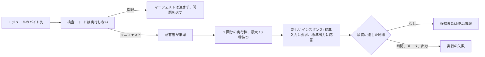

# 作品情報プラグイン: サンドボックスと制限 {#work-info-plugins-sandbox-and-limits}

VVMDM は、外部のサイトから作品情報を読み取る WebAssembly のモジュールである作品情報プラグインを、自分のプロセスの中で wazero により実行する。アダプタは [`internal/wasmplugin`](../../internal/wasmplugin) で、[`internal/app/work_info_plugin_runtime.go`](../../internal/app/work_info_plugin_runtime.go) の `WorkInfoPluginRuntime` ポートの背後にある。プラグインの契約は [contracts/plugin-contract.md](../../specs/049-work-info-plugins/contracts/plugin-contract.md) で、各選択の理由はこの機能の [research.md](../../specs/049-work-info-plugins/research.md) (R-1 から R-4) にある。

図は、モジュールがアップロードから実行の結果までにたどる過程を示す。

## 検査はモジュールを決して実行しない {#inspection-never-runs-the-module}

`Inspect` はモジュールをコンパイルし、その `vv.plugin` マニフェスト、インポート、エクスポート、テーブルを読み、最初に見つけた [data-model.md](../../specs/049-work-info-plugins/data-model.md#work_info_plugins) の `problem` を返す ([`runtime.go`](../../internal/wasmplugin/runtime.go))。

所有者はプラグインをその名前、バージョン、設定から承認するので、これらは所有者がまだ承認していないコードからではなく、カスタムセクションから得る。wazero のコンパイル済みモジュールはテーブルも関数以外のインポートも見せないので、[`binary.go`](../../internal/wasmplugin/binary.go) がインポートとテーブルのセクションをバイト列から読む。

| 確認する内容 | 満たさないときの問題 |
| --- | --- |
| バイト列が、メモリの初期サイズが 128 MiB 以下の WebAssembly モジュールとしてコンパイルできる | `not_wasm` |
| `vv.plugin` セクションがある | `manifest_missing` |
| マニフェストが、マニフェストの規則に従う JSON オブジェクトである | `manifest_invalid` |
| `contract` が `1` である。他のフィールドより先に確認する | `contract_unsupported` |
| すべてのインポートが、vv のものと同じシグネチャを持つ `wasi_snapshot_preview1` または `vv` の関数である | `import_unsupported` |
| `_start` が何も受け取らず何も返さず、`memory` がエクスポートされている | `export_invalid` |
| すべてのテーブルの最小値と、宣言された最大値があればその最大値が、100,000 要素以下である | `table_too_large` |

## テーブルにはコンパイルの前に最大値を与える {#tables-get-a-maximum-before-compiling}

Go の `wasip1` リンカが関数テーブルを書き出すときのように最大値を宣言していないテーブルには、検査時と実行前の両方で、コンパイルの前にモジュールのバイト列へ 100,000 要素の最大値を書き込む ([`binary.go`](../../internal/wasmplugin/binary.go) の `capTables`)。

テーブルの要素は線形メモリの上限の外にあるホストのメモリなので、上限のない `table.grow` はサーバーのメモリを際限なく使えてしまう。そのようなテーブルを拒否すると、Go でビルドしたプラグインをすべて拒否することになる。

## 実行にはファイルも環境もなく、制限は固定である {#a-run-has-no-files-no-environment-and-fixed-limits}

各実行は新しいインスタンスを開始し、要求の JSON を標準入力に書き、応答の JSON を標準出力から読む ([`run.go`](../../internal/wasmplugin/run.go))。インスタンスには時計と乱数源を与え、事前に開いたディレクトリ、環境変数、引数は与えない。`vv` のホスト関数 `http_send`、`http_meta`、`http_body` は、vv の HTTP クライアントが追加されるまで `-1` を返す。

| 制限 | 値 | 達したとき |
| --- | --- | --- |
| モジュールのサイズ | 16 MiB | `Inspect` が `domain.ErrWorkInfoPluginTooLarge` を返す |
| 線形メモリ | 128 MiB (2048 ページ) | `memory.grow` が `-1` を返し、実行は `memory_exceeded` で失敗する |
| 実行時間 | 30 秒、HTTP を含む | モジュールを閉じ、実行は `timed_out` で失敗する |
| 標準出力 | 1 MiB | 実行を `output_too_large` で止める |
| 標準エラー出力 | 64 KiB を保持し、残りは捨てる | サーバーのログにだけ書く |
| 同時に行う実行 | 1。2 つ目の実行は最大 10 秒待つ | 2 つ目の実行は `busy` で失敗する |

メモリの上限は wazero のページ数の上限ではなく vv のメモリアロケータで強制する。wazero は上限を超える `memory.grow` をアロケータが見る前に拒否するので、vv はメモリの失敗を他の 0 以外の終了と区別できなくなるからである。応答がプラグインのエラーである実行、0 以外で終了した実行、契約から外れた出力をした実行は `plugin_failed` で失敗する。

| 採用しなかった案 | 理由 |
| --- | --- |
| 実行ごとに別のプロセス | コンテナと Windows アプリで別々の OS のサンドボックスが必要になる |
| アップロード時に `describe` 操作を実行する | 承認のために表示する名前とバージョンが、承認されていないコードから来ることになる |
| 複数の実行を同時に行う | 各実行は 128 MiB を使いうるので、1 つずつにするとプラグインのメモリが 1 モジュール分に収まる |
