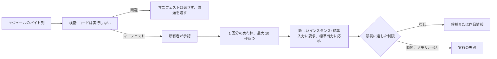
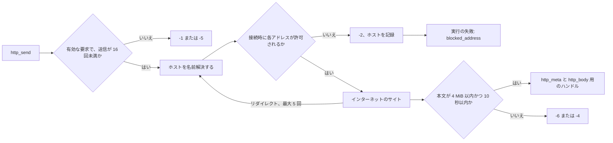
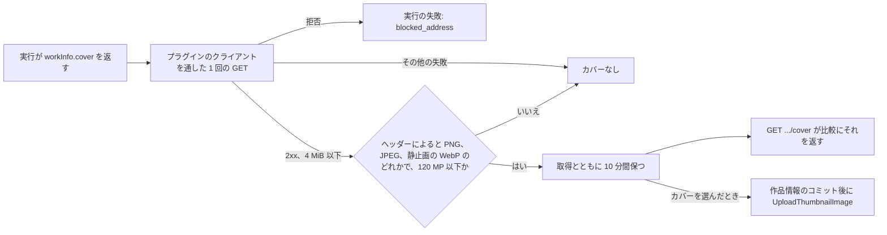
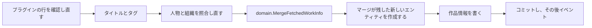

# 作品情報プラグイン: サンドボックス、制限、ネットワーク {#work-info-plugins-sandbox-limits-and-network}

VVMDM は、外部のサイトから作品情報を読み取る WebAssembly のモジュールである作品情報プラグインを、自分のプロセスの中で wazero により実行する。アダプタは [`internal/wasmplugin`](../../internal/wasmplugin) で、[`internal/app/work_info_plugin_runtime.go`](../../internal/app/work_info_plugin_runtime.go) の `WorkInfoPluginRuntime` ポートの背後にある。プラグインの契約は [作品情報プラグインを書く](../how-to/work-info-plugins.md) で、各選択の理由はこの機能の [research.md](../../specs/049-work-info-plugins/research.md) (R-1 から R-5) にある。

図は、モジュールがアップロードから実行の結果までにたどる過程を示す。

## 検査はモジュールを決して実行しない {#inspection-never-runs-the-module}

`Inspect` はモジュールをコンパイルし、その `vv.plugin` マニフェスト、インポート、エクスポート、テーブルを読み、最初に見つけた [data-model.md](../../specs/049-work-info-plugins/data-model.md#work_info_plugins) の `problem` を返す ([`runtime.go`](../../internal/wasmplugin/runtime.go))。

所有者はプラグインをその名前、バージョン、設定から承認するので、これらは所有者がまだ承認していないコードからではなく、カスタムセクションから得る。wazero のコンパイル済みモジュールはテーブルも関数以外のインポートも見せないので、[`binary.go`](../../internal/wasmplugin/binary.go) がインポートとテーブルのセクションをバイト列から読む。

| 確認する内容 | 満たさないときの問題 |
| --- | --- |
| バイト列が、メモリの初期サイズが 128 MiB 以下の WebAssembly モジュールとしてコンパイルできる | `not_wasm` |
| `vv.plugin` セクションがある | `manifest_missing` |
| マニフェストが、マニフェストの規則に従う JSON オブジェクトである | `manifest_invalid` |
| `contract` が `1` である。他のフィールドより先に確認する | `contract_unsupported` |
| すべてのインポートが、vv のものと同じシグネチャを持つ `wasi_snapshot_preview1` または `vv` の関数である | `import_unsupported` |
| `_start` が何も受け取らず何も返さず、`memory` がエクスポートされている | `export_invalid` |
| すべてのテーブルの最小値と、宣言された最大値があればその最大値が、100,000 要素以下であり、各テーブルの宣言された最大値 (ないテーブルは 100,000) を全テーブルで合計した値も 100,000 要素以下である | `table_too_large` |

## テーブルにはコンパイルの前に最大値を与える {#tables-get-a-maximum-before-compiling}

Go の `wasip1` リンカが関数テーブルを書き出すときのように最大値を宣言していないテーブルには、検査時と実行前の両方で、コンパイルの前にモジュールのバイト列へ 100,000 要素の最大値を書き込む ([`binary.go`](../../internal/wasmplugin/binary.go) の `capTables`)。

テーブルの要素は線形メモリの上限の外にあるホストのメモリなので、上限のない `table.grow` はサーバーのメモリを際限なく使えてしまう。そのようなテーブルを拒否すると、Go でビルドしたプラグインをすべて拒否することになる。同じ理由で、上限はモジュール全体にも適用する。そうしないと、それぞれ 100,000 要素以内の多数のテーブルが合計で上限を超えうる。

## 実行にはファイルも環境もなく、制限は固定である {#a-run-has-no-files-no-environment-and-fixed-limits}

各実行は新しいインスタンスを開始し、要求の JSON を標準入力に書き、応答の JSON を標準出力から読む ([`run.go`](../../internal/wasmplugin/run.go))。インスタンスには時計と乱数源を与え、事前に開いたディレクトリ、環境変数、引数は与えない。ネットワークへの唯一の経路は `vv` のホスト関数で、[プラグインは公開インターネットのアドレスにだけ到達する](#plugins-reach-only-public-internet-addresses) で説明する。

| 制限 | 値 | 達したとき |
| --- | --- | --- |
| モジュールのサイズ | 16 MiB | `Inspect` が `domain.ErrWorkInfoPluginTooLarge` を返す |
| 線形メモリ | 128 MiB (2048 ページ) | `memory.grow` が `-1` を返し、モジュールを閉じ、プラグインがその後正常に終了した場合でも、実行は `memory_exceeded` で失敗する |
| 実行時間 | 実行枠を取ってから 30 秒、コンパイルと HTTP を含む | コンパイルまたはモジュールを止め、実行は `timed_out` で失敗する |
| 標準出力 | 1 MiB | 実行を `output_too_large` で止める |
| 標準エラー出力 | 64 KiB を保持し、残りは捨てる | サーバーのログにだけ書く |
| 同時に行う実行 | 1。2 つ目の実行は最大 10 秒待つ | 2 つ目の実行は `busy` で失敗する |

メモリの上限は wazero のページ数の上限ではなく vv のメモリアロケータで強制する。wazero は上限を超える `memory.grow` をアロケータが見る前に拒否するので、vv はメモリの失敗を他の 0 以外の終了と区別できなくなるからである。実行が出力とメモリの両方の上限に達したときは、先に達した方が失敗を決める。応答がプラグインのエラーである実行、0 以外で終了した実行、契約から外れた出力をした実行は `plugin_failed` で失敗する。

実行時間は実行が実行枠を取った時点から始まるので、まだキャッシュされていないモジュールのコンパイルもこれに含まれる。wazero は複数のワーカーでコンパイルするときにだけ関数の間でコンテキストを確認するので、実行は 2 つのワーカーでコンパイルする。

| 採用しなかった案 | 理由 |
| --- | --- |
| 実行ごとに別のプロセス | コンテナと Windows アプリで別々の OS のサンドボックスが必要になる |
| アップロード時に `describe` 操作を実行する | 承認のために表示する名前とバージョンが、承認されていないコードから来ることになる |
| 複数の実行を同時に行う | 各実行は 128 MiB を使いうるので、1 つずつにするとプラグインのメモリが 1 モジュール分に収まる |

## プラグインは公開インターネットのアドレスにだけ到達する {#plugins-reach-only-public-internet-addresses}

プラグインはソケットを持たない。vv がプラグインの各 HTTP 要求を、`vv` のホスト関数 `http_send`、`http_meta`、`http_body` ([`host.go`](../../internal/wasmplugin/host.go)) を通じて、自分の HTTP クライアント ([`netclient.go`](../../internal/wasmplugin/netclient.go)) で実行する。クライアントは URL のホストを名前解決し、解決したすべてのアドレスを、各接続の直前にダイアラの制御フックで確認するので、リダイレクトと DNS の応答は最初の要求と同じ確認を通る。

図は、プラグインの要求からそのハンドルまたはエラーまでの、1 回の `http_send` を示す。

アドレスが許可されるのは、IPv4 射影 IPv6 アドレスを IPv4 に戻したうえで、グローバルユニキャスト (IPv6 では `2000::/3` の中) であり、`refusedPrefixes` のどの範囲にも含まれず、サーバー自身のインターフェースのアドレスでもないときだけである ([`address.go`](../../internal/wasmplugin/address.go))。`refusedPrefixes` は 1 つの表で、IANA の IPv4 と IPv6 の Special-Purpose Address Registry のうち "Globally Reachable" が `True` でないすべての範囲に、`fec0::/10` と IPv4 アドレスを埋め込むプレフィックス (`64:ff9b::/96`、`64:ff9b:1::/48`、`2001::/32`、`2002::/16`) を加えたものである。サーバーのインターフェースは vv の実行中に変わりうるので、確認のたびに読む。

拒否した要求はプラグインに `-2` を返し、プラグインがその後に何を書いても、実行全体を `blocked_address` と拒否したホストで失敗させる。そのため、プラグインは vv や LAN に到達しようとしたことを所有者から隠せない。接続に失敗した要求は `-3` を返す。その後プラグインが失敗したときは、実行は `network_error` と到達できなかった最初のホストで失敗する。所有者はホストには対処できるが、プラグインのメッセージだけでは対処できないからである。

| 制限 | 値 | 達したとき |
| --- | --- | --- |
| 要求 | 実行ごとに 16 回、`GET` と `POST`、`http` と `https` | 17 回目の要求は `-5` を返す。他のメソッドやスキームは `-1` を返す |
| リダイレクト | 要求ごとに 5 回 | 6 回目のリダイレクトの応答はそのままプラグインに渡す |
| 時間 | 要求ごとに 10 秒、送信から本文の最後のバイトまで | 要求は `-4` を返す |
| 応答のヘッダー | 1 MiB | 要求は `-3` を返す |
| 応答の本文 | 4 MiB | 要求は `-6` を返す |

プロキシを使うとダイアラの確認がプロキシのアドレスしか見なくなるので、クライアントは `HTTP_PROXY` などのプロキシの変数を無視する。プラグインが設定した `Host` とホップバイホップのヘッダーは捨てる。プラグインが `User-Agent` を設定しないときは、一般的なデスクトップブラウザのもの（Windows 版 Chrome）を送る。プラグインが読むのはユーザーが開いたページであってクロールではなく、ボットのような値では別のページが返ったり拒否されたりすることがあるからだ。本文は応答のヘッダーとともにバイト列としてプラグインに届くので、ページの文字コードはプラグイン自身がデコードする。

アドレスの確認はこのアダプタにだけある。ComfyUI と Ollama のクライアントは、それらのサービスが動く LAN に引き続き到達する。

| 採用しなかった案 | 理由 |
| --- | --- |
| 要求の前にホスト名を名前解決して確認する | 接続が名前を再び解決して別の応答を得ることがあり、リダイレクトは確認を通らない |
| プラグインごとのホスト名の許可リスト | 公開の名前が LAN のアドレスに解決されうる |
| 拒否をプラグインにだけ返す | プラグインがそれを無視でき、所有者は到達しようとしたことを知れない |
| 接続、TLS、ヘッダーで別々のタイムアウト | 遅いサイトが、要求の 10 秒の制限より前に `-4` ではなく `-3` を返しうる |

## 取得は作品の詳細とその照合結果を保持する {#the-fetch-keeps-the-work-details-and-their-matches}

[`internal/app/work_info_fetch.go`](../../internal/app/work_info_fetch.go) の `WorkInfoPlugins.FetchWorkInfo` は、取得した日付を種類順に、人物と組織を役割順に並べ、その後人物と組織を `CreditStore.Match` で照合する。詳細と照合結果は、タイトルとタグとともに、同じ 10 分間メモリ上の結果に残る ([049 research.md](../../specs/049-work-info-plugins/research.md) R-8)。人物も組織もない結果はストアを読まない。

照合結果は表示されるだけである。画面はそれをもとに各項目を結び付け済み、`New`、`Not linked` のいずれかとして示す ([052 screen-api.md](../../specs/052-plugin-work-info-fields/contracts/screen-api.md))。次の節で示すとおり、適用はトランザクションの中で照合し直す。適用は何かを書く前に、結果の中でその行に値がない選択済みのフィールドを `invalid_request` で拒否する。

## VVMDM がカバーを取得し、アップロードした画像として適用する {#vvmdm-fetches-the-cover-and-applies-it-as-an-uploaded-image}

プラグインはカバーを `workInfo.cover` の URL として返し、VVMDM は実行の後に、プラグインの要求の HTTP クライアントでそれを取得する ([`cover.go`](../../internal/wasmplugin/cover.go) の `coverImage`)。そのため [プラグインは公開インターネットのアドレスにだけ到達する](#plugins-reach-only-public-internet-addresses) のアドレスの規則はカバーにも当てはまり、拒否されたアドレスは実行を `blocked_address` で失敗させる。それ以外の失敗ではカバーを捨て、結果の残りを保つ ([プラグインの契約](../how-to/work-info-plugins.md#cover-image))。

図は、実行からサムネイルまでのカバーを示す。

[`work_info_cover.go`](../../internal/app/work_info_cover.go) は画像のヘッダーだけを確かめる。完全なデコードは適用が担う。カバーはアップロードした画像の経路である `Ingest.UploadThumbnailImage` を通る ([thumbnail-editing.md](thumbnail-editing.md#uploaded-images)) ので、アップロードのゲート、1 億 2000 万ピクセルの上限、生成のロックを受け、origin `uploaded` で保存される。

ブラウザはカバーを `GET /api/videos/{id}/work-info-fetches/{fetchId}/cover` から表示するので、プラグインのサイトに決して接続しない。VVMDM は読み取った形式から型を設定し、`nosniff` とサンドボックス化する `Content-Security-Policy` を送るので、応答は画像にしかならない。

各カバーは、その取得とともにメモリに保持する。保持するカバーは合わせて 32 MiB、つまり上限の 4 MiB のカバー 8 つ分に収まる。この予算を超える新しい取得は、カバーを持つ取得のうち先に期限が切れるものを捨て、捨てた取得の適用は `work_info_fetch_stale` を返す。

適用は、作品情報のトランザクションがコミットした後にカバーをサムネイルにするので、取得の後に差し替えられた、または取り消されたプラグインは、そのトランザクションが確かめ直すため、サムネイルを変えない。コミット後のカバーの失敗 (サムネイルの経路が拒否する画像、取得の後に内容が変わった動画、書き込みのエラー) はすべて `invalid` として飛ばす。取得は一度しか使えず、すでに適用済みなので、エラーにすると画面は何が書かれたかを判別できなくなる。

| 採用しなかった案 | 理由 |
| --- | --- |
| プラグインが画像をダウンロードして応答で返す | 応答は 1 MiB に制限され、base64 は画像を 3 分の 1 大きくする |
| ブラウザがサイトからカバーを読み込む | サイトに閲覧者が見えてしまう。[R-10](../../specs/049-work-info-plugins/research.md#r-10-search-candidates-are-text-only) が候補について退けたとおりである |
| 表示のたびや適用時にカバーを取得し直す | 所有者が比較した画像とは別の画像をサイトが返しうる |

## 適用は選んだフィールドを 1 つのトランザクションでマージする {#the-apply-merges-the-selected-fields-in-one-transaction}

[`internal/store/work_info_fetch.go`](../../internal/store/work_info_fetch.go) の `OverrideStore.ApplyFetchedWorkInfo` は、取得した結果のうち選んだタイトル、タグ、作品の詳細を 1 つのトランザクションで書く。理由は [052 research.md](../../specs/052-plugin-work-info-fields/research.md) の R-3 と R-4 である。

図はトランザクションの中の手順の順序を示す。

1. 従来どおりプラグインの行を読み直す: 置き換えられた、取り消された、または削除されたプラグインは `ErrWorkInfoFetchStale` を返し、何も書かない。
2. 取得した人物と組織を、取得時と同じクエリで照合し直す ([`credit_match.go`](../../internal/store/credit_match.go) の `matchCredits`)。取得と適用の間に作成されたエンティティは結び付け、二重に作成しない。
3. [`work_info_merge.go`](../../internal/domain/work_info_merge.go) の `domain.MergeFetchedWorkInfo` は、選んだフィールドを保存済みの作品情報に重ねる。ストアに依存しないので、その規則は SQLite なしで単体テストする。
4. マージが残した新しいエンティティだけを、取得した名前と外部 ID で、`CreditStore.Create` と同じ挿入を通して作成する。
5. 結果は、保存済みの値と異なるときだけ、047 の置き換えの経路で書く。そのときユーザーキーのメンバーの編集時刻が進む。

コミットの後、適用は従来どおり `VideoOverrideChanged` を発行し、作品情報が変わったときは `VideoWorkInfoChanged` を 1 つ発行する。どの手順で失敗しても、タイトル、タグ、作品情報、新しいエンティティをまとめてロールバックする。

| フィールド | マージの規則 |
| --- | --- |
| `code`、`description`、日付の種類 | 保存済みの値を置き換える |
| 人物または組織の役割 | その役割でまだ結び付いていないエンティティを、取得した順に追加する |
| `urls`、`externalIds` | まだ保存されていない値を、取得した順に追加する |

マージが除いた値は、そのフィールド、比較で示したテキスト、理由とともにスキップとして返す。行の残りはそれでも適用する。

| 理由 | 該当するとき |
| --- | --- |
| `invalid` | 値が `NormalizeWorkInfo` のフィールドの規則に反する、または新しいエンティティの名前か外部 ID が `NormalizeCredit` に反する |
| `too_many` | 保存済みの項目の後に数えて、項目がフィールドの上限を超える、または新しいエンティティがその上限より多くの外部 ID を持つことになる |
| `ambiguous` | 照合で複数のエンティティが見つかった、または新しい項目の外部 ID がすでに別の新しいエンティティに属している |

マージは何かを作成する前にスキップを決めるので、スキップした項目が、どの動画にも結び付かないエンティティを残すことはない。1 つの結果の中で外部 ID か畳み込んだ名前を共有する新しい項目は 1 つのエンティティになり、役割ごとに 1 回結び付く。そのエンティティはそこにまとめたすべての項目の外部 ID を持つので、後の取得がそれらの ID の 1 つだけで指していても、そのエンティティを見つけられる。
