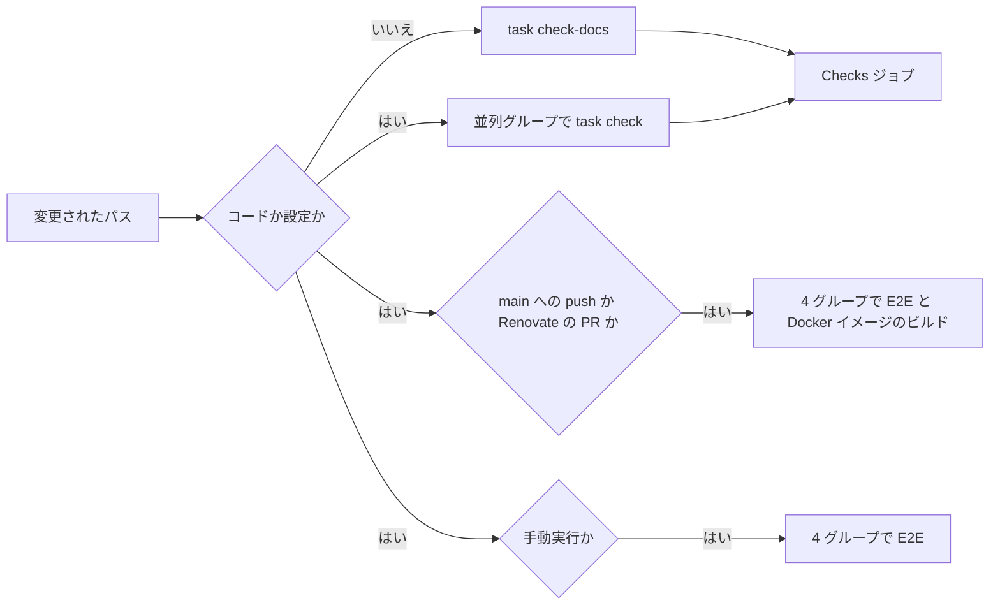

# 開発 {#development}

## ツールチェーンを準備する {#set-up-the-toolchain}

Go、Node.js、Task のバージョンは `mise.toml` で固定されている。`ffmpeg`、Docker、Git、bash はシステムの依存関係で、`task doctor` が確認する。

```bash
mise trust
mise install
mise exec --command "task setup"
mise exec --command "task doctor"
```

npm の依存関係をインストールするタスクは `task setup` だけだ。Windows では、ネイティブの依存ファイルがロックされることがあるため、再実行の前に起動中の開発サーバーを止める。

## ローカルで実行する {#run-locally}

```bash
mise exec --command "task dev"
```

<http://localhost:5173> を開く。このコマンドは、自動再起動つきの Go サーバーと Vite 開発サーバーを起動する。

| 設定 | 効果 |
| --- | --- |
| `MDM_ADDR` | Go の待ち受けアドレスで、Vite の API プロキシの既定の転送先 |
| `MDM_API_TARGET` | `MDM_ADDR` と異なる場合の Vite の API プロキシの転送先 |
| `MDM_DATA_DIR` | データフォルダ。Windows で直接起動した Go バイナリには、ドライブ文字つきの絶対パスが必要（`task dev` は絶対パスを渡す） |

## 変更を検証する {#validate-changes}

```bash
mise exec --command "task check"
```

`task check` は、フォーマットの確認、静的解析、単体テスト、生成ファイルの確認、マイグレーションの確認、Windows のビルド確認を実行する。push の前には毎回、コードまたは設定の変更ならこれを、Markdown、`docs/`、`specs/` の変更なら `task check-docs` を実行する。実行を省くと、CI からフォーマットや lint の修正として戻ってきやすい。`task fmt` は Go と Web のソースを確認対象の形式に書き換える。

lint の指摘はコードで直し、抑止しない。`task check` は、Go のソースに `//nolint` コメントが一つでもあると失敗し（`scripts/nolintguard`）、`web/` に `eslint-disable*` などのインラインの ESLint 設定コメントが一つでもあると失敗する（`linterOptions.noInlineConfig`）。変更は、追加する関数と複雑にする関数の複雑度を 25 以下に保ち、コードをコピーせずに共有する。Codex レビューは違反を指摘する（[複雑度と重複](../design-docs/complexity-and-duplication.md)）。

ブラウザテストは別のコマンドだ。

```bash
mise exec --command "task test-e2e"
```

`task help` はすべてのコマンドを一覧表示する。開発者向けコマンドのサポートされた入口は `Taskfile.yml` だ。

CI は変更されたパスからジョブを選び、必須の `Checks` ジョブと `Browser E2E` ジョブで結果を報告する。



「いいえ」は、Markdown、`docs/`、`specs/` だけが変更されたことを意味する。コードの変更では、CI は `task check` のサブタスクを並列の `Checks (<group>)` ジョブとして実行する。生成ファイル、マイグレーション、Windows のビルドの確認と組み合わせた Go の lint、Go のテスト、SPA のビルドの確認（`task build-check-web`）と組み合わせた Web の lint、3 つのシャードに分けた Vitest スイート（`task test-web-report -- --shard=1/3`）だ。`task test-web` はビルドの確認とスイート全体を実行する。`task check` に追加する確認は、`.github/workflows/ci.yml` のこれらのグループのいずれかにも入れる。Go のビルドキャッシュを復元するのは Go のグループだけで、それぞれが `main` への push で自分のコピーを保存する。Vitest はファイル単位でシャードに分けるため、一つのシャードの大半を占めるまで大きくなったテストファイルは、`web/src/tags/TagsPage*.test.tsx` が共有の `web/src/testing/tagsPage.tsx` を中心に分けられているように、トピックごとに分割する。`main` への push はマージされたプルリクエストなので、ブラウザ E2E と Docker イメージのビルドはプルリクエストでは実行されない。プルリクエストでは `Browser E2E` は実行されずに成功する。Renovate の PR（head ブランチが `renovate/*`）は例外で、イメージを公開せずに両方を実行する。Renovate のルーチンが人を介さずにそれらをマージするためである（[dependency-updates.md](dependency-updates.md)）。

マージ前のブランチでブラウザ E2E を実行するには、Actions タブから、または `gh workflow run ci.yml --ref <branch>` で、CI ワークフローを手動で開始する（`workflow_dispatch`）。手動実行はブランチをコードの変更として扱い、すべての `Checks` グループと 4 つの E2E グループを実行する。Docker イメージはビルドしない。

Go と Vitest のテストグループは、`task test-go` と `task test-web-unit` と同じテストを `task test-go-report` と `task test-web-report` で実行し、これらはカバレッジと JUnit のテスト結果も `reports/` の下に書き出す。CI は、テストが失敗したときも、それらを `main` への push の E2E の結果と合わせて [Codecov](https://app.codecov.io/gh/syudead/vv) にアップロードする。コードを変更する各プルリクエストで、Codecov は変更行のカバレッジをコメントし、失敗したテストと不安定なテストの名前を示し、`go` と `web` のフラグごとに情報提供の patch ステータスを設定する。マージはブロックしない（[`.github/codecov.yml`](../../.github/codecov.yml)）。フラグ別とコンポーネント別のカバレッジは Codecov の Flags と Components のページにある。新しいプッシュは、プルリクエストでは実行中の CI 実行をキャンセルするが、`main` ではキャンセルしない。そのため `main` のすべてのコミットが Codecov に届く。アップロードは GitHub OIDC で認証するため、リポジトリに Codecov のトークンは不要だが、codecov.io に GitHub でサインインして Codecov GitHub App をインストールし、リポジトリを一度有効にする必要がある。アップロードが失敗しても確認は失敗しない。

確認グループと並んで、`Quality` ジョブはすべてのプルリクエストと `main` へのプッシュで `task complexity-go`、`task complexity-web`、`task duplication` を並列に実行する。それぞれが 1 つのツールの出力を `reports/quality/` の下に書き出す。gocyclo（`tools/go.mod` にツールとして固定されている）によるすべての Go の関数の循環的複雑度、ESLint の `complexity` ルールによるすべての Web の関数の循環的複雑度、そして jscpd が見つける重複コードだ。CI はそれぞれを同じ名前のアーティファクトとして 90 日間保持する（[テストと CI の品質監視](../design-docs/test-quality-monitoring.md)）。測定が失敗しても実行は失敗しない。`task quality-metrics` はローカルマシンで 3 つすべてを実行する。

毎月 1 日に `Mutation testing` ワークフロー（[`.github/workflows/mutation-testing.yml`](../../.github/workflows/mutation-testing.yml)）が、Go のテストが埋め込まれたバグを検出するかを測定する。ワークフローは `task mutation-go` を実行し、このタスクは gremlins（`tools/go.mod` にツールとして固定されている）を `./internal/domain/...` に対して実行し、すべてのミュータントの位置と結果を記した `reports/mutation/go/gremlins.json` を書き出す。ワークフローはそのレポートをそのまま、アーティファクトとして 90 日間保持する。テストが見逃したミュータントがあっても実行は失敗しない。`MUTATION_GO_DIR=./internal/other task mutation-go` は別のパッケージツリーを測定し、`--` のあとの引数は `gremlins unleash` に渡る。ワークフローを変更するプルリクエストもそれを実行する。StrykerJS による Web のミューテーションテストは、[stryker-js#6210](https://github.com/stryker-mutator/stryker-js/issues/6210) を修正する `@stryker-mutator/vitest-runner` のリリースを待っている。Vitest 5 ではランナーがすべてのテストを除外するので、すべてのミュータントが生き残る。

OpenAPI の契約が変わるときは、`api/openapi.yaml`（外部 API なら `api/external-v1.yaml`）を編集し、`task generate` を実行する。`internal/httpapi/gen/`、`internal/httpapi/extgen/`、`web/src/api/gen/` を直接編集してはならない。
