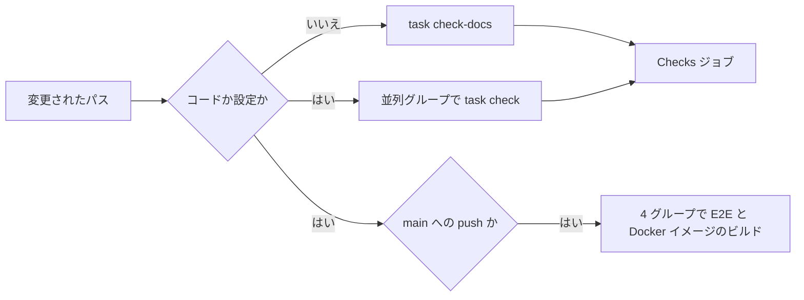

# 開発 {#development}

## ツールチェーンを準備する {#set-up-the-toolchain}

Go、Node.js、Task のバージョンは `mise.toml` で固定されている。`ffmpeg`、Docker、Git、bash はシステムの依存関係で、`task doctor` が確認する。

```bash
mise trust
mise install
mise exec --command "task setup"
mise exec --command "task doctor"
```

npm の依存関係をインストールするタスクは `task setup` だけだ。Windows では、ネイティブの依存ファイルがロックされることがあるため、再実行の前に起動中の開発サーバーを止める。

## ローカルで実行する {#run-locally}

```bash
mise exec --command "task dev"
```

<http://localhost:5173> を開く。このコマンドは、自動再起動つきの Go サーバーと Vite 開発サーバーを起動する。

| 設定 | 効果 |
| --- | --- |
| `MDM_ADDR` | Go の待ち受けアドレスで、Vite の API プロキシの既定の転送先 |
| `MDM_API_TARGET` | `MDM_ADDR` と異なる場合の Vite の API プロキシの転送先 |
| `MDM_DATA_DIR` | データフォルダ。Windows で直接起動した Go バイナリには、ドライブ文字つきの絶対パスが必要（`task dev` は絶対パスを渡す） |

## 変更を検証する {#validate-changes}

```bash
mise exec --command "task check"
```

`task check` は、フォーマットの確認、静的解析、単体テスト、生成ファイルの確認、マイグレーションの確認、Windows のビルド確認を実行する。push の前には毎回、コードまたは設定の変更ならこれを、Markdown、`docs/`、`specs/` の変更なら `task check-docs` を実行する。実行を省くと、CI からフォーマットや lint の修正として戻ってきやすい。`task fmt` は Go と Web のソースを確認対象の形式に書き換える。

lint の指摘はコードで直し、抑止しない。`task check` は、Go のソースに `//nolint` コメントが一つでもあると失敗し（`scripts/nolintguard`）、`web/` に `eslint-disable*` などのインラインの ESLint 設定コメントが一つでもあると失敗する（`linterOptions.noInlineConfig`）。

ブラウザテストは別のコマンドだ。

```bash
mise exec --command "task test-e2e"
```

`task help` はすべてのコマンドを一覧表示する。開発者向けコマンドのサポートされた入口は `Taskfile.yml` だ。

CI は変更されたパスからジョブを選び、必須の `Checks` ジョブと `Browser E2E` ジョブで結果を報告する。



「いいえ」は、Markdown、`docs/`、`specs/` だけが変更されたことを意味する。コードの変更では、CI は `task check` のサブタスクを並列の `Checks (<group>)` ジョブとして実行する。生成ファイル、マイグレーション、Windows のビルドの確認と組み合わせた Go の lint、Go のテスト、SPA のビルドの確認（`task build-check-web`）と組み合わせた Web の lint、3 つのシャードに分けた Vitest スイート（`task test-web-report -- --shard=1/3`）だ。`task test-web` はビルドの確認とスイート全体を実行する。`task check` に追加する確認は、`.github/workflows/ci.yml` のこれらのグループのいずれかにも入れる。Go のビルドキャッシュを復元するのは Go のグループだけで、それぞれが `main` への push で自分のコピーを保存する。Vitest はファイル単位でシャードに分けるため、一つのシャードの大半を占めるまで大きくなったテストファイルは、`web/src/tags/TagsPage*.test.tsx` が共有の `web/src/testing/tagsPage.tsx` を中心に分けられているように、トピックごとに分割する。`main` への push はマージされたプルリクエストなので、ブラウザ E2E と Docker イメージのビルドはプルリクエストでは決して実行されない。プルリクエストでは `Browser E2E` は実行されずに成功する。

Go と Vitest のテストグループは、`task test-go` と `task test-web-unit` と同じテストを `task test-go-report` と `task test-web-report` で実行し、これらはカバレッジと JUnit のテスト結果も `reports/` の下に書き出す。CI は、テストが失敗したときも、それらを `main` への push の E2E の結果と合わせて [Codecov](https://app.codecov.io/gh/syudead/vv) にアップロードする。Codecov はテスト結果から不安定なテストと遅いテストを報告し、変更された行のカバレッジを、プルリクエストをブロックせずにそのプルリクエストにコメントする（[`.github/codecov.yml`](../../.github/codecov.yml)）。アップロードは GitHub OIDC で認証するため、リポジトリに Codecov のトークンは不要だが、codecov.io に GitHub でサインインして Codecov GitHub App をインストールし、リポジトリを一度有効にする必要がある。アップロードが失敗しても確認は失敗しない。

`main` へのプッシュの CI 実行が成功するたびに、そのあとで `Quality metrics` ワークフロー（[`.github/workflows/quality-metrics.yml`](../../.github/workflows/quality-metrics.yml)）が `task quality-metrics` を実行する。これは、すべての Go の関数（`go/ast`）と Web の関数（ESLint の `complexity` ルール）の循環的複雑度、jscpd が見つける重複行、`main` での直近 20 回の成功した CI 実行とその各ジョブの所要時間の p50 と p90 を測定する。測定結果を `quality-metrics` ブランチの `history.jsonl` に追記し、前回のプッシュからの変化を載せた Markdown の表を実行のサマリーに書き出し、測定値が悪化したときは `quality-regression` ラベルの付いた Issue にコメントする（[テストと CI の品質監視](../design-docs/test-quality-monitoring.md)）。`task quality-metrics -- -ci-runs 0` はローカルマシンでコードだけを測定する。CI の所要時間には `gh` が必要だ。ワークフロー、`scripts/qualitymetrics/`、またはそれが使うツール（`Taskfile.yml`、`mise.toml`、`tools/` と `web/` の npm マニフェスト、`web/eslint.config.js`）を変更するプルリクエストは、履歴を保存せずにそれを実行する。

毎月 1 日に `Mutation testing` ワークフロー（[`.github/workflows/mutation-testing.yml`](../../.github/workflows/mutation-testing.yml)）が、Go のテストが埋め込まれたバグを検出するかを測定する。ワークフローは `task mutation-go` を実行し、このタスクは gremlins（`tools/go.mod` にツールとして固定されている）を `./internal/domain/...` に対して実行して `reports/mutation/go/gremlins.json` を書き出す。ワークフローはテストの有効性（killed と lived のミュータントに対する killed のミュータントの割合）とミュータントのカバレッジを実行のサマリーに書き出し、レポートをアーティファクトとして 90 日間保持する。スコアが低くても実行は失敗しない。`MUTATION_GO_DIR=./internal/other task mutation-go` は別のパッケージツリーを測定し、`--` のあとの引数は `gremlins unleash` に渡る。ワークフローを変更するプルリクエストもそれを実行する。StrykerJS による Web のミューテーションテストは、[stryker-js#6210](https://github.com/stryker-mutator/stryker-js/issues/6210) を修正する `@stryker-mutator/vitest-runner` のリリースを待っている。Vitest 5 ではランナーがすべてのテストを除外するので、すべてのミュータントが生き残る。

OpenAPI の契約が変わるときは、`api/openapi.yaml`（外部 API なら `api/external-v1.yaml`）を編集し、`task generate` を実行する。`internal/httpapi/gen/`、`internal/httpapi/extgen/`、`web/src/api/gen/` を直接編集してはならない。
