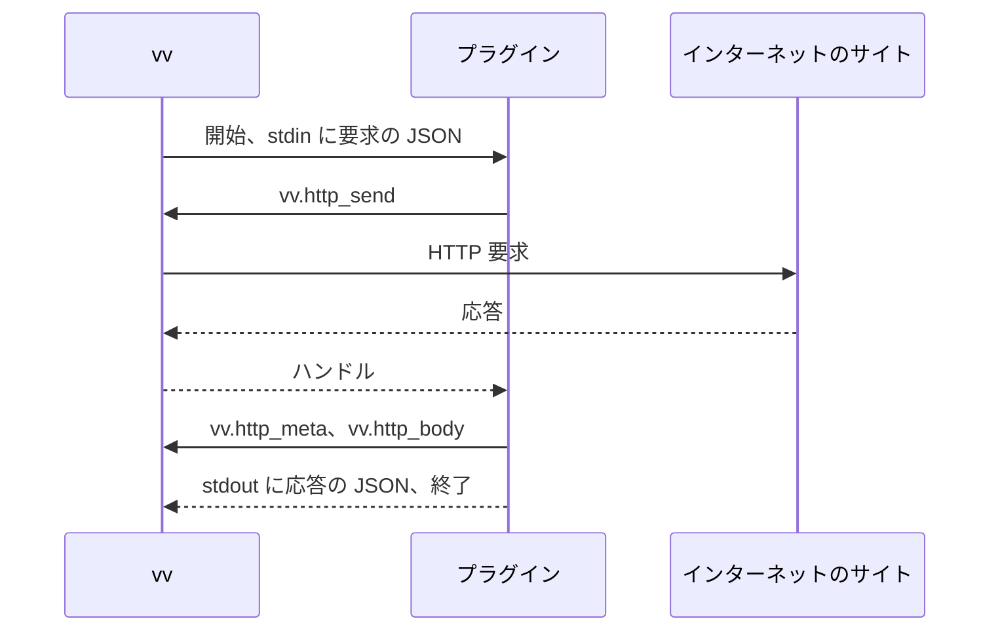

# 作品情報プラグインを書く {#write-a-work-info-plugin}

作品情報プラグインは、外部のサイトで作品を検索し、作品のタイトルとタグを取得するために VVMDM が実行する WebAssembly のモジュールである。終えると、所有者が設定画面で追加して承認できるモジュールができる。この手順書が、プラグインの契約のバージョン 1 である。サンドボックス、制限、ネットワークの規則がこの形である理由は [work-info-plugins.md](../design-docs/work-info-plugins.md) にある。

図のとおり、VVMDM は実行のたびに新しいインスタンスを起動する。



## 前提条件 {#prerequisites}

- Go 1.24 以降。`GOOS=wasip1 GOARCH=wasm` で `wasip1` のモジュールをビルドする。[モジュール](#module) を満たすモジュールをビルドするツールチェーンならどれでも使える。手順では Go を使う。
- プラグインを追加して承認するための、VVMDM の所有者のアカウント。

## 手順 {#steps}

1. 新しいディレクトリで、プラグインの Go モジュールを作る:

   ```bash
   go mod init example.com/title-plugin
   ```

2. プラグインを `main.go` として、Go の `main` パッケージで書く。標準入力から [要求](#request) を読み、HTTP のために [ホスト関数](#host-functions) を呼び、標準出力に [応答](#response) を書く。この例は作品のページを取得し、その `<title>` を返す:

   ```go
   package main

   import (
       "encoding/json"
       "html"
       "os"
       "regexp"
       "unsafe"
   )

   //go:wasmimport vv http_send
   func httpSend(req unsafe.Pointer, reqLen uint32) int32

   //go:wasmimport vv http_meta
   func httpMeta(handle int32, buf unsafe.Pointer, bufCap uint32) int32

   //go:wasmimport vv http_body
   func httpBody(handle int32, buf unsafe.Pointer, bufCap uint32) int32

   type request struct {
       Operation string            `json:"operation"`
       URL       string            `json:"url"`
       Settings  map[string]string `json:"settings"`
   }

   var titleTag = regexp.MustCompile(`(?is)<title[^>]*>(.*?)</title>`)

   func main() {
       var req request
       if err := json.NewDecoder(os.Stdin).Decode(&req); err != nil {
           fail("unreadable request")
           return
       }
       page, ok := get(req.URL)
       if !ok {
           fail("could not read " + req.URL)
           return
       }
       info := map[string]any{}
       if m := titleTag.FindSubmatch(page); m != nil {
           info["title"] = html.UnescapeString(string(m[1]))
       }
       reply(map[string]any{"workInfo": info})
   }

   // get sends a GET request and returns the body of a 200 response.
   func get(url string) ([]byte, bool) {
       req, _ := json.Marshal(map[string]string{"method": "GET", "url": url})
       handle := httpSend(unsafe.Pointer(&req[0]), uint32(len(req)))
       if handle < 0 {
           return nil, false
       }
       var meta struct {
           Status int `json:"status"`
       }
       if json.Unmarshal(read(httpMeta, handle), &meta) != nil || meta.Status != 200 {
           return nil, false
       }
       return read(httpBody, handle), true
   }

   // read asks for the length with an empty buffer, then reads into a buffer of that size.
   func read(fn func(int32, unsafe.Pointer, uint32) int32, handle int32) []byte {
       var probe [1]byte
       n := fn(handle, unsafe.Pointer(&probe[0]), 0)
       if n <= 0 {
           return nil
       }
       buf := make([]byte, n)
       fn(handle, unsafe.Pointer(&buf[0]), uint32(n))
       return buf
   }

   func fail(message string) {
       reply(map[string]any{"error": map[string]any{"message": message}})
   }

   func reply(v any) {
       _ = json.NewEncoder(os.Stdout).Encode(v)
   }
   ```

   失敗は `error` の応答として報告し、正常に終了する。0 以外の終了コードでも実行は失敗するが、そのとき所有者にはメッセージが表示されない。

3. モジュールをビルドする:

   ```bash
   GOOS=wasip1 GOARCH=wasm go build -o plugin.wasm .
   ```

4. [マニフェスト](#manifest) を `manifest.json` として書く:

   ```json
   {
     "contract": 1,
     "name": "example-title",
     "version": "0.1.0",
     "description": "Reads the title of a work's page.",
     "operations": ["fetch"]
   }
   ```

5. 次のプログラムを `addsection/main.go` として保存する。マニフェストを `vv.plugin` という名前のカスタムセクションとしてモジュールに追加する:

   ```go
   // Command addsection appends a vv.plugin custom section holding a manifest file
   // to a WebAssembly module. Usage: go run ./addsection plugin.wasm manifest.json
   package main

   import (
       "encoding/binary"
       "log"
       "os"
   )

   func main() {
       module, err := os.ReadFile(os.Args[1])
       if err != nil {
           log.Fatal(err)
       }
       manifest, err := os.ReadFile(os.Args[2])
       if err != nil {
           log.Fatal(err)
       }
       const name = "vv.plugin"
       payload := binary.AppendUvarint(nil, uint64(len(name)))
       payload = append(payload, name...)
       payload = append(payload, manifest...)
       module = append(module, 0) // custom section id
       module = binary.AppendUvarint(module, uint64(len(payload)))
       module = append(module, payload...)
       if err := os.WriteFile(os.Args[1], module, 0o644); err != nil {
           log.Fatal(err)
       }
   }
   ```

6. ビルドしたばかりのモジュールにセクションを追加する。実行するたびに別のセクションが追加されるので、ビルドごとに 1 回だけ実行する:

   ```bash
   go run ./addsection plugin.wasm manifest.json
   ```

7. VVMDM で **Settings** を開き、**Work-info plugins** の節で **Add plugin** を選び、`plugin.wasm` を選ぶ。プラグインを確認し、承認する。

## 結果を確認する {#check-the-result}

プラグインの行に、名前とバージョンが **Approved** のバッジとともに表示され、動画のページに **Fetch work info from a plugin** が表示される。名前のない行は、VVMDM がモジュールを拒否した理由を示す。[トラブルシューティング](#troubleshooting) を参照する。

## モジュール {#module}

| 項目 | 規則 |
| --- | --- |
| 形式 | `_start` を引数も戻り値もない関数として、`memory` をメモリとして export する、`wasip1` 向けにビルドした WebAssembly のコアモジュール |
| テーブル | 合わせて 100,000 要素以下。各テーブルは宣言された最大値で、それがなければ最小値と 100,000 の大きい方で数える。宣言された最大値のないテーブル (Go の `wasip1` リンカーが書く形) は受け入れ、コンパイル前に VVMDM が 100,000 に制限する |
| import | `wasi_snapshot_preview1` と `vv` の関数だけで、VVMDM のシグネチャに従うもの |
| WASI | 事前に開かれたディレクトリ、環境変数、引数はない。時計と乱数は動く。標準入力が要求を持ち、標準出力が応答を受け、標準エラーはサーバーのログに行く |
| 上限 | [上限](#limits) |

## マニフェスト {#manifest}

カスタムセクション `vv.plugin` がこの JSON オブジェクトを持つ。未知のフィールドは無視する。VVMDM はモジュールを実行せずにそれを読み、ほかのフィールドより先に `contract` を確かめる。

| フィールド | 型 | 必須 | 規則 |
| --- | --- | --- | --- |
| `contract` | integer | はい | `1` |
| `name` | string | はい | `a-z`、`0-9`、`-`、`.` からなる 1 から 64 文字。プラグインの識別子なので、同じ名前のモジュールはそれを置き換える |
| `version` | string | はい | 1 から 32 文字。所有者に表示する |
| `description` | string | いいえ | 最大 500 文字 |
| `operations` | string の配列 | はい | `search` と `fetch` の空でない部分集合で、それぞれ最大 1 回 |
| `settings` | object の配列 | いいえ | 最大 10 個の `{"key", "label", "secret", "required"}` の宣言。`key` は `A-Z`、`a-z`、`0-9`、`_` からなり英字で始まる 1 から 32 文字で、一意である。`label` は所有者に表示する 1 から 60 文字。`secret` と `required` の既定値は `false` |

API キー (`"secret": true`) や言語など、所有者が与えるものには設定を宣言する。所有者は設定画面で値を入力し、VVMDM はそれをこのプラグインの実行にだけ渡す。

## 要求 {#request}

VVMDM は 1 つの JSON オブジェクトを標準入力に書き、それを閉じる。

| 操作 | フィールド |
| --- | --- |
| `search` | `{"contract": 1, "operation": "search", "query": "<1 to 200 characters>"}` |
| `fetch` | `{"contract": 1, "operation": "fetch", "url": "<an http or https URL of at most 2048 characters>"}` |

どちらの操作も、所有者が値を設定した宣言済みのキーをすべて、そしてそれだけを含む `"settings": {"<key>": "<value>"}` も持つ。`required` のキーが未設定のあいだ、実行は始まらない。

## 応答 {#response}

プラグインは 1 つの JSON オブジェクトを標準出力に書き、終了する。未知のフィールドは無視するので、後の契約はバージョン 1 を壊さずにフィールドを加えられる。

| 場合 | 本文 |
| --- | --- |
| `search` の結果 | `{"candidates": [{"url": "...", "title": "...", "detail": "..."}]}`: `url` (http か https) と `title` は必須、`detail` は省略できる。VVMDM は最初の 50 個を保つ |
| `fetch` の結果 | `{"workInfo": {"title": "...", "tags": ["..."]}}`: どちらのフィールドも省略できる。VVMDM は最初の 100 個のタグを保ち、重複を落とす |
| 失敗 | `{"error": {"message": "..."}}`: VVMDM は `message` の最初の 300 文字を所有者に表示する |

0 以外の終了コード、またはこれらのどれでもない出力では、実行は `plugin_failed` で失敗する。

## ホスト関数 {#host-functions}

モジュール `vv`。ポインターと長さは、プラグインが export する `memory` の中の `i32` のオフセットである。JSON は UTF-8 である。

| 関数 | シグネチャ | 動作 |
| --- | --- | --- |
| `http_send` | `(req_ptr, req_len) -> handle` | 要求を行い、その応答へのハンドル (0 以上) か負のエラーを返す |
| `http_meta` | `(handle, buf_ptr, buf_cap) -> len` | 応答のメタデータの JSON を `buf_cap` に収まるときに書き、常にその全体の長さを返す |
| `http_body` | `(handle, buf_ptr, buf_cap) -> len` | 応答の本文のバイト列を `buf_cap` に収まるときに書き、常にその全体の長さを返す |

バッファより大きな長さを受け取ったプラグインは、その大きさのバッファでもう一度呼ぶ。ハンドルは実行が終わるまで有効である。

| JSON | 形 |
| --- | --- |
| `http_send` の要求 | `{"method": "GET" or "POST", "url": "...", "headers": {"Name": "value"}, "body": "<base64>"}`。`headers` と `body` は省略できる。VVMDM はプラグインが設定しないときに `User-Agent` を設定し、`Host` とホップバイホップのヘッダーを落とす |
| `http_meta` の結果 | `{"status": 200, "url": "<final URL after redirects>", "headers": {"Name": ["value"]}}` |

本文はバイト列としてプラグインに届くので、ページの文字コードは `Content-Type` ヘッダーかページから、プラグイン自身がデコードする。

| `http_send` のエラー | 意味 |
| --- | --- |
| `-1` | 要求の JSON が無効である (メソッド、スキーム、URL) |
| `-2` | アドレスが拒否された。プラグインが何を返しても、実行は `blocked_address` で失敗する |
| `-3` | 接続か TLS が失敗した。または応答のヘッダーが 1 MiB を超えた |
| `-4` | 要求に 10 秒より長くかかった |
| `-5` | 実行がすでに 16 の要求を行った |
| `-6` | 本文が 4 MiB を超えた |

`http_meta` と `http_body` は、未知のハンドルに対して `-1` を返す。

## 上限 {#limits}

実行は最初に達した上限で止まる。

| 上限 | 値 | 達したとき |
| --- | --- | --- |
| モジュールの大きさ | 16 MiB | アップロードを拒否する |
| 線形メモリ | 128 MiB (2048 ページ) | 実行は `memory_exceeded` で失敗する |
| 実行時間 | 30 秒、コンパイルと HTTP を含む | 実行は `timed_out` で失敗する |
| 標準出力 | 1 MiB | 実行は `output_too_large` で失敗する |
| 標準エラー | 64 KiB を保ち、残りは捨てる | サーバーのログにだけ書く |
| 同時に動く実行 | 1。2 つ目の実行は最大 10 秒待つ | 2 つ目の実行は `busy` で失敗する |
| HTTP 要求 | 実行ごとに 16 個、`GET` と `POST`、`http` と `https` | `http_send` は `-5` を返し、ほかのメソッドかスキームには `-1` を返す |
| リダイレクト | 要求ごとに 5 回 | 6 回目のリダイレクトの応答は、そのままプラグインに渡す |
| 要求の時間 | 10 秒、送信から本文の最後のバイトまで | `http_send` は `-4` を返す |
| 応答のヘッダー | 1 MiB | `http_send` は `-3` を返す |
| 応答の本文 | 4 MiB | `http_send` は `-6` を返す |

## アドレス {#addresses}

プラグインが届くのは、公開されたインターネットのアドレスだけである。VVMDM は各要求のホストを解決し、接続する直前に、リダイレクトの後も含めてすべてのアドレスを確かめる。次を拒否する:

- グローバルユニキャストでないアドレス (マルチキャストなど) と、`2000::/3` の外の IPv6 アドレス。
- IANA の IPv4 と IPv6 の Special-Purpose Address Registry のうち、「Globally Reachable」が `True` でないすべての範囲。ループバック、プライベートな LAN の範囲 (`10.0.0.0/8`、`172.16.0.0/12`、`192.168.0.0/16`、`fc00::/7`)、リンクローカルアドレス、`100.64.0.0/10` など。
- `fec0::/10` と、IPv4 アドレスを埋め込むプレフィックス (`64:ff9b::/96`、`64:ff9b:1::/48`、`2001::/32`、`2002::/16`)。
- VVMDM のサーバー自身のインターフェースのアドレス。

拒否されたアドレスには `-2` を返し、プラグインがその後に何を書いても、実行は `blocked_address` と拒否されたホストで失敗する。VVMDM はプラグインの要求に対して `HTTP_PROXY` とほかのプロキシの変数を無視する。

## トラブルシューティング {#troubleshooting}

| 症状 | 原因 | 対処 |
| --- | --- | --- |
| `manifest_missing` | モジュールに `vv.plugin` セクションがない | ビルドしたモジュールに手順 6 を実行する |
| `manifest_invalid` | セクションが JSON オブジェクトでないか、フィールドが [マニフェスト](#manifest) の規則に反する | `manifest.json` を直し、ビルドし直し、セクションをもう一度追加する |
| `contract_unsupported` | `contract` が `1` でない | `"contract": 1` を設定する |
| `import_unsupported` | モジュールが WASI と `vv` の関数以外のものを import するか、別のシグネチャを使う | `wasip1` 向けにビルドし、手順 2 のようにホスト関数を宣言する |
| `export_invalid` | `_start` か `memory` がないか、別の型である | ライブラリではなくコマンド (`package main`) をビルドする |
| `table_too_large` | モジュールのテーブルが 100,000 要素を超える | モジュールのテーブルを減らす |
| 取得が `plugin_failed` で失敗し、メッセージがない | プラグインが 0 以外の終了コードで終了したか、[応答](#response) の外の出力を書いた | `error` の応答を書き、正常に終了する |
| 取得が `blocked_address` で失敗する | 要求かリダイレクトが VVMDM、LAN、またはほかの拒否される [アドレス](#addresses) を指していた | 公開されたサイトだけに要求する |
