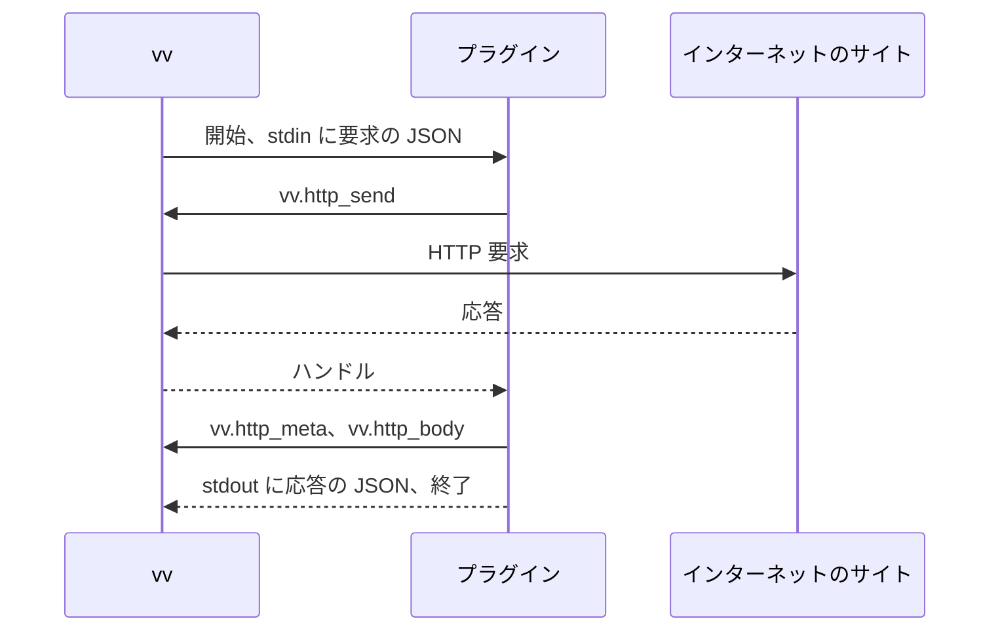

# 作品情報プラグインを書く {#write-a-work-info-plugin}

作品情報プラグインは、外部のサイトで作品を検索し、作品のページの URL か ID で作品のタイトル、タグ、詳細を取得するために VVMDM が実行する WebAssembly のモジュールである。終えると、所有者が設定画面で追加して承認できるモジュールができる。この手順書が、プラグインの契約のバージョン 1 である。サンドボックス、制限、ネットワークの規則がこの形である理由は [work-info-plugins.md](../design-docs/work-info-plugins.md) にある。

図のとおり、VVMDM は実行のたびに新しいインスタンスを起動する。



## 前提条件 {#prerequisites}

- Go 1.24 以降。`GOOS=wasip1 GOARCH=wasm` で `wasip1` のモジュールをビルドする。[モジュール](#module) を満たすモジュールをビルドするツールチェーンならどれでも使える。手順では Go を使う。
- VVMDM のサーバーのバイナリ `mdm` (コンテナイメージの `/usr/local/bin/mdm` にあり、`go build ./cmd/mdm` でもビルドできる)。マニフェストをモジュールに書き込み、ローカルで実行するために使う。Windows アプリの `VVMDM.exe` はコマンドを受け付けない。このコマンドは設定を読まず、データベースを開かず、`ffmpeg` も要らない。
- プラグインを追加して承認するための、VVMDM の所有者のアカウント。

## 手順 {#steps}

1. 新しいディレクトリで、プラグインの Go モジュールを作る:

   ```bash
   go mod init example.com/title-plugin
   ```

2. プラグインを `main.go` として、Go の `main` パッケージで書く。標準入力から [要求](#request) を読み、HTTP のために [ホスト関数](#host-functions) を呼び、標準出力に [応答](#response) を書く。この例は作品のページを取得し、その `<title>` を返す:

   ```go
   package main

   import (
       "encoding/json"
       "html"
       "os"
       "regexp"
       "unsafe"
   )

   //go:wasmimport vv http_send
   func httpSend(req unsafe.Pointer, reqLen uint32) int32

   //go:wasmimport vv http_meta
   func httpMeta(handle int32, buf unsafe.Pointer, bufCap uint32) int32

   //go:wasmimport vv http_body
   func httpBody(handle int32, buf unsafe.Pointer, bufCap uint32) int32

   type request struct {
       Operation string            `json:"operation"`
       URL       string            `json:"url"`
       Settings  map[string]string `json:"settings"`
   }

   var titleTag = regexp.MustCompile(`(?is)<title[^>]*>(.*?)</title>`)

   func main() {
       var req request
       if err := json.NewDecoder(os.Stdin).Decode(&req); err != nil {
           fail("unreadable request")
           return
       }
       page, ok := get(req.URL)
       if !ok {
           fail("could not read " + req.URL)
           return
       }
       info := map[string]any{}
       if m := titleTag.FindSubmatch(page); m != nil {
           info["title"] = html.UnescapeString(string(m[1]))
       }
       reply(map[string]any{"workInfo": info})
   }

   // get sends a GET request and returns the body of a 200 response.
   func get(url string) ([]byte, bool) {
       req, _ := json.Marshal(map[string]string{"method": "GET", "url": url})
       handle := httpSend(unsafe.Pointer(&req[0]), uint32(len(req)))
       if handle < 0 {
           return nil, false
       }
       var meta struct {
           Status int `json:"status"`
       }
       if json.Unmarshal(read(httpMeta, handle), &meta) != nil || meta.Status != 200 {
           return nil, false
       }
       return read(httpBody, handle), true
   }

   // read asks for the length with an empty buffer, then reads into a buffer of that size.
   func read(fn func(int32, unsafe.Pointer, uint32) int32, handle int32) []byte {
       var probe [1]byte
       n := fn(handle, unsafe.Pointer(&probe[0]), 0)
       if n <= 0 {
           return nil
       }
       buf := make([]byte, n)
       fn(handle, unsafe.Pointer(&buf[0]), uint32(n))
       return buf
   }

   func fail(message string) {
       reply(map[string]any{"error": map[string]any{"message": message}})
   }

   func reply(v any) {
       _ = json.NewEncoder(os.Stdout).Encode(v)
   }
   ```

   失敗は `error` の応答として報告し、正常に終了する。0 以外の終了コードでも実行は失敗するが、そのとき所有者にはメッセージが表示されない。

3. モジュールをビルドする:

   ```bash
   GOOS=wasip1 GOARCH=wasm go build -o plugin.wasm .
   ```

4. [マニフェスト](#manifest) を `manifest.json` として書く:

   ```json
   {
     "contract": 1,
     "name": "example-title",
     "version": "0.1.0",
     "description": "Reads the title of a work's page.",
     "operations": ["fetch"]
   }
   ```

5. VVMDM のサーバーのバイナリが持つプラグイン用のコマンド `mdm plugin pack` で、マニフェストをモジュールに書き込む。マニフェストと、パックしたモジュールを、アップロードのときと同じように確かめ、そのあとでだけモジュールの `vv.plugin` セクションを置き換えるので、ビルドやマニフェストの変更のたびに実行できる:

   ```bash
   mdm plugin pack plugin.wasm manifest.json
   ```

   成功すると、設定画面が一覧するとおりに、プラグインの名前、バージョン、操作、設定を表示する。問題があると、終了コード 2 で終了して問題を表示し、`plugin.wasm` はそのままにする。マニフェストでは、フィールドとそれが反する規則を表示する。たとえば `manifest_invalid: settings[0].default must be one of options` である。

6. `mdm plugin run` で、操作とその入力を指定してプラグインを 1 回実行する:

   ```bash
   mdm plugin run plugin.wasm fetch https://example.com/works/1
   ```

   操作は、入力が検索語の `search` か、入力が作品の URL の `fetch` である。入力の規則は動画のページと同じである。[設定](#setting-fields) のあるプラグインには、`--set KEY=VALUE` でキーごとに 1 回、たとえば `--set token=abc` のように値を与える。マニフェストが宣言したキーだけを受け取り、`--set` のない設定は、VVMDM と同じく `default` を受け取る。`--proxy URL` は、運用者のプロキシ設定と同じように、プラグインの要求をプロキシ経由で送る。実行には VVMDM と同じ [上限](#limits) と [アドレスの規則](#addresses) が適用される。

7. VVMDM で **Settings** を開き、**Work-info plugins** の節で **Add plugin** を選び、`plugin.wasm` を選ぶ。プラグインを確認し、承認する。

## 結果を確認する {#check-the-result}

`mdm plugin run` は、応答が有効なら終了コード 0 で終了する。VVMDM の上限と切り詰めを適用したあとで VVMDM が応答から保つものを、標準出力にインデントした JSON として表示する。`search` では `{"candidates": […]}`、`fetch` では `{"workInfo": {…}}` である。プラグインの標準エラーは標準エラーに表示する。失敗した実行は終了コード 1 で終了し、標準エラーを `Run failed: blocked_address, host 127.0.0.1` のような 1 行で終える。この行は、失敗の種類、`blocked_address` と `network_error` ではホスト、`plugin_failed` ではプラグインのメッセージを示す。VVMDM が拒否するモジュール、宣言されていない設定や足りない設定、規則に反する入力やプロキシの URL は、終了コード 2 と理由で終了する。`--set` で与えた秘密の値は、プラグインが書いたとおりに表示される。VVMDM が値を隠すのは設定画面だけである。

プラグインの行に、名前とバージョンが **Approved** のバッジとともに表示され、動画のページに **Fetch work info from a plugin** が表示される。名前のない行は、VVMDM がモジュールを拒否した理由を示す。[トラブルシューティング](#troubleshooting) を参照する。

## モジュール {#module}

| 項目 | 規則 |
| --- | --- |
| 形式 | `_start` を引数も戻り値もない関数として、`memory` をメモリとして export する、`wasip1` 向けにビルドした WebAssembly のコアモジュール |
| テーブル | 合わせて 100,000 要素以下。各テーブルは宣言された最大値で、それがなければ最小値と 100,000 の大きい方で数える。宣言された最大値のないテーブル (Go の `wasip1` リンカーが書く形) は受け入れ、コンパイル前に VVMDM が 100,000 に制限する |
| import | `wasi_snapshot_preview1` と `vv` の関数だけで、VVMDM のシグネチャに従うもの |
| WASI | 事前に開かれたディレクトリ、環境変数、引数はない。時計と乱数は動く。標準入力が要求を持ち、標準出力が応答を受け、標準エラーはサーバーのログに行く |
| 上限 | [上限](#limits) |

## マニフェスト {#manifest}

カスタムセクション `vv.plugin` がこの JSON オブジェクトを持つ。未知のフィールドは無視する。VVMDM はモジュールを実行せずにそれを読み、ほかのフィールドより先に `contract` を確かめる。

| フィールド | 型 | 必須 | 規則 |
| --- | --- | --- | --- |
| `contract` | integer | はい | `1` |
| `name` | string | はい | `a-z`、`0-9`、`-`、`.` からなる 1 から 64 文字。プラグインの識別子なので、同じ名前のモジュールはそれを置き換える |
| `version` | string | はい | 1 から 32 文字。所有者に表示する |
| `description` | string | いいえ | 最大 500 文字 |
| `operations` | string の配列 | はい | `search` と `fetch` の空でない部分集合で、それぞれ最大 1 回。[操作を選ぶ](#choose-the-operations) を参照 |
| `settings` | object の配列 | いいえ | 最大 10 個の [設定フィールド](#setting-fields) の宣言 |

API キー (`"secret": true`) や言語など、所有者が与えるものには設定を宣言する。所有者は設定画面で値を入力し、VVMDM はそれをこのプラグインの実行にだけ渡す。

### 操作を選ぶ {#choose-the-operations}

操作が、動画のページの取得ダイアログで所有者が入力するものを決める。

| サイト | 宣言するもの | 所有者 |
| --- | --- | --- |
| 検索がある | `search` と `fetch` | 語を入力して候補の 1 つを選ぶ。VVMDM はその URL で取得する。または、欄の上の **ID** を選んで作品の ID を入力する |
| 品番など、作品の ID から組み立てるページの URL がある | `fetch` | ID を入力する (最初は動画の品番)。またはページの URL を貼り付ける |

`search` だけを宣言するプラグインは、候補をリンクとして表示し、取得するものはない。

### 設定フィールド {#setting-fields}

| フィールド | 型 | 必須 | 規則 |
| --- | --- | --- | --- |
| `key` | string | はい | `A-Z`、`a-z`、`0-9`、`_` からなり英字で始まる 1 から 32 文字。マニフェストの中で一意である |
| `label` | string | はい | 1 から 60 文字。所有者に表示する |
| `secret` | boolean | いいえ | 既定値は `false` |
| `required` | boolean | いいえ | 既定値は `false` |
| `default` | string | いいえ | 1 から 2000 文字。`options` があるときはそのどれか。`"secret": true` とは併用できない |
| `options` | string の配列 | いいえ | 1 から 200 文字の異なる値を 2 から 50 個。所有者に見える順に並べる。`"secret": true` とは併用できない |

規則に反するマニフェストは `manifest_invalid` で拒否される。

`default` は、所有者が値を保存していないあいだ、実行が受け取る値である。したがって、言語の `"default": "ja"` のように、妥当な値のある設定には宣言する。VVMDM は既定値を所有者の値に書き込まない。後のバージョンの既定値は、値を選んでいないすべての所有者に届く。

`options` は設定を選択式にする。選択肢を落とした置き換えは、所有者が保存した値を保つが、VVMDM はそれを実行に渡さない。実行は代わりに `default` を受け取り、なければ何も受け取らない。設定画面は、保存された値がもう選択肢のどれでもないことを所有者に示す。

## 要求 {#request}

VVMDM は 1 つの JSON オブジェクトを標準入力に書き、それを閉じる。

| 操作 | フィールド |
| --- | --- |
| `search` | `{"contract": 1, "operation": "search", "query": "<1 to 200 characters>"}` |
| `fetch` | `{"contract": 1, "operation": "fetch", "url": "<an http or https URL of at most 2048 characters>"}` (候補または貼り付けたページの URL の場合)、または `{"contract": 1, "operation": "fetch", "id": "<1 to 200 characters>"}` (所有者が前後に空白なしで入力した ID の場合)。プラグインは ID からページの URL を組み立てる |

どちらの操作も、有効な値を持つ宣言済みのキーをすべて、そしてそれだけを含む `"settings": {"<key>": "<value>"}` も持つ。有効な値は、所有者が保存した値が設定されていて、`options` のある設定ではそのどれかであるときはその値で、そうでなければ `default` である。`required` のキーに有効な値がないあいだ、実行は始まらない。したがって `default` のある `required` のキーが実行を止めることはない。

## 応答 {#response}

プラグインは 1 つの JSON オブジェクトを標準出力に書き、終了する。未知のフィールドは無視するので、後の契約はバージョン 1 を壊さずにフィールドを加えられる。

| 場合 | 本文 |
| --- | --- |
| `search` の結果 | `{"candidates": [{"url": "...", "title": "...", "detail": "..."}]}`: `url` (http か https) と `title` は必須、`detail` は省略できる。VVMDM は最初の 50 個を保つ |
| `fetch` の結果 | `{"workInfo": {"title": "...", "tags": ["..."], ...}}`: どのフィールドも省略できる。フィールドは [作品のフィールド](#work-fields) にある |
| 失敗 | `{"error": {"message": "..."}}`: VVMDM は `message` の最初の 300 文字を所有者に表示する |

0 以外の終了コード、またはこれらのどれでもない出力では、実行は `plugin_failed` で失敗する。

### 作品のフィールド {#work-fields}

`workInfo` は次のフィールドを持つ。`title` と `tags` だけを返すプラグインに、ほかのフィールドは要らない。

| フィールド | 形 | VVMDM が保つもの |
| --- | --- | --- |
| `title` | string | 書かれたとおり |
| `tags` | `["..."]` | 最初の 100 個。重複は除く |
| `code` | string。品番など | 前後の空白を除いたもの |
| `description` | string。改行を含められる | 前後の空白を除いたもの |
| `dates` | `[{"kind": "release", "date": "2024-03-01"}]`。`kind` は `release`、`recorded`、`published` のどれか。`date` は `YYYY`、`YYYY-MM`、`YYYY-MM-DD` のどれか | 種類ごとに最初の日付 |
| `people` | `[{"role": "performer", "name": "...", "externalIds": [{"source": "...", "value": "..."}]}]`。`role` は `performer`、`director`、`photographer`、`streamer` のどれか。`externalIds` は省略できる | 役割ごとに最初の 100 人と、人ごとに最初の 20 個の異なる外部 ID |
| `organizations` | `[{"role": "maker", "name": "...", "externalIds": [...]}]`。`role` は `maker` か `label`。`externalIds` は省略できる | 役割ごとに最初の 20 個と、組織ごとに最初の 20 個の異なる外部 ID |
| `urls` | `["https://..."]` | 最初の 20 個の異なるもの |
| `externalIds` | `[{"source": "...", "value": "..."}]`。ほかのサイトでの作品の識別子 | 最初の 20 個の異なる `(source, value)` の組 |
| `cover` | string。作品の表紙画像の `http` か `https` の URL で、最大 2048 文字 | 画像。実行の後に VVMDM 自身が取得する。[表紙画像](#cover-image) を参照 |

`title` と `tags` 以外のすべてのフィールドについて、VVMDM は各文字列の前後の空白を除き、そのうえで空の項目、`kind`、`role`、`source`、`value` がないか表にない項目、ほかの JSON の型のフィールドや項目を落とす。上限は残ったものを数える。1 つの役割に同じ名前と外部 ID で 2 回現れる同じ人や組織は、1 つだけ保つ。

所有者は保たれた値をすべて見て、適用するものを選ぶ。100 文字を超える `code`、ほかの形の `date`、絶対でない URL など、[作品情報を設定する](external-api.md#set-work-information) の規則に反する値は、表示するが適用せず、VVMDM はそれを飛ばしたことを所有者に伝える。

VVMDM は取得した人や組織を、まず外部 ID で、次に名前か別名で既存のものに結び付け、何も一致しないときは新しく作る。各人について、サイト自身の識別子を `"externalIds": [{"source": "<site>", "value": "<id>"}]` として返す。そうすると同じ出演者が、取得をまたいで、表記の違いをまたいで、同じ `source` を使うプラグインをまたいで結び付く。既存の複数の人に一致する名前は結び付けない。

### 表紙画像 {#cover-image}

`cover` を返す `fetch` の後、VVMDM は実行の 30 秒の中で、プラグインの要求と同じクライアントとアドレスの規則を通して、その URL に `GET` を 1 回送る。この要求はプラグインの 16 個には数えない。所有者は画像を現在のサムネイルの隣で見て、それを動画のサムネイルとして適用できる。VVMDM はそれを、アップロードされた画像と同じように確かめて収める。

| 画像 | 結果 |
| --- | --- |
| 4 MiB 以下、120 メガピクセル以下の PNG、JPEG、静止画の WebP | 表示し、適用で選択された状態になる |
| ほかの応答: `2xx` でない、より大きい、ほかの形式、到達できない | 捨てる。結果の残りは保つ |
| 拒否されたアドレス | プラグイン自身の要求と同じく、実行は `blocked_address` で失敗する |

## ホスト関数 {#host-functions}

モジュール `vv`。ポインターと長さは、プラグインが export する `memory` の中の `i32` のオフセットである。JSON は UTF-8 である。

| 関数 | シグネチャ | 動作 |
| --- | --- | --- |
| `http_send` | `(req_ptr, req_len) -> handle` | 要求を行い、その応答へのハンドル (0 以上) か負のエラーを返す |
| `http_meta` | `(handle, buf_ptr, buf_cap) -> len` | 応答のメタデータの JSON を `buf_cap` に収まるときに書き、常にその全体の長さを返す |
| `http_body` | `(handle, buf_ptr, buf_cap) -> len` | 応答の本文のバイト列を `buf_cap` に収まるときに書き、常にその全体の長さを返す |

バッファより大きな長さを受け取ったプラグインは、その大きさのバッファでもう一度呼ぶ。ハンドルは実行が終わるまで有効である。

| JSON | 形 |
| --- | --- |
| `http_send` の要求 | `{"method": "GET" or "POST", "url": "...", "headers": {"Name": "value"}, "body": "<base64>"}`。`headers` と `body` は省略できる。VVMDM はプラグインが設定しないときにデスクトップ版 Chrome の `User-Agent` を送り、`Host` とホップバイホップのヘッダーを落とす |
| `http_meta` の結果 | `{"status": 200, "url": "<final URL after redirects>", "headers": {"Name": ["value"]}}` |

本文はバイト列としてプラグインに届くので、ページの文字コードは `Content-Type` ヘッダーかページから、プラグイン自身がデコードする。

| `http_send` のエラー | 意味 |
| --- | --- |
| `-1` | 要求の JSON が無効である (メソッド、スキーム、URL) |
| `-2` | アドレスが拒否された。プラグインが何を返しても、実行は `blocked_address` で失敗する |
| `-3` | 接続か TLS が失敗した。または応答のヘッダーが 1 MiB を超えた |
| `-4` | 要求に 10 秒より長くかかった |
| `-5` | 実行がすでに 16 の要求を行った |
| `-6` | 本文が 4 MiB を超えた |

`http_meta` と `http_body` は、未知のハンドルに対して `-1` を返す。

## 上限 {#limits}

実行は最初に達した上限で止まる。サイトが `429` で要求を拒否することは VVMDM の上限ではない。プラグインがこれらの上限の中でそれをどう扱うかは [レート制限](#rate-limiting) にある。

| 上限 | 値 | 達したとき |
| --- | --- | --- |
| モジュールの大きさ | 16 MiB | アップロードを拒否する |
| 線形メモリ | 128 MiB (2048 ページ) | 実行は `memory_exceeded` で失敗する |
| 実行時間 | 30 秒、コンパイルと HTTP を含む | 実行は `timed_out` で失敗する |
| 標準出力 | 1 MiB | 実行は `output_too_large` で失敗する |
| 標準エラー | 64 KiB を保ち、残りは捨てる | そのままサーバーのログに書き、プラグインの最後の実行としても保つ。そのとき、秘密の設定の値はそれぞれ `[secret]` に置き換える。所有者は設定画面でプラグインの行の `Last run output` からそれを開く。プラグインが先にエンコードしたり分割したりした値は置き換えない |
| 同時に動く実行 | 1。2 つ目の実行は最大 10 秒待つ | 2 つ目の実行は `busy` で失敗する |
| HTTP 要求 | 実行ごとに 16 個、`GET` と `POST`、`http` と `https` | `http_send` は `-5` を返し、ほかのメソッドかスキームには `-1` を返す |
| リダイレクト | 要求ごとに 5 回 | 6 回目のリダイレクトの応答は、そのままプラグインに渡す |
| 要求の時間 | 10 秒、送信から本文の最後のバイトまで | `http_send` は `-4` を返す |
| 応答のヘッダー | 1 MiB | `http_send` は `-3` を返す |
| 応答の本文 | 4 MiB | `http_send` は `-6` を返す |

## レート制限 {#rate-limiting}

要求が速すぎると、サイトは `429 Too Many Requests` を返すことがある。VVMDM はプラグインの代わりに再試行しない。`http_send` はほかの応答と同じように `429` の応答を返し、プラグインが判断する。次のように扱う:

1. `http_meta` から `Retry-After` ヘッダーを読む。これは秒数か HTTP の日付である。ない場合や読めない場合は 1 秒とする。
2. その遅延と 5 秒のうち小さい方を待ち時間とする。
3. 待つ前に予算を確かめる。今回の待ちを含めて、実行の待ちの合計が 10 秒を超えるときは、待たずに手順 5 へ進む。
4. 待ってから、要求をもう一度送る。サンドボックスでは時計と `nanosleep` が動くので、言語の通常のスリープが使える。
5. 予算を使い切ったとき、または再試行がまた `429` を返したときは、サイトと遅延を示すメッセージの `error` の応答を返す。たとえば `example.com is busy; try again in 60 s` である。

これは [上限](#limits) に収まる。再試行はどれも要求であり、実行ごとの 16 個に数えられるので、最大 7 ページを取得するプラグインでも、ページごとに 1 回の再試行が残る。実行の待ちは、拒否されたページがいくつあっても合計で最大 10 秒なので、30 秒の実行時間の残りは、モジュールのコンパイル、プラグイン自身の処理、その要求に残る。待ちは要求の余地を作らない。各要求は依然として最大 10 秒かかりうるので、遅い要求を複数行うプラグインは、`429` の有無にかかわらず `timed_out` に達しうる。この予算より長く待つプラグインは、それをより起こりやすくし、そのとき所有者にはメッセージが表示されない。`error` の応答は、あとでもう一度試すよう所有者に伝える。

## アドレス {#addresses}

プラグインが届くのは、公開されたインターネットのアドレスだけである。VVMDM は各要求のホストを解決し、接続する直前に、リダイレクトの後も含めてすべてのアドレスを確かめる。次を拒否する:

- グローバルユニキャストでないアドレス (マルチキャストなど) と、`2000::/3` の外の IPv6 アドレス。
- IANA の IPv4 と IPv6 の Special-Purpose Address Registry のうち、「Globally Reachable」が `True` でないすべての範囲。ループバック、プライベートな LAN の範囲 (`10.0.0.0/8`、`172.16.0.0/12`、`192.168.0.0/16`、`fc00::/7`)、リンクローカルアドレス、`100.64.0.0/10` など。
- `fec0::/10` と、IPv4 アドレスを埋め込むプレフィックス (`64:ff9b::/96`、`64:ff9b:1::/48`、`2001::/32`、`2002::/16`)。
- VVMDM のサーバー自身のインターフェースのアドレス。

拒否されたアドレスには `-2` を返し、プラグインがその後に何を書いても、実行は `blocked_address` と拒否されたホストで失敗する。VVMDM はプラグインの要求に対して `HTTP_PROXY` とほかのプロキシの変数を無視する。

運用者は、プラグインの要求をプロキシ (`http`、`https`、`socks5`) 経由で送ってよい。ホスト関数では違いが見えない。そのとき VVMDM は、要求が出る前に各要求のホストと各リダイレクトのホストを解決し、どれかのアドレスが上の規則に当たるときは `-2` と `blocked_address` で拒否するので、LAN に解決される公開の名前は、プロキシに届く前に拒否される。プロキシに到達できない、接続を拒否する、または `407` を返すときは、要求は `-3` を返し、その後プラグインが失敗したときは、実行は `network_error` とプロキシのホストで失敗する。

## トラブルシューティング {#troubleshooting}

| 症状 | 原因 | 対処 |
| --- | --- | --- |
| `manifest_missing` | モジュールに `vv.plugin` セクションがない。ビルドしたばかりのモジュールにはない | ビルドしたモジュールに `mdm plugin pack` を実行する (手順 5) |
| `manifest_invalid` | セクションが JSON オブジェクトでないか、フィールドが [マニフェスト](#manifest) の規則に反する | `mdm plugin pack` が示すフィールドを `manifest.json` で直し、もう一度実行する |
| `contract_unsupported` | `contract` が `1` でない | `"contract": 1` を設定する |
| `import_unsupported` | モジュールが WASI と `vv` の関数以外のものを import するか、別のシグネチャを使う | `wasip1` 向けにビルドし、手順 2 のようにホスト関数を宣言する |
| `export_invalid` | `_start` か `memory` がないか、別の型である | ライブラリではなくコマンド (`package main`) をビルドする |
| `table_too_large` | モジュールのテーブルが 100,000 要素を超える | モジュールのテーブルを減らす |
| 取得が `plugin_failed` で失敗し、メッセージがない | プラグインが 0 以外の終了コードで終了したか、[応答](#response) の外の出力を書いた | `error` の応答を書き、正常に終了する |
| 取得が `blocked_address` で失敗する | 要求かリダイレクトが VVMDM、LAN、またはほかの拒否される [アドレス](#addresses) を指していた | 公開されたサイトだけに要求する |
