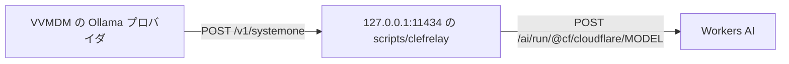

# Workers AI の Clef で自動タグ付けを試す {#try-auto-tagging-with-clef-on-workers-ai}

この手順を終えると、Claude Code on the web のコンテナのように Ollama を動かせないマシンで、VVMDM の自動タグ付けがローカルのリレーを通じて Cloudflare Workers AI 上の Clef に質問を送る。VVMDM は変わらない。これまでどおり Ollama のプロバイダと通信し、リレーが Ollama の代わりを務める。リレーがリクエストの形を変える理由と、他の選択肢との比較は [ai-layer.md](../design-docs/ai-layer.md#workers-ai-through-a-relay) にある。



## 前提条件 {#prerequisites}

- Cloudflare のアカウント ID と、Workers AI へのアクセス権を持つ API トークン。ネットワーク設定が `api.cloudflare.com` 向けにトークンを注入する Claude Code on the web の環境では、アカウント ID だけが必要だ。
- VVMDM が動く環境 ([VVMDM を動かす](running-vv.md))。

## 手順 {#steps}

1. リレーを起動する。リレーは Ollama の既定のアドレス `127.0.0.1:11434` で待ち受ける。

   ```sh
   export CLOUDFLARE_ACCOUNT_ID=<account id>
   export CLOUDFLARE_API_TOKEN=<token>   # omit when a proxy injects it
   task clef-relay
   ```

   ポート 11434 が使われているときは、`task clef-relay` に `-- -addr 127.0.0.1:11435` を渡す。
2. VVMDM を起動し、所有者としてサインインする。
3. Settings の Ollama で、URL を `http://127.0.0.1:11434` (または手順 1 のアドレス) のままにし、モデル `clef-flash` または `clef` を選び、**Save and test connection** を選ぶ。これはリレーにだけ届く。
4. Settings の Auto-tagging で、**Test judging** を選ぶ。これは 1 つの質問をリレー経由で Workers AI に送る。
5. 自動タグ付けをオンにし、いつもどおり動画にタグを付ける ([auto-tagging.md](../design-docs/auto-tagging.md))。

## 結果を確認する {#check-the-result}

どちらのテストも成功を報告し、リレーは Workers AI へのリクエストごとに 1 行を出力する。

```text
clefrelay: clef-flash 16 questions, 9→1 images, 3099 tokens, 1.459s
```

自動タグ付けした動画にはタグが表示され、提案されたタグには確定と却下のボタンが表示される。

## トラブルシューティング {#troubleshooting}

| 症状 | 原因 | 対処 |
| --- | --- | --- |
| 接続テストが Ollama に到達できないと表示する | リレーが動いていない、または別のアドレスで待ち受けている | リレーを起動し、そのアドレスを Ollama の URL に使う |
| 接続テストがモデルがないと表示する | 保存したモデルが Clef のモデルではない | `clef-flash` または `clef` を選ぶ |
| Test judging が `ollama answered 401` または `403` で失敗する | トークンがない、または Workers AI へのアクセス権がない | Workers AI へのアクセス権を持つトークンを `CLOUDFLARE_API_TOKEN` に設定する |
| 起動時に `clefrelay: Account ID が無い` | `CLOUDFLARE_ACCOUNT_ID` が設定されていない | それを export するか、`-- -account <id>` を渡す |
