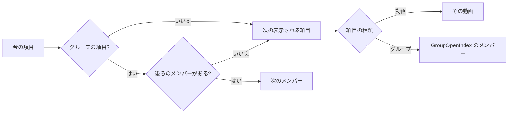

# データモデル: 名前付きのプレイリストと連続再生 {#data-model-named-playlists-and-continuous-playback}

親 Issue: #787。モデルの残りは変わらない。正本:

| 項目 | 出典 |
| --- | --- |
| 既存のテーブルの定義 | [internal/store/migrations/](../../internal/store/migrations/) |
| データの分類 | [running-vv.md、Data and recovery](../../docs/how-to/running-vv.md#data-and-recovery) |
| ユーザーキー、まとまり、継承 | [030 データモデル、User key](../030-video-versions/data-model.md#user-key)、[internal/store/versions.go](../../internal/store/versions.go)、[internal/store/successions.go](../../internal/store/successions.go) (`moveUserData`) |
| フォルダのキー、グループのメンバーと順序 | [017 データモデル](../017-folder-groups/data-model.md#assignment-rules) |
| 視聴状態、グループを開くときのメンバー | [internal/domain/watch.go](../../internal/domain/watch.go)、[internal/domain/library_item.go](../../internal/domain/library_item.go) の `GroupOpenIndex` |

このファイルは、この機能が加えるテーブル、値、規則だけを扱う。

## マイグレーション {#migration}

`00036_playlists.sql` (`main` の最後のマイグレーションは `00035_watch_history_title_key.sql`。実装するときに番号を確かめる)。

```sql
-- User data (specs/044-playlists/research.md R-1). No foreign key to the library.
create table playlists (
    id         integer primary key autoincrement,
    name       text    not null check (length(name) between 1 and 100),
    created_at integer not null,  -- Unix ms
    updated_at integer not null   -- Unix ms; any change of the name or the items
);

create table playlist_items (
    id          integer primary key autoincrement,
    playlist_id integer not null references playlists (id) on delete cascade,
    -- Exactly one of the two keys is set.
    content_key text,  -- a video's user key ('bundle:<id>' for a bundle member)
    folder_key  text,  -- a group's folder key (domain.FolderKey of its absolute path)
    position    integer not null,  -- 0-based, dense within the playlist (R-3)
    added_at    integer not null,  -- Unix ms
    check ((content_key is null) <> (folder_key is null)),
    check (content_key is null or content_key <> ''),
    unique (playlist_id, content_key),
    unique (playlist_id, folder_key)
);
create index playlist_items_order_idx on playlist_items (playlist_id, position);
create index playlist_items_content_idx on playlist_items (content_key);
```

Down は両方のテーブルを削除する。どちらもユーザーデータである: ARCHITECTURE.md (「User data survives a rebuild」) と running-vv.md の表にそれらが加わる。`RemoveContent`、`releaseContentIndex`、`rebuildFolderIndex`、メディアフォルダの削除はどちらにも触れない。

不変条件 (`internal/store/invariants_test.go` に加える):

| 規則 | 強制する場所 |
| --- | --- |
| 1 つのプレイリストの位置は `0 … n-1` である | `internal/store/invariants_test.go` |
| `folder_key` は `domain.FolderKey(folder_key)` と等しい | `internal/store/invariants_test.go` |

## 継承とまとめること {#succession-and-bundling}

下のどの経路も、ほかのユーザーデータのキーをすでに付け替えているトランザクションの中で、パッケージ内に非公開のヘルパー `rekeyPlaylistItems(tx, from, to)` を通じて実行する。このヘルパーは行を移し、決して写さない。キー `to` の項目が 2 つになったプレイリストでは、`position` の大きいほうを削除し、プレイリストの番号を振り直す ([R-2](research.md#r-2-bundling-and-succession-re-key-every-members-items-and-merge-duplicates))。

| 経路 | 変化 |
| --- | --- |
| `moveUserData` (同じパスでの継承) | `from` の項目が `to` の項目になる |
| `VersionStore.Bundle` | まとまりに吸収されるすべてのキー (メンバーの内容の鍵、または吸収されるまとまりのキー) の項目がまとまりのキーに移る |
| `VersionStore.Unbundle`、最後から 2 番目のメンバーを取り除く | まとまりのキーの項目が、残ったメンバーの内容の鍵に移る (`replaceUserData` が実行される場所) |
| `VersionStore.Unbundle`、他のメンバーが残る | 変化なし: 項目はまとまりに残り、取り除いたメンバーは何も持たない |
| `MakeRepresentative` | 変化なし: まとまりのキーは変わらない |
| フォルダの名前の変更、移動、解散 | 変化なし: フォルダのキーは解決しなくなり、グループがそれを持つとまた解決する (R-4) |

## `domain` に加える値 {#domain-values-added}

| 値 | 内容 |
| --- | --- |
| `Playlist` | `ID`、`Name`、`ItemCount` (表示される項目)、`UpdatedAt`、`Covers []FolderPreview` (一覧のカードの絵。`ListPlaylists` だけが埋め、ほかでは nil) |
| `PlaylistItem` | `ID` と、`Video *Video` か `Group *LibraryGroup` のどちらか。どちらも所有者として読む |
| `ValidatePlaylistName(string) (string, error)` | トリムする。空か 100 文字を超えると `*InvalidPlaylistNameError` ([R-11](research.md#r-11-a-playlist-name-is-1-to-100-characters-after-trimming-names-may-repeat)) |
| `PlaylistAdd` | `AddPlaylistItems` の入力: `VideoIDs []int64`、`FolderPaths []string` (絶対パス) |
| `PlaylistAdded` | `Added int`、`Existing int` (解決したが、すでにプレイリストにある) |
| `PlaylistStep` | `ItemID`、`Video Video`: 開く動画と、それが属する項目 |
| `PlaylistPlayback` | `Playlist`、`ItemID`、`Position` (表示される項目の中で 1 から数える。今の項目が表示されないときは 0)、`Count`、`Next *PlaylistStep`、`PreviousItem *PlaylistStep`、`NextItem *PlaylistStep` |
| `ErrPlaylistNotFound`、`ErrPlaylistItemNotFound` | `404 not_found` |

## 再生の順序 {#playback-order}

`domain.PlaylistPlaybackOf(items, current)` は、位置の順に並んだプレイリストのすべての項目 (それぞれ表示されるかどうかの印を持ち、表示されるグループの項目はメンバーとその再生位置も持つ) と、今の項目と動画から決める。隠れた項目も入力に残るので、今の項目が隠れても今の項目はその場所を保つ。ストアはその入力を 1 つの読み取りトランザクションで読む。



| 場合 | 結果 |
| --- | --- |
| 今の項目が最後の表示される項目で、後ろのメンバーがない | `Next` がない: プレイリストの終わり (要件 9) |
| 今の動画が、今のグループの項目のメンバーではなくなった | 「後ろのメンバーがない」と同じ: 次の表示される項目 |
| 今の項目が表示されない (その動画かグループがなくなった) | `Position` は 0。順序の中のその場所が引き続き `Next`、`PreviousItem`、`NextItem` を決める |
| 今の動画が別の項目としても現れる (動画の項目と、グループの項目のメンバー) | `item` パラメーターが場所を決める。各項目はそれぞれの場所で再生される (エッジケース) |
| 今の項目かプレイリストが存在しない | `ErrPlaylistItemNotFound` / `ErrPlaylistNotFound` ([R-7](research.md#r-7-a-playlist-playback-overrides-the-group-and-folder-neighbours)) |
| `PreviousItem`、`NextItem` | 隣の表示される項目の開始の動画: その動画か、グループの `GroupOpenIndex` のメンバー |

グループの項目は、`GroupOpenIndex` が選ぶメンバー、つまりグループのカードが開くメンバーから始まる: 最初の視聴中のメンバー、なければ最初の未完了のメンバー、すべて視聴済みなら最初のメンバーである。その後、グループの順序でメンバーを最後まで再生する。グループの自動再生と同じく、開始より後ろの視聴済みのメンバーも再生する (要件 7)。すべて視聴済みのグループの項目は、飛ばさずに最初のメンバーから再生する。要件 7 は項目をグループを開くときと同じ場所から始めさせ、グループのカードは視聴済みのグループを最初のメンバーから再生し直すからである。

## ストアの操作 (`PlaylistStore`) {#store-operations-playliststore}

新しい役割の型 `PlaylistStore` で、`FavoriteStore` と同じく `sql` の接続だけを持つ。どの書き込みも `playlists.updated_at` を設定する。

| 操作 | 規則 |
| --- | --- |
| `ListPlaylists` | すべてのプレイリスト。`updated_at` の降順、次に `id` の降順で、表示される項目の数と `Covers` を持つ: 位置の順の最初の表示される項目で、動画の項目はその動画、グループの項目はグループの順でサムネイルを持つ最初のメンバーであり、サムネイルを生成済みの動画だけを最大 `MaxFolderPreviews` まで持つ ([contracts/screen-api.md](contracts/screen-api.md#get-apiplaylists))。要約と同じ 1 つの読み取りトランザクションで読む |
| `CreatePlaylist(name)` | 検証した名前。空のプレイリスト |
| `RenamePlaylist(id, name)` | ないときは `ErrPlaylistNotFound` |
| `DeletePlaylist(id)` | 項目は連鎖して消える。ないときは `ErrPlaylistNotFound` |
| `Playlist(id)` | プレイリストと、`position` の順の表示される項目。動画とグループは所有者として読む |
| `AddPlaylistItems(id, PlaylistAdd)` | 動画の id は `userKeysForVideoIDs` で解決する。フォルダは `SetFavorites` と同じく `folder_groups.path_key` にあるときだけ書く。既存のキーは `Existing` に数える。残りは要求の順に末尾に付ける |
| `MovePlaylistItem(id, itemID, afterItemID *int64)` | `nil` は先頭。項目を `afterItemID` のすぐ後ろに置き、プレイリストの番号を振り直す。どちらかの id がプレイリストにないと `ErrPlaylistItemNotFound` |
| `RemovePlaylistItem(id, itemID)` | 行を削除して番号を振り直す。ないときは `ErrPlaylistItemNotFound` |
| `PlaylistPlayback(id, itemID, videoID)` | [再生の順序](#playback-order) |
