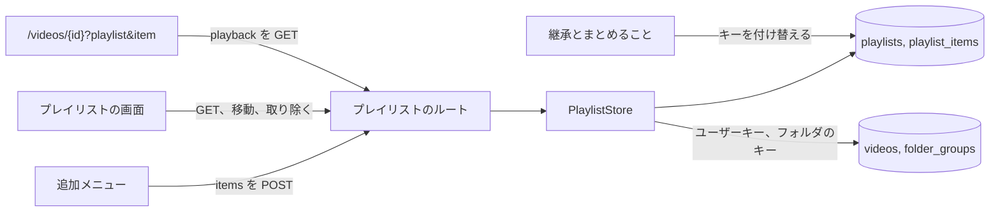
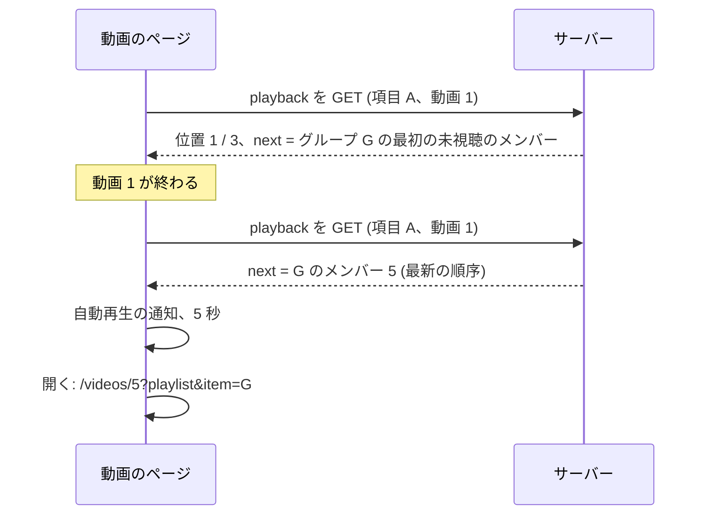
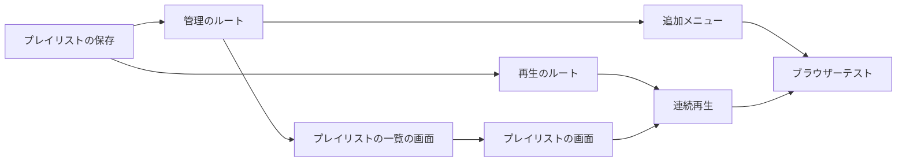

# 実装計画: 名前付きのプレイリストと連続再生 {#implementation-plan-named-playlists-and-continuous-playback}

**ブランチ**: `feature/044-playlists` | **親 Issue**: #787

**入力**: 親 Issue。これがこの機能の仕様である。

## 概要 {#summary}

所有者は名前付きのプレイリストをいくつでも作り、お気に入りを設定できる場所から動画とグループを加え、項目を並べ替えて取り除き、プレイリストを最初の項目または任意の項目から最後まで、項目の間にグループの自動再生の通知を挟んで再生する。プレイリストはお気に入りと同じようにキーを持つ所有者のデータなので、再スキャンを越えて残り、まとまりと継承に従う。次の動画は、サーバーがプレイリストの最新の順序から決める。

図は、この機能が加える部分と、それぞれが読むものを示す。



| 関心事 | 方針 |
| --- | --- |
| 保存 | `playlists` と `playlist_items`。項目はユーザーキーかフォルダのキーをキーにし、ライブラリへの外部キーを持たない ([R-1](research.md#r-1-two-tables-items-keyed-like-favorites-with-no-foreign-key-to-the-library)、[data-model.md、Migration](data-model.md#migration)) |
| まとまりと継承 | すべてのメンバーの項目のキーを付け替える。重複は前の位置を残す ([R-2](research.md#r-2-bundling-and-succession-re-key-every-members-items-and-merge-duplicates)) |
| 順序 | 詰めた位置。1 つの項目の「後ろへ移動」 ([R-3](research.md#r-3-dense-integer-positions-reordered-by-move-after)) |
| なくなったファイル、解散した、または名前の変わったグループ | 読むときに除き、解決すると元の位置に戻る ([R-4](research.md#r-4-hidden-items-are-resolved-at-read-time-never-deleted)) |
| 追加 | `videoIds` と `folders` を 1 回でまとめて加え、既存の項目は飛ばす ([R-5](research.md#r-5-one-owner-only-bulk-add-for-videos-and-groups-appended-in-request-order)) |
| 連続再生 | 動画のページの `?playlist&item`。サーバーが位置と次の動画を答え、開いたときと終わったときに読む ([R-6](research.md#r-6-the-server-answers-the-playlist-position-and-the-next-video-from-the-latest-order)、[R-7](research.md#r-7-a-playlist-playback-overrides-the-group-and-folder-neighbours)) |
| 誰が | 既存の既定による所有者だけ ([R-8](research.md#r-8-owner-only-through-the-existing-rules)) |
| 画面での並べ替え | `@dnd-kit/core` と `@dnd-kit/sortable` ([R-9](research.md#r-9-drag-reordering-with-dnd-kitcore-and-dnd-kitsortable)) |

シーケンスは、動画の項目からグループの項目への 1 回の移り変わりを示す。



Issue には `ui` ラベルがあるので、画面の単位より前に `design` 段階が `ui-design.md` を書く。対象は、プレイリストの一覧の画面とプレイリストの画面、追加メニューとその「新しいプレイリスト」の経路、ドラッグハンドル、削除の前の確認、空のプレイリスト、動画のページのプレイリストの行と矢印、プレイリストの終わりのレイヤーで、親 Issue の `UI品質` に照らして判断する。

親 Issue のとおり範囲外のもの: お気に入りをプレイリストに統合すること、組み込みの「Watch later」、シャッフルとリピート、外部 API と MCP、ゲストとの共有、スマートプレイリスト。

## 技術的な文脈 {#technical-context}

**正本の定義**:

| 項目 | 出典 |
| --- | --- |
| 境界、依存の方向、ユーザーデータ、認証の境界 | [ARCHITECTURE.md](../../ARCHITECTURE.md)、[.golangci.yml](../../.golangci.yml) (depguard) |
| お気に入り: キー、まとめての書き込み、選択、カード、選択バー、動画のページのトグル | [035 データモデル](../035-favorites/data-model.md)、[035 の UI 設計](../035-favorites/ui-design.md) |
| グループ、グループの自動再生の通知、再生終了のレイヤー | [017 の UI 設計、Video page](../017-folder-groups/ui-design.md#video-page)、[web/src/player/AutoplayNotice.tsx](../../web/src/player/AutoplayNotice.tsx) |
| ユーザーキー、まとまり、継承 | [030 データモデル、User key](../030-video-versions/data-model.md#user-key)、[internal/store/successions.go](../../internal/store/successions.go)、[internal/store/versions.go](../../internal/store/versions.go) |
| 所有者専用の画面、ゲート、サイドバー | [016 の UI 設計、Guest degradation](../016-single-account-auth/ui-design.md#guest-degradation)、[web/src/auth/AuthGate.tsx](../../web/src/auth/AuthGate.tsx)、[web/src/shell/navigation.ts](../../web/src/shell/navigation.ts) |
| 画面の API と生成コード | [api/openapi.yaml](../../api/openapi.yaml)、`task generate` |
| 画面と Web のテスト | [design-system.md](../../docs/design-docs/design-system.md)、[web-testing.md](../../docs/design-docs/web-testing.md)、[i18n.md](../../docs/design-docs/i18n.md) |
| 検査 | [Taskfile.yml](../../Taskfile.yml) (`task check`、`task check-docs`、`task test-e2e`) |

**この機能に固有の文脈**:

- マイグレーションを 1 つ、`00036_playlists.sql` ([data-model.md、Migration](data-model.md#migration))。
- 新しいルートが 9 つで、既存のルートの変更はない ([contracts/screen-api.md](contracts/screen-api.md))。
- 動画のページが初めて URL のクエリパラメーター (`playlist`、`item`) を読む。これまでページは文脈を `location.state` だけで運んでいた ([R-6](research.md#r-6-the-server-answers-the-playlist-position-and-the-next-video-from-the-latest-order))。
- Web の新しい依存は `@dnd-kit/core` と `@dnd-kit/sortable` ([R-9](research.md#r-9-drag-reordering-with-dnd-kitcore-and-dnd-kitsortable))。

## 憲章の確認 {#constitution-check}

| 規則 (出典) | 判定 |
| --- | --- |
| アダプターは互いも `internal/app` も import しない (ARCHITECTURE.md、depguard) | 合格: `internal/store` と `internal/httpapi` は `internal/httpapi` が宣言する `Playlists` インターフェースを通じて出会う。`internal/app` にユースケースはない |
| ドメインが決め、ストアが強制する (ARCHITECTURE.md) | 合格: `ValidatePlaylistName` と `PlaylistPlaybackOf` は `internal/domain` にある。プレイリストごとに 1 つのキーは一意インデックスである |
| ストアの役割: 役割ごとに 1 つの操作、役割をまたぐ作業は非公開のヘルパーを通す (ARCHITECTURE.md) | 合格: `PlaylistStore` は新しい。継承とまとめることは、それぞれのトランザクションで非公開の `rekeyPlaylistItems` を呼ぶ |
| イベントはコミットの後 (ARCHITECTURE.md) | 合格: 新しいイベントはない ([R-10](research.md#r-10-no-domain-event-and-no-live-update)) |
| ユーザーデータは作り直しを越えて残る (ARCHITECTURE.md) | 合格: ユーザーキーとフォルダのキーをキーにし、ライブラリへの外部キーを持たない。不変条件の一覧と復旧の表に両方のテーブルが加わる |
| どの読み取りも閲覧者を知っている (ARCHITECTURE.md) | 合格: ルートは所有者専用で、ストアは境界が分類した所有者の閲覧範囲で動画とグループを読む |
| 生成ファイルを手で編集しない (AGENTS.md) | 合格: `api/openapi.yaml` を変え、`task generate` を実行する |
| 画面の前に design-system.md を読む。最も低いレベルでテストする (AGENTS.md) | 合格: 画面はレジストリから `ui-design.md` に従う。順序の規則はドメインのテスト、画面はページテスト、流れは 1 つのブラウザーテストを得る |
| 依存の更新は dependency-updates.md に従う (AGENTS.md) | 合格: 2 つの dnd-kit パッケージはその規則のもとで加える |

違反はないので、複雑さの記録はない。

## プロジェクトの構成 {#project-structure}

### 文書 (この機能) {#documentation-this-feature}

```text
specs/044-playlists/
├── plan.md
├── research.md
├── data-model.md
└── contracts/
    └── screen-api.md
```

`ui-design.md` は `design` 段階が書く (Issue に `ui` ラベルがある)。`quickstart.md` はない: どの受け入れ条件とエッジケースも、ストア、ドメイン、ページのテストか、下のブラウザーテストで届く。

### ソースコード {#source-code}

**影響する境界**:

| 境界 | この機能で持つもの |
| --- | --- |
| `internal/domain` | プレイリストの値、名前の規則、再生の順序 |
| `internal/store` | マイグレーション、`PlaylistStore`、継承とまとめることでのキーの付け替え |
| `internal/httpapi`、`api/openapi.yaml`、`cmd/mdm` | 9 つのルート、`requiresJSONBody`、配線 |
| `web/src/api` | `playlists.ts` |
| `web/src/playlists` (新規)、`web/src/app`、`web/src/shell`、`web/src/auth`、`web/src/i18n` | 2 つの画面、そのルート、サイドバーの項目、所有者専用のパス、カタログの文言 |
| `web/src/library`、`web/src/videoList`、`web/src/player` | お気に入りのトグルの隣の追加メニュー。動画のページのプレイリストの文脈 |
| `web/e2e` | ブラウザーテスト |

**新しいパス**: `internal/store/migrations/00036_playlists.sql`、`internal/domain/playlist.go`、`internal/store/playlists.go`、`internal/httpapi/playlists.go`、`web/src/api/playlists.ts`、`web/src/playlists/`、`web/e2e/playlists.e2e.ts`。

**構成の判断**: 追加メニューは `web/src/playlists/` の下の 1 つのコンポーネントで、カード、選択バー、動画のページが使う。そのため 3 か所がメニューの状態を共有する。動画のページのプレイリストの文脈は、URL と playback の応答を矢印、通知の行き先、終わりの状態に変える 1 つのフックである。そのため `VideoPage` はそれと関連動画のどちらを使うかを 1 か所で選ぶ ([R-7](research.md#r-7-a-playlist-playback-overrides-the-group-and-folder-neighbours))。

## 実装作業 {#implementation-work}

図は、どの単位が先に入る必要があるかを示す。画面の単位は `design` 段階の `ui-design.md` も待つ。



### プレイリストとその項目を、まとまりと継承に従う所有者のデータとして保存する {#store-playlists-and-their-items-as-owner-data-that-follows-bundles-and-successions}

**範囲**: `00036_playlists.sql`、`internal/domain` のプレイリストの値と `ValidatePlaylistName`、`PlaylistPlayback` を除くすべての操作を持つ `PlaylistStore`、継承とまとめることでの `rekeyPlaylistItems`、不変条件、ARCHITECTURE.md と running-vv.md の両方のテーブルと、`doc-translator` によるそれらの `translations/ja/` の対応 ([data-model.md](data-model.md))。

**依存**: なし。

**受け入れ**: `task check` と `task check-docs` が通る。ストアのテストが次を示す: 2 つのプレイリストに加えた動画は両方で読まれる。もう一度加えると `existing` として数え、項目は 1 つのまま。動画とグループを加えると要求の順に末尾に付く。ライブラリにない id と、グループではないフォルダはどちらの数にも数えない。先頭への移動、別の項目の後ろへの移動、末尾への移動はその順で読み戻される。項目を取り除くと残りの番号を振り直し、`video_favorites` と `playback_progress` は変わらない。プレイリストを削除するとその項目が消える。動画に場所のない項目は除かれ、内容を再スキャンした後は元の位置で読まれる。グループの項目は、フォルダのグループを解くと除かれ、`auto` の後に戻る。同じパスの継承は項目のキーを付け替え、両方のキーを持つプレイリストでは前のほうを残す。同じプレイリストにある 2 つのメンバーをまとめると、前の位置にまとまりの項目が 1 つ残り、代表でないメンバーだけがプレイリストにあるときにまとめると、その項目はまとまりのキーのもとに残る。他のメンバーが残る中でメンバーを取り除くと、項目はまとまりに残り、そのメンバーには何も残らない。まとまりを解くと、項目は残ったメンバーに移る。これらのどの後でも位置は `0 … n-1` である。トリム後に 0 文字と 101 文字の名前は拒否され、日本語 100 文字は受け付け、2 つのプレイリストは同じ名前を持てる。

### プレイリストの管理のルートを画面の API に加える {#add-the-playlist-management-routes-to-the-screen-api}

**範囲**: `GET /api/playlists/{id}/playback` を除く [contracts/screen-api.md](contracts/screen-api.md) のすべてのルート、そのスキーマ、ハンドラーと `Playlists` インターフェース、`requiresJSONBody`、`cmd/mdm` での配線、それらのルートの `web/src/api/playlists.ts`。

**依存**: プレイリストとその項目を、まとまりと継承に従う所有者のデータとして保存する。

**受け入れ**: `task generate` の差分なしで `task check` が通る。ハンドラーのテストが契約の表の各ステータスを示す: 作成で `201`、空の名前で `400`、名前の変更でトリムした名前とともに `200`、削除で `204`、プレイリストの読み取りで `200`、追加で `added` と `existing` とともに `200`、20000 を超えると `400 too_many_videos`、1 つの項目を取り除くと `204` の後に `404`、項目をそれ自身の後ろに移動すると `400`、削除したプレイリストで `404`。ゲストはすべてのルートで `401` を受け、`TestAccessClassificationMatchesOpenAPISecurity` が通る。

### 動画のページのために、プレイリストの位置と次の動画を答える {#answer-a-playlists-position-and-next-video-for-the-video-page}

**範囲**: `internal/domain` の `PlaylistPlaybackOf`、`PlaylistStore.PlaylistPlayback`、`GET /api/playlists/{id}/playback` とそのスキーマとハンドラー、そのクライアント関数 ([data-model.md、Playback order](data-model.md#playback-order)、[contracts/screen-api.md、Playback](contracts/screen-api.md#get-apiplaylistsidplayback))。

**依存**: プレイリストとその項目を、まとまりと継承に従う所有者のデータとして保存する。

**受け入れ**: `task generate` の差分なしで `task check` が通る。ドメインのテストが Playback order の表のすべての行を扱う。ストアまたはハンドラーのテストが、動画 A、グループ G (メンバー 1 から 3、メンバー 1 は視聴済み)、動画 B のプレイリストについて次を示す: A からは `next` がメンバー 2 で `nextItem` もメンバー 2。メンバー 2 からは `next` がメンバー 3。メンバー 3 からは `next` が B。B からは `next` がなく、`position` は 3 中の 3。B を先頭に移動した後は、メンバー 3 からの `next` がない。A のファイルがなくなると `count` は 2 で、G からの `previousItem` はない。自身の項目でもありグループの項目 G のメンバーでもある動画 V では、V を G のメンバーとして再生すると G の次のメンバーに進み、V 自身の項目を再生するとその後ろの項目に進み、`position` が異なる。今の項目が隠れているとき (再生中にそのグループが解散した)、`position` は 0 で、`next`、`previousItem`、`nextItem` はその場所の前後の表示される項目である。すべて視聴済みのグループの項目は最初のメンバーから始まる。取り除いた項目と削除したプレイリストは `404` を返す。ゲストは `401` を受ける。

### 所有者のサイドバーにプレイリストの一覧の画面を加える {#add-the-playlists-screen-to-the-sidebar-for-the-owner}

**範囲**: プレイリストを挙げ、1 つ作成する `/playlists` の画面、そのルート、サイドバーの項目、`ownerOnlyPath` の `/playlists`、カタログの文言。レイアウトと文言は `ui-design.md` に従う。

**依存**: プレイリストの管理のルートを画面の API に加える。`design` 段階の `ui-design.md`。

**受け入れ**: この単位は画面を変えるので、`ui-design.md` と親 Issue の `UI品質` に照らした見た目と操作のレビューが必要である。`task check` が通る。ページテストが次を示す: プレイリストは変更の新しい順に、項目の数とともに並ぶ。名前を付けて作成すると一覧に加わる。空の名前は送れない。同じ名前の 2 つのプレイリストはどちらも並ぶ。ゲストのサイドバーには項目がなく、`/playlists` のゲストはログインのページに送られる。

### プレイリストの画面で、プレイリストの項目を表示し、並べ替え、取り除く {#show-reorder-and-remove-a-playlists-items-on-the-playlist-screen}

**範囲**: `/playlists/{id}` の画面: サムネイル、タイトル、視聴状態を持つ項目、先頭からと任意の項目からの再生、`@dnd-kit/core` と `@dnd-kit/sortable` によるドラッグでの並べ替え、項目を取り除くこと、名前の変更、確認付きの削除、空のプレイリスト、削除したプレイリスト、カタログの文言 ([R-3](research.md#r-3-dense-integer-positions-reordered-by-move-after)、[R-9](research.md#r-9-drag-reordering-with-dnd-kitcore-and-dnd-kitsortable))。

**依存**: 所有者のサイドバーにプレイリストの一覧の画面を加える。

**受け入れ**: この単位は画面を変えるので、`ui-design.md` と親 Issue の `UI品質` に照らした見た目と操作のレビューが必要である。`task check` が通る。ページテストが次を示す: 項目は応答の順に、それぞれの視聴状態とともに並ぶ。キーボードで項目を移動すると、新しい場所の上の項目とともに `move` を送り、再読み込みすると新しい順序が表示される。項目を取り除くとその行が消える。名前を変えるとトリムした名前を送って見出しに表示し、空の名前は送れない。削除はまず確認し、キャンセルは何も変えず、確定すると `/playlists` に移る。空のプレイリストには再生の操作がなく、項目の加え方を示す。再生は最初の項目の `/videos/{id}?playlist=&item=` を開き、3 行目の再生はその項目の動画を `item` をその項目にして開く。グループの項目はその `openVideoId` を開き、`state.from` はプレイリストの画面になる。`404` はプレイリストがなくなったことを示す。

### カード、選択バー、動画のページから動画とグループをプレイリストに加える {#add-videos-and-groups-to-a-playlist-from-cards-the-selection-bar-and-the-video-page}

**範囲**: `web/src/playlists/` の下の追加メニュー (プレイリスト、メニューからの新しいプレイリスト、結果のトースト)。置く場所は、動画とグループのカードと行のお気に入りのトグルの隣、お気に入りのメニューが送る `videoIds` と `folders` を持つ選択バー、動画のページ。所有者だけ ([R-5](research.md#r-5-one-owner-only-bulk-add-for-videos-and-groups-appended-in-request-order))。

**依存**: プレイリストの管理のルートを画面の API に加える。`design` 段階の `ui-design.md`。

**受け入れ**: この単位は画面を変えるので、`ui-design.md` と親 Issue の `UI品質` に照らした見た目と操作のレビューが必要である。`task check` が通る。ページテストが次を示す: 動画のカードからプレイリストを選ぶと、その動画の id を送る。グループのカードからはグループのフォルダを送る。2 つの動画と 1 つのグループの選択からは、2 つの id とフォルダを 1 つの要求で送る。メニューからプレイリストを作成すると、それを作ってそこに加える。トーストは追加と、すでにある項目を区別して伝える。ゲストには、カード、選択バー、動画のページに追加の操作が見えない。

### 動画のページでプレイリストを連続再生する {#play-a-playlist-continuously-on-the-video-page}

**範囲**: 動画のページのプレイリストの文脈のフック: `playlist` と `item` を読むこと、開いたときと終わったときの playback の応答、名前と位置を持つプレイリストの行、前と次の項目の矢印、キャンセルと今すぐ再生を持つ `next` への自動再生の通知、プレイリストの終わりのレイヤー、どの移動でもクエリを保つこと、`404` で文脈を捨てること。クエリのないページは変わらない ([R-6](research.md#r-6-the-server-answers-the-playlist-position-and-the-next-video-from-the-latest-order)、[R-7](research.md#r-7-a-playlist-playback-overrides-the-group-and-folder-neighbours))。

**依存**: 動画のページのために、プレイリストの位置と次の動画を答える。プレイリストの画面で、プレイリストの項目を表示し、並べ替え、取り除く。`design` 段階の `ui-design.md`。

**受け入れ**: この単位は画面を変えるので、`ui-design.md` と親 Issue の `UI品質` に照らした見た目と操作のレビューが必要である。`task check` が通る。ページテストが次を示す: クエリがあると、行はプレイリストの名前と `2 / 3` を示す。終わりで playback をもう一度読み、通知はその `next` を名指す。通知が次の動画がなくなったことに気づくと、playback をもう一度読み、通知は新しい `next` に移るか、それがなければプレイリストの終わりのレイヤーが表示される。キャンセルすると進行が止まる。進むと、`item` をその項目にして次の動画を開く。`next` がないと、プレイリストの終わりのレイヤーが表示され、何も進まない。矢印は `previousItem` と `nextItem` を開く。同じ動画の id で別の `item` を持つ一歩へ進むと、その動画を最初から再生し直し、行には新しい項目の位置が示される。`404` では関連動画の前後が進み先を決めたままになり、終わりの後に通知は出ない。`/videos/{id}?playlist=1&item=2` のゲストは playback の要求を送らず、プレイリストの行を見ない。クエリがなければ、グループのメンバーはこれまでどおりグループの中で進む。

### プレイリストをブラウザーテストで扱う {#cover-playlists-in-a-browser-test}

**範囲**: 実際のサーバーとメディアに対する `web/e2e/playlists.e2e.ts` ([web-testing.md、Test levels](../../docs/design-docs/web-testing.md#test-levels))。

**依存**: カード、選択バー、動画のページから動画とグループをプレイリストに加える。動画のページでプレイリストを連続再生する。

**受け入れ**: `task test-e2e -- e2e/playlists.e2e.ts` が通り、次を示す: 2 つのプレイリストに加えた 1 つの動画は両方に並ぶ (受け入れ条件 1)。もう一度加えても項目は 1 つのまま (2)。新しい順序は再読み込みを越えて残り、再生を動かす (3)。項目を取り除いても動画はお気に入りとともにライブラリに残る (4)。動画、グループ、動画を先頭から再生すると、グループの未視聴のメンバーを通って最後の動画まで進み (5)、真ん中の項目から始めるとその後ろの項目だけを再生する。通知をキャンセルするとその場にとどまる (6)。最後の項目はプレイリストの終わりのレイヤーで終わる (7)。ライブラリから同じ動画を開くとグループの中で進む (8)。ゲストには項目が見えず、`/playlists` はログインのページを示す (9)。
