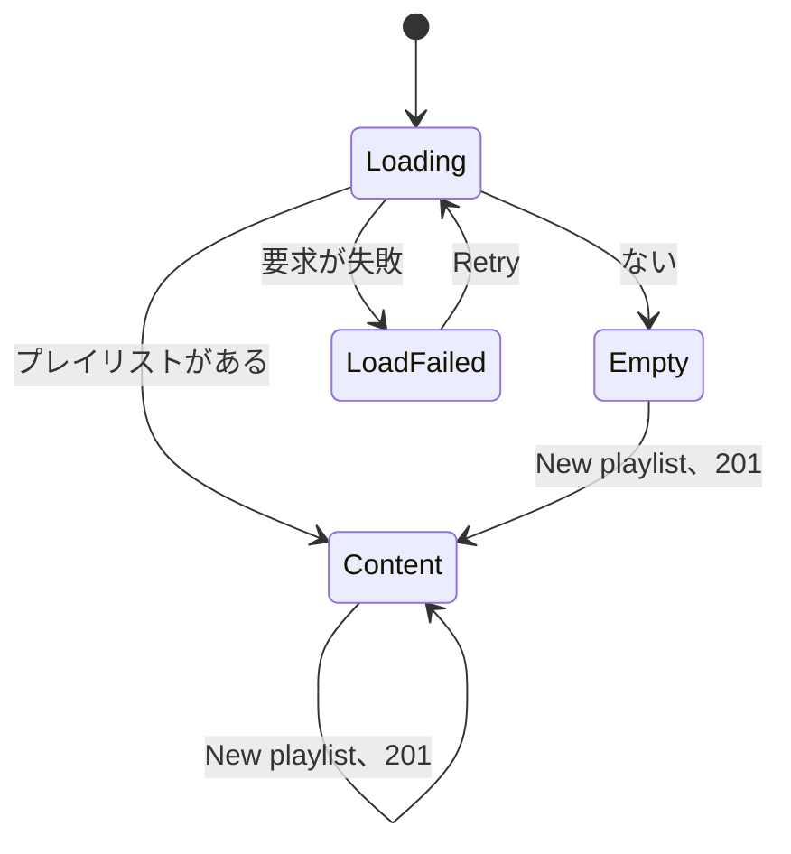
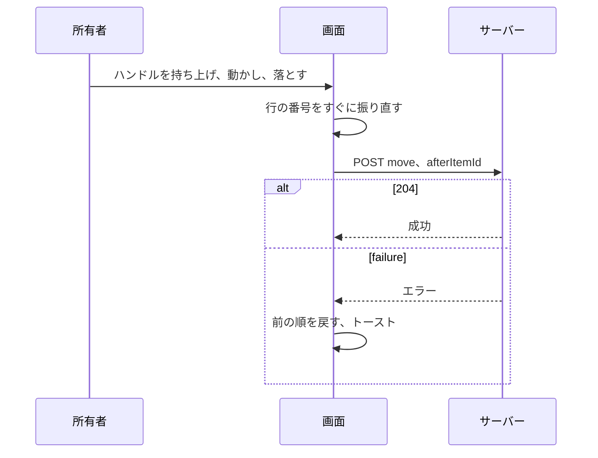
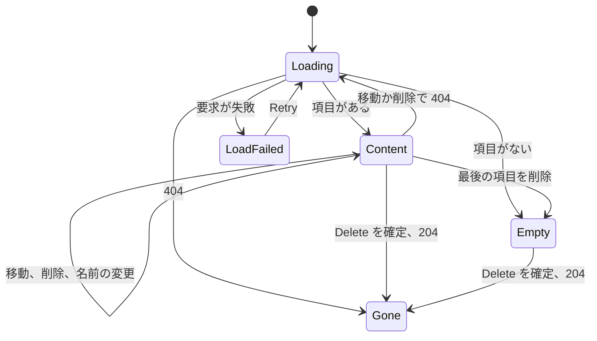
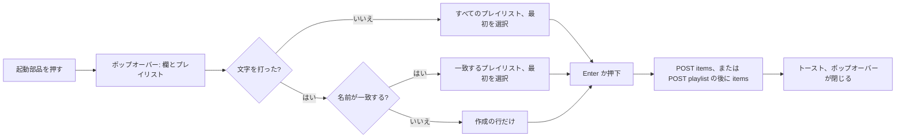
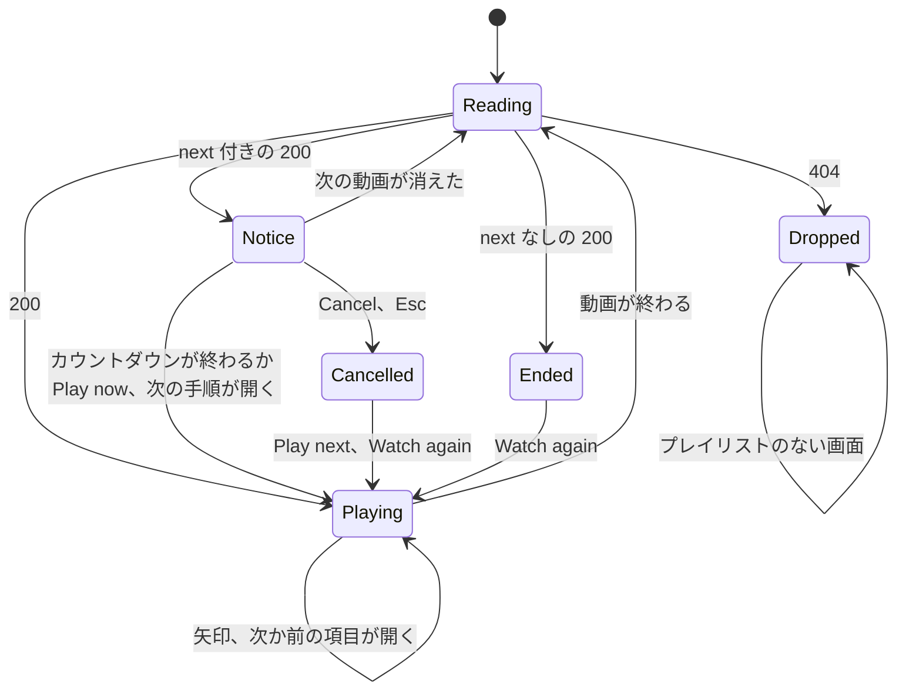
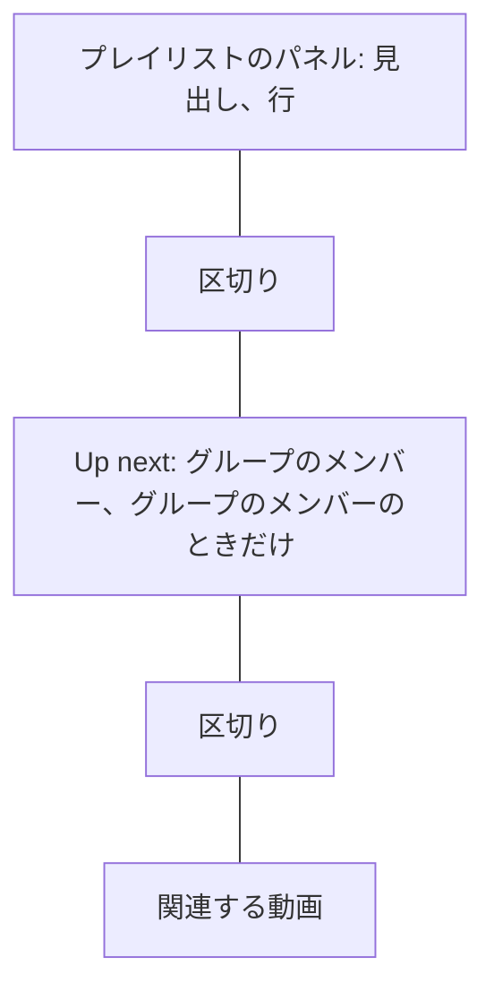

# UI 設計: 名前付きのプレイリストと連続再生 {#ui-design-named-playlists-and-continuous-playback}

**機能**: [親 Issue #787](https://github.com/syudead/vv/issues/787) · [plan.md](plan.md) · [research.md R-3](research.md#r-3-dense-integer-positions-reordered-by-move-after) · [R-5](research.md#r-5-one-owner-only-bulk-add-for-videos-and-groups-appended-in-request-order) · [R-6](research.md#r-6-the-server-answers-the-playlist-position-and-the-next-video-from-the-latest-order) · [R-7](research.md#r-7-a-playlist-playback-overrides-the-group-and-folder-neighbours) · [R-8](research.md#r-8-owner-only-through-the-existing-rules) · [R-9](research.md#r-9-drag-reordering-with-dnd-kitcore-and-dnd-kitsortable) · [R-11](research.md#r-11-a-playlist-name-is-1-to-100-characters-after-trimming-names-may-repeat) · [data-model.md の Playback order](data-model.md#playback-order) · [contracts/screen-api.md](contracts/screen-api.md)

すでに決めている出典。ここでは繰り返さず、リンクする。

| 話題 | 出典 |
| --- | --- |
| トークン、閉じた段階、ライブラリと視聴の密度 | [design-system.md の Foundations](../../docs/design-docs/design-system.md#foundations)。値は [`web/src/ui/tokens.css`](../../web/src/ui/tokens.css) の `@theme` にあり、ここでは名前で参照し、写さない |
| `ListPage`、`PageHeader`、`DataTable`、状態のブロック | [patterns.md の List page](../../web/registry/rules/patterns.md#list-page)、[Sections](../../web/registry/rules/patterns.md#sections)、[States](../../web/registry/rules/patterns.md#states) |
| `FormDialog`、`ConfirmDialog`: `pending`、その中の失敗の `Alert` | [patterns.md の Form dialog](../../web/registry/rules/patterns.md#form-dialog) と [Confirm dialog](../../web/registry/rules/patterns.md#confirm-dialog) |
| `Button`、`Popover`、`Command`、`DropdownMenu`、`Tooltip`、`Sonner`、`VideoThumbnail`、`FavoriteToggle`: それぞれの用途 | [components.md](../../web/registry/rules/components.md) |
| ライブラリのリスト表示の列、行の高さ、視聴の印。グループの行 | [library-ui.md の List view and selection](../../docs/design-docs/library-ui.md#list-view-and-selection)、[017 UI 設計の List view row](../017-folder-groups/ui-design.md#list-view-row) |
| カード、行、動画の画面のお気に入りのハートと、オフの印を出すとき | [library-ui.md の Favorite mark](../../docs/design-docs/library-ui.md#favorite-mark)、[035 UI 設計の Card](../035-favorites/ui-design.md#card) と [Video page](../035-favorites/ui-design.md#video-page) |
| 選択バーの順序、折り返し、`Favorite` メニューの `videoIds` と `folders` | [library-ui.md の Selection bar](../../docs/design-docs/library-ui.md#selection-bar)、[035 UI 設計の Selection bar](../035-favorites/ui-design.md#selection-bar) |
| 選択バーの `Add tag` のポップオーバー: ポップオーバーの中の、選択器である `Command` | [014 UI 設計の Selection bar](../014-video-tags/ui-design.md#selection-bar)、[components.md の TagCommand](../../web/registry/rules/components.md#tagcommand) |
| 動画の画面: グループの行、メンバーの一覧、矢印、自動再生の通知、再生終了のレイヤー | [library-ui.md の Group members](../../docs/design-docs/library-ui.md#group-members)、[017 UI 設計の Video page](../017-folder-groups/ui-design.md#video-page)、[012 UI 設計の Ended](../012-video-detail-ia/ui-design.md#ended) と [Neighbor arrows](../012-video-detail-ia/ui-design.md#neighbor-arrows) |
| 所有者専用の一覧画面: サイドバーの項目、ルート、ゲート、`document.title` | [043 UI 設計の Sidebar entry and route](../043-watch-history/ui-design.md#sidebar-entry-and-route)、[016 UI 設計の Guest degradation](../016-single-account-auth/ui-design.md#guest-degradation) |
| CSS の幅のブレークポイント。人が確かめるレイアウト | [library-ui.md の Width breakpoints](../../docs/design-docs/library-ui.md#width-breakpoints-in-css-and-the-sidebar-exception)、[Layout verified by people](../../docs/design-docs/library-ui.md#layout-verified-by-people-not-machines) |
| 画面の文言 | [`web/src/i18n/en.ts`](../../web/src/i18n/en.ts)（`shell.nav`、`common`、`list.card`、`library.selection`、`player`）。この機能は `playlists` と下の文言を加える |

図は、この機能が加える部分と、それぞれの操作の行き先を示す。

```mermaid
flowchart LR
  side[サイドバー: Playlists] --> list[プレイリスト一覧の画面]
  list -->|New playlist| create[フォームのダイアログ]
  list -->|行| detail[プレイリストの画面]
  detail -->|Play、行| page[動画の画面、プレイリストの文脈]
  detail -->|ハンドル| move[行が動く]
  detail -->|More| manage[名前の変更、削除]
  card[カード、行、動画の画面、選択バー] -->|Add to playlist| picker[プレイリストの選択器]
  picker -->|選ぶ、作る| toast[結果の通知]
  page --> panel[横の列: プレイリストのパネル]
  panel -->|行| page
  page -->|動画が終わる| notice[自動再生の通知]
  notice --> page
  page -->|最後の項目が終わる| end[プレイリストの終わり]
```

変わらないもの: 加える 1 つの操作を除くライブラリのカード、行、ツールバー、お気に入りのハート、グループのカード、フォルダの画面、`?playlist` のない動画の画面、サイドバーのほかの項目、ゲート。下のどの部分もレジストリのコンポーネントかパターンであり、`web/src/theme/tokens.test.ts` のコントラストの組も何も増えない。デザインシステムはトークンを 1 つ得る: 間隔の段 `playlist-panel`（20rem）がプレイリストのパネルの一覧の高さの上限になる。閉じた間隔の尺度に `max-h-80` がないからである。パネルとプレイリストの行のアイコンは `size-4` で、グループの行のアイコンとメンバーの一覧の視聴済みの印と同じ大きさである。尺度に `size-3.5` がないからである。

## この形にした理由 {#why-this-shape}

プレイリスト一覧の画面は一覧画面で、本体はプレイリストごとに 1 行の `DataTable` である。行は名前、項目の数、最後に変わった時を持つ。画面の唯一の仕事はプレイリストを開くことであり、所有者が押す行はそのための最も控えめな形である。プレイリストごとのカードは採用しなかった。`GET /api/playlists` は絵を持たないので、カードは名前を囲む枠になってしまうからである。`GroupedList` も採用しなかった。行が共有する見出しがないからである。唯一の `default` の操作は「New playlist」である。新しい所有者がこの画面で最初にするのはプレイリストを作ることだからである。名前の変更と削除は、名前が見えているプレイリスト自身の画面に置くので、一覧は行のメニューを持たず、名前と競うものはない（`UI品質`、`操作の優先度`）。

プレイリストの画面は一覧画面で、本体はライブラリのリスト表示の表に、親 Issue が求める行を載せたものである。行はサムネイル、タイトル、視聴の状態（`UI品質`、`情報密度`）に、番号、ドラッグのハンドル、削除の `×` を加えて持つ。表をライブラリのものにするのは、Issue が項目をライブラリでの見た目と同じにすることを求めており、行は順番として読めるが格子に並ぶカードはそう読めないからである。要件 6 が「ここから始める」を項目に対してすることにしているので、行全体がその項目からプレイリストを再生する。ヘッダーの唯一の `default` の操作は先頭から再生する。すでに再生する行の横に行ごとの再生ボタンを置く案は、1 つの操作に 2 つ目の操作部品を置くことになるので採用しなかった。名前の変更と削除は、ヘッダーの `More` メニューの奥に、再生の操作の後に置くので、操作部品の順は使う順である（`UI品質`、`視覚的な階層`、`操作の優先度`）。

並べ替えは、ハンドルによるドラッグ＆ドロップで、dnd-kit が用意するキーボードの経路を持つ（R-9）。ハンドルは行の最初にあるので、目は「ここをつかみ、次に項目」と読む。ハンドルのない、どこでもドラッグできる行は採用しなかった。行はリンクであり、開く押下が持ち上げる押下を兼ねてはならないからである。

追加は、Issue が挙げる 4 つの場所にある 1 つの選択器で、所有者が選択バーの `Add tag` ですでに知っている形をとる。`Command` を持つポップオーバーで、その欄がプレイリストを絞り込み、最初の行が打った名前からプレイリストを作る。名前の `DropdownMenu` は採用しなかった。要件 1 はプレイリストの数を制限せず、検索のないメニューは画面からあふれるからである。2 段階（「New playlist…」の後にダイアログ）は採用しなかった。名前を打って Enter を押すことが、タグの選択器がすでに教えた作り方だからである。操作部品はお気に入りのハートのある場所に置く（R-5、要件 2）。カードの隅と行の列ではその横に、動画の画面の操作のグループではその後に、選択バーでは `Favorite` の後に置き、オフのハートと同じ表示の規則に従うので、ポインタの当たっていないカードは今と同じに見える（`UI品質`、`操作の優先度`: お気に入りと同じ届きやすさ）。

動画の画面では、プレイリストはタイトルの上の 1 行で、グループの行の場所と形をとり、名前と「2 / 7」を持つ。矢印は項目の間を移り、自動再生の通知はグループの通知のまま変えず、終わりは「End of playlist」と記した再生終了のレイヤーである（R-7）。横の列は、プレイリストの項目のパネルで始まる。パネルはメンバーの一覧の行の形をとり、今の項目に印を付けるので、所有者は画面を離れずに何が再生され、何が続くかを見られる。同種のプレーヤーのパネルがそうするのと同じである。タイトルの上の行は位置を示し、パネルは順を示す（最初の設計の未解決の問いへのメンテナーの決定）。グループの項目の中では、グループの「Up next」のメンバーの一覧はパネルの下でその場所を保つ。パネルはグループがどの項目で、その後に何が続くかを言い、メンバーの一覧はその中で次に何が再生されるかを言い、2 つはタイトルの上の行の順（プレイリスト、次にグループ）で読める。メンバーの一覧を今のグループの行の中に入れ子にする案は採用しなかった。メンバーの一覧はスクロールにつれてその窓の先を読み、入れ子の一覧はスクロールするパネルの中でスクロールすることになるからである。プレイリストの文脈でメンバーの一覧を外す案も採用しなかった。次に再生されるメンバーがどの一覧にもなくなるからである。パネルの一覧は高さを制限して中でスクロールするので、長いプレイリストがメンバーの一覧と関連する動画を最初に見える範囲の外に押し出すことはない。パネルはハンドルも `×` も持たない。順を変える場所は、パネルの見出しから 1 回の押下で開くプレイリストの画面である。

## 文言 {#words}

文言は `web/src/i18n/en.ts` の `playlists` の下に置く。キーを挙げたものは除く。ユーザーのデータ（プレイリストの名前、タイトル）は引数として埋め込む。`items` はカタログの「1 item」/「N items」の補助で、`videos` は同じく「N videos」の補助である。

| 場所 | 文言 | 備考 |
| --- | --- | --- |
| サイドバーの項目、ページのタイトル、`/playlists` の `document.title` | Playlists | `shell.nav.playlists`、`playlists.title`、`playlists.documentTitle` |
| プレイリストの表のアクセシブルな名前 | Playlists | `playlists.table` |
| 列の見出し | Name, Items, Updated | `playlists.columns.name`、`.items`、`.updated` |
| Updated のセル | 3 days ago | `formatRelative(updatedAt)`。ライブラリのリスト表示の `Added` 列と同じ。完全な日時を `title` に持つ |
| 行のリンクのアクセシブルな名前 | {name}, {N items} | `playlists.rowLabel(name, count)` |
| `/playlists` のヘッダーの数 | 3 playlists | `playlists.count(count)`。「1 playlist」 |
| New playlist のボタン、ダイアログのタイトル | New playlist | `playlists.new`、`playlists.newDialog.title` |
| 名前の欄のラベル | Name | `playlists.nameLabel` |
| 名前の欄のエラー | Use a name of 1 to 100 characters. | `playlists.nameRule`。送信を試みたとき、前後の空白を除いた名前が空か、サーバーと同じくコードポイントで数えて 100 文字を超えるなら、`FieldError` として出す（R-11） |
| 作成の操作。送信中 | Create; Creating… | `playlists.newDialog.submit`、`.submitting` |
| 作成の失敗 | Couldn't create the playlist: {reason} | `playlists.newDialog.failed`。ダイアログの中の `destructive` の `Alert` |
| プレイリストがないときのタイトル | No playlists yet | `playlists.empty.title` |
| プレイリストがないときの説明 | Create a playlist, then add videos and groups to it from the library. | `playlists.empty.description` |
| プレイリスト一覧の読み込みの失敗 | Couldn't load the playlists | `playlists.loadFailed`。`Retry` は `common.retry` |
| `/playlists/{id}` のヘッダーの数 | 12 items · 1:32:10 | `playlists.detail.count(count, duration)`: `items(count)`、次に ` · ` と、出している項目の長さの和を `formatDuration` で書いたもの。出している項目のどれかが長さを持たないとき、長さの部分は省く |
| 再生の操作、アクセシブルな名前 | Play; Play "{name}" from the top | `playlists.detail.play`、`playlists.detail.playFor(name)` |
| More のボタン、ツールチップとアクセシブルな名前 | More | `common.more` |
| メニューの項目 | Rename…, Delete… | `playlists.detail.rename`、`playlists.detail.delete` |
| 名前の変更のダイアログのタイトル。操作。送信中 | Rename playlist; Save; Saving… | `playlists.renameDialog.title`、`.submit`、`.submitting` |
| 名前の変更の失敗 | Couldn't rename the playlist: {reason} | `playlists.renameDialog.failed` |
| 削除のダイアログのタイトル | Delete "{name}"? | `playlists.deleteDialog.title(name)` |
| 削除のダイアログの説明 | The playlist is deleted. Its videos and groups stay in the library. | `playlists.deleteDialog.description` |
| 削除の操作。送信中 | Delete; Deleting… | `playlists.deleteDialog.submit`、`.submitting`。`destructive` |
| 削除の失敗 | Couldn't delete the playlist: {reason} | `playlists.deleteDialog.failed` |
| 削除した | Deleted "{name}" | `playlists.deleted(name)`。`/playlists` でのトースト |
| 項目の表のアクセシブルな名前 | Items | `playlists.detail.table` |
| 行のリンクのアクセシブルな名前 | Play from {title} | `playlists.item.playFrom(title)`。グループの項目はグループの名前を使う |
| グループの項目の 2 行目 | 12 videos | `library.group.count`。`Folder` のアイコンを持ち、ライブラリのグループの行と同じ |
| 視聴済みの印 | Watched | `list.card.watched`。ライブラリのリスト表示と同じ |
| ドラッグのハンドルのアクセシブルな名前 | Reorder "{title}" | `playlists.item.reorder(title)` |
| ハンドルのキーボードの説明 | Press Space to pick up, the arrow keys to move, Space to drop and Esc to cancel. | `playlists.item.reorderInstructions`。dnd-kit の `screenReaderInstructions` を通して読み上げる |
| 削除のボタン、ツールチップ | Remove from playlist | `playlists.item.remove` |
| 削除のボタン、アクセシブルな名前 | Remove "{title}" from the playlist | `playlists.item.removeFor(title)` |
| 移動の失敗 | Couldn't move the item: {reason} | `playlists.item.moveFailed`。トースト |
| 削除の失敗 | Couldn't remove the item: {reason} | `playlists.item.removeFailed`。トースト |
| 空のプレイリストのタイトル | No items yet | `playlists.detail.empty.title` |
| 空のプレイリストの説明 | Add videos and groups with Add to playlist on a card, on the video page, or in the selection bar. | `playlists.detail.empty.description` |
| 空のプレイリストの操作 | Open library | `playlists.detail.empty.action`。`/` へのリンク |
| 削除されたプレイリストのタイトル | This playlist no longer exists | `playlists.detail.gone.title` |
| 削除されたプレイリストの説明 | It was deleted, maybe in another tab. | `playlists.detail.gone.description` |
| 削除されたプレイリストの操作 | Back to playlists | `playlists.detail.gone.action`。`/playlists` へのリンク |
| プレイリストの読み込みの失敗 | Couldn't load the playlist | `playlists.detail.loadFailed` |
| 選択器の起動部品、ツールチップ。選択バーの操作 | Add to playlist | `playlists.add.label`。選択バーは同じ文言の `library.selection.addToPlaylist` を使う |
| 動画のカードか行での選択器の起動部品のアクセシブルな名前 | Add "{title}" to a playlist | `list.card.addToPlaylist(title)` |
| グループのカードか行での選択器の起動部品のアクセシブルな名前 | Add group "{name}" to a playlist | `library.group.addToPlaylist(name)` |
| 選択器の欄のプレースホルダーとアクセシブルな名前 | Search or create a playlist | `playlists.add.search` |
| 選択器の一覧のアクセシブルな名前 | Playlists | `playlists.add.list` |
| 作成の行 | Create "{name}" | `playlists.add.create(name)` |
| プレイリストも文字もない選択器 | No playlists yet. Type a name to create one. | `playlists.add.none` |
| 打った名前が長すぎる | Use a name of up to 100 characters | `playlists.add.nameTooLong`。欄の下の理由の行。`TagCommand` が理由を出すのと同じ |
| 選択器の読み込み中、読み込みの失敗 | Loading…, Couldn't load the playlists | `playlists.add.loading`、`playlists.add.loadFailed`。`Retry` は `common.retry` |
| 加えた | Added {N items} to "{name}" | `playlists.add.added(count, name)`。`existing` が 0 のとき |
| 新しいものがない | Already in "{name}"; {N items} already in "{name}" | `playlists.add.existing(count, name)`: 1 つなら前の形、それより多ければ後の形。`added` が 0 で `existing` が 0 でないとき |
| 一部が新しい | Added {N items} to "{name}"; {M} already there | `playlists.add.partly(added, existing, name)` |
| 何も解決しなかった | Nothing was added | `playlists.add.nothing`。両方の数が 0 のとき |
| 追加の失敗 | Couldn't add to the playlist: {reason} | `playlists.add.failed` |
| プレイリストの行のアクセシブルな名前 | Playlist "{name}", item 2 of 7. Open the playlist | `player.playlist.line(name, position, count)`。`position` が 0 のときは位置の部分を持たない |
| プレイリストの行の位置 | 2 / 7 | `player.related.position(position, count)` |
| パネルの見出しのアクセシブルな名前 | Playlist "{name}". Open the playlist | `player.playlist.line(name, 0, count)`: 位置は見出しの横にあり、その名前には入らない |
| パネルの見出しの数 | 2 / 7 | `player.related.position(position, count)`。メンバーの一覧の見出しと同じ。`position` が 0 のときは省く |
| パネルの行のアクセシブルな名前 | Play from {title} | `playlists.item.playFrom(title)`。プレイリストの画面の行と同じ。グループの項目はグループの名前を使う |
| パネルの今の行 | Now playing | `player.related.nowPlaying`。隠し、タイトルの前に置く。メンバーの一覧の今の行と同じ |
| パネルの読み込みの失敗 | Couldn't load the playlist | `playlists.detail.loadFailed`。`Retry` は `common.retry` |
| 矢印のツールチップとアクセシブルな名前 | Previous item: {title}; Next item: {title} | `player.playlist.previous`、`player.playlist.next`。`player.neighbors.withTitle` でつなぐ |
| プレイリストの終わりのラベル | End of playlist | `player.playlist.end` |
| プレイリストの終わりの読み上げ | Playback finished. End of the playlist "{name}" | `player.playlist.endAnnouncement(name)`。`role="status"`、1 回 |
| 再生中にプレイリストが消えた | This video is no longer in the playlist. Playback stops after it. | `player.playlist.gone`。トースト |
| 再生できない項目を飛ばした | Skipped "{title}": it can't be played here. | `player.playlist.skipped(title)`。トースト（[再生できない項目](#unplayable-item)） |
| 再生できない最後の項目 | Can't play "{title}". End of the playlist. | `player.playlist.skippedLast(title)`。トースト |

「Item」は、プレイリストの中の動画またはグループを指す語であり、親 Issue の数がそれらを数えるのと同じである。まとめての追加のトーストは、お気に入りのトーストと同じく項目を数える。「Open」ではなく「Play from」とするのは、行を押すと再生が始まるからである（要件 6）。「Watch again」と「Up next」は今のキーを保つ。

## サイドバーの項目とルート {#sidebar-entry-and-route}

「Playlists」（lucide `ListVideo`、`/playlists`、`ownerOnly`）は、サイドバーの上のグループの 4 番目の項目で、「History」の後、「Tags」の前に置く。最初の 4 つの項目は見るものを探す画面であり、最後の 2 つは管理である。ゲストの上のグループは「Library」と「Folders」のままである。レールとドロワーはほかの項目と同じに扱い、数のバッジは持たない。

`/playlists` と `/playlists/{id}` は `/history` の形をとる。`AppShell` の中にあり、使うときに読み込み、ゲートの所有者専用のパスに入るので、どちらかを開いたゲストは完全な URL を持って `/login?next=…` に送られる（R-8）。`document.title` は、一覧では「Playlists」、プレイリストの画面ではプレイリストの名前である。プレイリストの画面の行のリンクとその `Play` は `/playlists/{id}` を `state.from` として運ぶので、動画の画面の `×` と Esc はプレイリストに戻る。

## プレイリスト一覧の画面 {#playlists-screen}

ツールバー、帯、横の列、選択バーのない `ListPage` である。ヘッダーは、`PageHeader` のタイトル「Playlists」（`text-xl font-semibold`）、数「3 playlists」、そして `actions` の中の唯一の `default` `sm` のボタン「New playlist」（lucide `Plus`）である。本体は 1 つの `DataTable` か 1 つの状態のブロックである。ヘッダーはどの状態でもその場所に留まる。

| 部分 | 形 |
| --- | --- |
| 行 | プレイリストごとに 1 行、API の順（最後に変わったものが先なので、所有者が作っている途中のプレイリストが一番上に来る） |
| 名前 | `text-sm font-medium text-foreground`、1 行で、切り詰め、完全な名前を `title` に持つ。セルは行を覆う `/playlists/{id}` への `Link` で（行に `hover:bg-accent`）、名前の前に `text-muted-foreground` の lucide `ListVideo` を持つ |
| 項目の数 | `text-xs text-muted-foreground tabular-nums` の `items(count)`、右寄せ。空のプレイリストは空欄ではなく「0 items」とするので、空の行が読み込みの不具合に見えない |
| 更新 | `text-xs text-muted-foreground` の `formatRelative(updatedAt)`、右寄せ、`md` から。それ未満では隠す |
| それ以外 | チェックの列、行のメニュー、サムネイルはない。API は絵を持たず、行の唯一の操作は開くことである |

2 つのプレイリストが名前を共有することがある（R-11）。同じ名前の 2 つの行は数と日付で見分け、何もそれらをまとめない。

### 新しいプレイリスト {#new-playlist}

「New playlist」は `FormDialog` を開く。それは 1 つの `Field` を持ち、その中身は `Label`「Name」と、ダイアログが開くとフォーカスを受ける `Input`（`autoComplete="off"`）である。入力に `maxLength` はない。HTML は UTF-16 の単位で数えるので、絵文字 100 個の名前は 50 個で止まるが、サーバーはコードポイントで数える（R-11）。代わりにダイアログは、検索欄と同じく、前後の空白を除いた名前をコードポイントで数える（`Array.from`）。フッターは `Cancel` と `default` の「Create」である。

| 出来事 | 振る舞い |
| --- | --- |
| 前後の空白を除くと名前が空か、100 コードポイントを超える | 「Create」は有効のままで、所有者が打つ間、欄はエラーを出さない。Enter か押下は何も送らない。「Use a name of 1 to 100 characters.」が欄の `FieldError` になり、文字が変わるまで欄は `aria-invalid` である |
| 送信 | `pending`: 両方のボタンを無効にし、`Spinner` 付きの「Creating…」。前後の空白を除いた名前を `POST /api/playlists` に送る |
| `201` | ダイアログが閉じ、新しい行が表の一番上にあり、フォーカスはその名前のリンクに移る。トーストは出さない。行が結果である |
| `400` | 欄の `FieldError` は「Use a name of 1 to 100 characters.」である。ダイアログは開いたままである |
| ほかの失敗 | 欄の下に `destructive` の `Alert`「Couldn't create the playlist: {reason}」。ダイアログは開いたままである |
| Cancel、Esc | ダイアログが閉じる。打った名前は捨てる |

### 状態 {#states}

図は、本体の状態と、状態の間を移すものを示す。



| 状態 | 画面が出すもの |
| --- | --- |
| 読み込み中 | 本体に `LoadingState` `layout="table"`。ヘッダーは「New playlist」を持つ |
| 読み込みの失敗 | 「Couldn't load the playlists」と `Retry` を持つ `ErrorState` |
| 空 | lucide `ListVideo`、「No playlists yet」、「Create a playlist, then add videos and groups to it from the library.」、`default` `sm` の操作「New playlist」を持つ `EmptyState`。操作は同じダイアログを開く。ヘッダーのボタンは描かないので、その範囲の `default` のボタンは 1 つである |
| 内容 | 表。ヘッダーの数と「New playlist」 |
| 作成中 | 変わらない表の上の、`pending` の形のダイアログ |

一覧は、画面が開いたときと作成の後に読む。プレイリストから戻ると読み直す（`Link` がルートを離れ、画面が再びマウントされる）。開いている間に自分から更新はしない（R-10）。

## プレイリストの画面 {#playlist-screen}

ツールバー、帯、横の列、選択バーのない `ListPage` である。ヘッダーは、`PageHeader` のタイトル（プレイリストの名前、`text-xl font-semibold`、必要なら 2 行目に折り返す）、数「12 items · 1:32:10」、そして `actions` の中の `default` `sm` の「Play」（lucide `Play`）と、その後の `ghost` `icon-sm` の「More」ボタン（lucide `Ellipsis`）である。「More」は `DropdownMenu` を開き、それは「Rename…」（lucide `Pencil`）、`DropdownMenuSeparator`、「Delete…」（lucide `Trash2`、`variant="destructive"`）を持つ。本体は項目の 1 つの `DataTable` か 1 つの状態のブロックである。

名前は画面で最も強い文字で、`text-xl` の唯一の文字である。数と行の番号は `text-xs text-muted-foreground` なので、目が止まるのは名前と行であり、数字は必要なときにだけ読まれる（`UI品質`、`タイポグラフィ`）。「Play」は画面で唯一の塗りつぶした操作部品であり、「More」はその横の控えめなアイコンである。

### 行 {#rows}

表はライブラリのリスト表示の列と行の高さをとるので、項目はライブラリのリスト表示での見た目と同じであり、前にハンドルと番号、最後に `×` を持つ。行の部分ごとに:

| 列 | 形 |
| --- | --- |
| ハンドルと番号 | `w-list-number` のセル: `ghost` `icon-sm` のハンドル（lucide `GripVertical`、`text-muted-foreground`、`cursor-grab`、`aria-label`「Reorder "{title}"」）、次に `text-xs text-muted-foreground tabular-nums` の 1 から始まる番号。画面はタッチでも使うので、ハンドルは常に描き、ホバーでだけ出すことはしない |
| サムネイル | リスト表示の行と同じ `VideoThumbnail` `w-list-thumb rounded-sm`: 動画の画像、グループなら最初のメンバーの画像。右下に `VideoThumbnailDuration`。動画またはグループが途中の間は下端に `VideoThumbnailProgress`。お気に入り、選択の印、公開の印は持たない |
| タイトル | リスト表示の行と同じ `text-sm font-medium`、視聴済みなら `text-muted-foreground`、2 行に制限し、完全な文字を `title` に持つ。グループの項目は、名前の下に、lucide `Folder`（`size-3`）と「12 videos」を持つ `text-xs text-muted-foreground` の行を 1 つ出す。ライブラリのグループの行と同じである。サムネイルとタイトルは、番号から `×` までの行を覆う 1 つの `Link` で、行に `hover:bg-accent` を持つ |
| 視聴済み | `sm` から: 視聴済みの動画か視聴済みのグループには、`text-success` の lucide `Check` と、隠した「Watched」。途中のグループには `tabular-nums` の「3 / 12」。それ以外は空。リスト表示と同じ |
| 長さ | 動画の長さ、またはグループの合計を `tabular-nums` で、右寄せ。わからないときは空 |
| 削除 | `ghost` `icon-sm` の `×`（lucide `X`、`text-muted-foreground`、ツールチップ「Remove from playlist」）を行の終わりに、常に描く |

行のリンクを押すと、`state: { from: "/playlists/{id}", autoplay: true }` で `/videos/{videoId}?playlist={id}&item={itemId}` を開く。`videoId` は動画、またはグループの `openVideoId` である（[contracts/screen-api.md の Client use](contracts/screen-api.md#client-use)）。再生はその項目から始まる。ヘッダーの「Play」は最初の行に同じことをする。ライブラリのリスト表示の画質、サイズ、追加日の列は描かない。行は順番の中の項目であり、その 3 つは、どこから始めるかも何が残っているかも言わずに行を広げるだけだからである。

ライブラリにあるが再生できない動画（`playable` が false）は、リンクを保ち、タイトルの下にリスト表示の行の警告の行（`text-xs text-warning`、lucide `AlertTriangle` `size-3`）を出すので、所有者は再生がそれを飛ばす前にそれに気づく（[再生できない項目](#unplayable-item)）。

### 並べ替え {#reordering}

行はハンドルで、ポインタ、タッチ、キーボードで持ち上げる（R-9）。図は 1 回の移動を示す。



| 出来事 | 振る舞い |
| --- | --- |
| 持ち上げた | 行は `bg-popover` の上に `shadow-elevated` 付きで描かれ、ポインタに付いて動く。ほかの行は場所を空けるためにずれる（`transition-transform`、動きを減らす設定では動きなし）。持ち上げている間、行のリンクは働かない |
| キーボード | ハンドルにフォーカスがあるとき: Space で持ち上げ、`↑` と `↓` で行を 1 つ動かし、Space で落とし、Esc で取り消して順を戻す。dnd-kit がそれぞれの手順を読み上げ、ハンドルがフォーカスを受けたときに説明を 1 回読み上げる |
| 新しい場所に落とした | 順と番号はすぐに変わる。`afterItemId` を、今その上にある項目、一番上なら `null` として、`POST /api/playlists/{id}/items/{itemId}/move` を 1 回送る。トーストは出さない。新しい順が結果である |
| 同じ場所に落とした | 何も送らない |
| 失敗 | 順はサーバーが最後に確かめたものに戻り、トーストが「Couldn't move the item: {reason}」を出す。`404`（項目かプレイリストが消えた）は、代わりにプレイリストを読み直す。下の `404` の行が言うとおりである |
| 1 つの移動の送信中に次の移動 | 認める。それぞれ順に送り、それぞれ落としたときの画面の順に対して送る |

### 項目を削除する {#removing-an-item}

`×` を押すと、すぐに `DELETE /api/playlists/{id}/items/{itemId}` を送る。確認も成功のトーストもない。行が消えることが結果であり、動画やグループはライブラリに残り（要件 5）、所有者はカードから加え直せる。

| 出来事 | 振る舞い |
| --- | --- |
| 押した | `×` は `disabled` になり、`Spinner` を出す。行は残る。2 回目の押下は何もしない |
| `204` | 行が消え、その下の行の番号を振り直す。ヘッダーの数と長さが変わる。フォーカスは次の行の `×`、なければ前の行のもの、それもなければページのタイトル（`titleRef`）に移る。最後の行が消えると、本体は空の状態を出し、「Play」はもう描かない |
| `404` | 一覧が古い: 画面は今の行を描いたままプレイリストを読み直し、応答が届くと行を置き換える。その読み込みでの `404` は削除された状態である |
| ほかの失敗 | 行は残り、`×` は元に戻り、トーストが「Couldn't remove the item: {reason}」を出す |

### 名前の変更 {#renaming}

「Rename…」は `FormDialog`「Rename playlist」を開く。ダイアログは [新しいプレイリスト](#new-playlist) の 1 つの `Field` を、今の名前を入れて文字を選択した状態で持ち、`default` の操作は「Save」である。名前の欄の規則は同じである。「Save」は、前後の空白を除いた文字が今の名前と等しい間だけ `submitDisabled` であり、これにはメッセージが要らない。`200` ではダイアログが閉じ、見出しと `document.title` は前後の空白を除いた名前を出し、フォーカスは「More」に戻る。`404` は削除された状態を出す。失敗はダイアログの中に「Couldn't rename the playlist: {reason}」として留まる。

### 削除 {#deleting}

「Delete…」は `ConfirmDialog` を開く。タイトル「Delete "{name}"?」、説明「The playlist is deleted. Its videos and groups stay in the library.」、最初に `Cancel`、次に `destructive` の「Delete」である。説明は何が残るかを名指す。ここで所有者が恐れる唯一のことは動画を失うことであり（要件 5）、押す前に文言がそれを解決するからである。

| 出来事 | 振る舞い |
| --- | --- |
| 確定 | `pending`: 両方のボタンを無効にし、`Spinner` 付きの「Deleting…」 |
| `204` | ダイアログが閉じ、画面は `/playlists` に移り、そこでトーストが「Deleted "{name}"」と言う |
| `404` | プレイリストはすでに削除されていた: `204` と同じで、トーストは出さない |
| ほかの失敗 | 説明の下に `destructive` の `Alert`「Couldn't delete the playlist: {reason}」。ダイアログは開いたままである |
| Cancel、Esc | ダイアログが閉じ、何も変わらない（要件 11） |

### 状態 {#states-1}

図は、本体の状態と、状態の間を移すものを示す。



| 状態 | 画面が出すもの |
| --- | --- |
| 読み込み中 | 本体に `LoadingState` `layout="table"`。ヘッダーは名前の場所に `Skeleton` の行を持ち、プレイリストが届くまで数も操作も持たない |
| 読み込みの失敗 | 「Couldn't load the playlist」と `Retry` を持つ `ErrorState`。ヘッダーは操作を持たない |
| 消えた | lucide `ListX`、「This playlist no longer exists」、「It was deleted, maybe in another tab.」、`default` `sm` の操作「Back to playlists」を持つ `EmptyState`。ヘッダーはタイトルとして「Playlists」を出し、数も操作も出さないので、画面は出せないものを何も名指さない |
| 空 | lucide `ListVideo`、「No items yet」、「Add videos and groups with Add to playlist on a card, on the video page, or in the selection bar.」、`default` `sm` の操作「Open library」を持つ `EmptyState`。ヘッダーは名前、「0 items」、「More」を出すが、再生するものがないので「Play」は出さない |
| 内容 | 表。ヘッダーは数、「Play」、「More」を持つ |
| 移動中、削除中 | [並べ替え](#reordering) と [項目を削除する](#removing-an-item) のとおり。ほかは変わらない |
| 名前の変更中、削除中 | 変わらない表の上の、`pending` の形のダイアログ |

動画かグループが隠れている項目（R-4）は応答に入らないので、番号は出している項目を数え、隠れた項目は行をとらない。その内容が戻ると、次の読み込みがそれを元の場所に出す。プレイリストは、画面が開いたとき、移動か削除での `404` の後、そして所有者が動画の画面からそこに戻ったとき（`Link` がルートを離れるので、画面は再びマウントされる）に読む。そのとき、各行は視聴が残した視聴の状態を出す。

## プレイリストに追加 {#add-to-playlist}

1 つの選択器のコンポーネントを 4 つの場所で使う。それは起動部品から開き、プレイリストを持つ。図は 1 回の追加を示す。



| 部分 | 形 |
| --- | --- |
| ポップオーバー | `w-popover` の `Popover`。カードと行と動画の画面では起動部品の下に開き、選択バーでは `Add tag` と同じくその上（`side="top"`）に開く。Esc、外側の押下、結果の後に閉じる |
| 欄 | プレースホルダーと名前が「Search or create a playlist」の `CommandInput`。ポップオーバーが開くとフォーカスを受ける。`maxLength` はないので、下の長さの規則はサーバーと同じくコードポイントで数える |
| 一覧 | 「Playlists」と名付けた `CommandList`、`shouldFilter={false}`: 前後の空白を除いた文字を、大文字小文字を区別せずに名前に含むプレイリストを、API の順（最後に変わったものが先）で、それぞれ lucide `ListVideo` 付きで並べる。文字がなければ、すべてのプレイリスト。最初の行が選択されているので、Enter はそれに働く |
| 作成の行 | 前後の空白を除いた文字が空でなく、どのプレイリストの名前もそれにちょうど等しくない間、一致するものより前に、最初に出す。lucide `Plus` 付きで「Create "{name}"」と読める。一致するものがなければ、それが唯一の行である |
| 打った名前が前後の空白を除いて 100 コードポイントを超える | 欄の下の理由の行「Use a name of up to 100 characters」。Enter も押下も働かない |
| プレイリストも文字もない | 一覧の場所に「No playlists yet. Type a name to create one.」 |
| 読み込み中 | 一覧の場所に「Loading…」。`GET /api/playlists` はポップオーバーが開くたびに読むので、ほかの画面で作ったプレイリストもそこにある |
| 読み込みの失敗 | 一覧の場所に「Couldn't load the playlists」と `ghost` `sm` の「Retry」。欄はそれでも名前を受け、名前の上の Enter は作成する |
| プレイリストを選ぶ | その場所の `videoIds` と `folders` で `POST /api/playlists/{id}/items`。応答まで、行はアイコンの場所に `Spinner` を出す |
| 作成 | 前後の空白を除いた名前で `POST /api/playlists`、次に新しいプレイリストへの追加。「Create "{name}"」が `Spinner` を出す |
| 結果 | ポップオーバーが閉じ、応答の `added` と `existing` から、1 つのトーストが「Added 3 items to "Tonight"」、「Already in "Tonight"」（または「{N items} already in "{name}"」）、「Added 2 items to "Tonight"; 1 already there」、「Nothing was added」のどれかを読む。失敗は、その間に削除されたプレイリストへの `404` も含めて、ポップオーバーを開いたままにし、欄の下に理由の行「Couldn't add to the playlist: {reason}」を出すので、所有者は別のものを選べる |

既存のプレイリストと同じ名前は作成の行として出さない。Enter で作られた 2 つ目の「Tonight」は選んだ結果ではなく誤りだからである。2 つ欲しい所有者は、2 つ目をプレイリスト一覧の画面から作る（R-11）。

起動部品の場所と、それが送るもの:

| 場所 | 起動部品 | 送るもの |
| --- | --- | --- |
| 動画のカード（ライブラリ、フォルダの画面、検索結果） | サムネイルの上端の `VideoThumbnailMark` の中、お気に入りのハートの左: `drop-shadow-mark` 付きの lucide `ListPlus` `size-5`、`text-foreground`、面を持たない `size-8` の押せる範囲、`aria-label`「Add "{title}" to a playlist」。オフのハートを出すときにちょうど出し（[035 UI 設計の When the mark is shown](../035-favorites/ui-design.md#when-the-mark-is-shown)）、そのポップオーバーが開いている間は出したままにする。押してもカードは開かず、選択も変わらない。ポインタがそこに入るとホバーのプレビューを止める。ハートと同じである | `videoIds: [id]` |
| グループのカード | 同じものを、グループのカードの隅の印の中、そのハートの横に置く。`aria-label`「Add group "{name}" to a playlist」 | `folders: [group.folder]` |
| リスト表示の行（動画とグループ） | お気に入りの列のすぐ後の `w-8` の列に、行の形の同じボタン（`size-6`、アイコン `size-4`、`text-muted-foreground`、ホバーで `text-foreground`）。行のオフのハートが見えるときに見える。列は `sm` から描き、それより下では見出しもセルも隠す。これで 360px でも行の長さの列が表の中に収まる。そこでは選択バーが「Add to playlist」を提供する | その種類のカードと同じ |
| 動画の画面 | 事実の行の操作のグループの中、お気に入りの切り替えのすぐ後、「Use current frame as thumbnail」の前: グループのアイコンだけの `ghost` のボタンで、lucide `ListPlus` とツールチップ「Add to playlist」を持つ。グループを描くときはいつも所有者に描き、場所を持たない動画も含む。グループのメンバーのグループの行には置かない。そこは何も加えない | `videoIds: [id]` |
| 選択バー | `Favorite` のすぐ後、`Visibility` の前に「Add to playlist」（lucide `ListPlus` と文字、`ghost` `sm`）。順は、数 → Add tag → Remove tag → Favorite → Add to playlist → Visibility → Bundle as versions → 区切り → Select all → 解除である。バーの規則で、`Favorite` 以降のグループの中で折り返し、アイコンに縮めることはない。送る数が 20000 を超えるときは、`Favorite` と同じ理由で `disabled` である | `folders` は選んだグループ、`videoIds` は選んだグループのメンバーでない選択した ID。`Favorite` と同じ（[035 UI 設計の Selection bar](../035-favorites/ui-design.md#selection-bar)）。結果の後も選択は残る |

カードの隅は上端に 2 つの印を持つようになる。ポインタの当たっていないカードではどちらも隠れるので、休んでいるカードは変わらず、ホバーのない端末では、オフのハートがすでにそうであるように、どのカードでも両方を出す。ハートは隅に最も近いままにする。状態を持ち、目で探される印だからである。追加の操作部品は状態を持たず、その内側に置く。

## プレイリストの中の動画の画面 {#video-page-in-a-playlist}

URL に `?playlist=<id>&item=<itemId>` があり、所有者がサインインしているとき、画面は開いたとき、動画が終わったとき、通知が次の動画が消えたことに気づいたときに `GET /api/playlists/{id}/playback?item=&video=` を読み（R-6）、応答が下の部分を動かす。それらの読み込みのそれぞれと並べて、[プレイリストのパネル](#playlist-panel)のために `GET /api/playlists/{id}` を読み、2 つの応答が同じ `playlist.updatedAt` を持つときだけ、その組を 1 つの順として扱う（[1 つの順](#one-order)）。クエリがないとき、またはゲストには、画面は変わらない（要件 8）。図は、文脈が保たれる間の画面の状態を示す。



| 部分 | 形 |
| --- | --- |
| プレイリストの行 | タイトルの上の 1 行で、タイトルのブロックの最初にあり、グループの行の形をとる: lucide `ListVideo`（`size-4`、`text-muted-foreground`）、プレイリストの名前（1 行、切り詰め、完全な名前を `title` に持つ）、`·`、`tabular-nums` の「2 / 7」。`text-xs`、`sm` から `text-sm`、`text-muted-foreground`。行は `/playlists/{id}` への `Link`（`state.from` を引き継ぐ）で、アクセシブルな名前は「Playlist "{name}", item 2 of 7. Open the playlist」である。`position` が 0（今の項目が隠れている）とき、行は名前だけを出す。動画がグループにも入っているとき、グループの行がその後に続くので、2 つの行はプレイリスト、グループ、タイトルの順に読める |
| 横の列 | まず[プレイリストのパネル](#playlist-panel)、次に、グループのメンバーならグループの「Up next」のメンバーの一覧、次に関連する動画。それぞれ、今メンバーの一覧が関連する動画から区切られているのと同じく、次のものから区切る。グループの項目の中では、メンバーの行はパネルの行と同じく `state.from` と `autoplay` を持って `/videos/{memberId}?playlist={id}&item={the group item's itemId}` を開くので、プレイリストの行、パネル、順は続く。関連する動画の行は動画だけを開く |
| 矢印 | プレーヤーの端の矢印は、関連する動画の隣ではなく、`previousItem` と `nextItem`（隣の項目の最初の動画）に行く。隣の項目のない側は描かない。ツールチップと名前は「Previous item: {title}」と「Next item: {title}」である。移ると、`item` を手順の `itemId` にし、クエリを保ってその動画を開く。再生中か終了後の移動は再生を始め、一時停止中の移動は始めない。今と同じである。プレーヤーがない状態の層の上にも描く（[再生できない項目](#unplayable-item)） |
| 通知 | `next` のある動画の終わりに、グループの自動再生の通知をそのまま出す: 「Up next」、カウントダウン、`next.video` のサムネイルとタイトル、`Cancel` と `Play now`。そのリンクと進行は `/videos/{next.video.id}?playlist={id}&item={next.itemId}` を開く。動画は画面にあるものだが `item` が違う手順は、行に新しい位置を出して最初から再生をやり直す（R-7） |
| 取り消した | 「Next video」= `next.video`、「Play next」、「Watch again」を持つ再生終了のレイヤー。グループの通知を取り消したときと同じ |
| 次の動画が消えた | 再生を読み直す。新しい `next` があれば通知はそれでやり直し、なければプレイリストの終わりのレイヤーを出す |
| プレイリストの終わり | `next` のない動画の終わりに: 再生終了のレイヤーの中央の `bg-navbar` の面に、上から（`gap-3`）、`text-xs font-semibold text-primary` のラベル「End of playlist」、2 行に制限した `text-base font-semibold` のプレイリストの名前、`secondary` の「Watch again」。何も進まず、カウントダウンも動かない（要件 9）。隠した読み上げが「Playback finished. End of the playlist "{name}"」を 1 回読む。`×` と Esc は、`state.from` であるプレイリストの画面に戻る |
| 外れた | プレイリストの読み込みを含め、どの読み込みからの `404` でも: 行とパネルを描かず、矢印は再び関連する動画に従い、今の動画の後に通知もプレイリストの終わりのレイヤーも続かず、トースト「This video is no longer in the playlist. Playback stops after it.」を 1 回出す。URL はクエリを保つ。再読み込みすると読み直し、プレイリストが戻っていることもある |
| 読み込み中 | 画面が開いてから最初の応答までは、行も矢印も描かない。行は来るときタイトルの上の `text-xs` の 1 行なので、タイトルのブロックはその場所を保つ。横の列のパネルの場所は、その読み込み中の形が保つので、パネルが埋まっても関連する動画は動かない |

### プレイリストのパネル {#playlist-panel}

文脈が保たれる間の横の列の最初の区画: プレイリストの項目を順に並べ、今の項目に印を付ける。再生の読み込みのたびにそれと並べて `GET /api/playlists/{id}` から読み、順が一致する組からだけ描くので（[1 つの順](#one-order)）、別のタブでの移動や削除の後も、パネルとサーバーの `next` は同じ順を示す（R-6、Edge Case）。読み込みの間に自ら更新することはない（R-10）。図は、プレイリストの文脈での横の列の区画を示す。



| 部分 | 形 |
| --- | --- |
| 見出しの行 | メンバーの一覧の見出しと同じく `flex items-baseline justify-between`: `h2`（`text-sm font-semibold`）は lucide `ListVideo`（`size-4`、`text-muted-foreground`）と 1 行のプレイリストの名前で、名前は切り詰め、完全な名前を `title` に持つ。名前は `/playlists/{id}` への `Link`（`state.from` を引き継ぎ、アクセシブルな名前は「Playlist "{name}". Open the playlist」）である。`lg` より狭いと、タイトルの上の行は 1 画面離れているからである。その右に、`text-xs text-muted-foreground tabular-nums` の「2 / 7」。`position` が 0 のときは何も出さない |
| 行 | 見出しでラベル付けした `ul` で、行の間は `gap-3`、応答の順に項目ごとに 1 行（表示する項目だけなので、番号は `count` と一致する）。行はメンバーの一覧の行である: `w-5 text-right text-xs text-muted-foreground tabular-nums` の番号、`w-related-thumb` の `VideoThumbnail`（動画の画像か、グループの最初のメンバーの画像。`VideoThumbnailDuration`。動画またはグループが視聴の途中の間は `VideoThumbnailProgress`）、2 行に制限した `text-sm font-medium` のタイトル。タイトルは視聴済みのとき `text-muted-foreground` で、lucide `Check`（`size-4`、`text-success`、隠した「Watched」）を持つ。グループの項目はその名前を出し、その下に lucide `Folder`（`size-3`）と「12 videos」を持つ `text-xs text-muted-foreground` の行を出し、途中の間はチェックの場所に `text-xs text-muted-foreground tabular-nums` の「3 / 12」を出す。再生できない動画は、プレイリストの画面の行の警告の行をタイトルの下に保つ |
| 行のリンク | 行は `/videos/{videoId}?playlist={id}&item={itemId}` への `Link`（関連する行と同じく `-m-1.5 p-1.5 rounded-lg hover:bg-accent`）で、`videoId` は動画か、グループの `openVideoId` である。`state.from` を引き継ぎ、`autoplay` は、矢印と同じく、画面の動画が再生中か終了後なら true、一時停止中なら false である。アクセシブルな名前は「Play from {title}」である。動画の項目の行は、関連する行と同じくホバーのプレビューを再生する。グループの項目の行は何も再生しない。プレビューは 1 つのメンバーのものになるが、行はグループのものだからである |
| 今の行 | `id` が再生の応答の `itemId` である項目: リンクではなく、`aria-current="true"`、`border-l-2 border-primary bg-accent pl-1` で、メンバーの一覧の今の行と同じく、タイトルの前に隠した「Now playing」を持つ。ホバーの面は変わらない。グループのメンバーでは、今の行はグループの項目で、その「3 / 12」がグループの中のどこかを言い、下のメンバーの一覧がメンバーに印を付ける。`position` が 0 のとき、今の行はない |
| 高さ | 一覧はどの幅でも `max-h-playlist-panel overflow-y-auto`（`scrollbar-on-hover`、`overscroll-contain`）である: 3 項目までのプレイリストは自身の高さをとり、それより長いものは 3 行と 4 行目の上部を出すので、切れた行が一覧はスクロールすると示す。この上限により、長いプレイリストの下でもメンバーの一覧と関連する動画に手が届く |
| スクロール | パネルが埋まったときと、`itemId` が変わるたびに、一覧自身の `scrollTop` を設定し、今の行がその上の行の下端とともに見えるようにするので、目は前に来たものと後に続くものを読む。どの幅でも、そのために画面と横の列が動くことはない（`scrollIntoView` はそれらを動かす。017 がメンバーの一覧のために `lg` の幅を読むのはそのためである）。`lg` では、パネルと、グループのメンバーなら「Up next」の見出しの行が列の上端に留まり、その下の行は今と同じく 1 つのコンテナの中でスクロールする |
| 区切り | パネルとその後に続くものの間に、メンバーの一覧の区切りの間隔（上に `pt-5`、下に `pb-2`）で 1 つの `Separator` を置くので、3 つの区画は 1 つのリズムを保つ（`UI品質`、`余白のリズム`）。グループも関連する動画もないときは何も続かず、区切りは描かない |

パネルは何も変えない: 移動や削除は見出しが開くプレイリストの画面でするので、パネルはハンドルも `×` も持たず、その中で `primary` で描くのは、今の行の線と進捗バーの塗りだけである（`UI品質`、`視覚的な階層`）。

| 状態 | パネル |
| --- | --- |
| 読み込み中 | 再生の読み込みかプレイリストの読み込みが応答していない間、または組がまだ一致しない間（[1 つの順](#one-order)）: 名前の場所に `Skeleton` の行を置いて数は出さず、3 つのスケルトンの行（`w-related-thumb` のブロックと 2 つの行）を置く。関連する動画の読み込みと同じである。読み直している後の組は、一致するまで、置き換える行を保つ |
| 内容 | 見出し、行、見える位置にある今の行 |
| 読み込みの失敗 | プレイリストの読み込みが失敗し、再生の読み込みは失敗しなかった: 再生の応答の `playlist` からの見出しと、一覧の場所に「Couldn't load the playlist」と、プレイリストを読み直す `ghost` `sm` の「Retry」。プレイリストの行、矢印、通知は影響を受けない |
| すべての項目が隠れている | 数も行もない見出し。サーバーの `next` がないので、今の動画はプレイリストの終わりのレイヤーで終わる |
| 外れた | 再生の読み込みかプレイリストの読み込みからの `404`: パネルは描かず、横の列はクエリがないときの画面のものである |
| ゲスト、クエリなし | 描かない |

#### 1 つの順 {#one-order}

2 つの読み込みは独立した要求なので、その間に別のタブでの移動や削除が入ると、パネルはある順に、`next`、`position`、`count` は別の順になる。どちらの応答もプレイリストの `updatedAt`（再生の応答の `playlist.updatedAt`、プレイリストの応答の `updatedAt`）を持ち、名前や項目のどの書き込みもそれを設定する（[data-model.md の Migration](data-model.md#migration)）。そのため画面は、2 つの値が等しいときだけ組を使う。異なるときは、一致するか 3 つ目の組もまだ異なるまで、両方を読み直す。その後は `updatedAt` が新しい組が両方の部分を表し（パネルはプレイリストの応答から、行、矢印、通知は再生の応答から）、次の読み込み、つまり動画の終わりの読み込みがそれらをそろえる。共有の改訂のパラメーターや、再生の応答の中の項目は採用しなかった: 応答は 2 つの順を見分ける値をすでに持ち、API は [screen-api.md](contracts/screen-api.md) のとおりのままなので、再生のルートの実装は変わらない。

### 再生できない項目 {#unplayable-item}

サーバーの `next` は次に表示する項目であり、その動画を再生できるかは見ない。また、プレーヤーを作らない動画は終わらない。そのため画面がそうした項目を自ら飛ばす。規則が対象とするのは、プレーヤーを作らず、待っても変わらない状態である。`ReadFailure`（プローブの失敗）、`Unplayable`（`playable` が false）、`MissingVideo` がそれにあたる。

| 到着 | 振る舞い |
| --- | --- |
| `state` に `autoplay` がある: ヘッダーの「Play」、行の押下、通知による進行か「Play now」、「Play next」 | 再生の読み込みが応答すると、画面は `autoplay` を保って `next` を `replace` で開き、トースト「Skipped "{title}": it can't be played here.」を出す。`next` がなければ、画面は動画の状態の層に留まり、行はその位置を出し、トースト「Can't play "{title}". End of the playlist.」を出す |
| `autoplay` がない: 一時停止中に矢印で移った、再読み込み、開いたリンク | 何も進まない。状態の層は今と同じく、所有者向けの再プローブとともに出る。プレイリストの矢印はその上に描かれたままなので、「Next item」で手で続けられる |
| `ProcessingStages`（プローブ待ち） | 画面は今と同じく待つ。プローブが再生できる動画で終われば再生し、プローブが失敗すれば上の規則で項目を飛ばす |

プレイリストの文脈では、再生の読み込みが応答していれば、プレーヤーの有無によらず矢印を描く。矢印が、終われない動画から先へ進む手段だからである。再生できない項目が続くときは 1 つずつ飛ばし、それぞれがトーストを出す。トーストは互いに置き換わるので、最後のものだけが残る。`/api/playlists/{id}/playback` とその順序の規則は変わらない。

グループの項目のメンバーは、今のグループの通知と同じく、グループのメンバーをグループの終わりまで順に再生し、その後に次の項目を再生する。横の列の「Up next」のメンバーの一覧とその位置はグループのものを保ち、[プレイリストのパネル](#playlist-panel)の下にある。パネルの今の行はグループの項目である。タイトルの上のプレイリストの行が、そのグループがどの項目かを言う。文脈が保たれる間、関連する動画の `nextId` は何にも使わない（R-7）。

## ゲストでの縮退 {#guest-degradation}

ゲストとして描くとき、次のものは出さない。`disabled` にも `aria-disabled` にもしない（016 と同じ）。

| 場所 | 出さないもの | 代わり |
| --- | --- | --- |
| サイドバー | 「Playlists」 | 上のグループは「Library」と「Folders」のままである |
| `/playlists`、`/playlists/{id}` | 画面 | ゲートがゲストを `/login?next=…` に送る（受け入れ条件 9） |
| カードと行、動画の画面の操作のグループ、選択バー | 「Add to playlist」 | 応答は `favorite` を持たず、追加の操作部品はハートのある場所にだけ描く |
| `?playlist=` 付きの動画の画面 | プレイリストの行、プレイリストのパネル、矢印のプレイリストの行き先、プレイリストの通知と終わりのレイヤー | 再生の要求もプレイリストの要求も送らない。画面は、クエリがないときと同じく公開の動画を再生する |

## レスポンシブな振る舞い {#responsive-behaviour}

下の幅は、実装を判断する幅である。表は `sm`（640 px: 視聴済みの列と、ライブラリのリスト表示のプレイリストへの追加の列）と `md`（768 px: 更新の列）で変わる。動画の画面の行とレイヤーは、グループの行と通知がすでにそうであるように `sm` で変わる。

| 幅 | レイアウト |
| --- | --- |
| 360px | サイドバーはドロワーである。プレイリスト一覧: ヘッダーはタイトル、数、「New playlist」を 1 行に持ち、ボタンの文字を保つ。表は Name と Items を出す。プレイリスト: ヘッダーは最大 2 行の名前、その下の数、行の終わりの「Play」と「More」である。行はハンドルと番号、`w-list-thumb` のサムネイル、最大 2 行のタイトル、長さ、`×` で、視聴済みの列はない。長いタイトルが `×` を行の外に押し出すことはない。ダイアログはダイアログ自身の余白で幅いっぱいに広がる。選択器のポップオーバーは `w-popover` で、ビューポートの中に収める。選択バーの「Add to playlist」は、「Favorite」と「Visibility」のある段か、その下の段の右端に、文字を欠かさずに置く。ライブラリのリスト表示の行にはプレイリストへの追加の列がないので、長さの列は表の中に収まる。そこからは選択バーが追加する。動画の画面: プレイリストの行はタイトルの上の `text-xs` である。通知と終わりのレイヤーは、今と同じくサムネイルを省く。横の列は事実の下にあり、上の境界線と `px-4` を持つ。プレイリストのパネルはその最初の区画で、行は関連する行の幅をとり、一覧は `max-h-playlist-panel` より高くならず、画面が動かないまま中でスクロールし、その下にメンバーの一覧と関連する動画がある |
| 768px | レールのサイドバー。プレイリスト一覧: Name、Items、Updated。プレイリスト: 視聴済みの列が行に加わる。ヘッダーの名前、数、2 つの操作は、名前が約 40 文字までなら 1 行に収まり、それより長い名前は操作の下に折り返す。選択バーは、1 つを選んでいるとき、1 行目に数と 5 つの操作、2 行目の右端に「Select all」と解除を持つ。2 つ以上なら、バーの規則が言うとおり、「Favorite」以降は 2 行目である。動画の画面: まだ 1 列。横の列は事実の下で `px-6` を持ち、パネルは 360px と同じである |
| 1280px | プレイリスト一覧: 3 つの列で、名前が幅をとる。プレイリスト: 完全な行。ドラッグした行の影は、通り過ぎる行に対して見える。選択バーは 1 行である。動画の画面: 2 列。プレイリストの行は左の列のタイトルの上にあり、横の列（この幅では `w-detail-aside-wide`）はプレイリストのパネルで始まる。パネルの見出しと上限のある一覧は列の上端に留まり、メンバーの一覧と関連する動画はその下でスクロールする。1280×800 では、パネルはその下に少なくとも 3 つの関連する行を見える状態で残す |

## レビューの基準 {#review-criteria}

360px、768px、1280px で画面を見て判断する。プレイリストは 3 つあり、そのうち 1 つは少なくとも 8 つの項目を持ち、グループ 2 つ、視聴済みの動画 1 つ、途中の動画 1 つ、再生できない動画 1 つを含む。空のプレイリストも 1 つある。

1. **視覚的な階層（プレイリストの画面）**: プレイリストの名前は画面で最も強い文字で、唯一の `text-xl` である。その下では行のタイトルが最初に読まれ、サムネイルはそれを支える。行の始めの番号と名前の下の数は薄い色の `text-xs` で、タイトルより先に目を引かない。「Play」は画面で唯一の塗りつぶした操作部品である。「More」、ハンドル、`×` は薄い色で描き、行の中では進み具合のバーの塗り以外の何も `primary` で描かない（`UI品質`、`視覚的な階層`、`タイポグラフィ`）。
2. **情報密度**: プレイリストの行は、ライブラリのリスト表示の行を並べて置いたものである。同じサムネイルの幅、同じタイトルのサイズと太さ、同じ視聴済みの印、同じ高さを持つ。1280×800 ではヘッダーの下に少なくとも 7 行が画面にあり、360×780 では少なくとも 4 行ある。行はサムネイル、タイトル、視聴の状態、長さを持ち、タグ、お気に入り、画質、サイズ、日付を持たない（`UI品質`、`情報密度`）。
3. **余白のリズム**: `ListPage` が描くので、プレイリスト一覧の画面とプレイリストの画面は、履歴とタグの画面と同じヘッダー、本体までの間隔、本体の端を持つ。表のカードと枠線はライブラリのリスト表示のものである。どちらの画面でも、何も自分の余白を書かない（`UI品質`、`余白のリズム`）。
4. **操作の優先度**: プレイリストの画面では、Tab は「More」より先に「Play」に届き、「More」は「Rename…」と「Delete…」を持ち、「Delete…」は線の後の最後にある。行を押すと、それ以上押さずにその項目から再生が始まる。「Play」は最初から始める。項目の削除は `×` を 1 回押すことである。プレイリストの削除は「More」、「Delete…」、「Delete」を要し、Cancel か Esc は何も変えない（要件 11、`UI品質`、`操作の優先度`）。
5. **カードからの追加**: ポインタの当たっていないライブラリのカードは、この機能の前と同じに見える。ポインタを当てると、同じ隅の輪郭のハートの左に追加の操作部品が現れる。それを押すと、動画を開かず選択も変えずに選択器が開く。プレイリストを選ぶと選択器が閉じ、トーストが「Added 1 item to "{name}"」と言う。カードの見た目は変わらない。タッチの端末では、どのカードでも両方の印が出る。同じ操作部品は、リスト表示の行のハートの後の列、グループのカードの隅、動画の画面の操作のグループの 2 番目、選択バーの「Favorite」の後にある（要件 2、受け入れ条件 1）。
6. **選択器**: 名前の一部を打つと一覧が絞られる。どのプレイリストも持たない名前を打つと「Create "{name}"」が最初に出て、Enter でそれを作り、1 回の操作で項目を加える。既存のプレイリストのちょうどの名前を打つと、作成の行は出ない。同じ動画を同じプレイリストにもう一度加えると「Already in "{name}"」が出て、プレイリストはそれを 1 つだけ持ったままである（受け入れ条件 2）。動画 2 つとグループ 1 つを選んでプレイリストを選ぶと「Added 3 items to "{name}"」が出て、プレイリストは 3 行を持つ（R-5）。
7. **並べ替え**: 行をハンドルでドラッグするとそれが動き、番号はすぐに振り直され、画面を再読み込みしても同じ順が出る（受け入れ条件 3）。ハンドルにフォーカスがあるとき、Space、`↓`、Space で行が 1 つ下に動き、同じ要求が送られる。移動中の Esc は順を戻す。ほかの行の上をドラッグされる行は、影付きでそれらの上に描かれ、ほかの行は場所を空けるためにずれる。
8. **削除とライブラリ**: 行を削除した後、その動画のライブラリのカードは前と同じハートと同じ進み具合を出す（受け入れ条件 4）。下の行がその番号をとる。最後の行を削除すると、「Open library」付きの「No items yet」が出て、「Play」はない。
9. **連続再生**: 動画、グループ、動画のプレイリストで「Play」を押すと、行「{name} · 1 / 3」とともに最初の動画が開く。その終わりに、通知はグループの最初の未視聴のメンバーを名指して進む。グループのメンバーは、行が「2 / 3」のまま順に再生される。最後のメンバーの終わりに、通知は 3 番目の項目の動画を名指す。その終わりに、終わりのレイヤーは名前と「Watch again」だけを持って「End of playlist」と読め、何も進まない（受け入れ条件 5 と 7）。通知を取り消すと「Next video」のレイヤーが残り、何も進まない（受け入れ条件 6）。途中の行を押すと、その後の項目だけを再生する。
10. **位置と矢印**: プレイリストの行はタイトルの上にあり、より小さく薄い色で、タイトルより先に目を引かない。それを押すとプレイリストの画面が開く。プレーヤーの右の矢印は、次の項目の最初の動画を、行の位置を 1 つ上げて開く。左の矢印は前のものを開く。最初の項目は左の矢印を持たず、最後の項目は右の矢印を持たない。動画がグループのメンバーのとき、グループの行がプレイリストの行の後に続き、パネルの今の行はグループの項目で、パネルの下の横の列の「Up next」はグループのメンバーの一覧である。
11. **直接の再生は変わらない**: 同じグループのメンバーをライブラリから開くと、プレイリストの行は出ず、矢印はグループの中を動き、その終わりの通知はグループのものである（受け入れ条件 8）。動画の再生中に 2 つ目のタブでプレイリストを並べ替えると、その終わりの通知は、今それに続く項目を名指す（Edge Case）。
12. **削除されたプレイリスト**: プレイリストを削除すると、トースト「Deleted "{name}"」とともに `/playlists` に移る。削除されたプレイリストの `/playlists/{id}` を開くと、「Back to playlists」付きの「This playlist no longer exists」が出る。動画がそれから再生されている間に 2 つ目のタブでそれを削除すると、動画の終わりに、通知もプレイリストの終わりのレイヤーも出ず、ただの終わりのレイヤーが出て、プレイリストについてのトーストが 1 回出る。
13. **ゲスト**: ゲストとしてサインインすると、どの幅でもサイドバーに「Playlists」はなく、`/playlists` と `/playlists/{id}` はログインの画面を出し、どのカード、行、動画の画面、選択バーも「Add to playlist」を出さず、`?playlist=1&item=2` で開いた公開の動画は、プレイリストの行も再生の要求もなしに再生される（受け入れ条件 9）。
14. **プレイリストのパネル**: 8 項目のプレイリストの 5 番目の項目を再生しているとき、横の列は、関連する動画と同じ大きさの見出しとしてプレイリストの名前と「5 / 8」で始まり、その下に関連する動画の密度の行があり、5 番目の行は左の線と面で印が付き、押せない。一覧は 3 行と 4 行目の上部を出し、4 行目の下端と 5 行目が見えるようにスクロールしてあり、360px でも 1280px でも、画面と横の列が動かないまま自身の中でスクロールする。見出しを押すとプレイリストの画面が開く。7 番目の行を押すとその項目を再生し、プレイリストの行は「7 / 8」を示し、パネルの印は 7 番目の行にある。2 つ目のタブでプレイリストを並べ替えて動画を終わらせると、パネルは新しい順で描き直される。パネルはハンドルも `×` も持たず、メンバーの一覧と関連する動画は、それぞれ 1 つの区切りの後にそれに続く（要件 8、`UI品質`、`視覚的な階層`、`情報密度`、`余白のリズム`）。
15. **失敗の例**（`UI品質`）: 絵のある場所にアイコンを置いた枠付きのカードとして描いたプレイリスト。プレイリスト一覧の画面の、名前の変更と削除を持つ行のメニュー。名前と同じサイズや太さのプレイリストの数や行の番号。すべての行の `default` の再生ボタン。ホバーでだけ現れるハンドル。ライブラリのリスト表示の行より高い行、または画質、サイズ、日付の列を持つ行。ヘッダーの `destructive` のボタンとして描いた「Delete…」。休んでいるすべてのカードに描いた追加の操作部品、またはハートを動かしてハートの場所に描いた追加の操作部品。欄のない名前のメニューとしての選択器。作成の行として出した 2 つ目の「Tonight」。`text-base` のプレイリストの行、または `primary` でタイトルの上に置いたプレイリストの行。プレイリストの終わりのレイヤーのカウントダウン。メンバーの一覧か関連する動画の下に描いたプレイリストのパネル、または関連する行より密な行か高い行を持つパネル。プレイリストの全体の高さまで伸ばしたパネル。リンクとして描いた今の行、または左の線のない今の行。パネルの行のハンドルか `×`。今の行まで画面をスクロールするパネル。
