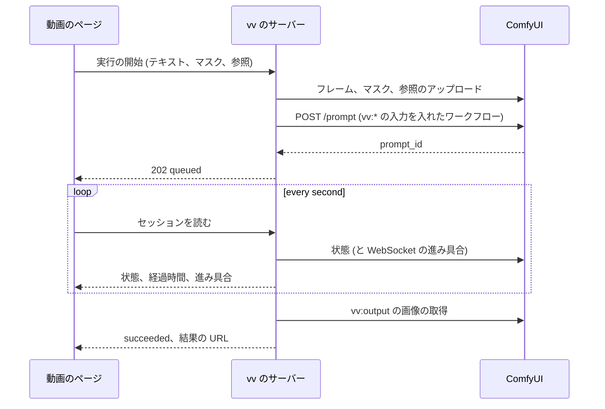

# 契約: サムネイルのワークフローとその実行 {#contract-the-thumbnail-workflow-and-its-runs}

正本: 実装がこれを、所有者がワークフローの用意の仕方を読む `docs/how-to/comfyui-thumbnails.md` に移すまでは、この文書である。この文書は、vv が所有者の ComfyUI のワークフローに求めることと、vv が 1 回の実行をどう動かすかを扱う。決定は [research.md R-2](../research.md#r-2-named-nodes-in-the-owners-api-format-workflow-are-the-whole-contract)、[R-3](../research.md#r-3-absent-optional-inputs-get-a-neutral-value)、[R-5](../research.md#r-5-provider-differences-stay-inside-the-adapter) にある。

## ワークフローの形式 {#workflow-format}

ワークフローは ComfyUI の API 形式 (「Export (API)」) である: キーがノード id で、値が `class_type`、`inputs`、`_meta.title` を持つ JSON オブジェクトである。vv は `_meta.title` でノードを見つけ、この表の入力だけを書く。

| タイトル | 必須 | ノード | vv が書くもの |
| --- | --- | --- | --- |
| `vv:frame` | はい | `image` 入力を持つ画像のローダー (`LoadImage`) | `image`: アップロードしたフレーム |
| `vv:output` | はい | 画像を保存またはプレビューするノード (`SaveImage`、`PreviewImage`) | なし。vv はその最初の出力画像を読む |
| `vv:prompt` | いいえ | 文字列の `prompt` または `text` 入力を持つノード | その入力 (両方あるときは `prompt`): 所有者のテキスト、または `""` |
| `vv:mask` | いいえ | `image` 入力を持つ画像のローダー (`LoadImage`、`LoadImageMask`) | `image`: アップロードしたマスク、またはフレーム全体を覆うマスク |
| `vv:reference` | いいえ | `image` 入力を持つ画像のローダー | `image`: アップロードした参照画像、またはフレーム |

マスクはフレームのピクセルの大きさの PNG である: 塗ったピクセルは不透明な白、残りは不透明な黒である。ワークフローは、`red` チャンネルの `LoadImageMask`、または `LoadImage` と画像からマスクへのノードでそれを読む。

## 登録 {#registration}

`domain.ParseThumbnailWorkflow` はワークフローを受け入れるか、理由を 1 つ返す。

| 状況 | 理由 |
| --- | --- |
| JSON オブジェクトではない、1 MiB より大きい、または `class_type` のないノードがある | `workflow_invalid` |
| UI 形式 (最上位の `nodes` 配列) | `workflow_not_api_format` |
| `vv:frame` または `vv:output` というタイトルのノードがない | `workflow_missing_node`、タイトル付き |
| 1 つの `vv:*` のタイトルを持つノードが 2 つある | `workflow_duplicate_node`、タイトル付き |
| 表が挙げる入力のない `vv:*` のノード | `workflow_node_input_missing`、タイトル付き |

成功すると、API はワークフローが受け取る省略可能な入力 (`prompt`、`mask`、`reference`) を返す。登録は決して ComfyUI に接続しないので、接続が動く前にワークフローを登録できる。

## 実行 {#run}

シーケンスは、ページでの開始から結果までの 1 回の実行を示す。

アップロードは `vv-` と無作為な部分で始まる名前を使い、`overwrite=true` と `type=input` を付ける。セルフホストの ComfyUI にはそれらを削除するルートがないので、vv はその後、それらや出力を ComfyUI から削除しない。

## 実行の状態 {#run-states}

| vv の状態 | セルフホストの ComfyUI | Comfy Cloud |
| --- | --- | --- |
| `queued` | id が `queue_pending` にある | `submitted`、`queued_waiting` |
| `preparing` | 報告されない | `preparing` |
| `running` | id が `queue_running` にある | `executing` |
| `succeeded` | `history/{id}` が `status.completed` と出力画像を持つ | `success` と出力画像 |
| `failed` | `history/{id}` が `status_str: error` を持つ、または id が履歴のエントリなしにキューから消えた | `error`、`non_retryable_error`、`lost` |
| `cancelled` | vv のキャンセルの後 | `cancel_requested`、`cancelled` |

ステップの進み具合 (`max` 中の `value`) は、実行の `prompt_id` に対する WebSocket の `progress` メッセージから来て、メッセージが届かなかったときはない。

## 失敗の理由 {#failure-reasons}

| 理由 | いつ |
| --- | --- |
| `unreachable` | 接続がない、DNS の失敗、または 5xx の応答 |
| `unauthorized` | Comfy Cloud からの `401` または `403` |
| `insufficient_credits` | Comfy Cloud からの `402`、または型がクレジットを挙げるエラー |
| `workflow_rejected` | `POST /prompt` が `400` (`node_errors`) を返す。最初のノードのエラーのメッセージを引き渡す |
| `run_failed` | プロバイダーが実行の失敗を報告する。実行のエラーのメッセージを引き渡す |
| `no_output` | 実行は成功し、`vv:output` に画像がない |
| `timed_out` | 送信から 10 分後に終わりの状態にない |
